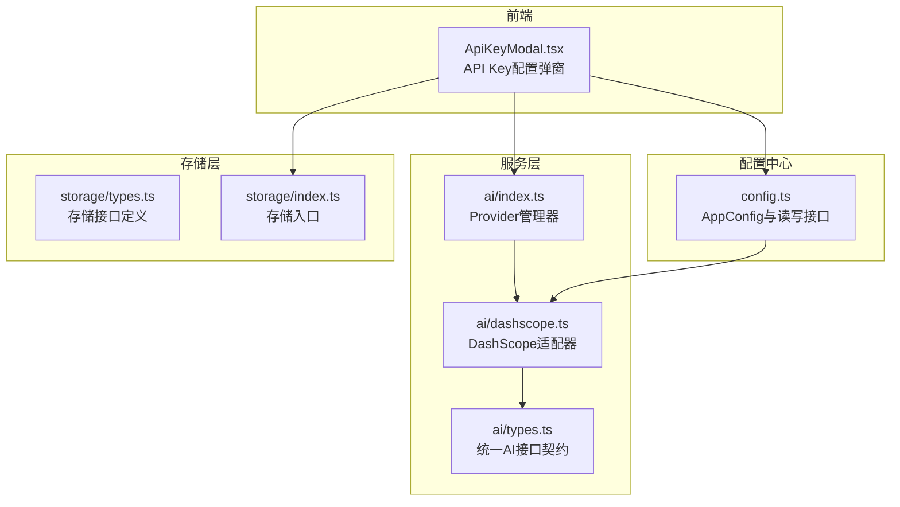
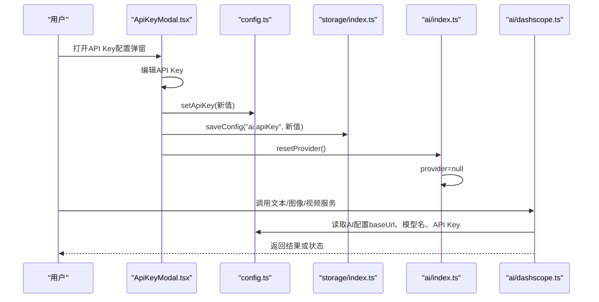
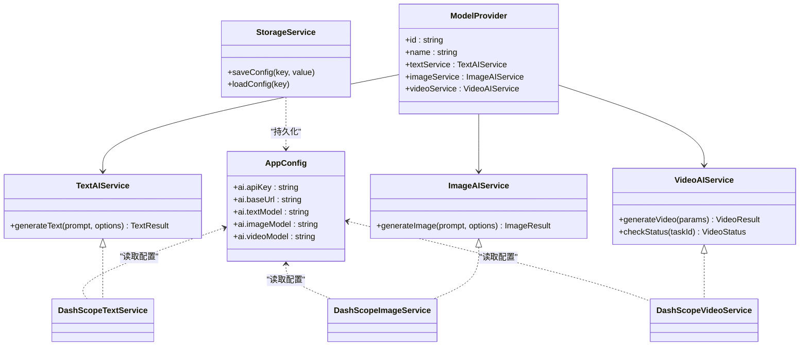
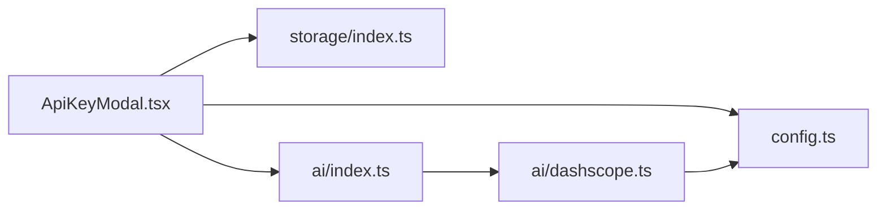

# 模型配置路由

<cite>
**本文引用的文件**
- [src/config.ts](file://src/config.ts)
- [src/services/ai/types.ts](file://src/services/ai/types.ts)
- [src/services/ai/index.ts](file://src/services/ai/index.ts)
- [src/services/ai/dashscope.ts](file://src/services/ai/dashscope.ts)
- [src/shared/components/ApiKeyModal.tsx](file://src/shared/components/ApiKeyModal.tsx)
- [src/services/storage/types.ts](file://src/services/storage/types.ts)
- [src/services/storage/index.ts](file://src/services/storage/index.ts)
- [README.md](file://README.md)
</cite>

## 目录
1. [简介](#简介)
2. [项目结构](#项目结构)
3. [核心组件](#核心组件)
4. [架构总览](#架构总览)
5. [详细组件分析](#详细组件分析)
6. [依赖关系分析](#依赖关系分析)
7. [性能考量](#性能考量)
8. [故障排查指南](#故障排查指南)
9. [结论](#结论)
10. [附录](#附录)

## 简介
本文件围绕“AI Shotlive”中的模型配置与路由能力，系统性梳理配置管理API、模型提供商集成、API Key管理机制，并详细说明模型列表获取、模型添加/删除、以及模型配置更新的实现方式。文档还阐述多厂商模型支持、模型切换策略、配置验证机制，给出模型数据结构与配置参数说明，并提供模型配置架构图与多厂商集成示例，帮助开发者快速理解与扩展。

## 项目结构
本项目采用“前端组件 + 服务层 + 配置中心”的分层组织方式：
- 配置中心：集中管理应用配置（包括AI模型相关参数），并提供读取/写入接口。
- 服务层：抽象统一的AI服务接口，屏蔽不同模型提供商的差异；当前默认接入DashScope（阿里云）。
- 组件层：提供API Key配置弹窗等UI交互，负责触发配置变更与服务重置。
- 存储层：提供本地配置持久化能力（IndexedDB），用于保存敏感配置（如API Key）。

图表来源
- [src/shared/components/ApiKeyModal.tsx:1-114](file://src/shared/components/ApiKeyModal.tsx#L1-L114)
- [src/config.ts:1-46](file://src/config.ts#L1-L46)
- [src/services/ai/types.ts:1-72](file://src/services/ai/types.ts#L1-L72)
- [src/services/ai/index.ts:1-34](file://src/services/ai/index.ts#L1-L34)
- [src/services/ai/dashscope.ts:1-327](file://src/services/ai/dashscope.ts#L1-L327)
- [src/services/storage/types.ts:1-30](file://src/services/storage/types.ts#L1-L30)
- [src/services/storage/index.ts:1-3](file://src/services/storage/index.ts#L1-L3)

章节来源
- [src/config.ts:1-46](file://src/config.ts#L1-L46)
- [src/services/ai/types.ts:1-72](file://src/services/ai/types.ts#L1-L72)
- [src/services/ai/index.ts:1-34](file://src/services/ai/index.ts#L1-L34)
- [src/services/ai/dashscope.ts:1-327](file://src/services/ai/dashscope.ts#L1-L327)
- [src/shared/components/ApiKeyModal.tsx:1-114](file://src/shared/components/ApiKeyModal.tsx#L1-L114)
- [src/services/storage/types.ts:1-30](file://src/services/storage/types.ts#L1-L30)
- [src/services/storage/index.ts:1-3](file://src/services/storage/index.ts#L1-L3)

## 核心组件
- 配置中心（AppConfig）
  - 提供全局配置读取与部分更新能力，包含AI模块的关键字段：API Key、基础URL、文本/图像/视频模型名称。
  - 支持读取当前配置、设置配置片段、设置API Key、检测是否已配置API Key。
- 服务层（AI Provider）
  - 定义统一的文本/图像/视频服务接口，屏蔽厂商差异。
  - Provider管理器负责创建与缓存当前Provider实例，并提供重置能力以应用新配置。
  - 当前默认Provider为DashScope（阿里云），后续可扩展为多Provider并支持动态切换。
- DashScope适配器
  - 实现统一接口契约，封装DashScope的兼容模式与原生API调用。
  - 提供文本、图像、视频三类服务，均支持重试、轮询与错误映射。
- API Key配置弹窗
  - 负责展示、编辑与保存API Key，保存后刷新Provider以使新配置生效。
  - 使用本地存储进行持久化，确保敏感信息不上传至服务器。
- 存储层
  - 提供配置与资产的持久化接口，当前通过IndexedDB实现，满足本地/桌面客户端场景。

章节来源
- [src/config.ts:1-46](file://src/config.ts#L1-L46)
- [src/services/ai/types.ts:1-72](file://src/services/ai/types.ts#L1-L72)
- [src/services/ai/index.ts:1-34](file://src/services/ai/index.ts#L1-L34)
- [src/services/ai/dashscope.ts:1-327](file://src/services/ai/dashscope.ts#L1-L327)
- [src/shared/components/ApiKeyModal.tsx:1-114](file://src/shared/components/ApiKeyModal.tsx#L1-L114)
- [src/services/storage/types.ts:1-30](file://src/services/storage/types.ts#L1-L30)
- [src/services/storage/index.ts:1-3](file://src/services/storage/index.ts#L1-L3)

## 架构总览
下图展示了从UI到服务再到外部厂商的整体调用链路，以及配置变更如何触达服务层：

图表来源
- [src/shared/components/ApiKeyModal.tsx:1-114](file://src/shared/components/ApiKeyModal.tsx#L1-L114)
- [src/config.ts:1-46](file://src/config.ts#L1-L46)
- [src/services/storage/index.ts:1-3](file://src/services/storage/index.ts#L1-L3)
- [src/services/ai/index.ts:1-34](file://src/services/ai/index.ts#L1-L34)
- [src/services/ai/dashscope.ts:1-327](file://src/services/ai/dashscope.ts#L1-L327)

## 详细组件分析

### 配置中心（AppConfig）
- 数据结构要点
  - ai.apiKey：API Key，用于鉴权。
  - ai.baseUrl：兼容模式或原生API的基础URL。
  - ai.textModel/imageModel/videoModel：分别对应文本、图像、视频模型名称。
- 关键行为
  - 读取当前配置：getConfig。
  - 部分更新配置：setConfig。
  - 设置API Key：setApiKey。
  - 检查是否已配置：hasApiKey。
- 设计原则
  - 配置驱动，避免硬编码；支持运行时热更新。
  - 与Provider解耦，便于切换不同厂商。

章节来源
- [src/config.ts:1-46](file://src/config.ts#L1-L46)

### 服务层接口与Provider管理
- 接口契约（ai/types.ts）
  - 文本服务：generateText(prompt, options?) → TextResult。
  - 图像服务：generateImage(prompt, options?) → ImageResult。
  - 视频服务：generateVideo(params) → VideoResult；checkStatus(taskId) → VideoStatus。
  - Provider：包含id、name与三种服务实例。
- Provider管理（ai/index.ts）
  - 单例Provider缓存，按需创建。
  - resetProvider用于清空缓存，以便在配置变更后重新初始化。
- 设计原则
  - 面向抽象编程，屏蔽厂商差异。
  - 支持未来多Provider并存与动态切换。

章节来源
- [src/services/ai/types.ts:1-72](file://src/services/ai/types.ts#L1-L72)
- [src/services/ai/index.ts:1-34](file://src/services/ai/index.ts#L1-L34)

### DashScope适配器（默认Provider）
- 文本服务（DashScopeTextService）
  - 使用兼容模式/chat/completions。
  - 参数包含systemPrompt、temperature、max_tokens等。
  - 返回content与usage统计。
- 图像服务（DashScopeImageService）
  - 使用原生API提交异步任务，轮询直到完成。
  - 支持尺寸、风格、负向提示词、数量等参数。
  - 返回URL与revisedPrompt。
- 视频服务（DashScopeVideoService）
  - 使用原生API提交异步任务，立即返回taskId。
  - 支持轮询检查状态，映射任务状态为pending/processing/completed/failed。
- 错误处理与重试
  - requireApiKey在未配置时抛出明确错误。
  - fetchWithRetry对5xx进行指数退避重试，4xx直接抛出友好错误。
  - 轮询超时与任务失败均有明确错误码与消息。
- 设计原则
  - 统一错误类型与错误码，便于上层处理。
  - 异步任务与轮询策略一致化。

章节来源
- [src/services/ai/dashscope.ts:1-327](file://src/services/ai/dashscope.ts#L1-L327)

### API Key配置弹窗（ApiKeyModal）
- 功能流程
  - 打开时读取当前配置值并允许编辑。
  - 保存时：
    - trim后写入配置中心。
    - 保存到本地存储（IndexedDB）。
    - 重置Provider以应用新配置。
- 安全与隐私
  - API Key仅保存在本地，不上传至服务器。
  - 支持明文/密文切换显示，提升输入体验。

章节来源
- [src/shared/components/ApiKeyModal.tsx:1-114](file://src/shared/components/ApiKeyModal.tsx#L1-L114)
- [src/services/storage/index.ts:1-3](file://src/services/storage/index.ts#L1-L3)

### 存储层（本地持久化）
- 接口定义（storage/types.ts）
  - 提供saveConfig/loadConfig等配置读写方法。
- 入口（storage/index.ts）
  - 导出storage实例（当前指向IndexedDB实现）。
- 用途
  - 保存API Key等敏感配置，确保应用重启后仍可用。

章节来源
- [src/services/storage/types.ts:1-30](file://src/services/storage/types.ts#L1-L30)
- [src/services/storage/index.ts:1-3](file://src/services/storage/index.ts#L1-L3)

### 多厂商模型支持与切换策略
- 当前现状
  - 默认Provider为DashScope，接口与实现均在此处集中。
- 切换策略
  - 在Provider管理器中新增工厂函数，按条件创建不同Provider。
  - 通过resetProvider触发重建，确保新Provider生效。
- 扩展建议
  - 为每家厂商创建独立适配器，保持接口一致。
  - 在配置中心增加“当前Provider标识”，实现运行时切换。
  - 提供“配置校验”流程：保存前验证模型名称与URL有效性。

章节来源
- [src/services/ai/index.ts:1-34](file://src/services/ai/index.ts#L1-L34)
- [src/services/ai/dashscope.ts:1-327](file://src/services/ai/dashscope.ts#L1-L327)
- [src/config.ts:1-46](file://src/config.ts#L1-L46)

### 配置验证机制
- 必填项校验
  - API Key缺失时，DashScope适配器抛出带错误码的异常，提示用户在“模型配置”中设置。
- 请求级校验
  - 对401/429/4xx/5xx进行分类处理，返回可读性强的错误信息。
- 超时与轮询
  - 异步任务轮询设定最大等待时间，超时返回明确错误。
- 建议增强
  - 在保存配置前进行连通性测试（如发送一次最小化请求）。
  - 对模型名称与URL格式进行正则校验，减少运行时错误。

章节来源
- [src/services/ai/dashscope.ts:1-327](file://src/services/ai/dashscope.ts#L1-L327)

### 模型数据结构与配置参数说明
- AppConfig（配置中心）
  - 字段：ai.apiKey、ai.baseUrl、ai.textModel、ai.imageModel、ai.videoModel。
  - 作用：集中管理AI相关配置，供服务层读取。
- TextOptions/ImageOptions/VideoParams（服务层接口）
  - 文本：temperature、maxTokens、systemPrompt。
  - 图像：width、height、style、negativePrompt、count。
  - 视频：prompt、imageUrl、duration、aspectRatio。
- VideoStatus（视频状态）
  - state：pending/processing/completed/failed。
  - progress：轮询进度（可选）。
  - resultUrl：完成后返回的资源地址。
  - error：失败原因（可选）。

章节来源
- [src/config.ts:1-46](file://src/config.ts#L1-L46)
- [src/services/ai/types.ts:1-72](file://src/services/ai/types.ts#L1-L72)

### 模型配置架构图

图表来源
- [src/config.ts:1-46](file://src/config.ts#L1-L46)
- [src/services/ai/types.ts:1-72](file://src/services/ai/types.ts#L1-L72)
- [src/services/ai/dashscope.ts:1-327](file://src/services/ai/dashscope.ts#L1-L327)
- [src/services/storage/types.ts:1-30](file://src/services/storage/types.ts#L1-L30)

### 多厂商集成示例（思路）
- 新增Provider工厂
  - 在Provider管理器中新增createOpenAIProvider/createAnthropicProvider等工厂函数。
- 适配器实现
  - 为每家厂商实现统一接口契约，封装其认证、URL、参数映射与轮询策略。
- 切换流程
  - 在配置中心增加“当前Provider标识”，保存后调用resetProvider重建Provider。
- 最佳实践
  - 统一错误码与错误消息格式，便于前端统一处理。
  - 对每个适配器编写单元测试与集成测试，覆盖成功、失败、超时等场景。

章节来源
- [src/services/ai/index.ts:1-34](file://src/services/ai/index.ts#L1-L34)
- [src/services/ai/types.ts:1-72](file://src/services/ai/types.ts#L1-L72)
- [README.md:141-206](file://README.md#L141-L206)

## 依赖关系分析
- 组件耦合
  - ApiKeyModal依赖config.ts与storage/index.ts，保存配置并触发Provider重置。
  - DashScope适配器依赖config.ts读取配置，依赖fetchWithRetry与轮询工具。
  - Provider管理器依赖具体适配器工厂，当前为DashScope。
- 外部依赖
  - DashScope兼容模式与原生API，需要稳定的网络与正确的鉴权头。
- 循环依赖
  - 未发现循环依赖；模块职责清晰，接口契约明确。

图表来源
- [src/shared/components/ApiKeyModal.tsx:1-114](file://src/shared/components/ApiKeyModal.tsx#L1-L114)
- [src/config.ts:1-46](file://src/config.ts#L1-L46)
- [src/services/storage/index.ts:1-3](file://src/services/storage/index.ts#L1-L3)
- [src/services/ai/index.ts:1-34](file://src/services/ai/index.ts#L1-L34)
- [src/services/ai/dashscope.ts:1-327](file://src/services/ai/dashscope.ts#L1-L327)

章节来源
- [src/shared/components/ApiKeyModal.tsx:1-114](file://src/shared/components/ApiKeyModal.tsx#L1-L114)
- [src/services/ai/index.ts:1-34](file://src/services/ai/index.ts#L1-L34)
- [src/services/ai/dashscope.ts:1-327](file://src/services/ai/dashscope.ts#L1-L327)
- [src/config.ts:1-46](file://src/config.ts#L1-L46)
- [src/services/storage/index.ts:1-3](file://src/services/storage/index.ts#L1-L3)

## 性能考量
- 异步任务与轮询
  - 图像/视频生成采用异步任务+轮询，合理设置轮询间隔与最大等待时间，避免阻塞主线程。
- 重试策略
  - 对5xx进行指数退避重试，减少瞬时故障影响；对4xx直接失败，避免无效重试。
- 配置缓存
  - Provider单例缓存避免重复初始化；仅在配置变更时重置，降低开销。
- 建议优化
  - 将轮询与重试逻辑抽象为通用工具，便于复用与测试。
  - 对高频调用的文本服务增加本地缓存策略（基于prompt哈希）。

[本节为通用指导，无需列出章节来源]

## 故障排查指南
- “未配置 API Key”
  - 现象：调用DashScope服务时报错，提示未配置API Key。
  - 处理：打开API Key配置弹窗，输入有效Key并保存，系统会自动重置Provider。
  - 参考：DashScope适配器的requireApiKey逻辑。
- “请求过于频繁或配额超限”
  - 现象：返回429错误。
  - 处理：降低请求频率或提升配额；可在上层增加退避重试与排队策略。
- “任务超时”
  - 现象：图像/视频任务长时间未完成。
  - 处理：检查网络与配额；适当延长最大等待时间或调整模型参数。
- “任务完成但未返回URL”
  - 现象：任务状态为completed但结果为空。
  - 处理：记录错误并提示用户重试或更换参数。

章节来源
- [src/services/ai/dashscope.ts:1-327](file://src/services/ai/dashscope.ts#L1-L327)
- [src/shared/components/ApiKeyModal.tsx:1-114](file://src/shared/components/ApiKeyModal.tsx#L1-L114)

## 结论
本项目通过“配置中心 + 统一接口 + 适配器”的架构，实现了对多厂商模型的灵活接入与切换。API Key管理与本地存储确保了安全与可用性；DashScope适配器提供了完善的错误处理与轮询机制。未来可进一步完善配置校验、多Provider动态切换与统一错误处理，以提升稳定性与可维护性。

[本节为总结性内容，无需列出章节来源]

## 附录
- 使用说明与开源声明
  - 项目强调“不绑定单一厂商”，可替换为OpenAI、Google、豆包、通义等；需自行配置API Key并承担调用费用。
  - 详细部署与启动说明见项目自述文件。

章节来源
- [README.md:141-206](file://README.md#L141-L206)