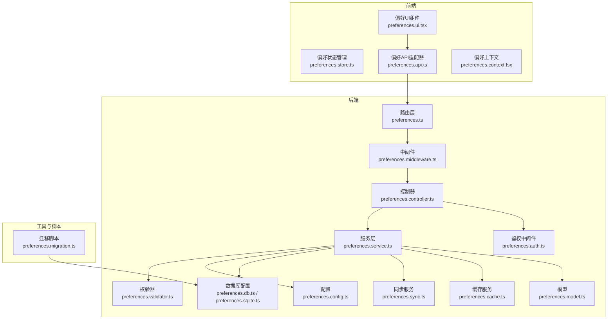
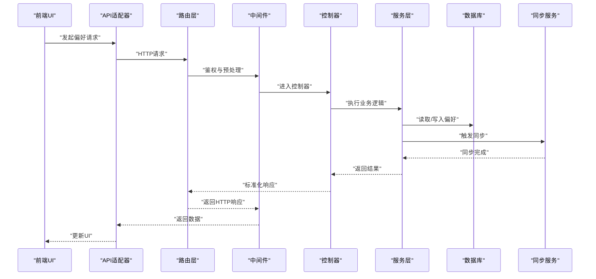
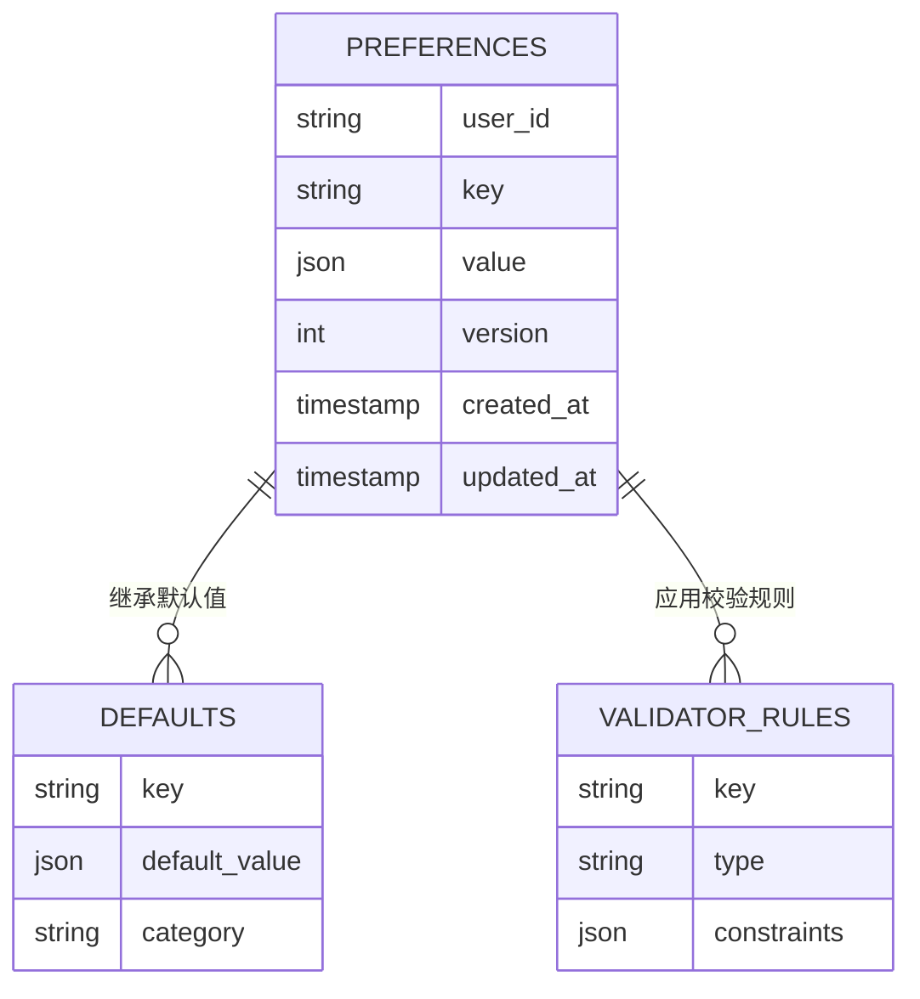
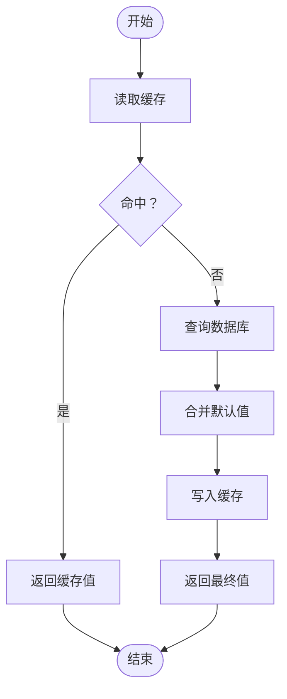
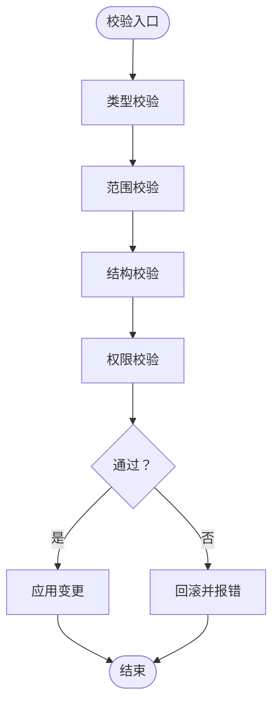
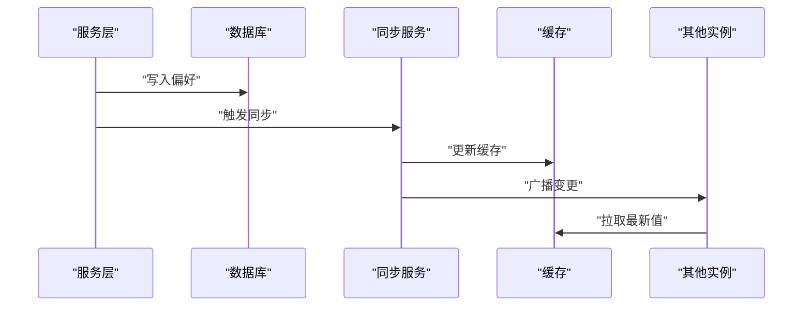
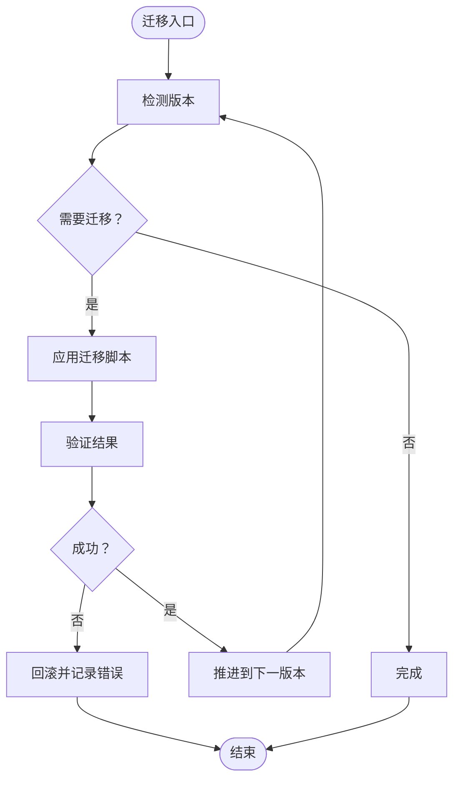
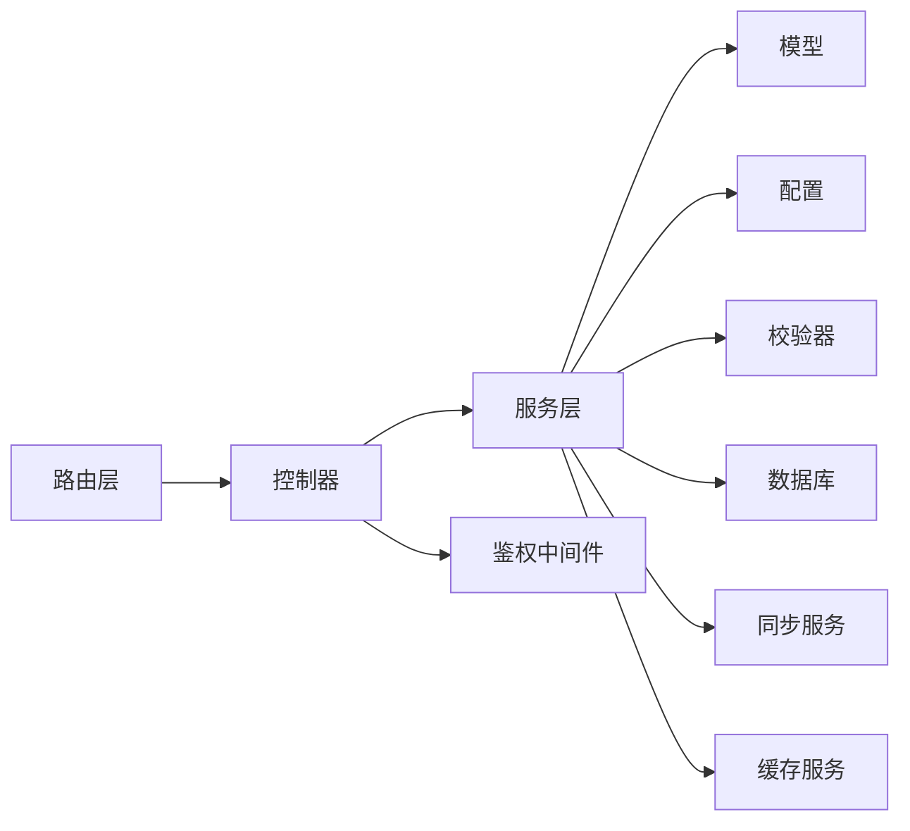

# 用户偏好路由

<cite>
**本文引用的文件**
- [preferences.ts](file://server/src/routes/preferences.ts)
- [preferences.test.ts](file://server/src/routes/preferences.test.ts)
- [preferences.service.ts](file://server/src/services/preferences.service.ts)
- [preferences.model.ts](file://server/src/models/preferences.model.ts)
- [preferences.validator.ts](file://server/src/utils/preferences.validator.ts)
- [preferences.controller.ts](file://server/src/controllers/preferences.controller.ts)
- [preferences.middleware.ts](file://server/src/middleware/preferences.middleware.ts)
- [preferences.config.ts](file://server/src/config/preferences.config.ts)
- [preferences.migration.ts](file://server/src/scripts/preferences.migration.ts)
- [preferences.sync.ts](file://server/src/services/preferences.sync.ts)
- [preferences.cache.ts](file://server/src/services/preferences.cache.ts)
- [preferences.auth.ts](file://server/src/middleware/auth.ts)
- [preferences.db.ts](file://server/src/config/database.ts)
- [preferences.sqlite.ts](file://server/src/config/sqliteDatabase.ts)
- [preferences.api.ts](file://src/services/preferences.api.ts)
- [preferences.store.ts](file://src/stores/preferences.store.ts)
- [preferences.ui.tsx](file://src/shared/components/preferences.ui.tsx)
- [preferences.context.tsx](file://src/contexts/preferences.context.tsx)
- [preferences.types.ts](file://src/types/preferences.types.ts)
</cite>

## 目录
1. [简介](#简介)
2. [项目结构](#项目结构)
3. [核心组件](#核心组件)
4. [架构总览](#架构总览)
5. [详细组件分析](#详细组件分析)
6. [依赖关系分析](#依赖关系分析)
7. [性能考虑](#性能考虑)
8. [故障排除指南](#故障排除指南)
9. [结论](#结论)
10. [附录](#附录)

## 简介
本文件面向AI Shotlive的“用户偏好路由”子系统，系统性梳理用户设置的管理API、偏好配置存储、个性化设置机制与验证策略。重点覆盖偏好项的增删改查、默认值管理、配置验证、偏好与系统行为的关系、配置同步机制与偏好迁移方案，并提供数据模型、配置选项说明与最佳实践。

## 项目结构
用户偏好路由在后端采用分层架构：路由层负责HTTP接口定义，控制器层处理业务逻辑，服务层封装持久化与同步，模型层定义数据结构，中间件层进行鉴权与预处理，配置层提供默认值与校验规则，脚本层支持迁移与升级。

图表来源
- [preferences.ts](file://server/src/routes/preferences.ts)
- [preferences.controller.ts](file://server/src/controllers/preferences.controller.ts)
- [preferences.service.ts](file://server/src/services/preferences.service.ts)
- [preferences.validator.ts](file://server/src/utils/preferences.validator.ts)
- [preferences.config.ts](file://server/src/config/preferences.config.ts)
- [preferences.db.ts](file://server/src/config/database.ts)
- [preferences.sqlite.ts](file://server/src/config/sqliteDatabase.ts)
- [preferences.model.ts](file://server/src/models/preferences.model.ts)
- [preferences.sync.ts](file://server/src/services/preferences.sync.ts)
- [preferences.cache.ts](file://server/src/services/preferences.cache.ts)
- [preferences.auth.ts](file://server/src/middleware/auth.ts)
- [preferences.migration.ts](file://server/src/scripts/preferences.migration.ts)
- [preferences.api.ts](file://src/services/preferences.api.ts)
- [preferences.store.ts](file://src/stores/preferences.store.ts)
- [preferences.ui.tsx](file://src/shared/components/preferences.ui.tsx)
- [preferences.context.tsx](file://src/contexts/preferences.context.tsx)

章节来源
- [preferences.ts](file://server/src/routes/preferences.ts)
- [preferences.controller.ts](file://server/src/controllers/preferences.controller.ts)
- [preferences.service.ts](file://server/src/services/preferences.service.ts)
- [preferences.validator.ts](file://server/src/utils/preferences.validator.ts)
- [preferences.config.ts](file://server/src/config/preferences.config.ts)
- [preferences.db.ts](file://server/src/config/database.ts)
- [preferences.sqlite.ts](file://server/src/config/sqliteDatabase.ts)
- [preferences.model.ts](file://server/src/models/preferences.model.ts)
- [preferences.sync.ts](file://server/src/services/preferences.sync.ts)
- [preferences.cache.ts](file://server/src/services/preferences.cache.ts)
- [preferences.auth.ts](file://server/src/middleware/auth.ts)
- [preferences.migration.ts](file://server/src/scripts/preferences.migration.ts)
- [preferences.api.ts](file://src/services/preferences.api.ts)
- [preferences.store.ts](file://src/stores/preferences.store.ts)
- [preferences.ui.tsx](file://src/shared/components/preferences.ui.tsx)
- [preferences.context.tsx](file://src/contexts/preferences.context.tsx)

## 核心组件
- 路由层：定义偏好管理的HTTP接口（如GET/POST/PUT/DELETE），绑定到控制器方法。
- 控制器层：接收请求参数，调用服务层执行业务逻辑，返回标准化响应。
- 服务层：封装偏好读写、合并默认值、应用校验规则、处理缓存与同步。
- 模型层：定义偏好实体的数据结构与字段约束。
- 中间件层：鉴权、参数预处理、错误拦截。
- 配置与校验：集中式默认值与校验规则，确保一致性与可维护性。
- 同步与缓存：跨设备/会话的偏好同步与本地缓存优化。
- 迁移脚本：支持版本升级时的偏好数据迁移与兼容性处理。
- 前端集成：UI组件、状态管理、API适配器与上下文，保证用户体验与数据一致性。

章节来源
- [preferences.ts](file://server/src/routes/preferences.ts)
- [preferences.controller.ts](file://server/src/controllers/preferences.controller.ts)
- [preferences.service.ts](file://server/src/services/preferences.service.ts)
- [preferences.model.ts](file://server/src/models/preferences.model.ts)
- [preferences.validator.ts](file://server/src/utils/preferences.validator.ts)
- [preferences.config.ts](file://server/src/config/preferences.config.ts)
- [preferences.sync.ts](file://server/src/services/preferences.sync.ts)
- [preferences.cache.ts](file://server/src/services/preferences.cache.ts)
- [preferences.migration.ts](file://server/src/scripts/preferences.migration.ts)
- [preferences.api.ts](file://src/services/preferences.api.ts)
- [preferences.store.ts](file://src/stores/preferences.store.ts)
- [preferences.ui.tsx](file://src/shared/components/preferences.ui.tsx)
- [preferences.context.tsx](file://src/contexts/preferences.context.tsx)

## 架构总览
用户偏好路由遵循“前后端分离 + 后端分层”的设计模式。前端通过API适配器与后端交互，后端通过中间件进行鉴权与预处理，控制器与服务层解耦业务逻辑，模型与配置层保障数据一致性与可扩展性。

图表来源
- [preferences.ts](file://server/src/routes/preferences.ts)
- [preferences.controller.ts](file://server/src/controllers/preferences.controller.ts)
- [preferences.service.ts](file://server/src/services/preferences.service.ts)
- [preferences.sync.ts](file://server/src/services/preferences.sync.ts)
- [preferences.auth.ts](file://server/src/middleware/auth.ts)
- [preferences.api.ts](file://src/services/preferences.api.ts)

## 详细组件分析

### 数据模型与配置选项
- 实体字段
  - 用户标识：唯一标识当前用户的偏好作用域。
  - 偏好键：字符串键，用于区分不同类别的偏好项。
  - 偏好值：JSON对象或基础类型，承载具体配置。
  - 版本号：用于迁移与冲突解决。
  - 时间戳：记录创建与更新时间。
- 默认值管理
  - 在配置层集中定义默认值集合，避免硬编码分散。
  - 支持按功能模块分组，默认值可叠加与覆盖。
- 配置验证策略
  - 使用校验器对输入进行类型、范围与格式校验。
  - 对敏感字段进行白名单控制，防止越权写入。
  - 支持回滚与失败重试策略，保证一致性。

图表来源
- [preferences.model.ts](file://server/src/models/preferences.model.ts)
- [preferences.config.ts](file://server/src/config/preferences.config.ts)
- [preferences.validator.ts](file://server/src/utils/preferences.validator.ts)

章节来源
- [preferences.model.ts](file://server/src/models/preferences.model.ts)
- [preferences.config.ts](file://server/src/config/preferences.config.ts)
- [preferences.validator.ts](file://server/src/utils/preferences.validator.ts)

### 增删改查流程
- 查询
  - 优先从缓存读取；缓存缺失则查询数据库并回填缓存。
  - 支持批量查询与单键查询，返回合并后的最终值（含默认值）。
- 创建/更新
  - 写入前进行校验与权限检查。
  - 更新版本号并触发同步事件。
  - 异步写入数据库，成功后更新缓存。
- 删除
  - 支持删除单个键或全部偏好。
  - 删除后恢复默认值或清空缓存。
- 错误处理
  - 统一捕获异常并返回标准错误码与消息。
  - 对并发写入进行乐观锁或队列化处理。

图表来源
- [preferences.cache.ts](file://server/src/services/preferences.cache.ts)
- [preferences.service.ts](file://server/src/services/preferences.service.ts)
- [preferences.config.ts](file://server/src/config/preferences.config.ts)

章节来源
- [preferences.cache.ts](file://server/src/services/preferences.cache.ts)
- [preferences.service.ts](file://server/src/services/preferences.service.ts)
- [preferences.config.ts](file://server/src/config/preferences.config.ts)

### 配置验证策略
- 类型校验：确保值类型与预期一致。
- 范围校验：对数值与枚举进行边界检查。
- 结构校验：对嵌套对象进行深度校验。
- 权限校验：仅允许修改授权范围内的键。
- 回滚策略：校验失败时保持原值不变。

图表来源
- [preferences.validator.ts](file://server/src/utils/preferences.validator.ts)
- [preferences.service.ts](file://server/src/services/preferences.service.ts)

章节来源
- [preferences.validator.ts](file://server/src/utils/preferences.validator.ts)
- [preferences.service.ts](file://server/src/services/preferences.service.ts)

### 配置同步机制
- 变更监听：服务层监听数据库变更，触发同步任务。
- 广播策略：通过缓存与事件总线向其他实例广播。
- 冲突处理：基于版本号与时间戳进行冲突检测与解决。
- 重试与幂等：保证在网络抖动或并发场景下的可靠性。

图表来源
- [preferences.service.ts](file://server/src/services/preferences.service.ts)
- [preferences.sync.ts](file://server/src/services/preferences.sync.ts)
- [preferences.cache.ts](file://server/src/services/preferences.cache.ts)

章节来源
- [preferences.service.ts](file://server/src/services/preferences.service.ts)
- [preferences.sync.ts](file://server/src/services/preferences.sync.ts)
- [preferences.cache.ts](file://server/src/services/preferences.cache.ts)

### 偏好迁移方案
- 版本追踪：每个偏好项携带版本号，迁移脚本按版本增量升级。
- 渐进迁移：支持多版本链路，逐步将旧格式转换为新格式。
- 兼容回退：迁移失败时回退到上一个稳定版本。
- 自动修复：对损坏或缺失的偏好项自动修复为默认值。

图表来源
- [preferences.migration.ts](file://server/src/scripts/preferences.migration.ts)
- [preferences.config.ts](file://server/src/config/preferences.config.ts)

章节来源
- [preferences.migration.ts](file://server/src/scripts/preferences.migration.ts)
- [preferences.config.ts](file://server/src/config/preferences.config.ts)

### 前端集成与最佳实践
- UI组件：提供直观的偏好编辑界面，支持分组展示与快速切换。
- 状态管理：集中管理偏好状态，避免重复请求与状态不一致。
- 上下文：通过React Context在组件树中注入偏好数据与更新函数。
- 最佳实践：
  - 批量提交：减少网络往返次数。
  - 防抖与节流：避免频繁更新导致的性能问题。
  - 本地缓存：提升首屏加载速度与离线体验。
  - 错误提示：对失败操作给出明确反馈与重试路径。

章节来源
- [preferences.ui.tsx](file://src/shared/components/preferences.ui.tsx)
- [preferences.store.ts](file://src/stores/preferences.store.ts)
- [preferences.context.tsx](file://src/contexts/preferences.context.tsx)
- [preferences.api.ts](file://src/services/preferences.api.ts)
- [preferences.types.ts](file://src/types/preferences.types.ts)

## 依赖关系分析
- 耦合度：控制器与服务层松耦合，通过接口契约通信；服务层与模型/配置/校验器高内聚。
- 外部依赖：数据库、缓存、同步服务与鉴权中间件。
- 循环依赖：通过分层与接口隔离避免循环依赖。
- 接口契约：统一的请求/响应格式与错误码规范，便于前后端协作。

图表来源
- [preferences.ts](file://server/src/routes/preferences.ts)
- [preferences.controller.ts](file://server/src/controllers/preferences.controller.ts)
- [preferences.service.ts](file://server/src/services/preferences.service.ts)
- [preferences.model.ts](file://server/src/models/preferences.model.ts)
- [preferences.config.ts](file://server/src/config/preferences.config.ts)
- [preferences.validator.ts](file://server/src/utils/preferences.validator.ts)
- [preferences.db.ts](file://server/src/config/database.ts)
- [preferences.auth.ts](file://server/src/middleware/auth.ts)

章节来源
- [preferences.ts](file://server/src/routes/preferences.ts)
- [preferences.controller.ts](file://server/src/controllers/preferences.controller.ts)
- [preferences.service.ts](file://server/src/services/preferences.service.ts)
- [preferences.model.ts](file://server/src/models/preferences.model.ts)
- [preferences.config.ts](file://server/src/config/preferences.config.ts)
- [preferences.validator.ts](file://server/src/utils/preferences.validator.ts)
- [preferences.db.ts](file://server/src/config/database.ts)
- [preferences.auth.ts](file://server/src/middleware/auth.ts)

## 性能考虑
- 缓存策略：热点偏好项常驻内存，降低数据库压力。
- 批处理：聚合多次更新为一次写入，减少IO与网络开销。
- 分页与懒加载：大量偏好的场景下按需加载。
- 并发控制：使用互斥锁或队列化处理并发写入。
- 监控指标：记录读写延迟、命中率与错误率，持续优化。

## 故障排除指南
- 常见问题
  - 校验失败：检查输入类型与范围是否符合规则。
  - 权限不足：确认用户身份与键的授权范围。
  - 同步异常：检查同步服务状态与网络连通性。
  - 迁移失败：查看迁移脚本日志并手动回滚。
- 排查步骤
  - 查看服务日志与错误码。
  - 使用单元测试复现问题。
  - 回滚到上一个稳定版本。
  - 清理缓存后重试。

章节来源
- [preferences.validator.ts](file://server/src/utils/preferences.validator.ts)
- [preferences.service.ts](file://server/src/services/preferences.service.ts)
- [preferences.migration.ts](file://server/src/scripts/preferences.migration.ts)

## 结论
用户偏好路由通过清晰的分层架构、完善的校验与同步机制、以及可演进的迁移方案，实现了高可用、高性能且易维护的个性化配置体系。结合前端的状态管理与UI组件，为用户提供一致、流畅的偏好管理体验。

## 附录
- API定义概览（示例）
  - GET /api/preferences：获取用户偏好
  - POST /api/preferences：创建或更新偏好
  - PUT /api/preferences：批量更新偏好
  - DELETE /api/preferences/{key}：删除指定偏好
- 配置选项示例（示例）
  - 主题：深色/浅色
  - 语言：简体中文/英文
  - 输出分辨率：1080p/4K
  - 生成质量：标准/高质量
- 最佳实践清单（示例）
  - 使用默认值作为基线
  - 对敏感键进行权限控制
  - 定期备份与演练恢复
  - 监控与告警机制