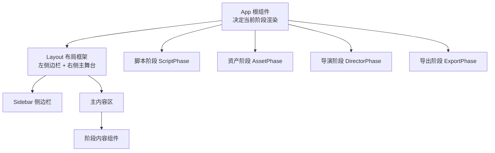
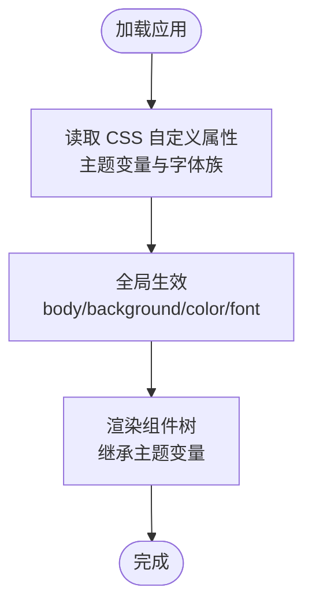
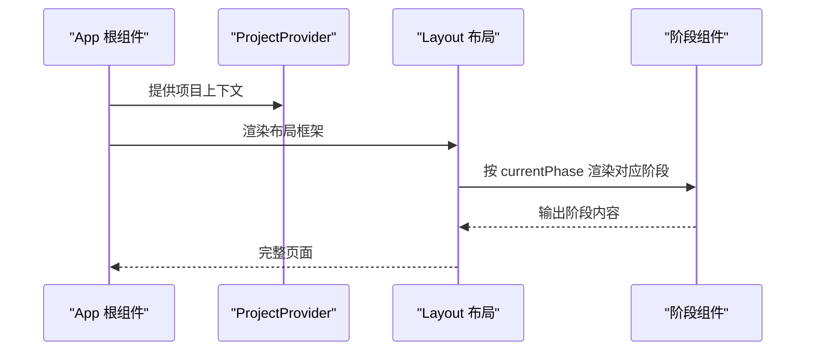
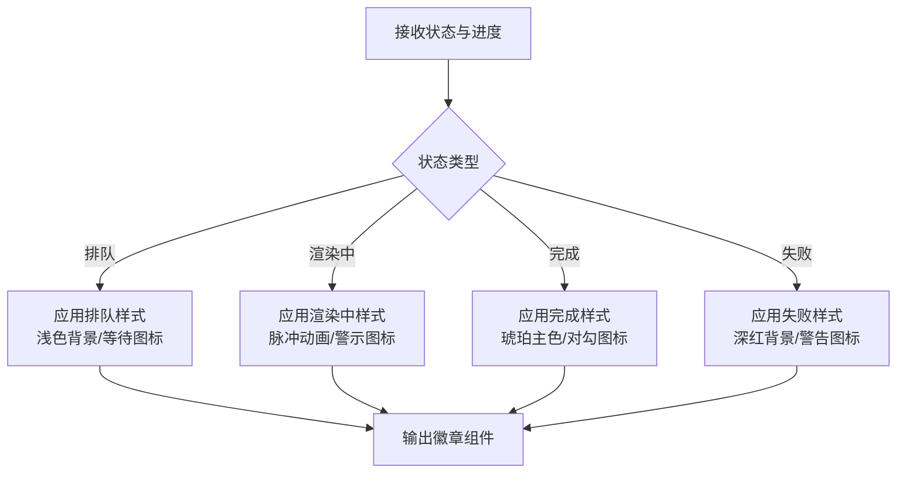
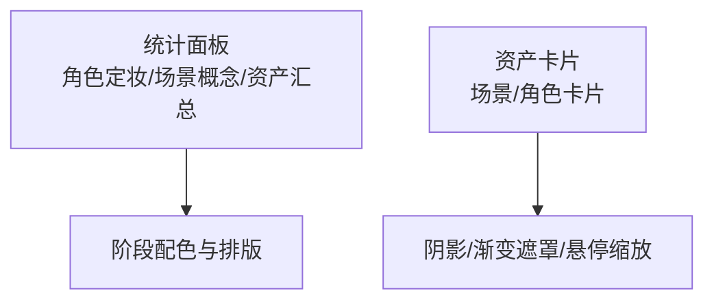
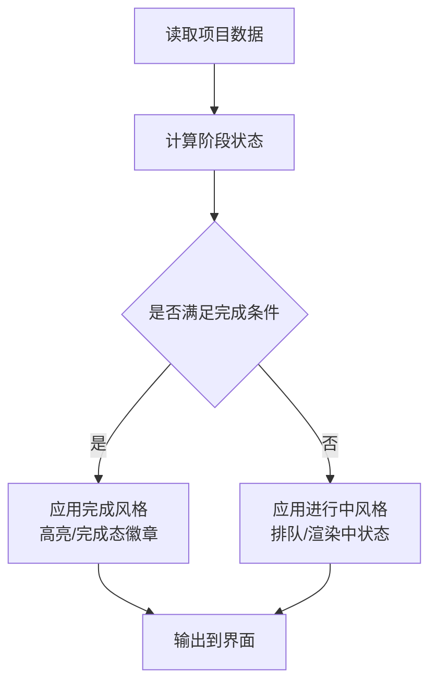
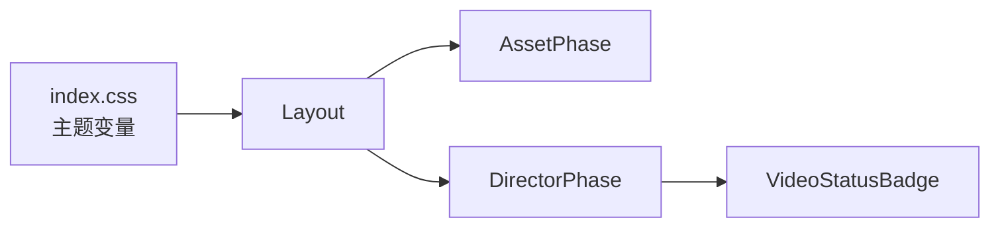

# 视觉风格路由

<cite>
**本文引用的文件**
- [App.tsx](file://src/App.tsx)
- [index.css](file://src/index.css)
- [Layout.tsx](file://src/shared/components/Layout.tsx)
- [DirectorPhase.tsx](file://src/phases/director/DirectorPhase.tsx)
- [AssetPhase.tsx](file://src/phases/assets/AssetPhase.tsx)
- [SceneAssetCard.tsx](file://src/phases/assets/components/SceneAssetCard.tsx)
- [VideoStatusBadge.tsx](file://src/phases/director/components/VideoStatusBadge.tsx)
- [engine.ts](file://src/services/workflow/engine.ts)
- [types.ts](file://src/services/storage/types.ts)
- [indexeddb.ts](file://src/services/storage/indexeddb.ts)
</cite>

## 目录
1. [简介](#简介)
2. [项目结构](#项目结构)
3. [核心组件](#核心组件)
4. [架构总览](#架构总览)
5. [详细组件分析](#详细组件分析)
6. [依赖关系分析](#依赖关系分析)
7. [性能考虑](#性能考虑)
8. [故障排除指南](#故障排除指南)
9. [结论](#结论)
10. [附录](#附录)

## 简介
本文件围绕 AI Shotlive 的“视觉风格路由”主题，系统梳理前端视觉风格管理在应用中的落地方式与最佳实践。当前仓库中未发现独立的“视觉风格路由”后端模块或前端可视化风格管理器组件。因此，本文以现有前端样式体系、阶段化工作流与状态展示为基础，给出面向“视觉风格”的统一设计语言与应用策略，并通过流程图与类图帮助读者理解如何在现有架构下扩展与集成视觉风格控制。

## 项目结构
AI Shotlive 采用分阶段（Phase）的创作流程，前端通过根组件按阶段渲染不同功能区域。视觉风格主要体现在全局主题变量、阶段内组件的配色与动效上，而非独立的“风格路由”页面或服务。



图表来源
- [App.tsx:15-28](file://src/App.tsx#L15-L28)
- [Layout.tsx:9-21](file://src/shared/components/Layout.tsx#L9-L21)

章节来源
- [App.tsx:15-28](file://src/App.tsx#L15-L28)
- [Layout.tsx:9-21](file://src/shared/components/Layout.tsx#L9-L21)

## 核心组件
- 全局主题与配色：通过 CSS 自定义属性定义“暗房”风格的主色调与辅助色，贯穿所有页面与组件。
- 阶段化渲染：根据项目当前阶段动态选择渲染模块，视觉风格在各阶段内保持一致的语义化表达。
- 状态徽章与动效：在导演阶段使用状态徽章对任务状态进行可视化编码，配合脉冲动画传达实时性。

章节来源
- [index.css:11-68](file://src/index.css#L11-L68)
- [DirectorPhase.tsx:407-440](file://src/phases/director/DirectorPhase.tsx#L407-L440)
- [VideoStatusBadge.tsx:11-44](file://src/phases/director/components/VideoStatusBadge.tsx#L11-L44)

## 架构总览
以下类图展示了视觉风格在前端的整体映射关系：全局主题变量作为“风格基座”，阶段组件作为“风格载体”，状态组件作为“风格表达”。

```mermaid
classDiagram
class Theme {
"+--color-ink-950"
"+--color-paper-50"
"+--color-amber-leader"
"+--color-crimson-mark"
"+--font-display"
"+--font-sans"
"+--font-mono"
}
class Layout {
"+渲染布局框架"
"+应用胶片噪点背景"
}
class DirectorPhase {
"+阶段内容容器"
"+状态徽章展示"
}
class AssetPhase {
"+资产统计与卡片"
"+场景/角色资产展示"
}
class VideoStatusBadge {
"+状态编码 : 排队/渲染中/完成/失败"
"+脉冲/高亮动效"
}
Theme <.. Layout : "提供颜色/字体变量"
Layout <.. DirectorPhase : "承载"
Layout <.. AssetPhase : "承载"
DirectorPhase --> VideoStatusBadge : "使用"
```

图表来源
- [index.css:11-68](file://src/index.css#L11-L68)
- [Layout.tsx:9-21](file://src/shared/components/Layout.tsx#L9-L21)
- [DirectorPhase.tsx:407-440](file://src/phases/director/DirectorPhase.tsx#L407-L440)
- [AssetPhase.tsx:335-362](file://src/phases/assets/AssetPhase.tsx#L335-L362)
- [VideoStatusBadge.tsx:11-44](file://src/phases/director/components/VideoStatusBadge.tsx#L11-L44)

## 详细组件分析

### 全局主题与风格基座
- 主题变量：定义了“墨黑暗房”与“琥珀电影”色调，辅以衬线/无衬线/等宽字体族，形成统一的视觉语言。
- 动效与交互：滚动条、选区高亮、焦点可见性等细节强化了“胶片质感”与“专业感”。



图表来源
- [index.css:11-68](file://src/index.css#L11-L68)

章节来源
- [index.css:11-68](file://src/index.css#L11-L68)

### 阶段化渲染与风格一致性
- 根据项目当前阶段切换渲染分支，确保同一套主题变量在不同阶段内保持一致的风格表达。
- 布局框架负责承载与装饰，保证侧边栏、主内容区的风格统一。



图表来源
- [App.tsx:15-28](file://src/App.tsx#L15-L28)
- [Layout.tsx:9-21](file://src/shared/components/Layout.tsx#L9-L21)

章节来源
- [App.tsx:15-28](file://src/App.tsx#L15-L28)
- [Layout.tsx:9-21](file://src/shared/components/Layout.tsx#L9-L21)

### 导演阶段的状态徽章与风格表达
- 状态编码：排队、渲染中、完成、失败四态，分别赋予不同的颜色、背景与图标。
- 动效策略：渲染中状态启用脉冲效果，强调实时性；完成状态使用琥珀主色突出成果。



图表来源
- [VideoStatusBadge.tsx:11-44](file://src/phases/director/components/VideoStatusBadge.tsx#L11-L44)
- [DirectorPhase.tsx:436-440](file://src/phases/director/DirectorPhase.tsx#L436-L440)

章节来源
- [VideoStatusBadge.tsx:11-44](file://src/phases/director/components/VideoStatusBadge.tsx#L11-L44)
- [DirectorPhase.tsx:436-440](file://src/phases/director/DirectorPhase.tsx#L436-L440)

### 资产阶段的风格化展示
- 统计面板：使用阶段专用配色与排版，强调完成度与进度。
- 资产卡片：通过阴影、渐变遮罩与悬停缩放，营造“胶片画廊”般的浏览体验。



图表来源
- [AssetPhase.tsx:335-362](file://src/phases/assets/AssetPhase.tsx#L335-L362)
- [SceneAssetCard.tsx:39-75](file://src/phases/assets/components/SceneAssetCard.tsx#L39-L75)

章节来源
- [AssetPhase.tsx:335-362](file://src/phases/assets/AssetPhase.tsx#L335-L362)
- [SceneAssetCard.tsx:39-75](file://src/phases/assets/components/SceneAssetCard.tsx#L39-L75)

### 工作流引擎与阶段状态的风格化映射
- 引擎根据项目数据计算阶段完成度与缺失项，这些状态信息可直接映射到视觉风格（如进度条、提示徽章、颜色编码）。
- 该映射体现了“数据驱动风格”的理念：状态变化 → 风格变化。



图表来源
- [engine.ts:35-72](file://src/services/workflow/engine.ts#L35-L72)

章节来源
- [engine.ts:35-72](file://src/services/workflow/engine.ts#L35-L72)

## 依赖关系分析
- 主题变量依赖于全局 CSS 文件，被所有组件继承。
- 布局组件依赖于主题变量，向阶段组件提供一致的风格容器。
- 阶段组件内部再细分子组件（如状态徽章），子组件直接消费主题变量与布局提供的上下文。



图表来源
- [index.css:11-68](file://src/index.css#L11-L68)
- [Layout.tsx:9-21](file://src/shared/components/Layout.tsx#L9-L21)
- [AssetPhase.tsx:335-362](file://src/phases/assets/AssetPhase.tsx#L335-L362)
- [DirectorPhase.tsx:407-440](file://src/phases/director/DirectorPhase.tsx#L407-L440)
- [VideoStatusBadge.tsx:11-44](file://src/phases/director/components/VideoStatusBadge.tsx#L11-L44)

章节来源
- [index.css:11-68](file://src/index.css#L11-L68)
- [Layout.tsx:9-21](file://src/shared/components/Layout.tsx#L9-L21)
- [AssetPhase.tsx:335-362](file://src/phases/assets/AssetPhase.tsx#L335-L362)
- [DirectorPhase.tsx:407-440](file://src/phases/director/DirectorPhase.tsx#L407-L440)
- [VideoStatusBadge.tsx:11-44](file://src/phases/director/components/VideoStatusBadge.tsx#L11-L44)

## 性能考虑
- 主题变量集中管理，减少重复计算与样式重绘。
- 组件按需渲染（按阶段），避免不必要的 DOM 更新。
- 状态徽章的动效（脉冲）仅在必要状态下启用，降低动画开销。

## 故障排除指南
- 颜色/字体不生效：检查全局 CSS 是否正确引入，确认自定义属性命名与使用位置一致。
- 状态徽章样式异常：核对状态枚举与样式映射表，确保每种状态都有对应的配色与图标。
- 阶段切换闪烁：确认根组件的渲染分支逻辑与布局容器的稳定性。

章节来源
- [index.css:11-68](file://src/index.css#L11-L68)
- [VideoStatusBadge.tsx:11-44](file://src/phases/director/components/VideoStatusBadge.tsx#L11-L44)
- [App.tsx:15-28](file://src/App.tsx#L15-L28)

## 结论
当前仓库未提供独立的“视觉风格路由”模块或服务端接口。本文基于现有前端主题体系与阶段化渲染，总结了“视觉风格”的统一设计语言与应用策略。建议后续扩展时遵循“数据驱动风格”的原则，将状态与业务数据映射到主题变量与组件风格，以实现一致且可维护的视觉体验。

## 附录
- 最佳实践
  - 将风格变量集中在全局 CSS 中，组件仅消费变量，不直接硬编码颜色。
  - 使用状态徽章对关键流程进行风格化表达，保持语义清晰。
  - 在阶段组件中复用统一的布局与配色，避免风格漂移。