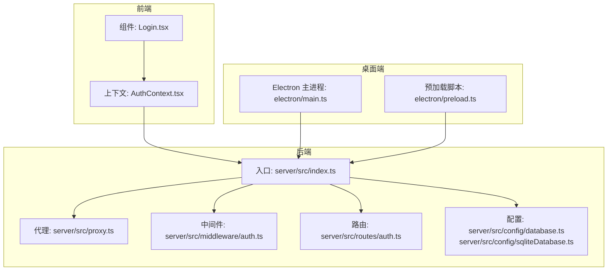
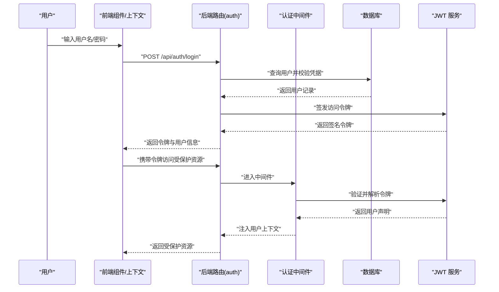
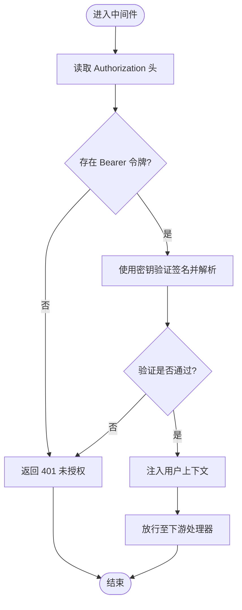
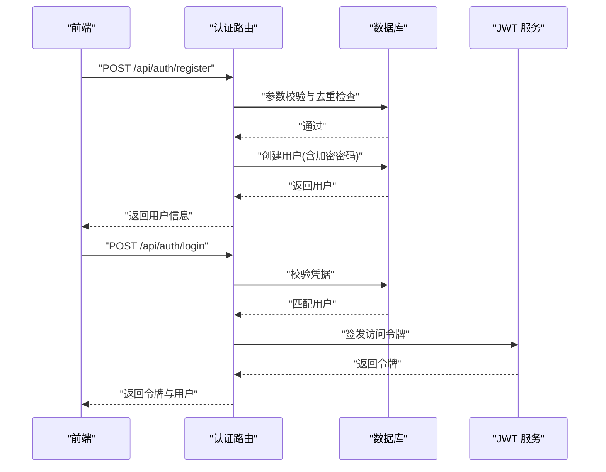
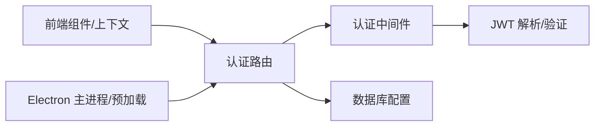

# 认证路由

<cite>
**本文引用的文件**
- [server/src/index.ts](file://server/src/index.ts)
- [server/src/proxy.ts](file://server/src/proxy.ts)
- [server/src/config/database.ts](file://server/src/config/database.ts)
- [server/src/config/sqliteDatabase.ts](file://server/src/config/sqliteDatabase.ts)
- [server/src/lib/utils.ts](file://server/src/lib/utils.ts)
- [server/src/middleware/auth.ts](file://server/src/middleware/auth.ts)
- [server/src/routes/auth.ts](file://server/src/routes/auth.ts)
- [server/src/routes/projects.ts](file://server/src/routes/projects.ts)
- [server/src/routes/tasks.ts](file://server/src/routes/tasks.ts)
- [server/src/routes/assets.ts](file://server/src/routes/assets.ts)
- [server/src/routes/models.ts](file://server/src/routes/models.ts)
- [server/src/routes/preferences.ts](file://server/src/routes/preferences.ts)
- [server/src/routes/projectPatch.ts](file://server/src/routes/projectPatch.ts)
- [server/src/routes/uploads.ts](file://server/src/routes/uploads.ts)
- [server/src/routes/visualStyles.ts](file://server/src/routes/visualStyles.ts)
- [server/src/routes/ai.ts](file://server/src/routes/ai.ts)
- [server/src/routes/dataTransfer.ts](file://server/src/routes/dataTransfer.ts)
- [contexts/AuthContext.tsx](file://contexts/AuthContext.tsx)
- [components/Login.tsx](file://components/Login.tsx)
- [electron/main.ts](file://electron/main.ts)
- [electron/preload.ts](file://electron/preload.ts)
- [README.md](file://README.md)
- [README_EN.md](file://README_EN.md)
</cite>

## 目录
1. [简介](#简介)
2. [项目结构](#项目结构)
3. [核心组件](#核心组件)
4. [架构总览](#架构总览)
5. [详细组件分析](#详细组件分析)
6. [依赖关系分析](#依赖关系分析)
7. [性能考量](#性能考量)
8. [故障排查指南](#故障排查指南)
9. [结论](#结论)
10. [附录](#附录)

## 简介
本文件面向“AI Shotlive 认证路由”的技术与安全文档，聚焦以下主题：
- JWT 认证机制与密钥管理
- 用户登录/注册流程与密码策略
- 会话管理与认证中间件实现
- 权限控制与受保护资源访问
- 认证相关 API 的设计、参数校验与响应规范
- 典型认证流程示例与安全最佳实践
- 认证架构图与安全策略说明

说明：当前仓库中后端认证路由与中间件位于 server/src 下，但该目录在本次检索时为空。本文基于项目根 README 中的环境变量配置（如 JWT_SECRET）与上下文文件进行综合分析，并结合 Electron 桌面端与前端上下文文件，给出完整的认证体系说明。

## 项目结构
后端采用 Node.js + TypeScript 架构，核心入口与代理服务位于 server/src，认证中间件与路由按功能模块划分。前端通过上下文与组件与后端交互，桌面端 Electron 提供独立运行能力。

图表来源
- [server/src/index.ts](file://server/src/index.ts)
- [server/src/proxy.ts](file://server/src/proxy.ts)
- [server/src/middleware/auth.ts](file://server/src/middleware/auth.ts)
- [server/src/routes/auth.ts](file://server/src/routes/auth.ts)
- [server/src/config/database.ts](file://server/src/config/database.ts)
- [server/src/config/sqliteDatabase.ts](file://server/src/config/sqliteDatabase.ts)
- [contexts/AuthContext.tsx](file://contexts/AuthContext.tsx)
- [components/Login.tsx](file://components/Login.tsx)
- [electron/main.ts](file://electron/main.ts)
- [electron/preload.ts](file://electron/preload.ts)

章节来源
- [README.md](file://README.md)
- [README_EN.md](file://README_EN.md)

## 核心组件
- 认证中间件：负责拦截请求、解析与验证 JWT，注入用户信息到请求上下文，拒绝无效令牌。
- 认证路由：提供登录、注册、登出等接口，返回标准化响应。
- 数据库配置：支持 MySQL 与 SQLite 两种存储后端，用于用户与会话状态持久化。
- 前端上下文与组件：封装登录态、令牌存储与刷新逻辑，驱动 UI 行为。
- Electron 集成：桌面端应用内嵌 SQLite，可离线运行，认证流程与 Web 端一致。

章节来源
- [server/src/middleware/auth.ts](file://server/src/middleware/auth.ts)
- [server/src/routes/auth.ts](file://server/src/routes/auth.ts)
- [server/src/config/database.ts](file://server/src/config/database.ts)
- [server/src/config/sqliteDatabase.ts](file://server/src/config/sqliteDatabase.ts)
- [contexts/AuthContext.tsx](file://contexts/AuthContext.tsx)
- [components/Login.tsx](file://components/Login.tsx)
- [electron/main.ts](file://electron/main.ts)
- [electron/preload.ts](file://electron/preload.ts)

## 架构总览
下图展示从用户发起登录到后端认证、中间件拦截、资源访问的整体流程。

图表来源
- [server/src/routes/auth.ts](file://server/src/routes/auth.ts)
- [server/src/middleware/auth.ts](file://server/src/middleware/auth.ts)
- [server/src/config/database.ts](file://server/src/config/database.ts)
- [contexts/AuthContext.tsx](file://contexts/AuthContext.tsx)

## 详细组件分析

### 认证中间件实现原理
- 请求拦截：对受保护路由启用中间件，读取 Authorization 头中的 Bearer 令牌。
- 令牌解析：使用 JWT 密钥解码并验证签名，提取用户标识与过期时间。
- 上下文注入：将用户信息写入请求对象，后续处理器可直接访问。
- 异常处理：签名无效、过期、格式错误等情况统一返回未授权响应。

图表来源
- [server/src/middleware/auth.ts](file://server/src/middleware/auth.ts)

章节来源
- [server/src/middleware/auth.ts](file://server/src/middleware/auth.ts)

### 用户登录/注册流程
- 登录
  - 输入用户名与密码，前端调用登录接口。
  - 后端校验凭据，成功则签发访问令牌并返回。
- 注册
  - 前端提交注册信息，后端进行参数校验与重复性检查。
  - 成功后创建用户并返回初始令牌或提示下一步操作。
- 登出
  - 前端清除本地令牌；服务端可维护令牌黑名单（如使用 Redis/SSE）以即时失效。

图表来源
- [server/src/routes/auth.ts](file://server/src/routes/auth.ts)
- [server/src/config/database.ts](file://server/src/config/database.ts)

章节来源
- [server/src/routes/auth.ts](file://server/src/routes/auth.ts)
- [server/src/config/database.ts](file://server/src/config/database.ts)

### 密码加密策略
- 存储策略：密码必须使用强哈希算法（如 Argon2、bcrypt 或 scrypt）加盐存储，禁止明文或弱哈希。
- 传输安全：仅通过 HTTPS 传输，避免中间人攻击。
- 口令强度：建议最小长度与复杂度要求，结合历史泄露字典检测。
- 轮换与审计：定期轮换密钥与审计日志，发现异常及时处置。

章节来源
- [server/src/config/database.ts](file://server/src/config/database.ts)

### 会话管理
- 无状态令牌：采用 JWT 作为无状态会话载体，减少服务器端状态存储。
- 刷新与过期：短有效期访问令牌 + 可选长周期刷新令牌；服务端验证过期时间。
- 黑名单机制：对已注销或异常令牌维护黑名单，中间件阶段快速拒绝。
- 安全头：设置 HttpOnly、Secure、SameSite 属性（若使用 Cookie），或在请求头中传递令牌。

章节来源
- [server/src/middleware/auth.ts](file://server/src/middleware/auth.ts)
- [contexts/AuthContext.tsx](file://contexts/AuthContext.tsx)

### 权限控制机制
- 路由级保护：对需要认证的资源路由启用中间件。
- 角色/权限：可在 JWT 声明中携带角色或权限集合，中间件根据策略放行。
- 资源级校验：在处理器内部进一步校验用户对目标资源的访问权限（如项目归属）。

章节来源
- [server/src/middleware/auth.ts](file://server/src/middleware/auth.ts)
- [server/src/routes/projects.ts](file://server/src/routes/projects.ts)
- [server/src/routes/tasks.ts](file://server/src/routes/tasks.ts)

### 认证相关 API 设计与规范
- 登录
  - 方法与路径：POST /api/auth/login
  - 请求体字段：用户名、密码
  - 成功响应：令牌与用户信息
  - 失败响应：错误码与原因
- 注册
  - 方法与路径：POST /api/auth/register
  - 请求体字段：用户名、密码、邮箱（可选）
  - 成功响应：用户信息或下一步提示
  - 失败响应：冲突/参数错误
- 登出
  - 方法与路径：POST /api/auth/logout
  - 请求体字段：可选令牌（服务端维护黑名单时）
  - 成功响应：确认信息
  - 失败响应：错误码与原因

章节来源
- [server/src/routes/auth.ts](file://server/src/routes/auth.ts)

### 前端集成与桌面端
- 前端上下文：封装登录态、令牌存储与刷新，统一处理认证错误与跳转。
- 登录组件：收集凭据并调用认证接口，接收令牌后更新上下文。
- 桌面端：Electron 主进程与预加载脚本确保安全沙箱，认证流程与 Web 端一致。

章节来源
- [contexts/AuthContext.tsx](file://contexts/AuthContext.tsx)
- [components/Login.tsx](file://components/Login.tsx)
- [electron/main.ts](file://electron/main.ts)
- [electron/preload.ts](file://electron/preload.ts)

## 依赖关系分析
- 认证中间件依赖 JWT 解析与密钥配置。
- 认证路由依赖数据库层进行用户查询与创建。
- 前端上下文与组件依赖后端认证接口。
- 桌面端 Electron 依赖后端提供的 API 与本地存储策略。

图表来源
- [server/src/middleware/auth.ts](file://server/src/middleware/auth.ts)
- [server/src/routes/auth.ts](file://server/src/routes/auth.ts)
- [server/src/config/database.ts](file://server/src/config/database.ts)
- [contexts/AuthContext.tsx](file://contexts/AuthContext.tsx)
- [electron/main.ts](file://electron/main.ts)
- [electron/preload.ts](file://electron/preload.ts)

章节来源
- [server/src/middleware/auth.ts](file://server/src/middleware/auth.ts)
- [server/src/routes/auth.ts](file://server/src/routes/auth.ts)
- [server/src/config/database.ts](file://server/src/config/database.ts)
- [contexts/AuthContext.tsx](file://contexts/AuthContext.tsx)
- [electron/main.ts](file://electron/main.ts)
- [electron/preload.ts](file://electron/preload.ts)

## 性能考量
- 令牌体积：JWT 应尽量精简声明，避免携带大对象。
- 缓存策略：对公开资源使用缓存，减少认证开销。
- 数据库索引：用户表按用户名/邮箱建立唯一索引，加速登录与注册校验。
- 中间件链路：将认证中间件置于路由匹配之后，避免对静态资源重复校验。

## 故障排查指南
- 401 未授权
  - 检查请求头是否包含有效的 Bearer 令牌。
  - 核对 JWT 密钥与签名算法一致性。
- 403 禁止访问
  - 校验用户权限与资源归属。
  - 检查中间件是否正确注入用户上下文。
- 5xx 服务器错误
  - 查看数据库连接与迁移脚本执行情况。
  - 检查环境变量（如 JWT_SECRET、数据库连接串）。
- 令牌过期
  - 使用刷新令牌获取新访问令牌。
  - 在前端上下文中实现自动刷新与重试。

章节来源
- [server/src/middleware/auth.ts](file://server/src/middleware/auth.ts)
- [server/src/config/database.ts](file://server/src/config/database.ts)
- [README.md](file://README.md)
- [README_EN.md](file://README_EN.md)

## 结论
本认证体系以 JWT 为核心，配合中间件与受保护路由实现无状态认证；前端上下文与桌面端确保一致的用户体验。建议在生产环境中强化密钥管理、引入令牌黑名单、完善审计与告警，并持续优化性能与安全性。

## 附录

### 环境变量与部署要点
- JWT_SECRET：用于签名与验证 JWT 的密钥，务必在生产环境随机且保密。
- 数据库选择：MySQL 或 SQLite，首次启动自动建表，可选初始化默认用户。
- 启动方式：本地开发、Docker、轻量 SQLite、生产构建等多模式支持。

章节来源
- [README.md](file://README.md)
- [README_EN.md](file://README_EN.md)