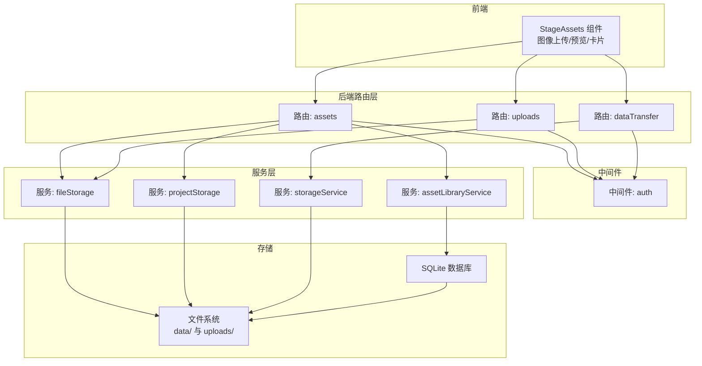
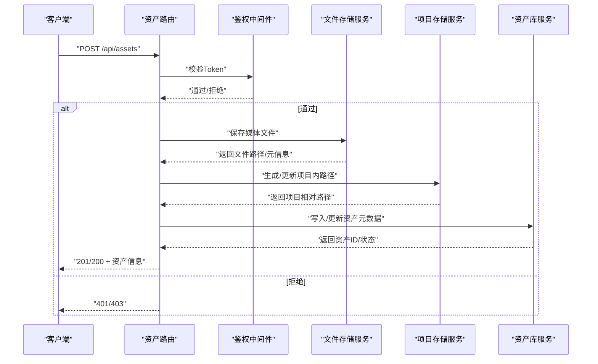
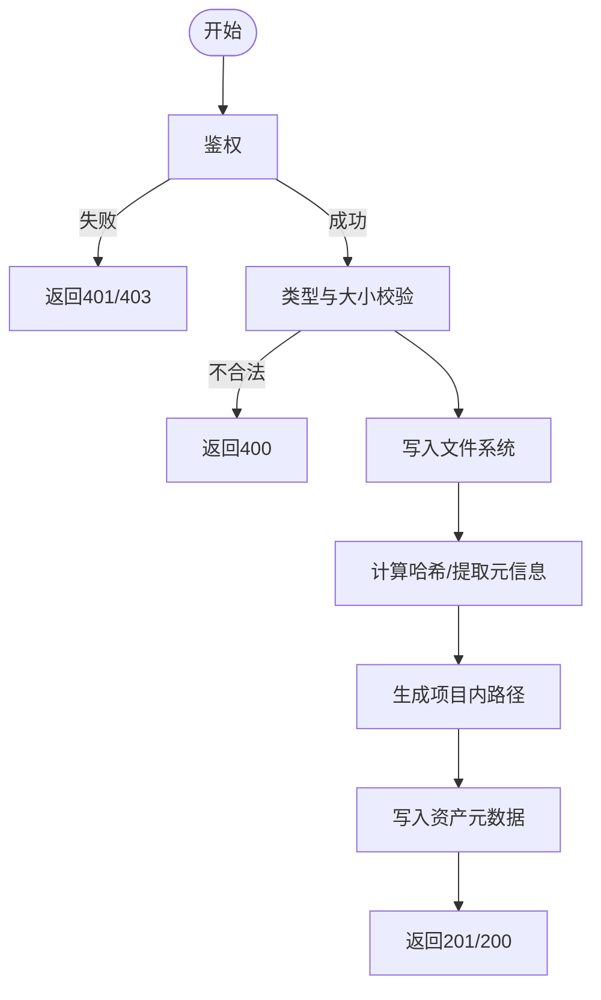
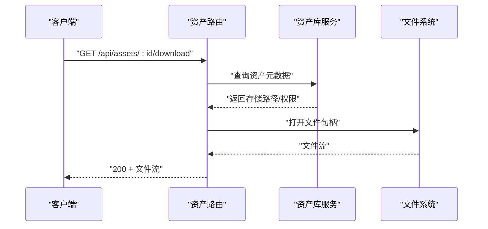
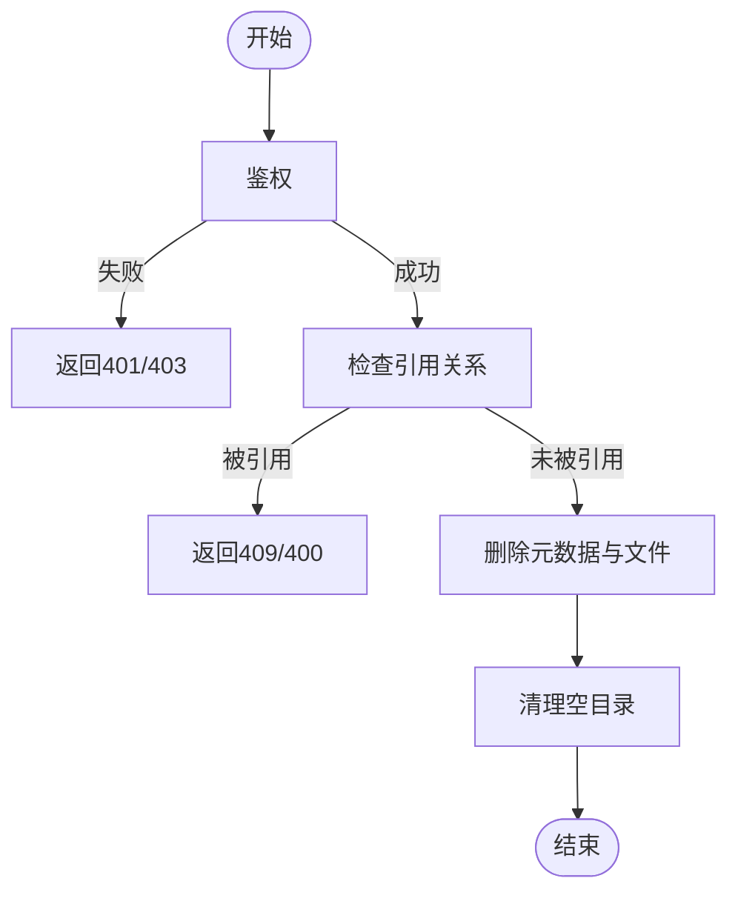
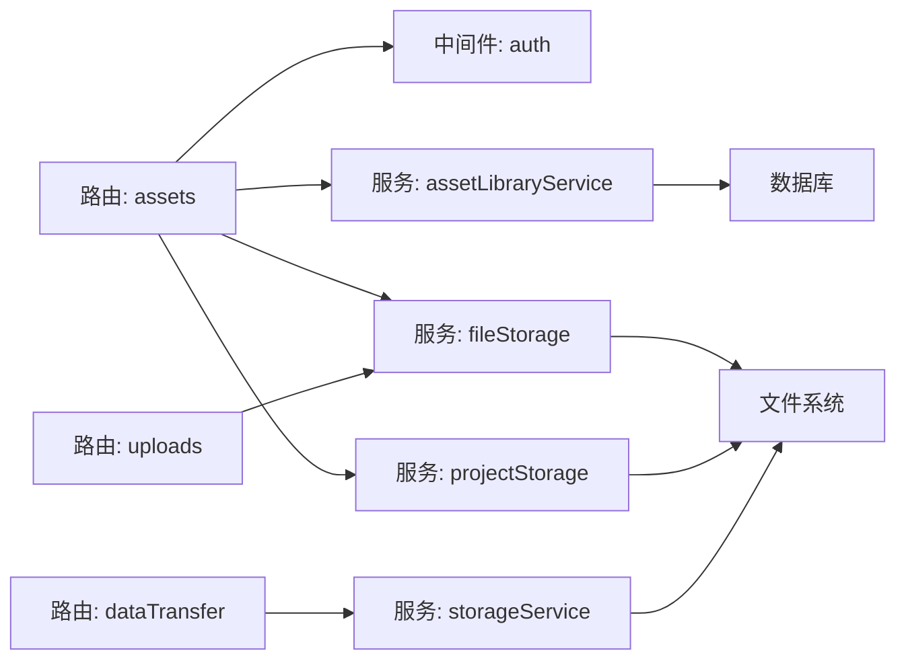

# 资产管理路由

<cite>
**本文引用的文件**
- [types.ts](file://src/types.ts)
- [README_EN.md](file://README_EN.md)
- [assets.ts](file://server/src/routes/assets.ts)
- [auth.ts](file://server/src/middleware/auth.ts)
- [fileStorage.ts](file://server/src/services/fileStorage.ts)
- [projectStorage.ts](file://server/src/services/projectStorage.ts)
- [uploads.ts](file://server/src/routes/uploads.ts)
- [dataTransfer.ts](file://server/src/routes/dataTransfer.ts)
- [storageService.ts](file://services/storageService.ts)
- [assetLibraryService.ts](file://services/assetLibraryService.ts)
</cite>

## 目录
1. [简介](#简介)
2. [项目结构](#项目结构)
3. [核心组件](#核心组件)
4. [架构总览](#架构总览)
5. [详细组件分析](#详细组件分析)
6. [依赖分析](#依赖分析)
7. [性能考虑](#性能考虑)
8. [故障排查指南](#故障排查指南)
9. [结论](#结论)
10. [附录](#附录)

## 简介
本文件面向AI Shotlive的资产管理路由，系统性梳理资产（角色、场景、道具等）的管理API设计、资产分类体系、媒体文件存储策略，并深入解释资产上传、下载、删除的实现机制、文件类型验证与存储路径管理。同时阐述资产库共享、批量操作、以及资产关联关系的处理方式，给出资产数据模型、API接口规范与文件处理最佳实践，并提供资产管理架构图与文件存储策略说明。

## 项目结构
资产管理相关的关键位置分布如下：
- 前端与服务端交互：通过路由层暴露REST API，中间件负责鉴权，服务层负责业务逻辑与文件存储。
- 存储层：本地文件系统按用户/项目隔离存放媒体文件；数据库用于持久化元数据。
- 关键模块：
  - 路由层：assets、uploads、dataTransfer
  - 中间件：auth
  - 服务层：fileStorage、projectStorage、storageService、assetLibraryService

图表来源
- [assets.ts](file://server/src/routes/assets.ts)
- [uploads.ts](file://server/src/routes/uploads.ts)
- [dataTransfer.ts](file://server/src/routes/dataTransfer.ts)
- [auth.ts](file://server/src/middleware/auth.ts)
- [fileStorage.ts](file://server/src/services/fileStorage.ts)
- [projectStorage.ts](file://server/src/services/projectStorage.ts)
- [storageService.ts](file://services/storageService.ts)
- [assetLibraryService.ts](file://services/assetLibraryService.ts)

章节来源
- [README_EN.md:82-96](file://README_EN.md#L82-L96)
- [README_EN.md:308-308](file://README_EN.md#L308-L308)

## 核心组件
- 资产路由层：提供资产增删改查、批量操作、共享与关联关系维护的HTTP接口。
- 鉴权中间件：统一校验登录态与权限。
- 文件存储服务：封装文件系统读写、路径生成、类型校验与清理。
- 项目存储服务：按用户/项目隔离媒体文件，支持路径迁移与版本化。
- 资产库服务：维护资产元数据、索引与共享策略。
- 导出/导入服务：支持整库备份与恢复，含媒体文件打包。

章节来源
- [assets.ts](file://server/src/routes/assets.ts)
- [auth.ts](file://server/src/middleware/auth.ts)
- [fileStorage.ts](file://server/src/services/fileStorage.ts)
- [projectStorage.ts](file://server/src/services/projectStorage.ts)
- [storageService.ts](file://services/storageService.ts)
- [assetLibraryService.ts](file://services/assetLibraryService.ts)

## 架构总览
资产管理从“请求进入”到“文件落盘”的关键流程如下：

图表来源
- [assets.ts](file://server/src/routes/assets.ts)
- [auth.ts](file://server/src/middleware/auth.ts)
- [fileStorage.ts](file://server/src/services/fileStorage.ts)
- [projectStorage.ts](file://server/src/services/projectStorage.ts)
- [assetLibraryService.ts](file://services/assetLibraryService.ts)

## 详细组件分析

### 资产数据模型
资产数据模型用于描述角色、场景、道具等资源的元数据与文件信息。字段包括但不限于：
- 资产标识：唯一ID、所属用户/项目
- 分类标签：类型（角色/场景/道具）、风格、用途
- 文件信息：原始文件名、扩展名、大小、哈希、存储路径
- 元信息：尺寸、帧率、时长（视频/音频）、分辨率（图片）
- 关联关系：被哪些脚本/镜头引用
- 共享与可见性：是否公开、可被他人访问
- 时间戳：创建/更新时间

章节来源
- [types.ts:52-52](file://src/types.ts#L52-L52)

### 资产分类体系
- 类型维度：角色、场景、道具、背景、特效等
- 风格维度：写实、卡通、赛博朋克、水彩等
- 用途维度：预览图、源素材、渲染输入、导出素材
- 约束：同一项目内同名资产需具备唯一标识或版本控制

章节来源
- [README_EN.md:95-96](file://README_EN.md#L95-L96)

### 文件类型验证与存储路径管理
- 类型验证：仅允许白名单扩展名（如图片、视频、音频），并进行MIME/魔数校验。
- 路径策略：
  - 用户级隔离：每个用户拥有独立根目录
  - 项目级隔离：在用户根下按项目划分
  - 媒体文件：存放在data/，上传文件暂存在uploads/
  - 路径迁移：支持从旧路径迁移到新路径（如按剧集/场景）
- 清理策略：删除资产时同步清理文件；空目录定期清理。

章节来源
- [README_EN.md:95-96](file://README_EN.md#L95-L96)
- [README_EN.md:308-308](file://README_EN.md#L308-L308)

### 资产上传流程
- 接口：POST /api/assets
- 步骤：
  1) 鉴权通过
  2) 校验文件类型与大小
  3) 写入文件系统（uploads/临时，随后迁移至data/）
  4) 计算哈希、提取元信息
  5) 生成项目内相对路径
  6) 写入资产库元数据
  7) 返回资产信息

图表来源
- [assets.ts](file://server/src/routes/assets.ts)
- [fileStorage.ts](file://server/src/services/fileStorage.ts)
- [projectStorage.ts](file://server/src/services/projectStorage.ts)
- [assetLibraryService.ts](file://services/assetLibraryService.ts)

章节来源
- [assets.ts](file://server/src/routes/assets.ts)
- [fileStorage.ts](file://server/src/services/fileStorage.ts)
- [projectStorage.ts](file://server/src/services/projectStorage.ts)
- [assetLibraryService.ts](file://services/assetLibraryService.ts)

### 资产下载流程
- 接口：GET /api/assets/:id 或 /api/assets/:id/download
- 步骤：
  1) 鉴权与权限校验
  2) 查询资产元数据
  3) 解析实际文件路径
  4) 流式返回文件内容
  5) 支持断点续传（Range）

图表来源
- [assets.ts](file://server/src/routes/assets.ts)
- [assetLibraryService.ts](file://services/assetLibraryService.ts)
- [fileStorage.ts](file://server/src/services/fileStorage.ts)

章节来源
- [assets.ts](file://server/src/routes/assets.ts)
- [assetLibraryService.ts](file://services/assetLibraryService.ts)
- [fileStorage.ts](file://server/src/services/fileStorage.ts)

### 资产删除流程
- 接口：DELETE /api/assets/:id
- 步骤：
  1) 鉴权与权限校验
  2) 检查是否被引用（脚本/镜头）
  3) 删除元数据与文件
  4) 清理空目录

图表来源
- [assets.ts](file://server/src/routes/assets.ts)
- [assetLibraryService.ts](file://services/assetLibraryService.ts)
- [fileStorage.ts](file://server/src/services/fileStorage.ts)

章节来源
- [assets.ts](file://server/src/routes/assets.ts)
- [assetLibraryService.ts](file://services/assetLibraryService.ts)
- [fileStorage.ts](file://server/src/services/fileStorage.ts)

### 资产库共享与批量操作
- 共享策略：
  - 私有：仅本人可见
  - 公开：所有人可见但不可编辑
  - 项目共享：项目成员可见
- 批量操作：
  - 批量上传：多文件合并提交
  - 批量删除：校验引用后批量清理
  - 批量更新：批量修改分类/标签/可见性

章节来源
- [README_EN.md:82-96](file://README_EN.md#L82-L96)
- [assets.ts](file://server/src/routes/assets.ts)

### 资产关联关系处理
- 引用追踪：记录资产被哪些脚本/镜头使用
- 变更传播：当资产被替换或删除时，触发引用方提示或自动替换
- 版本化：同一资产可保留多个版本，按时间线回溯

章节来源
- [types.ts:52-52](file://src/types.ts#L52-L52)
- [assets.ts](file://server/src/routes/assets.ts)

### API接口规范（示例）
- 上传资产
  - 方法：POST /api/assets
  - 请求体：multipart/form-data（文件、分类、标签、可见性）
  - 成功：201 Created，返回资产信息
  - 失败：400/401/403/409
- 下载资产
  - 方法：GET /api/assets/:id/download
  - 成功：200 OK + 文件流
  - 失败：404/403
- 删除资产
  - 方法：DELETE /api/assets/:id
  - 成功：204 No Content
  - 失败：404/400/403
- 批量操作
  - 方法：POST /api/assets/batch
  - 支持：批量上传、删除、更新

章节来源
- [assets.ts](file://server/src/routes/assets.ts)
- [uploads.ts](file://server/src/routes/uploads.ts)
- [dataTransfer.ts](file://server/src/routes/dataTransfer.ts)

## 依赖分析
资产管理各层之间的耦合关系如下：

图表来源
- [assets.ts](file://server/src/routes/assets.ts)
- [uploads.ts](file://server/src/routes/uploads.ts)
- [dataTransfer.ts](file://server/src/routes/dataTransfer.ts)
- [auth.ts](file://server/src/middleware/auth.ts)
- [fileStorage.ts](file://server/src/services/fileStorage.ts)
- [projectStorage.ts](file://server/src/services/projectStorage.ts)
- [storageService.ts](file://services/storageService.ts)
- [assetLibraryService.ts](file://services/assetLibraryService.ts)

章节来源
- [assets.ts](file://server/src/routes/assets.ts)
- [uploads.ts](file://server/src/routes/uploads.ts)
- [dataTransfer.ts](file://server/src/routes/dataTransfer.ts)
- [auth.ts](file://server/src/middleware/auth.ts)
- [fileStorage.ts](file://server/src/services/fileStorage.ts)
- [projectStorage.ts](file://server/src/services/projectStorage.ts)
- [storageService.ts](file://services/storageService.ts)
- [assetLibraryService.ts](file://services/assetLibraryService.ts)

## 性能考虑
- 并发上传：限制单用户并发上传数量，避免IO抖动
- 断点续传：支持分片上传与断点续传，提升大文件稳定性
- 缓存策略：对常用小图/缩略图进行缓存，减少重复读取
- 压缩与转码：根据用途选择合适格式（WebP、AVIF、H.264/HEVC），平衡质量与体积
- 索引优化：对资产元数据建立索引，加速查询与过滤

## 故障排查指南
- 401/403：检查Token有效性与权限范围
- 400：检查文件类型、大小与必填字段
- 404：确认资产ID是否存在
- 409：检查是否被引用，必要时先解除引用再删除
- 上传失败：查看文件系统权限、磁盘空间与路径生成逻辑
- 下载异常：确认文件存在、路径正确与Range请求兼容性

章节来源
- [assets.ts](file://server/src/routes/assets.ts)
- [auth.ts](file://server/src/middleware/auth.ts)
- [fileStorage.ts](file://server/src/services/fileStorage.ts)
- [projectStorage.ts](file://server/src/services/projectStorage.ts)

## 结论
本方案通过清晰的路由层、严格的中间件鉴权、完善的文件存储与项目隔离策略，以及可扩展的资产库服务，实现了角色、场景、道具等资产的全生命周期管理。结合共享与批量操作能力，满足团队协作与规模化生产的需要。建议在生产环境中进一步完善监控、日志与告警体系，确保高可用与可追溯性。

## 附录
- 备份与恢复：支持导出ZIP（数据库+媒体文件），导入时自动创建新用户并重建路径
- 路径约定：data/存放项目媒体，uploads/存放临时上传，按用户/项目分层组织

章节来源
- [README_EN.md:82-96](file://README_EN.md#L82-L96)
- [README_EN.md:308-308](file://README_EN.md#L308-L308)