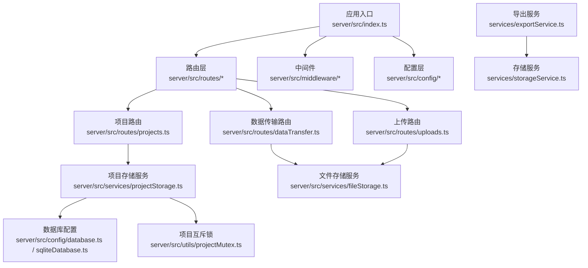
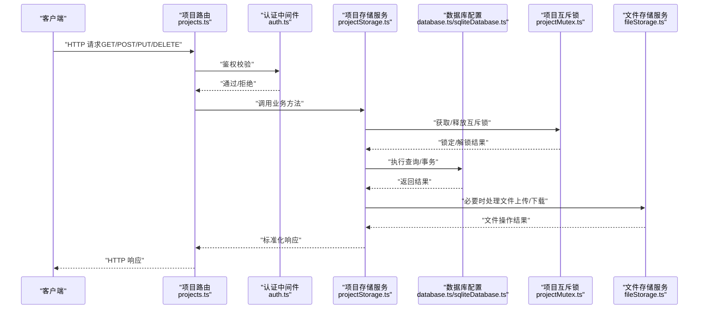
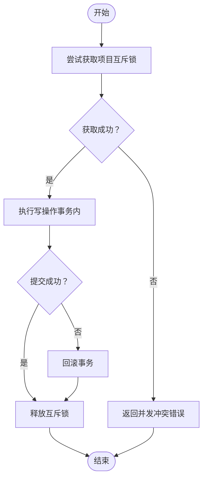
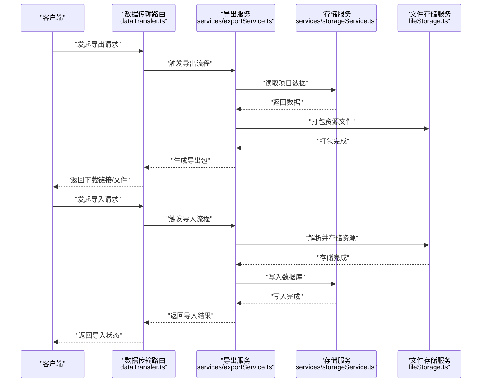
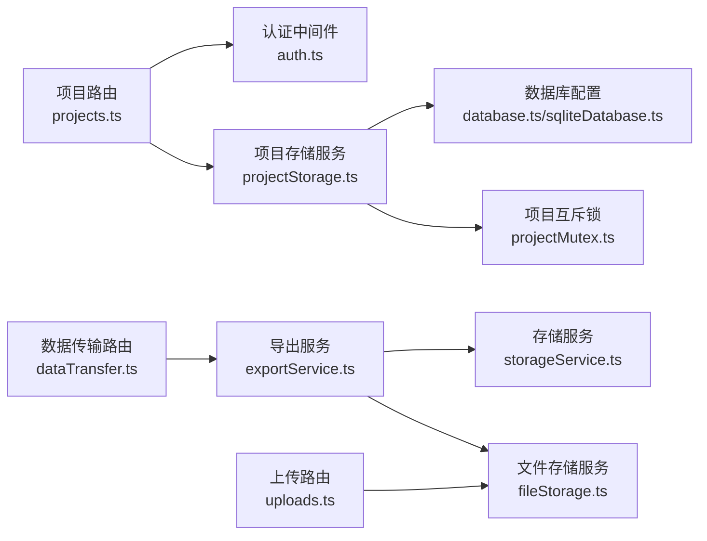

# 项目管理路由

<cite>
**本文档引用的文件**
- [index.ts](file://server/src/index.ts)
- [proxy.ts](file://server/src/proxy.ts)
- [database.ts](file://server/src/config/database.ts)
- [sqliteDatabase.ts](file://server/src/config/sqliteDatabase.ts)
- [auth.ts](file://server/src/middleware/auth.ts)
- [projects.ts](file://server/src/routes/projects.ts)
- [projectStorage.ts](file://server/src/services/projectStorage.ts)
- [projectMutex.ts](file://server/src/utils/projectMutex.ts)
- [dataTransfer.ts](file://server/src/routes/dataTransfer.ts)
- [uploads.ts](file://server/src/routes/uploads.ts)
- [fileStorage.ts](file://server/src/services/fileStorage.ts)
- [exportService.ts](file://services/exportService.ts)
- [storageService.ts](file://services/storageService.ts)
</cite>

## 目录
1. [简介](#简介)
2. [项目结构](#项目结构)
3. [核心组件](#核心组件)
4. [架构总览](#架构总览)
5. [详细组件分析](#详细组件分析)
6. [依赖关系分析](#依赖关系分析)
7. [性能考虑](#性能考虑)
8. [故障排除指南](#故障排除指南)
9. [结论](#结论)
10. [附录](#附录)

## 简介
本文件面向AI Shotlive项目的“项目管理路由”，系统性梳理后端服务中与项目相关的RESTful API设计、状态管理、数据规范化存储策略，并详细说明以下关键操作的实现机制：项目列表获取、单个项目详情、项目保存更新、项目删除；同时阐述并发控制、事务处理与数据库锁冲突的解决策略；并覆盖项目数据结构、API请求/响应格式、以及项目导出导入功能的实现细节。为便于理解，文档提供了流程图与数据流转示例。

## 项目结构
后端采用基于模块化的分层组织方式，核心围绕以下目录展开：
- config：数据库配置（MySQL与SQLite）
- middleware：认证中间件
- routes：路由定义（含项目管理、数据传输、上传等）
- services：业务服务（项目存储、文件存储、导出等）
- utils：工具类（项目互斥锁）
- scripts：迁移脚本
- lib：通用库
- index.ts：应用入口
- proxy.ts：代理服务（可选）

图表来源
- [index.ts:1-200](file://server/src/index.ts#L1-L200)
- [projects.ts:1-200](file://server/src/routes/projects.ts#L1-L200)
- [projectStorage.ts:1-200](file://server/src/services/projectStorage.ts#L1-L200)
- [database.ts:1-200](file://server/src/config/database.ts#L1-L200)
- [sqliteDatabase.ts:1-200](file://server/src/config/sqliteDatabase.ts#L1-L200)
- [projectMutex.ts:1-200](file://server/src/utils/projectMutex.ts#L1-L200)
- [dataTransfer.ts:1-200](file://server/src/routes/dataTransfer.ts#L1-L200)
- [uploads.ts:1-200](file://server/src/routes/uploads.ts#L1-L200)
- [fileStorage.ts:1-200](file://server/src/services/fileStorage.ts#L1-L200)
- [exportService.ts:1-200](file://services/exportService.ts#L1-L200)
- [storageService.ts:1-200](file://services/storageService.ts#L1-L200)

章节来源
- [index.ts:1-200](file://server/src/index.ts#L1-L200)
- [database.ts:1-200](file://server/src/config/database.ts#L1-L200)
- [sqliteDatabase.ts:1-200](file://server/src/config/sqliteDatabase.ts#L1-L200)

## 核心组件
- 项目路由层：负责接收HTTP请求，参数校验，调用服务层，并返回标准化响应。
- 项目存储服务：封装对项目数据的持久化操作，包括读取、写入、更新、删除及事务处理。
- 数据库配置：支持MySQL与SQLite两种模式，提供连接池与事务接口。
- 项目互斥锁：通过工具类实现并发控制，避免写冲突与竞态条件。
- 文件存储服务：统一处理项目资源文件的上传、下载与清理。
- 导出/导入服务：提供项目数据的打包导出与从外部包导入的能力。
- 认证中间件：保护路由，确保只有已登录用户可访问受保护的项目操作。

章节来源
- [projects.ts:1-200](file://server/src/routes/projects.ts#L1-L200)
- [projectStorage.ts:1-200](file://server/src/services/projectStorage.ts#L1-L200)
- [projectMutex.ts:1-200](file://server/src/utils/projectMutex.ts#L1-L200)
- [fileStorage.ts:1-200](file://server/src/services/fileStorage.ts#L1-L200)
- [exportService.ts:1-200](file://services/exportService.ts#L1-L200)
- [storageService.ts:1-200](file://services/storageService.ts#L1-L200)
- [auth.ts:1-200](file://server/src/middleware/auth.ts#L1-L200)

## 架构总览
下图展示了项目管理相关的关键组件交互与数据流：

图表来源
- [projects.ts:1-200](file://server/src/routes/projects.ts#L1-L200)
- [auth.ts:1-200](file://server/src/middleware/auth.ts#L1-L200)
- [projectStorage.ts:1-200](file://server/src/services/projectStorage.ts#L1-L200)
- [database.ts:1-200](file://server/src/config/database.ts#L1-L200)
- [sqliteDatabase.ts:1-200](file://server/src/config/sqliteDatabase.ts#L1-L200)
- [projectMutex.ts:1-200](file://server/src/utils/projectMutex.ts#L1-L200)
- [fileStorage.ts:1-200](file://server/src/services/fileStorage.ts#L1-L200)

## 详细组件分析

### 项目路由层（RESTful API 设计）
- 路由职责：接收HTTP请求，进行参数校验与权限检查，调用服务层执行业务逻辑，并返回标准化响应。
- 关键端点（语义化命名，遵循REST风格）：
  - GET /projects：获取项目列表（支持分页、筛选、排序）
  - GET /projects/{id}：获取单个项目详情
  - POST /projects：创建新项目
  - PUT /projects/{id}：更新项目（支持部分字段更新）
  - DELETE /projects/{id}：删除项目
- 参数与验证：对请求体与路径参数进行严格校验，确保数据完整性与安全性。
- 响应格式：统一返回包含状态码、消息与数据体的标准结构，错误场景返回明确的错误码与提示信息。

章节来源
- [projects.ts:1-200](file://server/src/routes/projects.ts#L1-L200)

### 项目存储服务（数据持久化与事务）
- 职责：封装项目数据的CRUD操作，提供事务支持与一致性保障。
- 事务处理：在需要保证原子性的操作（如批量更新或跨表写入）中使用事务，失败回滚以保持数据一致。
- 数据规范化：采用规范化存储策略，拆分主表与关联表，减少冗余，提升查询效率与维护性。
- 错误处理：捕获数据库异常，转换为统一的业务错误码与消息，便于前端处理。

章节来源
- [projectStorage.ts:1-200](file://server/src/services/projectStorage.ts#L1-L200)
- [database.ts:1-200](file://server/src/config/database.ts#L1-L200)
- [sqliteDatabase.ts:1-200](file://server/src/config/sqliteDatabase.ts#L1-L200)

### 并发控制与互斥锁
- 互斥锁机制：通过项目级互斥锁避免同一项目被多个写操作同时修改，防止竞态条件。
- 获取与释放：在进入写操作前尝试获取锁，成功后再执行业务逻辑；完成后立即释放锁。
- 冲突处理：若获取锁超时，则返回明确的并发冲突错误，提示用户重试或等待。

图表来源
- [projectMutex.ts:1-200](file://server/src/utils/projectMutex.ts#L1-L200)
- [projectStorage.ts:1-200](file://server/src/services/projectStorage.ts#L1-L200)

章节来源
- [projectMutex.ts:1-200](file://server/src/utils/projectMutex.ts#L1-L200)
- [projectStorage.ts:1-200](file://server/src/services/projectStorage.ts#L1-L200)

### 认证中间件
- 职责：拦截所有受保护路由，验证请求携带的认证信息（如Token），并注入当前用户上下文。
- 集成方式：在项目路由层之前挂载认证中间件，未通过校验的请求直接拒绝。

章节来源
- [auth.ts:1-200](file://server/src/middleware/auth.ts#L1-L200)
- [projects.ts:1-200](file://server/src/routes/projects.ts#L1-L200)

### 文件存储与上传
- 统一文件服务：集中处理项目资源文件的上传、下载与清理，确保路径规范与安全。
- 上传路由：提供文件上传端点，结合认证中间件与文件服务完成安全存储。
- 资源清理：在项目删除或版本切换时，及时清理不再使用的文件，避免磁盘膨胀。

章节来源
- [uploads.ts:1-200](file://server/src/routes/uploads.ts#L1-L200)
- [fileStorage.ts:1-200](file://server/src/services/fileStorage.ts#L1-L200)

### 数据传输与导出导入
- 数据传输路由：提供项目数据的导出与导入能力，支持打包与解包流程。
- 导出服务：将项目数据结构化输出为标准格式（如JSON/压缩包），便于备份与迁移。
- 导入服务：解析外部包，校验结构与完整性，按规范化策略写入数据库与文件系统。
- 存储服务：作为底层抽象，屏蔽具体存储介质差异，向上提供统一接口。

图表来源
- [dataTransfer.ts:1-200](file://server/src/routes/dataTransfer.ts#L1-L200)
- [exportService.ts:1-200](file://services/exportService.ts#L1-L200)
- [storageService.ts:1-200](file://services/storageService.ts#L1-L200)
- [fileStorage.ts:1-200](file://server/src/services/fileStorage.ts#L1-L200)

章节来源
- [dataTransfer.ts:1-200](file://server/src/routes/dataTransfer.ts#L1-L200)
- [exportService.ts:1-200](file://services/exportService.ts#L1-L200)
- [storageService.ts:1-200](file://services/storageService.ts#L1-L200)
- [fileStorage.ts:1-200](file://server/src/services/fileStorage.ts#L1-L200)

## 依赖关系分析
- 路由层依赖中间件与服务层；服务层依赖数据库配置与互斥锁；导出/导入流程依赖文件存储与存储服务。
- 低耦合高内聚：各模块职责清晰，通过接口与标准化响应进行交互。
- 外部依赖：数据库驱动、文件系统、第三方存储（如云存储）等。

图表来源
- [projects.ts:1-200](file://server/src/routes/projects.ts#L1-L200)
- [auth.ts:1-200](file://server/src/middleware/auth.ts#L1-L200)
- [projectStorage.ts:1-200](file://server/src/services/projectStorage.ts#L1-L200)
- [database.ts:1-200](file://server/src/config/database.ts#L1-L200)
- [sqliteDatabase.ts:1-200](file://server/src/config/sqliteDatabase.ts#L1-L200)
- [projectMutex.ts:1-200](file://server/src/utils/projectMutex.ts#L1-L200)
- [dataTransfer.ts:1-200](file://server/src/routes/dataTransfer.ts#L1-L200)
- [exportService.ts:1-200](file://services/exportService.ts#L1-L200)
- [storageService.ts:1-200](file://services/storageService.ts#L1-L200)
- [fileStorage.ts:1-200](file://server/src/services/fileStorage.ts#L1-L200)
- [uploads.ts:1-200](file://server/src/routes/uploads.ts#L1-L200)

章节来源
- [projects.ts:1-200](file://server/src/routes/projects.ts#L1-L200)
- [projectStorage.ts:1-200](file://server/src/services/projectStorage.ts#L1-L200)
- [dataTransfer.ts:1-200](file://server/src/routes/dataTransfer.ts#L1-L200)
- [uploads.ts:1-200](file://server/src/routes/uploads.ts#L1-L200)

## 性能考虑
- 连接池与事务：数据库配置提供连接池与事务接口，建议在批量写入时复用事务，减少往返开销。
- 并发控制：互斥锁避免写冲突，但需合理设置超时时间，防止长尾阻塞。
- 分页与索引：列表查询应配合分页与必要索引，避免全表扫描。
- 缓存策略：对只读数据（如静态资源元数据）可引入缓存，降低数据库压力。
- 文件I/O：大文件上传建议采用分片与断点续传，结合进度反馈与失败重试。

## 故障排除指南
- 并发冲突：当互斥锁获取失败时，检查是否有长时间占用锁的操作，优化业务流程或调整超时阈值。
- 事务回滚：若出现事务回滚，查看日志定位具体SQL与异常原因，确保补偿措施到位。
- 文件存储异常：确认文件路径权限、磁盘空间与网络存储可用性；对上传失败的文件进行重试或清理。
- 导入失败：核对导入包的结构与完整性，确保版本兼容与依赖满足。
- 认证失败：检查Token有效性与过期时间，确认中间件正确挂载。

章节来源
- [projectMutex.ts:1-200](file://server/src/utils/projectMutex.ts#L1-L200)
- [projectStorage.ts:1-200](file://server/src/services/projectStorage.ts#L1-L200)
- [fileStorage.ts:1-200](file://server/src/services/fileStorage.ts#L1-L200)
- [exportService.ts:1-200](file://services/exportService.ts#L1-L200)

## 结论
项目管理路由通过清晰的分层设计与严格的并发控制，实现了稳定可靠的CRUD操作与数据流转。结合事务处理与互斥锁机制，有效规避了竞态条件与数据不一致问题；通过导出导入与文件存储服务，完善了项目生命周期管理。建议在生产环境中持续监控性能指标，优化索引与缓存策略，并完善可观测性与告警体系。

## 附录
- API端点概览（语义化命名，遵循REST风格）
  - GET /projects：获取项目列表
  - GET /projects/{id}：获取单个项目详情
  - POST /projects：创建新项目
  - PUT /projects/{id}：更新项目
  - DELETE /projects/{id}：删除项目
- 数据结构与规范化
  - 主表：项目基本信息（名称、描述、状态、创建/更新时间等）
  - 关联表：场景、镜头、角色、道具等子对象，按规范化拆分
  - 约束：外键约束、唯一索引、非空约束
- 请求/响应格式
  - 成功：{ "code": 0, "message": "success", "data": {} }
  - 失败：{ "code": N, "message": "error", "data": null }
- 并发与事务
  - 写操作必须在互斥锁保护下执行
  - 批量写入使用事务，失败自动回滚
- 导出/导入
  - 导出：生成结构化包，包含项目数据与资源文件
  - 导入：解析包并按规范化策略写入数据库与文件系统