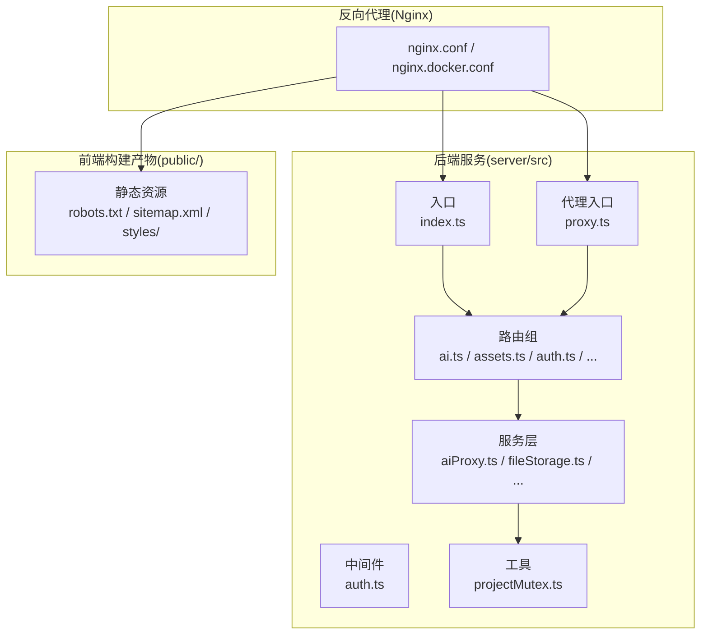
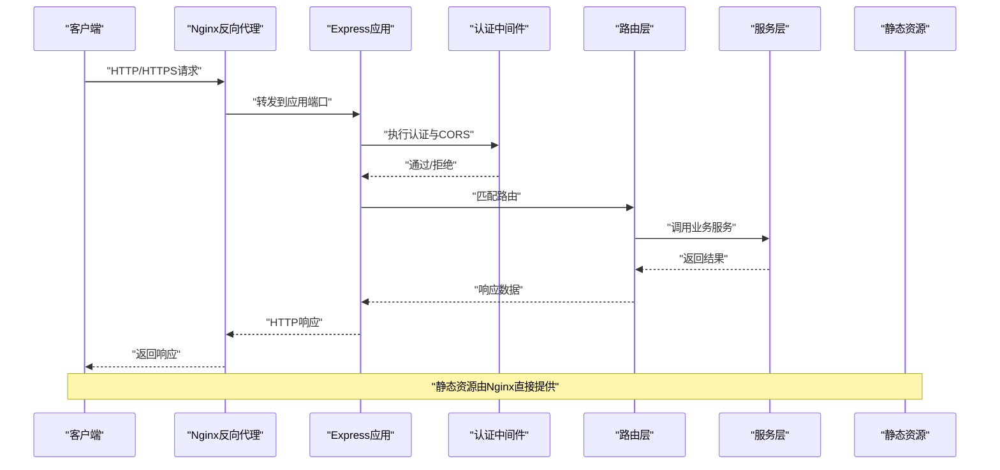
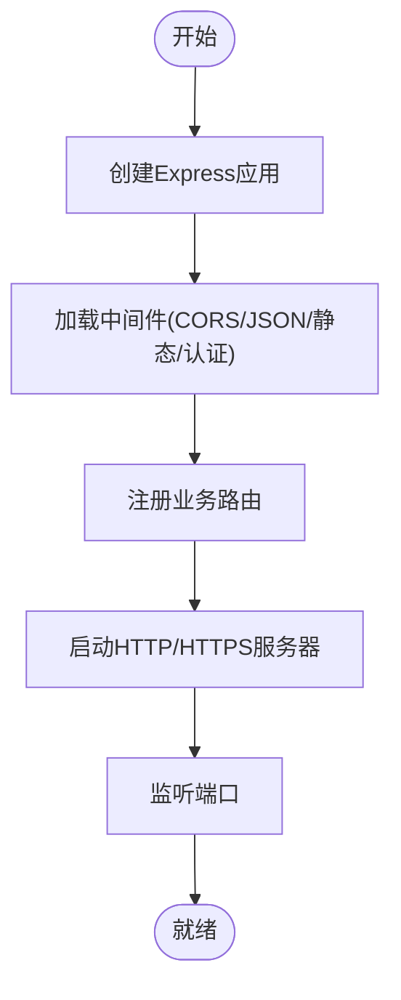
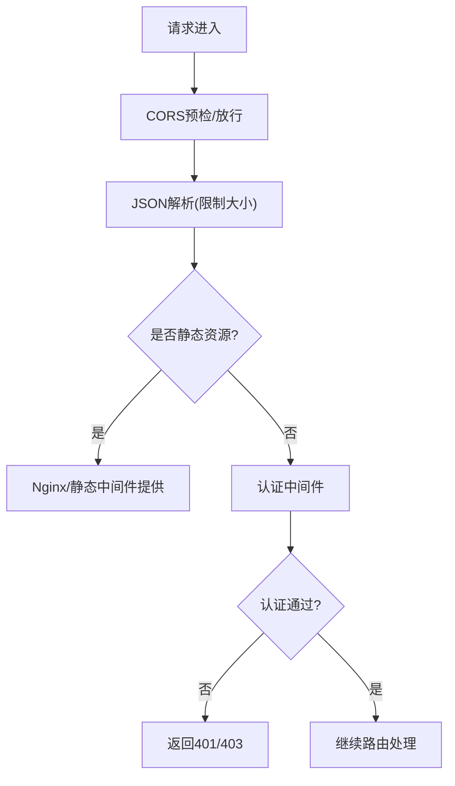
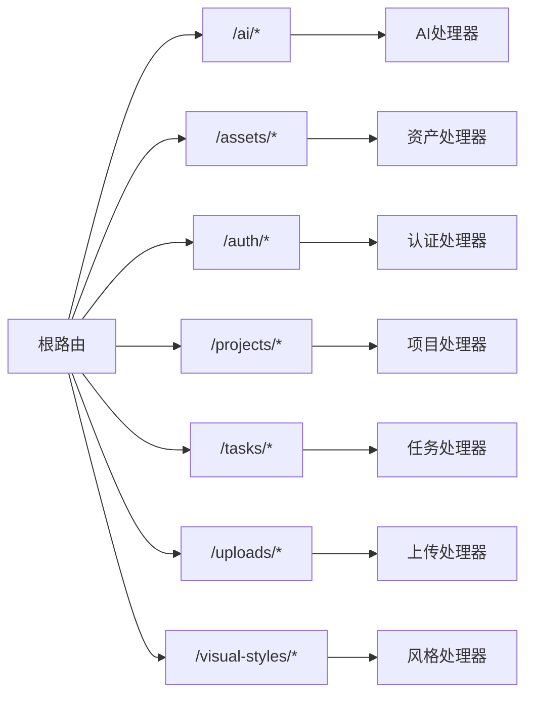
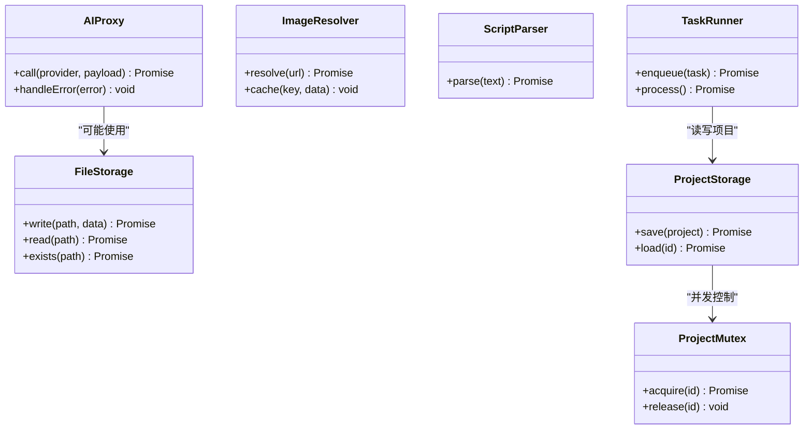
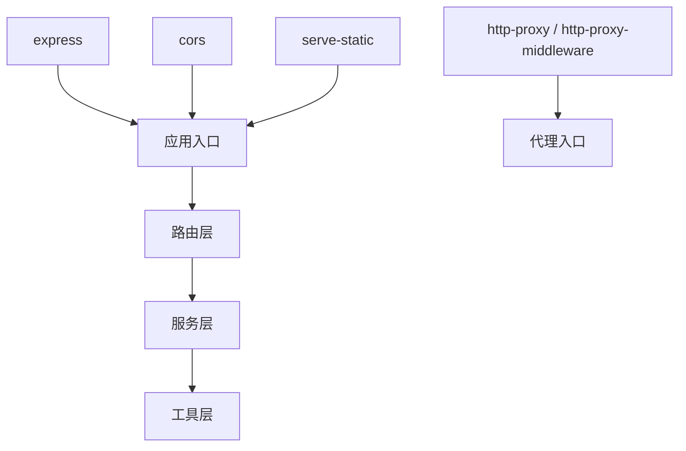

# Express服务器设计

<cite>
**本文档引用的文件**
- [package.json](file://package.json)
- [server/src/index.ts](file://server/src/index.ts)
- [server/src/proxy.ts](file://server/src/proxy.ts)
- [server/src/middleware/auth.ts](file://server/src/middleware/auth.ts)
- [server/src/routes/ai.ts](file://server/src/routes/ai.ts)
- [server/src/routes/assets.ts](file://server/src/routes/assets.ts)
- [server/src/routes/auth.ts](file://server/src/routes/auth.ts)
- [server/src/routes/dataTransfer.ts](file://server/src/routes/dataTransfer.ts)
- [server/src/routes/models.ts](file://server/src/routes/models.ts)
- [server/src/routes/preferences.ts](file://server/src/routes/preferences.ts)
- [server/src/routes/projectPatch.ts](file://server/src/routes/projectPatch.ts)
- [server/src/routes/projects.ts](file://server/src/routes/projects.ts)
- [server/src/routes/tasks.ts](file://server/src/routes/tasks.ts)
- [server/src/routes/uploads.ts](file://server/src/routes/uploads.ts)
- [server/src/routes/visualStyles.ts](file://server/src/routes/visualStyles.ts)
- [server/src/services/aiProxy.ts](file://server/src/services/aiProxy.ts)
- [server/src/services/fileStorage.ts](file://server/src/services/fileStorage.ts)
- [server/src/services/imageResolver.ts](file://server/src/services/imageResolver.ts)
- [server/src/services/projectStorage.ts](file://server/src/services/projectStorage.ts)
- [server/src/services/scriptParser.ts](file://server/src/services/scriptParser.ts)
- [server/src/services/taskRunner.ts](file://server/src/services/taskRunner.ts)
- [server/src/utils/projectMutex.ts](file://server/src/utils/projectMutex.ts)
- [nginx.conf](file://nginx.conf)
- [nginx.docker.conf](file://nginx.docker.conf)
</cite>

## 目录
1. [简介](#简介)
2. [项目结构](#项目结构)
3. [核心组件](#核心组件)
4. [架构总览](#架构总览)
5. [详细组件分析](#详细组件分析)
6. [依赖分析](#依赖分析)
7. [性能考虑](#性能考虑)
8. [故障排除指南](#故障排除指南)
9. [结论](#结论)
10. [附录](#附录)

## 简介
本文件面向AI Shotlive项目的Express服务器设计，系统性梳理服务器初始化流程、中间件配置、路由组织架构，并重点说明CORS配置、JSON解析限制、静态文件服务设置。同时阐述健康检查端点设计、生产环境SPA回退机制、服务器启动参数与配置示例、性能优化建议及错误处理策略。为便于不同技术背景读者理解，文档采用分层描述与可视化图示相结合的方式呈现。

## 项目结构
后端采用TypeScript模块化组织，核心位于server/src目录，按功能域划分为：
- 配置：数据库与SQLite配置（当前为空目录）
- 中间件：认证中间件等
- 路由：AI、资产、认证、数据传输、模型、偏好、项目补丁、项目、任务、上传、视觉风格等
- 服务：AI代理、文件存储、图像解析、项目存储、脚本解析、任务执行等
- 工具：项目互斥锁等
- 入口：index.ts（应用主入口）、proxy.ts（代理入口）

前端构建产物通过Nginx提供静态服务，Express仅负责API与代理能力；生产环境通过Nginx实现SPA回退与静态资源服务。

**图表来源**
- [server/src/index.ts](file://server/src/index.ts)
- [server/src/proxy.ts](file://server/src/proxy.ts)
- [server/src/middleware/auth.ts](file://server/src/middleware/auth.ts)
- [server/src/routes/ai.ts](file://server/src/routes/ai.ts)
- [server/src/services/aiProxy.ts](file://server/src/services/aiProxy.ts)
- [nginx.conf](file://nginx.conf)
- [nginx.docker.conf](file://nginx.docker.conf)

**章节来源**
- [server/src/index.ts](file://server/src/index.ts)
- [server/src/proxy.ts](file://server/src/proxy.ts)
- [server/src/middleware/auth.ts](file://server/src/middleware/auth.ts)
- [server/src/routes/ai.ts](file://server/src/routes/ai.ts)
- [server/src/routes/assets.ts](file://server/src/routes/assets.ts)
- [server/src/routes/auth.ts](file://server/src/routes/auth.ts)
- [server/src/routes/dataTransfer.ts](file://server/src/routes/dataTransfer.ts)
- [server/src/routes/models.ts](file://server/src/routes/models.ts)
- [server/src/routes/preferences.ts](file://server/src/routes/preferences.ts)
- [server/src/routes/projectPatch.ts](file://server/src/routes/projectPatch.ts)
- [server/src/routes/projects.ts](file://server/src/routes/projects.ts)
- [server/src/routes/tasks.ts](file://server/src/routes/tasks.ts)
- [server/src/routes/uploads.ts](file://server/src/routes/uploads.ts)
- [server/src/routes/visualStyles.ts](file://server/src/routes/visualStyles.ts)
- [server/src/services/aiProxy.ts](file://server/src/services/aiProxy.ts)
- [server/src/services/fileStorage.ts](file://server/src/services/fileStorage.ts)
- [server/src/services/imageResolver.ts](file://server/src/services/imageResolver.ts)
- [server/src/services/projectStorage.ts](file://server/src/services/projectStorage.ts)
- [server/src/services/scriptParser.ts](file://server/src/services/scriptParser.ts)
- [server/src/services/taskRunner.ts](file://server/src/services/taskRunner.ts)
- [server/src/utils/projectMutex.ts](file://server/src/utils/projectMutex.ts)
- [nginx.conf](file://nginx.conf)
- [nginx.docker.conf](file://nginx.docker.conf)

## 核心组件
- 应用入口与初始化
  - 主入口负责创建Express实例、加载中间件、注册路由、启动HTTP/HTTPS服务器并监听端口。
  - 代理入口提供反向代理能力，用于转发到下游服务或本地静态资源。
- 中间件体系
  - 认证中间件：统一鉴权逻辑，支持Token校验与权限判定。
  - CORS中间件：允许跨域请求，配置来源、方法、头字段与凭证。
  - JSON解析中间件：限制请求体大小，避免过大负载导致内存压力。
  - 静态文件中间件：提供public目录下静态资源访问。
- 路由组织
  - 按业务域划分路由：AI生成、资产管理、认证、数据传输、模型配置、偏好设置、项目与补丁、任务调度、上传下载、视觉风格等。
  - 统一前缀与版本化路径，便于扩展与维护。
- 服务层
  - AI代理：封装第三方AI服务调用，统一错误处理与超时控制。
  - 文件存储：抽象文件读写与路径管理。
  - 图像解析：统一图像资源解析与缓存策略。
  - 项目存储：项目数据持久化与并发控制。
  - 脚本解析：剧本文本解析与结构化输出。
  - 任务执行：异步任务队列与状态管理。
- 工具与配置
  - 项目互斥锁：防止并发修改同一项目造成数据不一致。
  - Nginx配置：生产环境静态资源、SPA回退与反向代理。

**章节来源**
- [server/src/index.ts](file://server/src/index.ts)
- [server/src/proxy.ts](file://server/src/proxy.ts)
- [server/src/middleware/auth.ts](file://server/src/middleware/auth.ts)
- [server/src/services/aiProxy.ts](file://server/src/services/aiProxy.ts)
- [server/src/services/fileStorage.ts](file://server/src/services/fileStorage.ts)
- [server/src/services/imageResolver.ts](file://server/src/services/imageResolver.ts)
- [server/src/services/projectStorage.ts](file://server/src/services/projectStorage.ts)
- [server/src/services/scriptParser.ts](file://server/src/services/scriptParser.ts)
- [server/src/services/taskRunner.ts](file://server/src/services/taskRunner.ts)
- [server/src/utils/projectMutex.ts](file://server/src/utils/projectMutex.ts)

## 架构总览
下图展示从客户端到后端服务的整体交互流程，包括认证、CORS、静态资源、API路由与代理转发。

**图表来源**
- [server/src/index.ts](file://server/src/index.ts)
- [server/src/middleware/auth.ts](file://server/src/middleware/auth.ts)
- [server/src/routes/ai.ts](file://server/src/routes/ai.ts)
- [server/src/services/aiProxy.ts](file://server/src/services/aiProxy.ts)
- [nginx.conf](file://nginx.conf)

## 详细组件分析

### 服务器初始化流程
- 创建Express实例与基础配置
  - 设置端口、主机绑定、超时时间等启动参数。
  - 加载中间件：CORS、JSON解析、静态文件、认证等。
  - 注册路由：按模块注册各业务路由。
  - 启动HTTP/HTTPS服务器并监听端口。
- 生产环境启动参数
  - 端口：默认端口可通过环境变量配置。
  - 主机：可绑定到特定IP或0.0.0.0。
  - 超时：根据业务场景调整请求/连接超时。
  - 日志：接入统一日志系统，便于问题追踪。
- 启动流程图

**图表来源**
- [server/src/index.ts](file://server/src/index.ts)

**章节来源**
- [server/src/index.ts](file://server/src/index.ts)

### 中间件配置
- CORS配置
  - 支持来源白名单、允许方法、允许头字段、是否携带凭证。
  - 开发环境可放宽策略，生产环境严格限定来源。
- JSON解析限制
  - 限制最大请求体大小，避免内存溢出与慢注入攻击。
  - 对上传类接口可单独放宽限制。
- 静态文件服务
  - 指定静态目录与缓存策略，生产环境可由Nginx接管以提升性能。
- 认证中间件
  - Token解析与校验，权限判定与用户上下文注入。
  - 异常处理：无效Token、过期Token、权限不足等。

**图表来源**
- [server/src/middleware/auth.ts](file://server/src/middleware/auth.ts)
- [nginx.conf](file://nginx.conf)

**章节来源**
- [server/src/middleware/auth.ts](file://server/src/middleware/auth.ts)

### 路由组织架构
- 路由分层
  - 一级路由：按业务域划分，如AI、资产、认证、项目等。
  - 二级路由：在各域内进一步细分，如项目列表、项目详情、任务队列等。
- 统一规范
  - 命名：使用RESTful命名，动词与名词清晰。
  - 错误处理：统一错误格式与状态码映射。
  - 版本控制：可选的API版本前缀，便于演进。
- 路由与服务解耦
  - 路由仅负责参数解析与响应包装，具体业务逻辑下沉至服务层。

**图表来源**
- [server/src/routes/ai.ts](file://server/src/routes/ai.ts)
- [server/src/routes/assets.ts](file://server/src/routes/assets.ts)
- [server/src/routes/auth.ts](file://server/src/routes/auth.ts)
- [server/src/routes/projects.ts](file://server/src/routes/projects.ts)
- [server/src/routes/tasks.ts](file://server/src/routes/tasks.ts)
- [server/src/routes/uploads.ts](file://server/src/routes/uploads.ts)
- [server/src/routes/visualStyles.ts](file://server/src/routes/visualStyles.ts)

**章节来源**
- [server/src/routes/ai.ts](file://server/src/routes/ai.ts)
- [server/src/routes/assets.ts](file://server/src/routes/assets.ts)
- [server/src/routes/auth.ts](file://server/src/routes/auth.ts)
- [server/src/routes/projects.ts](file://server/src/routes/projects.ts)
- [server/src/routes/tasks.ts](file://server/src/routes/tasks.ts)
- [server/src/routes/uploads.ts](file://server/src/routes/uploads.ts)
- [server/src/routes/visualStyles.ts](file://server/src/routes/visualStyles.ts)

### 服务层设计
- AI代理
  - 封装第三方AI服务调用，统一错误处理与超时控制。
  - 支持重试策略与熔断保护。
- 文件存储
  - 抽象文件读写与路径管理，支持本地与云存储适配器。
- 图像解析
  - 统一图像资源解析与缓存策略，减少重复计算。
- 项目存储
  - 项目数据持久化与并发控制，结合互斥锁保证一致性。
- 脚本解析
  - 剧本文本解析与结构化输出，支持多格式兼容。
- 任务执行
  - 异步任务队列与状态管理，支持优先级与失败重试。

**图表来源**
- [server/src/services/aiProxy.ts](file://server/src/services/aiProxy.ts)
- [server/src/services/fileStorage.ts](file://server/src/services/fileStorage.ts)
- [server/src/services/imageResolver.ts](file://server/src/services/imageResolver.ts)
- [server/src/services/projectStorage.ts](file://server/src/services/projectStorage.ts)
- [server/src/services/scriptParser.ts](file://server/src/services/scriptParser.ts)
- [server/src/services/taskRunner.ts](file://server/src/services/taskRunner.ts)
- [server/src/utils/projectMutex.ts](file://server/src/utils/projectMutex.ts)

**章节来源**
- [server/src/services/aiProxy.ts](file://server/src/services/aiProxy.ts)
- [server/src/services/fileStorage.ts](file://server/src/services/fileStorage.ts)
- [server/src/services/imageResolver.ts](file://server/src/services/imageResolver.ts)
- [server/src/services/projectStorage.ts](file://server/src/services/projectStorage.ts)
- [server/src/services/scriptParser.ts](file://server/src/services/scriptParser.ts)
- [server/src/services/taskRunner.ts](file://server/src/services/taskRunner.ts)
- [server/src/utils/projectMutex.ts](file://server/src/utils/projectMutex.ts)

### 健康检查端点设计
- 设计原则
  - 轻量：仅检查关键依赖（数据库、缓存、外部服务）。
  - 快速：避免复杂计算，返回状态码与简要信息。
  - 可观测：记录检查时间与失败原因，便于告警。
- 推荐路径
  - GET /health
  - 返回 { status: "ok", timestamp: "...", checks: [...] }
- 集成方式
  - 在Nginx或容器编排中配置探针，定期调用健康端点。

**章节来源**
- [server/src/index.ts](file://server/src/index.ts)

### 生产环境SPA回退机制
- Nginx配置要点
  - 静态资源：指向构建产物目录，设置强缓存与压缩。
  - SPA回退：对未命中API的路径回退到index.html，支持前端路由。
  - 反向代理：将API请求转发到后端应用端口。
- docker环境
  - 使用nginx.docker.conf作为容器内Nginx配置模板。
- 配置示例（路径）
  - [nginx.conf](file://nginx.conf)
  - [nginx.docker.conf](file://nginx.docker.conf)

**章节来源**
- [nginx.conf](file://nginx.conf)
- [nginx.docker.conf](file://nginx.docker.conf)

### 服务器启动参数与配置示例
- 启动参数
  - 端口：PORT（默认值参考应用配置）
  - 主机：HOST（默认0.0.0.0）
  - 超时：REQUEST_TIMEOUT、CONNECTION_TIMEOUT
  - 日志：LOG_LEVEL、LOG_FORMAT
- CORS配置示例（路径）
  - [server/src/middleware/auth.ts](file://server/src/middleware/auth.ts)
- JSON解析限制示例（路径）
  - [server/src/index.ts](file://server/src/index.ts)
- 静态文件服务示例（路径）
  - [nginx.conf](file://nginx.conf)
  - [nginx.docker.conf](file://nginx.docker.conf)

**章节来源**
- [server/src/index.ts](file://server/src/index.ts)
- [server/src/middleware/auth.ts](file://server/src/middleware/auth.ts)
- [nginx.conf](file://nginx.conf)
- [nginx.docker.conf](file://nginx.docker.conf)

## 依赖分析
- 外部依赖
  - express：Web框架核心
  - cors：跨域支持
  - serve-static：静态文件服务
  - http-proxy / http-proxy-middleware：反向代理
- 内部模块耦合
  - 路由依赖服务层，服务层依赖工具与存储抽象。
  - 中间件独立于路由，提供横切关注点。
- 循环依赖风险
  - 通过清晰的模块边界与接口定义避免循环依赖。

**图表来源**
- [server/src/index.ts](file://server/src/index.ts)
- [server/src/proxy.ts](file://server/src/proxy.ts)
- [package.json](file://package.json)

**章节来源**
- [package.json](file://package.json)
- [server/src/index.ts](file://server/src/index.ts)
- [server/src/proxy.ts](file://server/src/proxy.ts)

## 性能考虑
- 中间件顺序优化
  - 将CORS与静态文件置于路由之前，减少不必要的路由匹配开销。
- 请求体大小限制
  - 为上传接口单独放宽限制，其他接口保持较小上限。
- 缓存策略
  - 静态资源强缓存与ETag，API响应可使用协商缓存。
- 并发控制
  - 使用互斥锁保护共享资源，避免竞态条件。
- 日志与监控
  - 结合采样日志与指标埋点，定位性能瓶颈。
- 反向代理优化
  - Nginx启用gzip压缩、连接复用与连接池，降低后端压力。

[本节为通用性能指导，无需列出章节来源]

## 故障排除指南
- 常见问题
  - CORS失败：检查来源白名单与凭证设置。
  - JSON解析错误：确认Content-Type与请求体大小。
  - 静态资源404：确认Nginx静态目录与SPA回退配置。
  - 认证失败：核对Token格式与有效期。
- 错误处理策略
  - 统一错误响应格式，包含错误码、消息与时间戳。
  - 区分业务错误与系统错误，避免敏感信息泄露。
  - 记录关键错误堆栈与上下文，便于排查。
- 排障步骤
  - 查看应用日志与Nginx访问/错误日志。
  - 使用健康端点快速判断服务可用性。
  - 逐步禁用中间件定位问题来源。

**章节来源**
- [server/src/middleware/auth.ts](file://server/src/middleware/auth.ts)
- [server/src/index.ts](file://server/src/index.ts)
- [nginx.conf](file://nginx.conf)

## 结论
本设计以模块化与分层架构为核心，通过明确的中间件职责、清晰的路由组织与服务抽象，实现了高内聚低耦合的服务结构。配合Nginx的静态资源与SPA回退能力，形成前后端分离的生产就绪方案。建议在实际部署中结合业务场景持续优化中间件顺序、缓存策略与并发控制，并完善监控与告警体系。

[本节为总结性内容，无需列出章节来源]

## 附录
- 最佳实践清单
  - 明确CORS白名单，生产环境禁止通配符。
  - 为上传接口设置合理上限，其他接口保持较小限制。
  - 使用Nginx提供静态资源与SPA回退，Express专注API。
  - 为关键路径添加健康检查与监控指标。
  - 统一错误处理与日志格式，保留必要上下文。
- 参考文件
  - [server/src/index.ts](file://server/src/index.ts)
  - [server/src/proxy.ts](file://server/src/proxy.ts)
  - [server/src/middleware/auth.ts](file://server/src/middleware/auth.ts)
  - [server/src/routes/ai.ts](file://server/src/routes/ai.ts)
  - [server/src/services/aiProxy.ts](file://server/src/services/aiProxy.ts)
  - [nginx.conf](file://nginx.conf)
  - [nginx.docker.conf](file://nginx.docker.conf)

[本节为补充内容，无需列出章节来源]