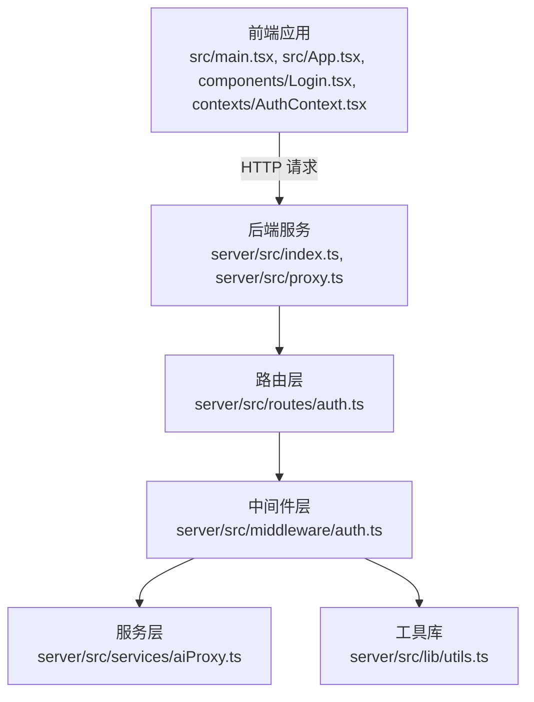
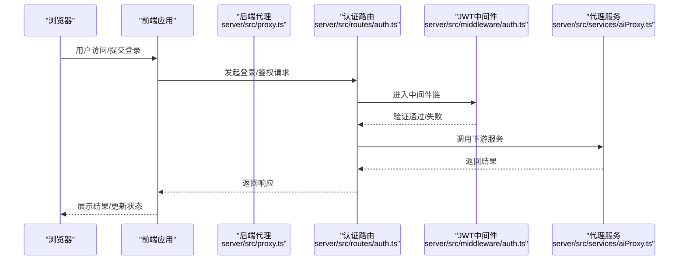
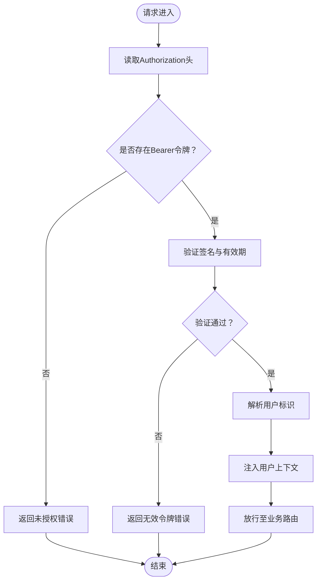
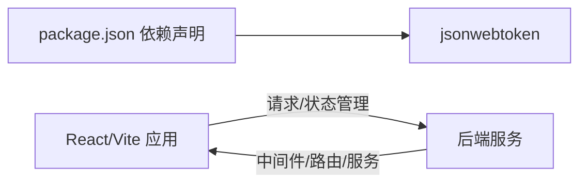

# 中间件体系

<cite>
**本文引用的文件**
- [index.tsx](file://src/main.tsx)
- [App.tsx](file://src/App.tsx)
- [AuthContext.tsx](file://contexts/AuthContext.tsx)
- [Login.tsx](file://components/Login.tsx)
- [package.json](file://package.json)
- [server/src/index.ts](file://server/src/index.ts)
- [server/src/proxy.ts](file://server/src/proxy.ts)
- [server/src/routes/auth.ts](file://server/src/routes/auth.ts)
- [server/src/middleware/auth.ts](file://server/src/middleware/auth.ts)
- [server/src/services/aiProxy.ts](file://server/src/services/aiProxy.ts)
- [server/src/lib/utils.ts](file://server/src/lib/utils.ts)
</cite>

## 目录
1. [简介](#简介)
2. [项目结构](#项目结构)
3. [核心组件](#核心组件)
4. [架构总览](#架构总览)
5. [详细组件分析](#详细组件分析)
6. [依赖分析](#依赖分析)
7. [性能考虑](#性能考虑)
8. [故障排查指南](#故障排查指南)
9. [结论](#结论)
10. [附录](#附录)

## 简介
本文件面向AI Shotlive中间件体系，聚焦JWT认证中间件的实现原理、令牌验证流程与用户身份验证机制，系统阐述中间件执行顺序、错误处理策略、认证失败响应格式、中间件与路由的关系、扩展新认证规则的方法，并提供配置示例、安全最佳实践与调试技巧。文档同时给出认证流程图与中间件链路分析，帮助开发者快速理解与维护认证子系统。

## 项目结构
AI Shotlive采用前后端分离架构：前端基于React/Vite构建，后端位于server/src目录，提供REST服务、中间件与路由层。认证相关的关键位置包括：
- 前端：登录页面、认证上下文、应用入口
- 后端：认证路由、JWT中间件、代理服务与通用工具库

图表来源
- [index.tsx](file://src/main.tsx)
- [App.tsx](file://src/App.tsx)
- [Login.tsx](file://components/Login.tsx)
- [AuthContext.tsx](file://contexts/AuthContext.tsx)
- [server/src/index.ts](file://server/src/index.ts)
- [server/src/proxy.ts](file://server/src/proxy.ts)
- [server/src/routes/auth.ts](file://server/src/routes/auth.ts)
- [server/src/middleware/auth.ts](file://server/src/middleware/auth.ts)
- [server/src/services/aiProxy.ts](file://server/src/services/aiProxy.ts)
- [server/src/lib/utils.ts](file://server/src/lib/utils.ts)

章节来源
- [index.tsx](file://src/main.tsx)
- [App.tsx](file://src/App.tsx)
- [Login.tsx](file://components/Login.tsx)
- [AuthContext.tsx](file://contexts/AuthContext.tsx)
- [server/src/index.ts](file://server/src/index.ts)
- [server/src/proxy.ts](file://server/src/proxy.ts)

## 核心组件
本节概述认证相关的核心组件及其职责：
- 前端登录与认证上下文：负责用户登录交互、令牌存储与全局状态管理
- 后端认证路由：处理登录、登出与令牌刷新等认证接口
- JWT认证中间件：统一拦截请求，校验Authorization头中的JWT令牌
- 代理服务：封装对外API调用，支持携带认证信息转发
- 工具库：提供通用的认证辅助函数（如解析令牌、生成响应）

章节来源
- [AuthContext.tsx](file://contexts/AuthContext.tsx)
- [Login.tsx](file://components/Login.tsx)
- [server/src/routes/auth.ts](file://server/src/routes/auth.ts)
- [server/src/middleware/auth.ts](file://server/src/middleware/auth.ts)
- [server/src/services/aiProxy.ts](file://server/src/services/aiProxy.ts)
- [server/src/lib/utils.ts](file://server/src/lib/utils.ts)

## 架构总览
下图展示从浏览器到后端服务的完整认证链路，突出中间件在路由前的拦截作用与代理服务的协作。

图表来源
- [server/src/proxy.ts](file://server/src/proxy.ts)
- [server/src/routes/auth.ts](file://server/src/routes/auth.ts)
- [server/src/middleware/auth.ts](file://server/src/middleware/auth.ts)
- [server/src/services/aiProxy.ts](file://server/src/services/aiProxy.ts)

## 详细组件分析

### JWT认证中间件
JWT中间件负责在进入具体路由处理逻辑之前，对请求进行统一的身份验证。其典型职责包括：
- 提取Authorization头中的Bearer令牌
- 校验签名与有效期
- 解析用户标识并注入到请求上下文
- 对无效或过期令牌返回标准化错误

中间件执行顺序与链路
- 在路由注册时，先挂载认证中间件，再挂载业务路由
- 每个受保护路由都会经过中间件链，确保统一的安全策略
- 失败时立即终止后续处理，返回错误响应

错误处理策略
- 未携带令牌：返回未授权状态码与标准错误体
- 令牌格式不正确：返回参数错误状态码与错误信息
- 签名验证失败/已过期：返回无效令牌状态码与提示
- 其他异常：返回内部错误状态码与日志追踪号

认证失败响应格式
- 统一字段：状态码、错误类型、消息、可选追踪ID
- 示例字段结构（路径参考）：[server/src/lib/utils.ts](file://server/src/lib/utils.ts)

中间件与路由的关系
- 受保护路由通常以中间件包裹或在路由前统一挂载
- 例外路由（如登录、健康检查）跳过中间件
- 中间件仅处理Authorization头，不关心具体业务逻辑

扩展新的认证规则
- 新增规则：在中间件中添加新的校验步骤（如角色、租户）
- 路由分组：按规则对路由进行分组，选择性挂载中间件
- 配置化：通过环境变量或配置表控制是否启用某类校验

章节来源
- [server/src/middleware/auth.ts](file://server/src/middleware/auth.ts)
- [server/src/lib/utils.ts](file://server/src/lib/utils.ts)

### 认证流程图
以下流程图描述了典型的JWT认证过程，涵盖令牌提取、验证与失败处理。

图表来源
- [server/src/middleware/auth.ts](file://server/src/middleware/auth.ts)
- [server/src/lib/utils.ts](file://server/src/lib/utils.ts)

### 前端认证上下文与登录页
前端通过认证上下文管理登录状态与令牌，登录页负责收集凭据并发起登录请求。关键点：
- 登录成功后持久化令牌
- 将令牌设置到后续请求的Authorization头
- 登录失败时展示错误信息并阻止继续操作

章节来源
- [AuthContext.tsx](file://contexts/AuthContext.tsx)
- [Login.tsx](file://components/Login.tsx)

### 后端认证路由与代理服务
- 认证路由：提供登录、登出、刷新等接口，返回标准化响应
- 代理服务：封装对外API调用，支持携带认证信息转发请求
- 工具库：提供统一的响应构造、错误转换与日志记录

章节来源
- [server/src/routes/auth.ts](file://server/src/routes/auth.ts)
- [server/src/services/aiProxy.ts](file://server/src/services/aiProxy.ts)
- [server/src/lib/utils.ts](file://server/src/lib/utils.ts)

## 依赖分析
- 前端依赖：React、TailwindCSS、TypeScript等，用于构建UI与状态管理
- 后端依赖：jsonwebtoken等用于JWT处理；Express/Koa等用于HTTP服务（根据实际实现）
- 中间件与路由：中间件在路由前执行，形成统一的认证拦截层
- 代理与服务：代理服务依赖中间件提供的用户上下文，向下游服务转发请求

图表来源
- [package.json](file://package.json)
- [server/src/middleware/auth.ts](file://server/src/middleware/auth.ts)
- [server/src/routes/auth.ts](file://server/src/routes/auth.ts)
- [server/src/services/aiProxy.ts](file://server/src/services/aiProxy.ts)

章节来源
- [package.json](file://package.json)

## 性能考虑
- 令牌缓存：对频繁访问的用户令牌进行短期缓存，减少重复验证开销
- 异步验证：在高并发场景下，避免阻塞主线程，使用异步验证与超时控制
- 响应压缩：对认证相关的小型响应启用压缩，降低带宽占用
- 日志采样：生产环境对认证日志进行采样，避免过多I/O影响性能

## 故障排查指南
常见问题与定位方法：
- 401未授权：检查Authorization头格式与令牌是否过期
- 403禁止访问：检查用户权限与角色校验逻辑
- 500内部错误：查看中间件与服务的日志，定位异常堆栈
- 代理失败：确认代理服务的下游地址与超时设置

调试技巧：
- 使用浏览器开发者工具观察请求头与响应体
- 在中间件中打印关键信息（如令牌摘要、用户ID），便于排错
- 临时关闭中间件验证，隔离问题范围
- 使用独立脚本模拟认证请求，验证中间件行为

章节来源
- [server/src/middleware/auth.ts](file://server/src/middleware/auth.ts)
- [server/src/lib/utils.ts](file://server/src/lib/utils.ts)

## 结论
AI Shotlive的中间件体系以JWT认证为核心，通过统一的中间件链实现跨路由的一致性安全控制。结合前端认证上下文与后端代理服务，形成了完整的认证闭环。建议在生产环境中强化令牌轮换、日志审计与限流策略，并持续优化中间件性能与可观测性。

## 附录
- 中间件配置示例（路径参考）：[server/src/middleware/auth.ts](file://server/src/middleware/auth.ts)
- 认证失败响应格式（路径参考）：[server/src/lib/utils.ts](file://server/src/lib/utils.ts)
- 安全最佳实践
  - 严格校验令牌签名与有效期
  - 使用HTTPS传输，避免令牌泄露
  - 定期轮换密钥，缩短令牌有效期
  - 对敏感操作增加二次校验（如短信/邮箱验证码）
  - 限制请求频率，防止暴力破解
- 调试技巧
  - 在中间件中输出令牌摘要与用户ID
  - 使用Postman或curl手动构造请求，验证中间件行为
  - 分别测试有效/无效/过期令牌，覆盖所有分支