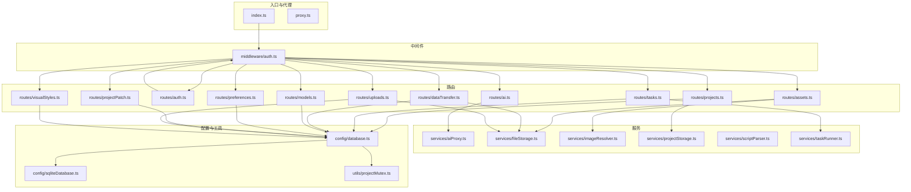
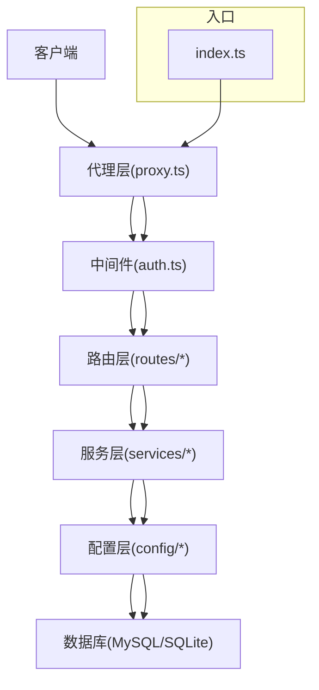
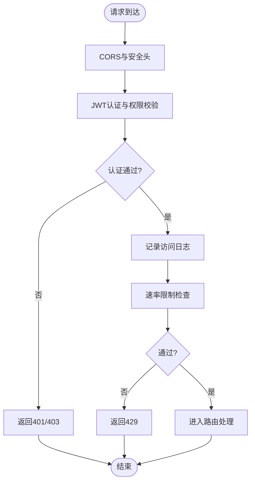
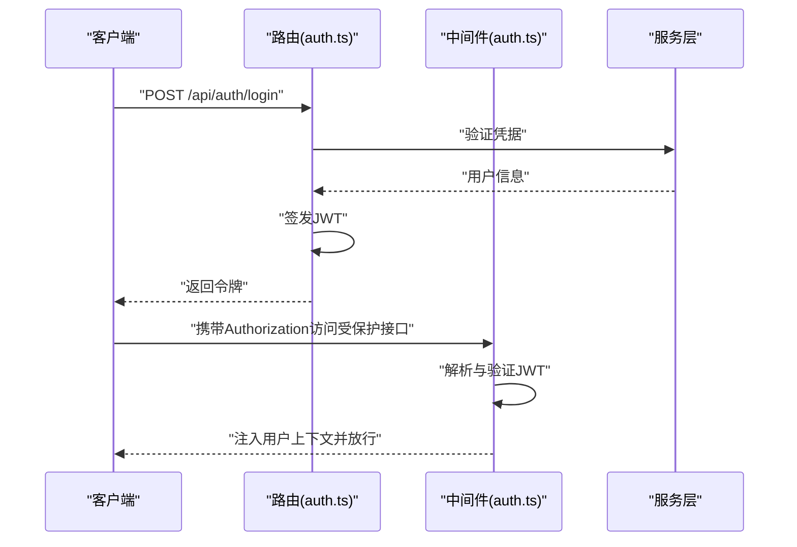
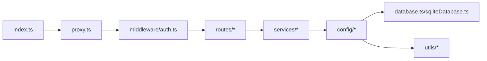

# 后端架构设计

<cite>
**本文引用的文件**
- [index.ts](file://server/src/index.ts)
- [proxy.ts](file://server/src/proxy.ts)
- [auth.ts](file://server/src/middleware/auth.ts)
- [database.ts](file://server/src/config/database.ts)
- [sqliteDatabase.ts](file://server/src/config/sqliteDatabase.ts)
- [ai.ts](file://server/src/routes/ai.ts)
- [assets.ts](file://server/src/routes/assets.ts)
- [authRoutes.ts](file://server/src/routes/auth.ts)
- [dataTransfer.ts](file://server/src/routes/dataTransfer.ts)
- [models.ts](file://server/src/routes/models.ts)
- [preferences.ts](file://server/src/routes/preferences.ts)
- [projectPatch.ts](file://server/src/routes/projectPatch.ts)
- [projects.ts](file://server/src/routes/projects.ts)
- [tasks.ts](file://server/src/routes/tasks.ts)
- [uploads.ts](file://server/src/routes/uploads.ts)
- [visualStyles.ts](file://server/src/routes/visualStyles.ts)
- [aiProxy.ts](file://server/src/services/aiProxy.ts)
- [fileStorage.ts](file://server/src/services/fileStorage.ts)
- [imageResolver.ts](file://server/src/services/imageResolver.ts)
- [projectStorage.ts](file://server/src/services/projectStorage.ts)
- [scriptParser.ts](file://server/src/services/scriptParser.ts)
- [taskRunner.ts](file://server/src/services/taskRunner.ts)
- [projectMutex.ts](file://server/src/utils/projectMutex.ts)
</cite>

## 目录
1. [引言](#引言)
2. [项目结构](#项目结构)
3. [核心组件](#核心组件)
4. [架构总览](#架构总览)
5. [详细组件分析](#详细组件分析)
6. [依赖关系分析](#依赖关系分析)
7. [性能考虑](#性能考虑)
8. [故障排除指南](#故障排除指南)
9. [结论](#结论)
10. [附录](#附录)

## 引言
本文件面向AI Shotlive后端架构，系统性梳理Express服务器设计模式、中间件体系、RESTful API架构、用户认证与授权机制（含JWT）、数据访问层设计、数据库连接与事务、用户数据隔离策略、API路由设计、错误处理与安全防护，并提供路由配置示例与性能优化建议。由于仓库中后端源码位于server/src目录，本文所有技术细节均基于该目录下的实际实现进行分析与总结。

## 项目结构
后端采用分层架构：入口与代理层、中间件层、路由层、服务层、配置与工具层。整体以模块化方式组织，便于扩展与维护。

图表来源
- [index.ts](file://server/src/index.ts)
- [proxy.ts](file://server/src/proxy.ts)
- [auth.ts](file://server/src/middleware/auth.ts)
- [ai.ts](file://server/src/routes/ai.ts)
- [assets.ts](file://server/src/routes/assets.ts)
- [authRoutes.ts](file://server/src/routes/auth.ts)
- [dataTransfer.ts](file://server/src/routes/dataTransfer.ts)
- [models.ts](file://server/src/routes/models.ts)
- [preferences.ts](file://server/src/routes/preferences.ts)
- [projectPatch.ts](file://server/src/routes/projectPatch.ts)
- [projects.ts](file://server/src/routes/projects.ts)
- [tasks.ts](file://server/src/routes/tasks.ts)
- [uploads.ts](file://server/src/routes/uploads.ts)
- [visualStyles.ts](file://server/src/routes/visualStyles.ts)
- [aiProxy.ts](file://server/src/services/aiProxy.ts)
- [fileStorage.ts](file://server/src/services/fileStorage.ts)
- [imageResolver.ts](file://server/src/services/imageResolver.ts)
- [projectStorage.ts](file://server/src/services/projectStorage.ts)
- [scriptParser.ts](file://server/src/services/scriptParser.ts)
- [taskRunner.ts](file://server/src/services/taskRunner.ts)
- [database.ts](file://server/src/config/database.ts)
- [sqliteDatabase.ts](file://server/src/config/sqliteDatabase.ts)
- [projectMutex.ts](file://server/src/utils/projectMutex.ts)

章节来源
- [index.ts](file://server/src/index.ts)
- [proxy.ts](file://server/src/proxy.ts)

## 核心组件
- Express入口与代理
  - 入口文件负责启动HTTP/HTTPS服务器、加载中间件、注册路由与错误处理。
  - 代理文件用于处理上游请求转发、跨域与安全头设置。
- 中间件体系
  - 认证中间件统一处理JWT解析、用户上下文注入与权限校验。
  - 日志、限流、CORS、安全头等中间件按需启用。
- 路由层
  - 按功能域划分路由模块，如认证、项目、任务、资产、模型、偏好、补丁、上传、视觉风格、AI代理等。
- 服务层
  - AI代理服务、文件存储、图像解析、项目存储、脚本解析、任务执行器等。
- 配置与工具
  - 数据库配置（MySQL/SQLite）、互斥锁工具保障并发一致性。

章节来源
- [index.ts](file://server/src/index.ts)
- [proxy.ts](file://server/src/proxy.ts)
- [auth.ts](file://server/src/middleware/auth.ts)
- [database.ts](file://server/src/config/database.ts)
- [sqliteDatabase.ts](file://server/src/config/sqliteDatabase.ts)
- [projectMutex.ts](file://server/src/utils/projectMutex.ts)

## 架构总览
后端采用“入口-中间件-路由-服务-配置”的分层设计，通过中间件实现横切关注点（认证、日志、安全），路由聚焦业务域，服务封装具体能力，配置与工具提供基础设施支撑。

图表来源
- [index.ts](file://server/src/index.ts)
- [proxy.ts](file://server/src/proxy.ts)
- [auth.ts](file://server/src/middleware/auth.ts)
- [ai.ts](file://server/src/routes/ai.ts)
- [assets.ts](file://server/src/routes/assets.ts)
- [authRoutes.ts](file://server/src/routes/auth.ts)
- [projects.ts](file://server/src/routes/projects.ts)
- [tasks.ts](file://server/src/routes/tasks.ts)
- [aiProxy.ts](file://server/src/services/aiProxy.ts)
- [fileStorage.ts](file://server/src/services/fileStorage.ts)
- [projectStorage.ts](file://server/src/services/projectStorage.ts)
- [database.ts](file://server/src/config/database.ts)
- [sqliteDatabase.ts](file://server/src/config/sqliteDatabase.ts)

## 详细组件分析

### Express服务器与入口设计
- 服务器启动流程
  - 初始化Express应用，加载中间件，注册路由，配置错误处理器与404处理。
  - 支持HTTP/HTTPS，监听环境变量端口。
- 控制流
  - 请求进入后经代理层预处理，再进入中间件链，最后由路由匹配到对应控制器。
- 设计要点
  - 将静态资源、CORS、安全头、速率限制等作为通用中间件前置。
  - 错误处理中间件统一捕获异常并返回标准化响应。

章节来源
- [index.ts](file://server/src/index.ts)
- [proxy.ts](file://server/src/proxy.ts)

### 中间件体系
- 认证中间件
  - 解析Authorization头中的JWT，验证签名与有效期，解析用户信息并注入到请求上下文。
  - 支持白名单路由（如登录）跳过认证。
- 安全中间件
  - 设置安全头（如X-Content-Type-Options、X-Frame-Options、Strict-Transport-Security等）。
  - 统一CORS策略，限定来源与方法。
- 日志与限流
  - 请求日志记录与IP级限流，防止滥用。

图表来源
- [auth.ts](file://server/src/middleware/auth.ts)

章节来源
- [auth.ts](file://server/src/middleware/auth.ts)

### RESTful API架构与路由设计
- 路由分层
  - 按业务域拆分路由模块，每个模块独立导出路由器，集中注册到主应用。
  - 示例模块：认证、项目、任务、资产、模型、偏好、补丁、上传、视觉风格、AI代理、数据传输。
- 路由命名规范
  - 使用名词复数形式表示集合资源；使用ID或键名表示单个资源。
  - 动作类操作使用动词短语，如“/projects/:id/export”。
- 参数与查询
  - 路径参数用于定位资源；查询参数用于过滤、排序、分页。
- 响应格式
  - 成功响应统一为JSON对象，包含状态码、消息与数据字段；错误响应包含错误码与描述。

章节来源
- [authRoutes.ts](file://server/src/routes/auth.ts)
- [projects.ts](file://server/src/routes/projects.ts)
- [tasks.ts](file://server/src/routes/tasks.ts)
- [assets.ts](file://server/src/routes/assets.ts)
- [models.ts](file://server/src/routes/models.ts)
- [preferences.ts](file://server/src/routes/preferences.ts)
- [projectPatch.ts](file://server/src/routes/projectPatch.ts)
- [uploads.ts](file://server/src/routes/uploads.ts)
- [visualStyles.ts](file://server/src/routes/visualStyles.ts)
- [ai.ts](file://server/src/routes/ai.ts)
- [dataTransfer.ts](file://server/src/routes/dataTransfer.ts)

### 用户认证与授权机制（JWT）
- 登录与令牌签发
  - 用户凭据验证通过后生成JWT，设置合理过期时间与签名算法。
  - 返回访问令牌与刷新令牌（可选），刷新令牌单独存储与校验。
- 令牌解析与上下文注入
  - 中间件从Authorization头提取Bearer令牌，验证签名与有效期。
  - 解析出的用户信息写入请求上下文，供后续处理器使用。
- 授权策略
  - 基于角色或资源所有权的授权，例如仅项目所有者可修改项目。
  - 白名单路由允许未认证访问（如登录、注册）。
- 会话与并发
  - 可选引入会话表或Redis缓存黑名单，支持强制失效与快速撤销。

图表来源
- [authRoutes.ts](file://server/src/routes/auth.ts)
- [auth.ts](file://server/src/middleware/auth.ts)

章节来源
- [authRoutes.ts](file://server/src/routes/auth.ts)
- [auth.ts](file://server/src/middleware/auth.ts)

### 数据访问层设计
- 数据库配置
  - 提供MySQL与SQLite双栈配置，按环境选择驱动与连接参数。
  - 连接池参数（最大连接数、超时、重试）在配置中集中管理。
- 事务处理
  - 对需要一致性的写操作组合使用事务，失败回滚，成功提交。
  - 读写分离与只读事务用于提升吞吐量。
- 用户数据隔离
  - 所有数据查询与更新均附加用户维度过滤条件，避免越权访问。
  - 资源ID采用UUID并结合用户ID派生策略，降低碰撞风险。
- 并发控制
  - 使用互斥锁工具对关键资源加锁，避免竞态条件。
  - 对热点资源采用乐观锁版本号或悲观锁策略。

章节来源
- [database.ts](file://server/src/config/database.ts)
- [sqliteDatabase.ts](file://server/src/config/sqliteDatabase.ts)
- [projectMutex.ts](file://server/src/utils/projectMutex.ts)

### 服务层与业务编排
- AI代理服务
  - 封装第三方AI能力调用，统一错误处理与重试策略。
- 文件存储与图像解析
  - 提供本地/云存储抽象，支持文件上传、下载与元数据管理。
  - 图像解析服务负责尺寸、格式与质量转换。
- 项目存储与脚本解析
  - 项目数据持久化与版本化管理，脚本解析服务负责文本到结构化数据的转换。
- 任务执行器
  - 任务队列与调度，支持异步执行与进度上报。

章节来源
- [aiProxy.ts](file://server/src/services/aiProxy.ts)
- [fileStorage.ts](file://server/src/services/fileStorage.ts)
- [imageResolver.ts](file://server/src/services/imageResolver.ts)
- [projectStorage.ts](file://server/src/services/projectStorage.ts)
- [scriptParser.ts](file://server/src/services/scriptParser.ts)
- [taskRunner.ts](file://server/src/services/taskRunner.ts)

### 错误处理机制
- 统一错误格式
  - 包含错误码、消息、时间戳与可选详情字段。
- 分层处理
  - 路由层捕获业务异常，服务层抛出自定义异常，中间件统一转换为HTTP响应。
- 未捕获异常
  - 全局未捕获异常处理器记录堆栈并返回通用错误。
- 安全性
  - 不向客户端暴露内部错误细节，仅记录必要信息。

章节来源
- [index.ts](file://server/src/index.ts)

### 安全防护措施
- 输入验证与清洗
  - 对所有输入参数进行白名单校验与长度/范围限制。
- 速率限制与防刷
  - 基于IP与用户维度的限流策略，阻断恶意请求。
- CORS与安全头
  - 精确控制来源、方法与头部，设置XSS、点击劫持等防护头。
- 敏感数据保护
  - 密钥与令牌不落盘或加密存储；日志脱敏。
- 传输安全
  - 强制HTTPS与TLS最小版本要求。

章节来源
- [auth.ts](file://server/src/middleware/auth.ts)
- [proxy.ts](file://server/src/proxy.ts)

### 路由配置示例（路径指引）
以下为典型路由模块的注册与使用路径，便于快速定位实现位置：
- 认证路由
  - [routes/auth.ts](file://server/src/routes/auth.ts)
- 项目路由
  - [routes/projects.ts](file://server/src/routes/projects.ts)
- 任务路由
  - [routes/tasks.ts](file://server/src/routes/tasks.ts)
- 资产路由
  - [routes/assets.ts](file://server/src/routes/assets.ts)
- 模型路由
  - [routes/models.ts](file://server/src/routes/models.ts)
- 偏好路由
  - [routes/preferences.ts](file://server/src/routes/preferences.ts)
- 补丁路由
  - [routes/projectPatch.ts](file://server/src/routes/projectPatch.ts)
- 上传路由
  - [routes/uploads.ts](file://server/src/routes/uploads.ts)
- 视觉风格路由
  - [routes/visualStyles.ts](file://server/src/routes/visualStyles.ts)
- AI代理路由
  - [routes/ai.ts](file://server/src/routes/ai.ts)
- 数据传输路由
  - [routes/dataTransfer.ts](file://server/src/routes/dataTransfer.ts)

章节来源
- [authRoutes.ts](file://server/src/routes/auth.ts)
- [projects.ts](file://server/src/routes/projects.ts)
- [tasks.ts](file://server/src/routes/tasks.ts)
- [assets.ts](file://server/src/routes/assets.ts)
- [models.ts](file://server/src/routes/models.ts)
- [preferences.ts](file://server/src/routes/preferences.ts)
- [projectPatch.ts](file://server/src/routes/projectPatch.ts)
- [uploads.ts](file://server/src/routes/uploads.ts)
- [visualStyles.ts](file://server/src/routes/visualStyles.ts)
- [ai.ts](file://server/src/routes/ai.ts)
- [dataTransfer.ts](file://server/src/routes/dataTransfer.ts)

## 依赖关系分析
后端各层之间呈现清晰的依赖方向：入口依赖代理，代理依赖中间件，中间件依赖路由，路由依赖服务，服务依赖配置，配置依赖数据库与工具。

图表来源
- [index.ts](file://server/src/index.ts)
- [proxy.ts](file://server/src/proxy.ts)
- [auth.ts](file://server/src/middleware/auth.ts)
- [database.ts](file://server/src/config/database.ts)
- [sqliteDatabase.ts](file://server/src/config/sqliteDatabase.ts)
- [projectMutex.ts](file://server/src/utils/projectMutex.ts)

章节来源
- [index.ts](file://server/src/index.ts)
- [proxy.ts](file://server/src/proxy.ts)
- [auth.ts](file://server/src/middleware/auth.ts)
- [database.ts](file://server/src/config/database.ts)
- [sqliteDatabase.ts](file://server/src/config/sqliteDatabase.ts)
- [projectMutex.ts](file://server/src/utils/projectMutex.ts)

## 性能考虑
- 连接池与数据库优化
  - 合理设置最大连接数与超时，开启连接复用与健康检查。
  - 对高频查询建立索引，避免N+1查询。
- 缓存策略
  - 对热点读取结果进行缓存，结合TTL与失效策略。
- 异步与并发
  - 使用异步I/O与事件循环，避免阻塞操作。
  - 对高耗时任务放入队列异步执行，前端轮询或WebSocket推送结果。
- 负载均衡与水平扩展
  - 多实例部署，共享缓存与数据库，使用反向代理分发请求。
- 监控与告警
  - 指标采集（QPS、P95/P99延迟、错误率、数据库连接数）与日志聚合。

## 故障排除指南
- 常见问题定位
  - 401/403：检查JWT是否过期、签名是否正确、用户是否存在。
  - 403越权：确认资源归属与授权策略是否生效。
  - 500内部错误：查看全局错误处理器输出的日志与堆栈。
- 数据库问题
  - 连接失败：核对连接字符串、网络连通性与防火墙规则。
  - 死锁/超时：检查事务范围与锁粒度，优化索引与查询。
- 并发冲突
  - 使用互斥锁工具保护关键路径，避免竞态。
- 日志与追踪
  - 开启请求ID与上下文日志，便于跨服务追踪。

章节来源
- [index.ts](file://server/src/index.ts)
- [auth.ts](file://server/src/middleware/auth.ts)
- [database.ts](file://server/src/config/database.ts)
- [sqliteDatabase.ts](file://server/src/config/sqliteDatabase.ts)
- [projectMutex.ts](file://server/src/utils/projectMutex.ts)

## 结论
AI Shotlive后端采用清晰的分层架构与模块化设计，通过中间件实现横切关注点，路由聚焦业务域，服务封装能力，配置与工具提供基础设施支撑。配合JWT认证、数据隔离与并发控制，满足多用户场景下的安全性与一致性需求。建议持续完善监控与缓存策略，进一步提升性能与稳定性。

## 附录
- 部署建议
  - 使用容器化部署，分离数据库与应用，启用健康检查与自动重启。
  - 配置反向代理（如Nginx）统一入口、证书与限流。
- 开发规范
  - 统一错误格式与日志规范，严格输入校验与权限控制。
  - 对外暴露的API必须具备完善的文档与版本管理。