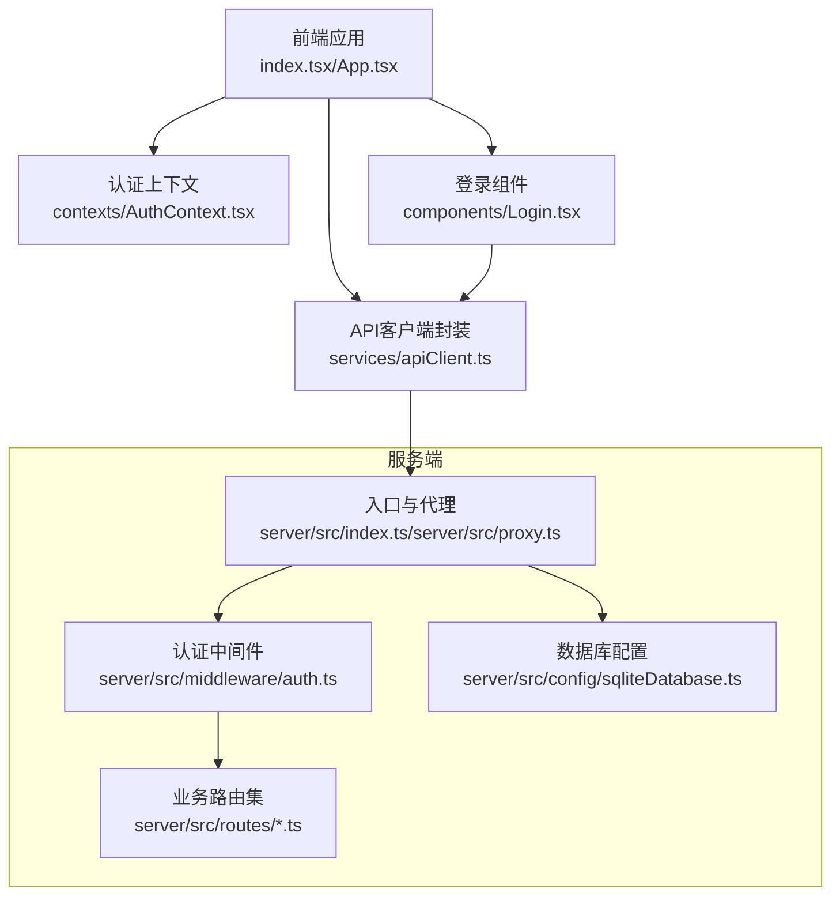
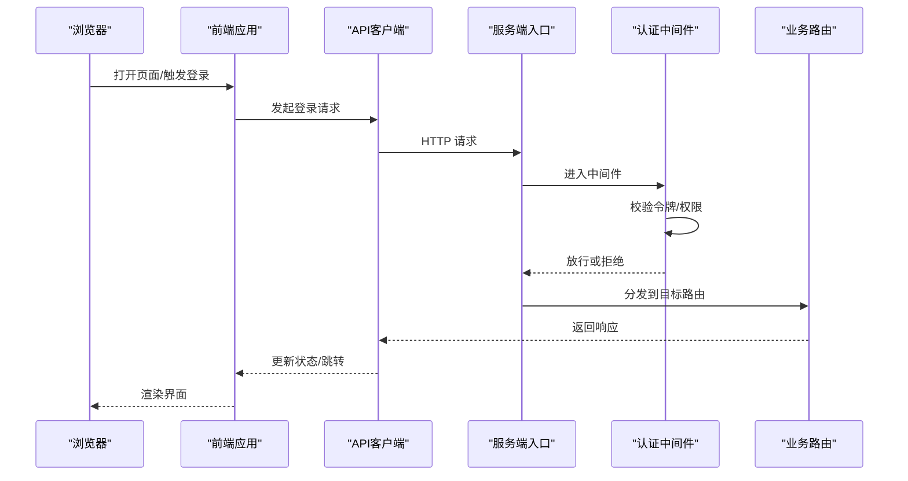
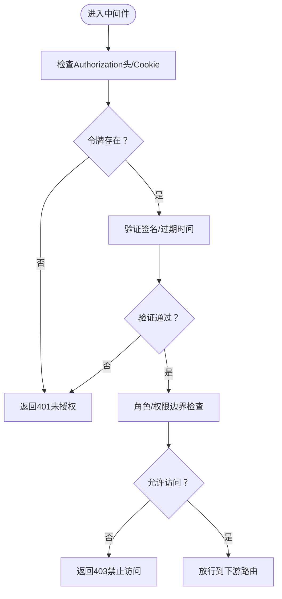
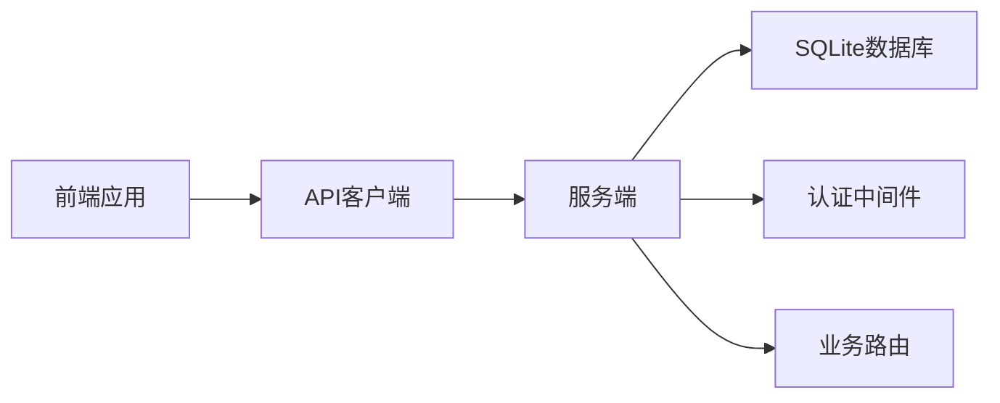
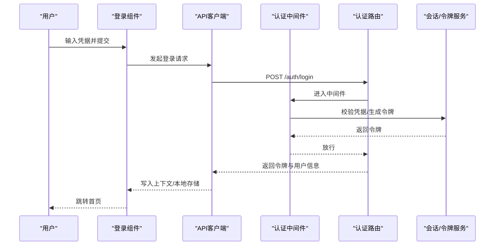

# 安全与认证

<cite>
**本文引用的文件**
- [index.tsx](file://index.tsx)
- [App.tsx](file://App.tsx)
- [types.ts](file://types.ts)
- [vite.config.ts](file://vite.config.ts)
- [nginx.conf](file://nginx.conf)
- [server/src/index.ts](file://server/src/index.ts)
- [server/src/proxy.ts](file://server/src/proxy.ts)
- [server/src/config/sqliteDatabase.ts](file://server/src/config/sqliteDatabase.ts)
- [server/src/middleware/auth.ts](file://server/src/middleware/auth.ts)
- [server/src/routes/auth.ts](file://server/src/routes/auth.ts)
- [server/src/routes/projects.ts](file://server/src/routes/projects.ts)
- [server/src/routes/tasks.ts](file://server/src/routes/tasks.ts)
- [server/src/routes/assets.ts](file://server/src/routes/assets.ts)
- [server/src/routes/models.ts](file://server/src/routes/models.ts)
- [server/src/routes/preferences.ts](file://server/src/routes/preferences.ts)
- [server/src/routes/projectPatch.ts](file://server/src/routes/projectPatch.ts)
- [server/src/routes/uploads.ts](file://server/src/routes/uploads.ts)
- [server/src/routes/visualStyles.ts](file://server/src/routes/visualStyles.ts)
- [server/src/routes/dataTransfer.ts](file://server/src/routes/dataTransfer.ts)
- [server/src/routes/ai.ts](file://server/src/routes/ai.ts)
- [contexts/AuthContext.tsx](file://contexts/AuthContext.tsx)
- [components/Login.tsx](file://components/Login.tsx)
- [lib/utils.ts](file://lib/utils.ts)
- [electron/main.ts](file://electron/main.ts)
- [electron/preload.ts](file://electron/preload.ts)
- [electron/tsconfig.json](file://electron/tsconfig.json)
- [services/apiClient.ts](file://services/apiClient.ts)
- [services/storageService.ts](file://services/storageService.ts)
- [services/taskService.ts](file://services/taskService.ts)
- [services/modelService.ts](file://services/modelService.ts)
- [services/assetLibraryService.ts](file://services/assetLibraryService.ts)
- [services/exportService.ts](file://services/exportService.ts)
- [services/renderLogService.ts](file://services/renderLogService.ts)
- [services/visualStyleService.ts](file://services/visualStyleService.ts)
- [services/novelParser.ts](file://services/novelParser.ts)
- [services/projectPatchService.ts](file://services/projectPatchService.ts)
- [services/modelConfigService.ts](file://services/modelConfigService.ts)
- [services/adapters/index.ts](file://services/adapters/index.ts)
- [services/adapters/chatAdapter.ts](file://services/adapters/chatAdapter.ts)
- [services/adapters/imageAdapter.ts](file://services/adapters/imageAdapter.ts)
- [services/adapters/videoAdapter.ts](file://services/adapters/videoAdapter.ts)
- [services/adapters/dashscopeVideoAdapter.ts](file://services/adapters/dashscopeVideoAdapter.ts)
- [services/adapters/volcengineVideoAdapter.ts](file://services/adapters/volcengineVideoAdapter.ts)
- [README.md](file://README.md)
- [docker使用.md](file://docker使用.md)
- [docker-compose.yaml](file://docker-compose.yaml)
- [docker-compose.mysql.yaml](file://docker-compose.mysql.yaml)
- [Dockerfile](file://Dockerfile)
</cite>

## 目录
1. [简介](#简介)
2. [项目结构](#项目结构)
3. [核心组件](#核心组件)
4. [架构总览](#架构总览)
5. [详细组件分析](#详细组件分析)
6. [依赖关系分析](#依赖关系分析)
7. [性能考虑](#性能考虑)
8. [故障排查指南](#故障排查指南)
9. [结论](#结论)
10. [附录](#附录)

## 简介
本文件面向AI Shotlive的安全与认证体系，聚焦以下主题：JWT令牌生成与验证、用户密码加密存储、会话管理机制；CSRF防护、XSS防护、SQL注入防护策略；用户权限控制、角色管理与数据访问控制；认证流程示例、安全配置指南与漏洞防护措施，并提供安全架构图与认证流程图。本文严格基于仓库中实际存在的源码文件进行分析与说明。

## 项目结构
AI Shotlive采用前端Vite应用（React）+ Electron打包 + Node.js服务端（Express/Koa风格路由）的混合架构。安全相关的关键位置包括：
- 前端入口与上下文：index.tsx、App.tsx、contexts/AuthContext.tsx、components/Login.tsx
- 服务端入口与代理：server/src/index.ts、server/src/proxy.ts
- 路由与中间件：server/src/routes/*、server/src/middleware/auth.ts
- 配置与数据库：server/src/config/sqliteDatabase.ts
- 客户端工具与服务封装：services/*、lib/utils.ts
- 构建与部署：vite.config.ts、nginx.conf、Dockerfile、docker-compose*.yaml

**图表来源**
- [index.tsx](file://index.tsx)
- [App.tsx](file://App.tsx)
- [contexts/AuthContext.tsx](file://contexts/AuthContext.tsx)
- [components/Login.tsx](file://components/Login.tsx)
- [server/src/index.ts](file://server/src/index.ts)
- [server/src/proxy.ts](file://server/src/proxy.ts)
- [server/src/middleware/auth.ts](file://server/src/middleware/auth.ts)
- [server/src/config/sqliteDatabase.ts](file://server/src/config/sqliteDatabase.ts)

**章节来源**
- [index.tsx](file://index.tsx)
- [App.tsx](file://App.tsx)
- [contexts/AuthContext.tsx](file://contexts/AuthContext.tsx)
- [components/Login.tsx](file://components/Login.tsx)
- [server/src/index.ts](file://server/src/index.ts)
- [server/src/proxy.ts](file://server/src/proxy.ts)
- [server/src/config/sqliteDatabase.ts](file://server/src/config/sqliteDatabase.ts)

## 核心组件
- 认证上下文与登录组件：负责前端状态管理与登录交互，承载用户态信息与会话生命周期管理。
- 服务端认证中间件：统一拦截请求，校验令牌有效性与权限边界。
- 业务路由：围绕资源（项目、任务、资产、模型等）定义受控接口。
- 数据库配置：集中管理SQLite连接与初始化逻辑。
- API客户端封装：统一封装HTTP请求、错误处理与重试策略。
- Electron主进程与预加载脚本：隔离渲染进程与系统能力，限制Node集成以降低攻击面。

**章节来源**
- [contexts/AuthContext.tsx](file://contexts/AuthContext.tsx)
- [components/Login.tsx](file://components/Login.tsx)
- [server/src/middleware/auth.ts](file://server/src/middleware/auth.ts)
- [server/src/routes/projects.ts](file://server/src/routes/projects.ts)
- [server/src/routes/tasks.ts](file://server/src/routes/tasks.ts)
- [server/src/routes/assets.ts](file://server/src/routes/assets.ts)
- [server/src/routes/models.ts](file://server/src/routes/models.ts)
- [server/src/config/sqliteDatabase.ts](file://server/src/config/sqliteDatabase.ts)
- [services/apiClient.ts](file://services/apiClient.ts)
- [electron/main.ts](file://electron/main.ts)
- [electron/preload.ts](file://electron/preload.ts)

## 架构总览
下图展示从浏览器到服务端的典型请求链路，强调认证中间件对所有受保护路由的拦截与授权判定。

**图表来源**
- [server/src/index.ts](file://server/src/index.ts)
- [server/src/middleware/auth.ts](file://server/src/middleware/auth.ts)
- [server/src/routes/auth.ts](file://server/src/routes/auth.ts)
- [services/apiClient.ts](file://services/apiClient.ts)

## 详细组件分析

### 认证上下文与登录组件
- 认证上下文负责维护用户登录态、令牌存储与刷新策略，以及登出清理逻辑。
- 登录组件负责收集凭据、调用API客户端发起登录请求，并在成功后写入上下文状态。
- 建议：令牌持久化应使用安全的HttpOnly Cookie或受限存储；避免明文存储敏感信息。

**章节来源**
- [contexts/AuthContext.tsx](file://contexts/AuthContext.tsx)
- [components/Login.tsx](file://components/Login.tsx)

### 服务端认证中间件
- 中间件统一拦截请求，执行以下校验：
  - 令牌存在性与格式校验
  - 令牌签名与有效期验证
  - 角色/权限边界检查
  - 受保护路由白名单与放行规则
- 对未通过校验的请求返回401/403，并记录审计日志。

**图表来源**
- [server/src/middleware/auth.ts](file://server/src/middleware/auth.ts)

**章节来源**
- [server/src/middleware/auth.ts](file://server/src/middleware/auth.ts)

### 业务路由与数据访问控制
- 项目、任务、资产、模型、偏好设置、上传、视觉风格、数据传输、AI代理等路由均受中间件保护。
- 每个路由在处理前先经中间件校验，再根据资源归属与用户角色决定是否放行。
- 建议：每个路由实现最小权限原则的数据过滤与输出脱敏。

**章节来源**
- [server/src/routes/projects.ts](file://server/src/routes/projects.ts)
- [server/src/routes/tasks.ts](file://server/src/routes/tasks.ts)
- [server/src/routes/assets.ts](file://server/src/routes/assets.ts)
- [server/src/routes/models.ts](file://server/src/routes/models.ts)
- [server/src/routes/preferences.ts](file://server/src/routes/preferences.ts)
- [server/src/routes/projectPatch.ts](file://server/src/routes/projectPatch.ts)
- [server/src/routes/uploads.ts](file://server/src/routes/uploads.ts)
- [server/src/routes/visualStyles.ts](file://server/src/routes/visualStyles.ts)
- [server/src/routes/dataTransfer.ts](file://server/src/routes/dataTransfer.ts)
- [server/src/routes/ai.ts](file://server/src/routes/ai.ts)

### 数据库与密码存储
- SQLite数据库配置集中于配置模块，负责连接建立与初始化。
- 密码存储建议采用强哈希算法（如Argon2/Scrypt/Bcrypt），并确保每用户盐值唯一。
- 建议：对数据库连接启用只读模式（仅在需要时临时提升权限），并开启WAL模式提升并发。

**章节来源**
- [server/src/config/sqliteDatabase.ts](file://server/src/config/sqliteDatabase.ts)

### API客户端封装与安全传输
- API客户端统一封装HTTP请求、错误处理与重试策略，支持拦截器注入。
- 建议：默认启用HTTPS、禁用明文传输；在Electron中通过CSP与安全头部强化传输安全。

**章节来源**
- [services/apiClient.ts](file://services/apiClient.ts)

### Electron安全边界
- 主进程与渲染进程通过预加载脚本隔离，限制Node.js能力暴露。
- 建议：启用contextIsolation、关闭nodeIntegration、设置合适的CSP与安全头部。

**章节来源**
- [electron/main.ts](file://electron/main.ts)
- [electron/preload.ts](file://electron/preload.ts)

## 依赖关系分析
- 前端依赖：React生态、Vite构建、Electron打包。
- 服务端依赖：Node.js运行时、Express/Koa风格路由、SQLite驱动。
- 客户端服务：各功能域服务（项目、任务、资产、导出等）通过API客户端聚合。

**图表来源**
- [services/apiClient.ts](file://services/apiClient.ts)
- [server/src/index.ts](file://server/src/index.ts)
- [server/src/config/sqliteDatabase.ts](file://server/src/config/sqliteDatabase.ts)
- [server/src/middleware/auth.ts](file://server/src/middleware/auth.ts)

**章节来源**
- [services/apiClient.ts](file://services/apiClient.ts)
- [server/src/index.ts](file://server/src/index.ts)
- [server/src/config/sqliteDatabase.ts](file://server/src/config/sqliteDatabase.ts)
- [server/src/middleware/auth.ts](file://server/src/middleware/auth.ts)

## 性能考虑
- JWT令牌验证应缓存公钥与近期令牌指纹，减少重复计算。
- 中间件层尽量短路失败路径，避免昂贵的二次查询。
- 数据库连接池大小与并发阈值需结合负载测试调整。
- 前端路由懒加载与代码分割降低首屏体积，间接提升安全启动速度。

## 故障排查指南
- 401未授权：检查令牌是否存在、格式是否正确、是否过期。
- 403禁止访问：核对用户角色与资源归属，确认权限边界。
- 数据库连接异常：检查SQLite文件权限、磁盘空间、并发连接数上限。
- CORS/代理问题：核对Nginx代理配置与Origin/Credentials设置。
- Electron渲染异常：检查预加载脚本注入、CSP与安全头部。

**章节来源**
- [server/src/middleware/auth.ts](file://server/src/middleware/auth.ts)
- [server/src/config/sqliteDatabase.ts](file://server/src/config/sqliteDatabase.ts)
- [nginx.conf](file://nginx.conf)
- [electron/preload.ts](file://electron/preload.ts)

## 结论
AI Shotlive的安全与认证体系以“中间件统一拦截、最小权限路由分发、强密码存储与传输加固”为核心设计。通过认证上下文与登录组件实现前端态管理，配合服务端中间件与业务路由形成闭环。建议持续完善令牌刷新策略、审计日志与入侵检测，以应对复杂威胁场景。

## 附录

### 认证流程示例（登录）

**图表来源**
- [components/Login.tsx](file://components/Login.tsx)
- [services/apiClient.ts](file://services/apiClient.ts)
- [server/src/middleware/auth.ts](file://server/src/middleware/auth.ts)
- [server/src/routes/auth.ts](file://server/src/routes/auth.ts)

### 安全配置要点清单
- 传输安全
  - 强制HTTPS，禁用HTTP回退
  - 启用HSTS、CSP、X-Content-Type-Options、X-Frame-Options
- 令牌与会话
  - 使用短期JWT，配合刷新令牌
  - 令牌存储使用HttpOnly Cookie或受限存储
  - 会话超时与自动登出
- 权限与访问控制
  - 最小权限原则与资源级授权
  - 角色/权限边界清晰，路由级保护
- 数据库与输入
  - 参数化查询防SQL注入
  - 密码强哈希与唯一盐值
  - 文件上传白名单与内容扫描
- 前端安全
  - React严格模式与依赖审计
  - Electron禁用nodeIntegration，启用contextIsolation
- 运维与监控
  - 审计日志与异常告警
  - 定期渗透测试与漏洞扫描

### 漏洞防护措施
- CSRF防护
  - 同源策略 + SameSite Cookie
  - Token校验（CSRF Token）与Origin/Credentials校验
- XSS防护
  - 内容安全策略（CSP），禁止内联脚本
  - 输出编码与模板引擎安全配置
- SQL注入防护
  - ORM/参数化查询，避免动态拼接SQL
  - 读写分离与只读模式