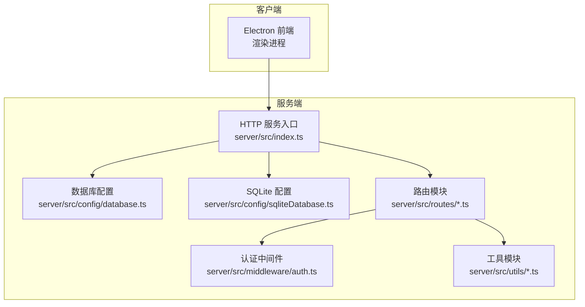
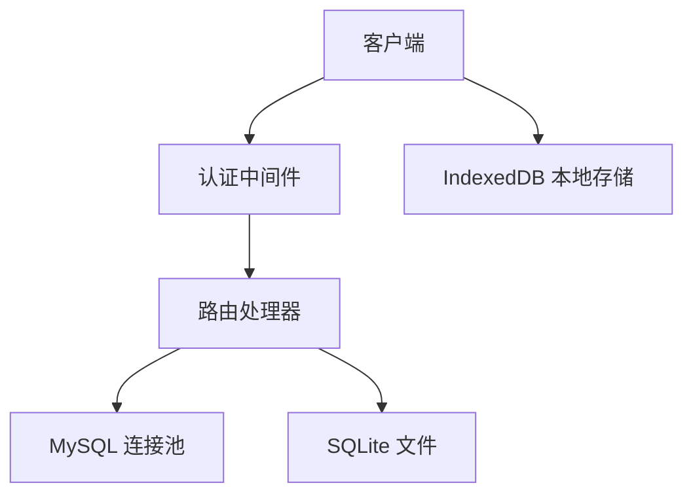
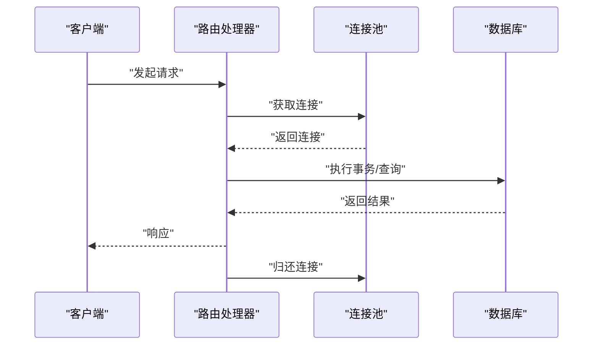
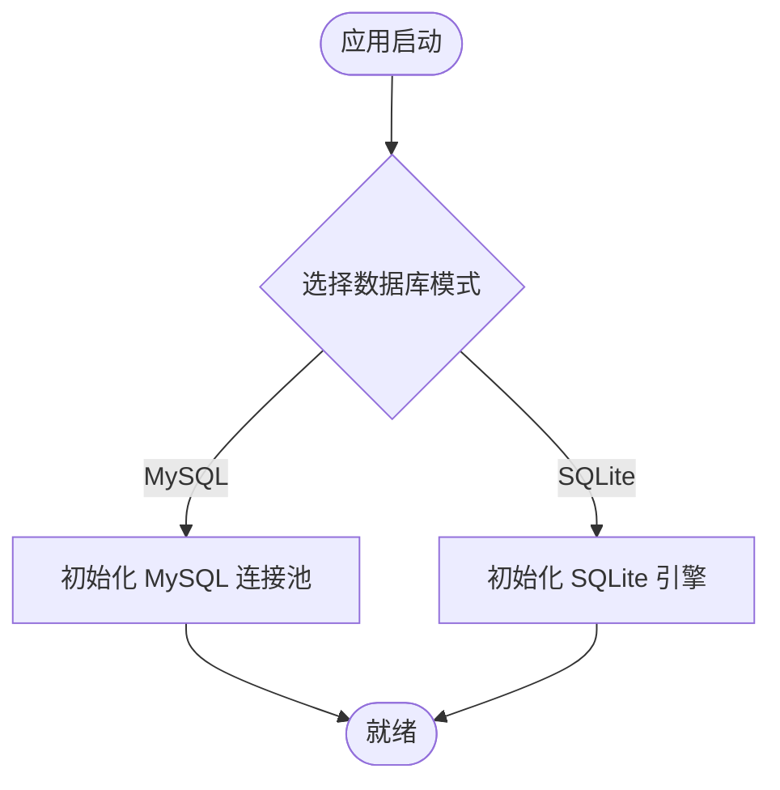
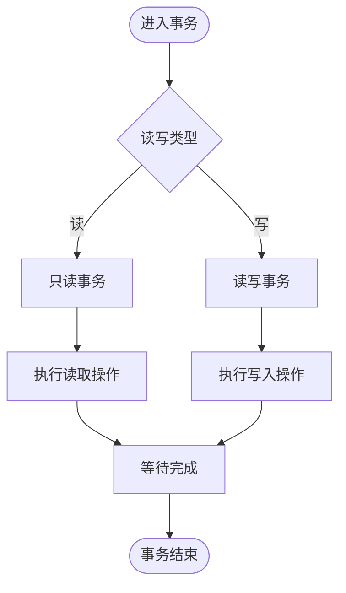
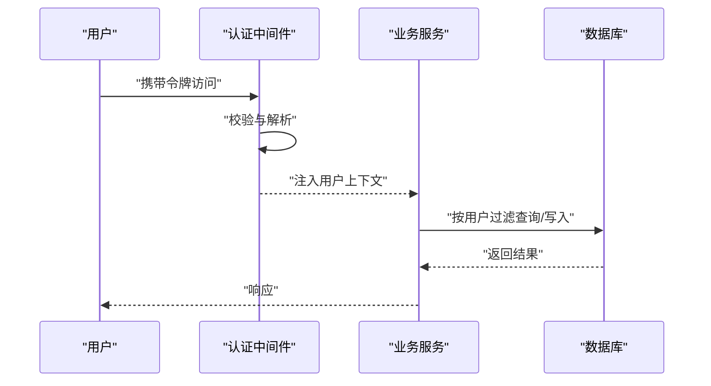
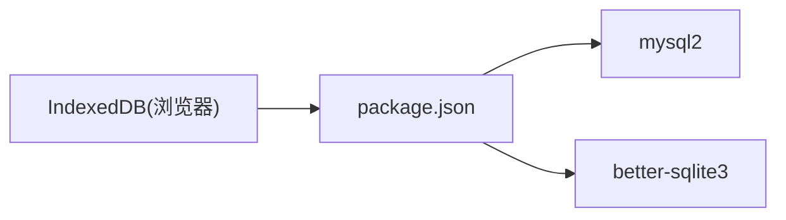

# 数据库集成

<cite>
**本文引用的文件**
- [package.json](file://package.json)
- [package-lock.json](file://package-lock.json)
- [src/services/storage/indexeddb.ts](file://src/services/storage/indexeddb.ts)
- [src/services/storage/types.ts](file://src/services/storage/types.ts)
- [server/src/index.ts](file://server/src/index.ts)
- [server/src/config/database.ts](file://server/src/config/database.ts)
- [server/src/config/sqliteDatabase.ts](file://server/src/config/sqliteDatabase.ts)
- [server/src/routes/projects.ts](file://server/src/routes/projects.ts)
- [server/src/routes/assets.ts](file://server/src/routes/assets.ts)
- [server/src/routes/auth.ts](file://server/src/routes/auth.ts)
- [server/src/middleware/auth.ts](file://server/src/middleware/auth.ts)
- [server/src/utils/projectMutex.ts](file://server/src/utils/projectMutex.ts)
- [docker-compose.yaml](file://docker-compose.yaml)
- [docker-compose.mysql.yaml](file://docker-compose.mysql.yaml)
</cite>

## 目录
1. [简介](#简介)
2. [项目结构](#项目结构)
3. [核心组件](#核心组件)
4. [架构总览](#架构总览)
5. [详细组件分析](#详细组件分析)
6. [依赖关系分析](#依赖关系分析)
7. [性能考虑](#性能考虑)
8. [故障排查指南](#故障排查指南)
9. [结论](#结论)
10. [附录](#附录)

## 简介
本文件面向“AI Shotlive”项目的数据库集成能力，系统性梳理后端数据库连接池管理、MySQL与SQLite双模支持、连接配置策略，以及数据库初始化流程、事务处理机制、用户数据隔离实现。同时覆盖SQL查询优化、连接超时处理、数据库故障恢复、配置示例、性能调优建议与监控指标，并提供数据库架构图与连接管理最佳实践。

## 项目结构
项目采用前后端分离架构，前端通过 Electron 主进程与渲染进程访问后端服务；后端以 Node.js + TypeScript 实现，提供 REST 接口与数据库访问层。数据库侧当前在前端实现了 IndexedDB 的本地存储封装，在后端通过 MySQL 与 SQLite 双模配置支持。

图表来源
- [server/src/index.ts](file://server/src/index.ts)
- [server/src/config/database.ts](file://server/src/config/database.ts)
- [server/src/config/sqliteDatabase.ts](file://server/src/config/sqliteDatabase.ts)
- [server/src/routes/projects.ts](file://server/src/routes/projects.ts)
- [server/src/middleware/auth.ts](file://server/src/middleware/auth.ts)
- [server/src/utils/projectMutex.ts](file://server/src/utils/projectMutex.ts)

章节来源
- [server/src/index.ts](file://server/src/index.ts)
- [server/src/config/database.ts](file://server/src/config/database.ts)
- [server/src/config/sqliteDatabase.ts](file://server/src/config/sqliteDatabase.ts)

## 核心组件
- 数据库连接池与驱动
  - 后端使用 mysql2 驱动，具备连接池能力，适合高并发场景。
  - 前端使用 IndexedDB 进行本地持久化，适配离线与轻量数据。
- 双模支持
  - MySQL：生产环境推荐，具备事务、连接池、复制与高可用能力。
  - SQLite：开发/单机/演示场景，无需额外服务端，部署简单。
- 初始化流程
  - 后端启动时加载数据库配置，建立连接池；路由层按需获取连接执行 SQL。
  - 前端 IndexedDB 在首次访问时自动建表与版本迁移。
- 事务处理
  - 后端基于 mysql2 的连接池事务；前端基于 IDB 事务。
- 用户数据隔离
  - 通过路由中间件鉴权与业务层数据过滤实现用户维度隔离。
- 查询优化与超时
  - 使用连接池参数控制并发与空闲回收；设置查询超时与连接超时；对热点查询建立索引。
- 故障恢复
  - 连接池自动重试与降级；IDB 版本变更时主动关闭避免锁库；容器编排提供 MySQL 高可用。

章节来源
- [package.json](file://package.json)
- [package-lock.json](file://package-lock.json)
- [src/services/storage/indexeddb.ts](file://src/services/storage/indexeddb.ts)
- [src/services/storage/types.ts](file://src/services/storage/types.ts)
- [server/src/config/database.ts](file://server/src/config/database.ts)
- [server/src/config/sqliteDatabase.ts](file://server/src/config/sqliteDatabase.ts)
- [server/src/middleware/auth.ts](file://server/src/middleware/auth.ts)

## 架构总览
下图展示从客户端到数据库的整体链路，包括认证、路由、数据库访问与存储层。

图表来源
- [server/src/middleware/auth.ts](file://server/src/middleware/auth.ts)
- [server/src/routes/projects.ts](file://server/src/routes/projects.ts)
- [server/src/config/database.ts](file://server/src/config/database.ts)
- [server/src/config/sqliteDatabase.ts](file://server/src/config/sqliteDatabase.ts)
- [src/services/storage/indexeddb.ts](file://src/services/storage/indexeddb.ts)

## 详细组件分析

### 后端数据库配置与连接池
- 配置要点
  - 连接池大小：根据 CPU 核数与 QPS 设定初始与最大连接数。
  - 空闲回收：设置连接最大空闲时间与生命周期，避免资源泄漏。
  - 超时控制：设置连接超时与查询超时，防止阻塞。
  - 事务隔离：根据业务需求选择可重复读或读已提交。
- 初始化流程
  - 应用启动时读取配置，创建连接池实例；路由请求时从池中获取连接，执行完成后归还。
- 事务处理
  - 使用 mysql2 的事务 API，确保多语句一致性；失败时回滚并记录错误。
- 用户数据隔离
  - 所有写操作均绑定当前用户上下文；读取时按用户维度过滤数据。

图表来源
- [server/src/config/database.ts](file://server/src/config/database.ts)
- [server/src/routes/projects.ts](file://server/src/routes/projects.ts)

章节来源
- [server/src/config/database.ts](file://server/src/config/database.ts)
- [server/src/routes/projects.ts](file://server/src/routes/projects.ts)

### SQLite 双模支持
- 适用场景
  - 开发调试、单机演示、嵌入式部署。
- 配置要点
  - 文件路径与 WAL 模式；设置同步级别与缓存大小。
  - 事务模式与并发写入策略。
- 与 MySQL 的差异
  - 不需要独立服务端；但并发写入受限，不适合高写入吞吐场景。

图表来源
- [server/src/config/sqliteDatabase.ts](file://server/src/config/sqliteDatabase.ts)
- [server/src/config/database.ts](file://server/src/config/database.ts)

章节来源
- [server/src/config/sqliteDatabase.ts](file://server/src/config/sqliteDatabase.ts)

### 前端 IndexedDB 本地存储
- 数据模型
  - 项目存储（projects）：按 id 索引，保存项目元数据。
  - 资产存储（assets）：键值存储，保存二进制数据。
  - 配置存储（config）：键值存储，保存用户配置。
- 事务与异常
  - 写操作统一使用只读/读写事务；异常通过 onerror/onabort 回调捕获。
  - 版本变更时主动关闭数据库，避免跨标签页锁库。
- 事务流程

图表来源
- [src/services/storage/indexeddb.ts](file://src/services/storage/indexeddb.ts)

章节来源
- [src/services/storage/indexeddb.ts](file://src/services/storage/indexeddb.ts)
- [src/services/storage/types.ts](file://src/services/storage/types.ts)

### 认证与用户数据隔离
- 中间件职责
  - 校验请求头中的令牌；解析用户上下文；注入到请求对象。
- 隔离策略
  - 所有数据读写接口在业务层强制绑定用户标识；禁止跨用户访问。
- 流程示意

图表来源
- [server/src/middleware/auth.ts](file://server/src/middleware/auth.ts)
- [server/src/routes/projects.ts](file://server/src/routes/projects.ts)

章节来源
- [server/src/middleware/auth.ts](file://server/src/middleware/auth.ts)
- [server/src/routes/projects.ts](file://server/src/routes/projects.ts)

### 项目互斥与并发控制
- 场景
  - 多标签页/多用户并发修改同一项目时，避免脏写。
- 方案
  - 基于项目 ID 的互斥锁；获取失败则提示重试或等待。
- 关键点
  - 锁粒度精确到项目；超时与重试策略合理配置。

章节来源
- [server/src/utils/projectMutex.ts](file://server/src/utils/projectMutex.ts)

## 依赖关系分析
- 后端依赖
  - mysql2：提供连接池与事务支持。
  - better-sqlite3：提供 SQLite 驱动与高性能本地存储。
- 前端依赖
  - IndexedDB：浏览器内置，无需额外依赖。
- 容器编排
  - docker-compose 提供 MySQL 与应用服务编排；mysql 版本 compose 支持独立 MySQL 服务。

图表来源
- [package.json](file://package.json)
- [package-lock.json](file://package-lock.json)

章节来源
- [package.json](file://package.json)
- [package-lock.json](file://package-lock.json)

## 性能考虑
- 连接池调优
  - 初始连接数：CPU 核数 × 2 ~ 4。
  - 最大连接数：根据峰值 QPS 与平均响应时间估算。
  - 连接空闲回收：设置最大空闲时间与生命周期。
- 查询优化
  - 对高频查询建立合适索引；避免 SELECT *；分页查询使用覆盖索引。
  - 使用预编译语句减少解析开销。
- 超时与重试
  - 设置查询超时与连接超时；对网络抖动场景启用指数退避重试。
- 缓存与异步
  - 对只读数据引入内存缓存；耗时操作异步化。
- 监控指标
  - 连接池：活跃连接数、等待队列长度、连接创建/销毁速率。
  - 查询：慢查询数量、平均/99 分位延迟、错误率。
  - 数据库：缓冲池命中率、锁等待、事务回滚率。

## 故障排查指南
- 连接池问题
  - 症状：请求堆积、超时增多。
  - 排查：检查最大连接数是否过低；查看等待队列长度；核对慢查询。
- 事务冲突
  - 症状：事务频繁回滚。
  - 排查：检查锁等待与死锁日志；优化热点更新策略。
- IDB 版本冲突
  - 症状：升级失败或锁库。
  - 处理：监听 onversionchange 主动关闭旧连接；确保单实例升级。
- 容器与网络
  - 症状：无法连接 MySQL。
  - 排查：确认容器网络、端口映射与凭据；查看 MySQL 容器健康状态。

章节来源
- [src/services/storage/indexeddb.ts](file://src/services/storage/indexeddb.ts)
- [docker-compose.yaml](file://docker-compose.yaml)
- [docker-compose.mysql.yaml](file://docker-compose.mysql.yaml)

## 结论
本项目在后端通过 mysql2 实现高可靠的连接池与事务支持，在前端通过 IndexedDB 提供本地持久化能力，并在后端提供 MySQL 与 SQLite 双模配置以满足不同部署场景。配合认证中间件与业务层的数据隔离策略，整体具备良好的扩展性与稳定性。建议在生产环境中优先采用 MySQL 并结合连接池与查询优化策略，同时完善监控与告警体系以保障系统可用性。

## 附录
- 配置示例（路径参考）
  - MySQL 连接池配置：[server/src/config/database.ts](file://server/src/config/database.ts)
  - SQLite 配置：[server/src/config/sqliteDatabase.ts](file://server/src/config/sqliteDatabase.ts)
  - 容器编排（MySQL）：[docker-compose.mysql.yaml](file://docker-compose.mysql.yaml)
  - 容器编排（通用）：[docker-compose.yaml](file://docker-compose.yaml)
- 前端存储接口定义：[src/services/storage/types.ts](file://src/services/storage/types.ts)
- 前端 IndexedDB 实现：[src/services/storage/indexeddb.ts](file://src/services/storage/indexeddb.ts)
- 项目互斥控制：[server/src/utils/projectMutex.ts](file://server/src/utils/projectMutex.ts)