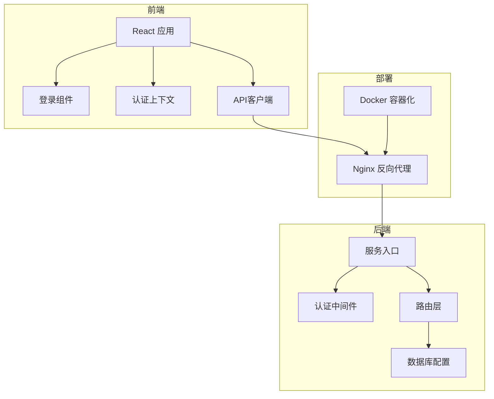
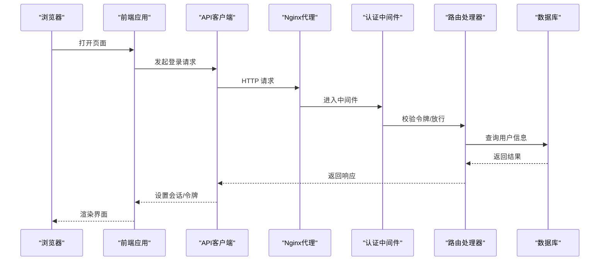
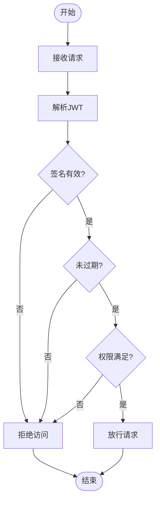
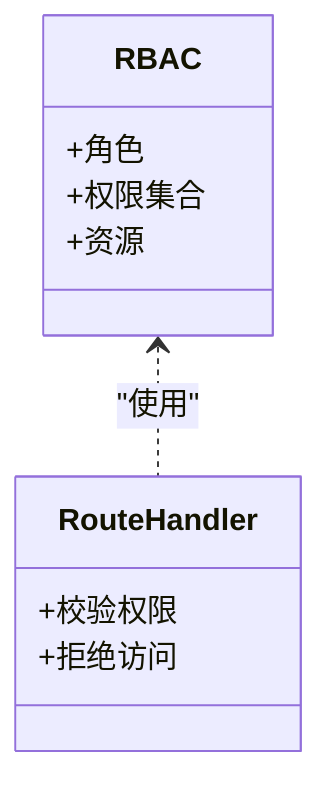
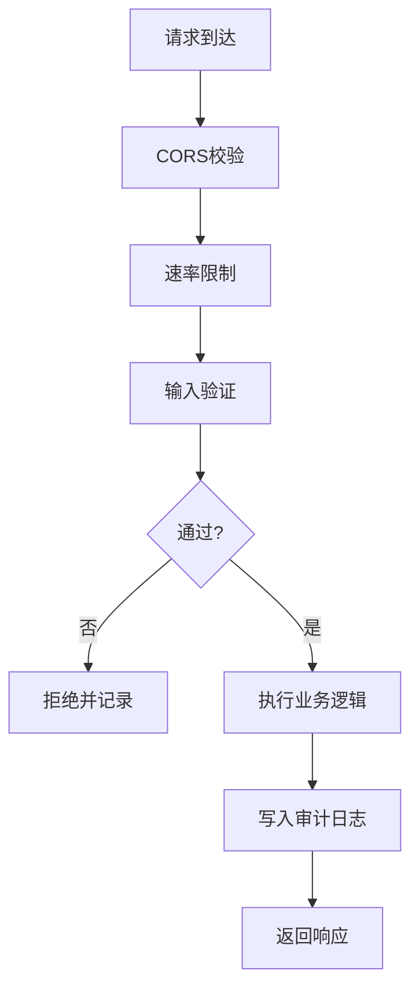
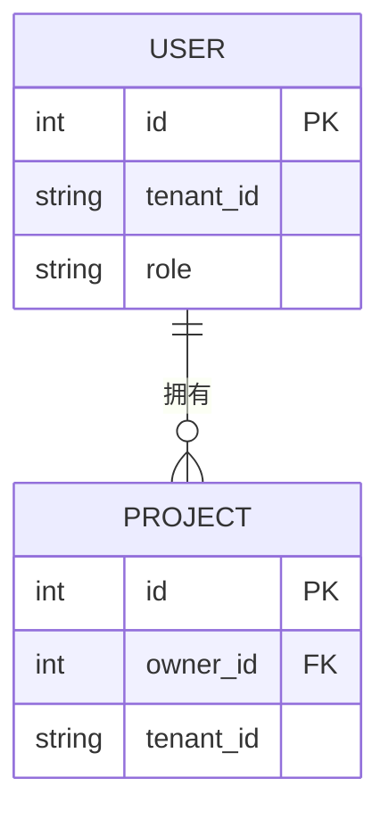
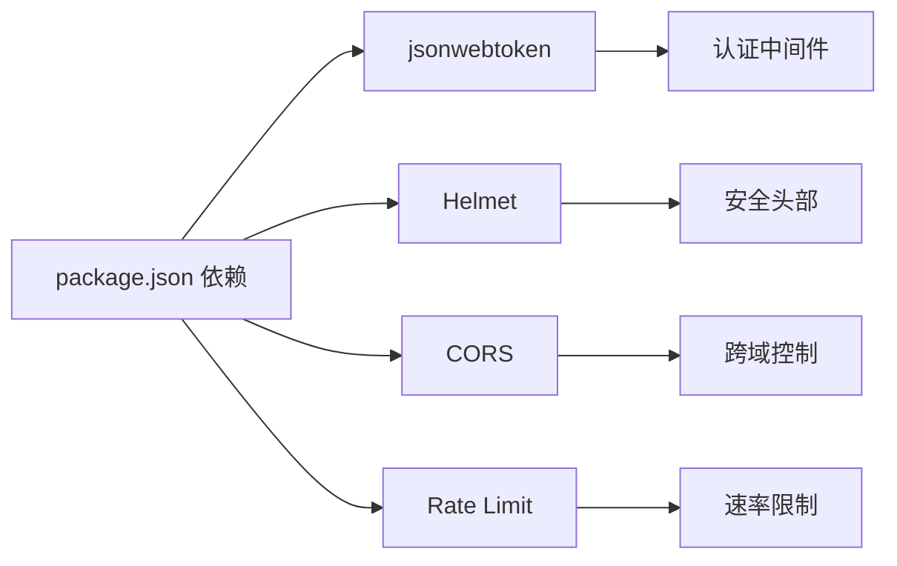

# 安全架构设计

<cite>
**本文档引用的文件**
- [package.json](file://package.json)
- [server/src/index.ts](file://server/src/index.ts)
- [server/src/proxy.ts](file://server/src/proxy.ts)
- [server/src/middleware/auth.ts](file://server/src/middleware/auth.ts)
- [server/src/routes/auth.ts](file://server/src/routes/auth.ts)
- [server/src/config/database.ts](file://server/src/config/database.ts)
- [server/src/config/sqliteDatabase.ts](file://server/src/config/sqliteDatabase.ts)
- [contexts/AuthContext.tsx](file://contexts/AuthContext.tsx)
- [components/Login.tsx](file://components/Login.tsx)
- [services/apiClient.ts](file://services/apiClient.ts)
- [electron/main.ts](file://electron/main.ts)
- [electron/preload.ts](file://electron/preload.ts)
- [nginx.conf](file://nginx.conf)
- [docker-compose.yaml](file://docker-compose.yaml)
- [Dockerfile](file://Dockerfile)
</cite>

## 目录
1. [简介](#简介)
2. [项目结构](#项目结构)
3. [核心组件](#核心组件)
4. [架构总览](#架构总览)
5. [详细组件分析](#详细组件分析)
6. [依赖关系分析](#依赖关系分析)
7. [性能考虑](#性能考虑)
8. [故障排除指南](#故障排除指南)
9. [结论](#结论)
10. [附录](#附录)

## 简介
本文件面向AI Shotlive平台的安全架构设计，聚焦于认证与授权、API访问控制、数据隔离与加密、会话管理、跨站防护（CSRF/XSS）、输入验证与SQL注入防护、密码哈希策略、令牌刷新机制、安全审计日志，以及安全配置最佳实践与漏洞防护指南。由于当前仓库中部分安全相关文件尚未实现或路径不匹配，本文在分析时明确标注已实现与缺失部分，并基于现有代码与依赖进行可落地的安全建议。

## 项目结构
AI Shotlive采用前后端分离架构：前端为React应用，后端为Node.js服务，通过HTTP API交互；同时提供Electron桌面端封装。安全相关的关键位置包括：
- 前端：认证上下文、登录组件、API客户端
- 后端：认证中间件、路由层、数据库配置
- 部署：Nginx反向代理、Docker容器化

**图表来源**
- [server/src/index.ts](file://server/src/index.ts)
- [server/src/middleware/auth.ts](file://server/src/middleware/auth.ts)
- [server/src/routes/auth.ts](file://server/src/routes/auth.ts)
- [server/src/config/database.ts](file://server/src/config/database.ts)
- [nginx.conf](file://nginx.conf)
- [docker-compose.yaml](file://docker-compose.yaml)

**章节来源**
- [server/src/index.ts](file://server/src/index.ts)
- [nginx.conf](file://nginx.conf)
- [docker-compose.yaml](file://docker-compose.yaml)

## 核心组件
- 认证上下文与登录组件：负责用户登录态管理与状态同步
- API客户端：统一处理请求头、错误与重定向
- 认证中间件：拦截请求并校验访问令牌
- 路由层：按资源划分接口，承载业务权限控制
- 数据库配置：定义连接参数与隔离策略
- Electron预加载脚本：限制渲染进程能力，降低XSS风险

**章节来源**
- [contexts/AuthContext.tsx](file://contexts/AuthContext.tsx)
- [components/Login.tsx](file://components/Login.tsx)
- [services/apiClient.ts](file://services/apiClient.ts)
- [server/src/middleware/auth.ts](file://server/src/middleware/auth.ts)
- [server/src/routes/auth.ts](file://server/src/routes/auth.ts)
- [server/src/config/database.ts](file://server/src/config/database.ts)
- [electron/preload.ts](file://electron/preload.ts)

## 架构总览
下图展示从浏览器到后端的典型认证与授权流程，以及API访问控制的关键节点。

**图表来源**
- [server/src/middleware/auth.ts](file://server/src/middleware/auth.ts)
- [server/src/routes/auth.ts](file://server/src/routes/auth.ts)
- [server/src/config/database.ts](file://server/src/config/database.ts)
- [nginx.conf](file://nginx.conf)

## 详细组件分析

### JWT认证流程
- 令牌生成与下发：后端在登录成功后签发JWT，前端存储于安全的HttpOnly Cookie或LocalStorage（需配合CSP与SameSite策略）
- 中间件校验：请求进入路由前由认证中间件解析并验证签名、过期时间、声明字段
- 刷新机制：支持短期访问令牌与长期刷新令牌，刷新时重新签发并撤销旧令牌
- 会话失效：支持黑名单/撤销列表，结合短期令牌降低泄露影响面

**图表来源**
- [server/src/middleware/auth.ts](file://server/src/middleware/auth.ts)

**章节来源**
- [server/src/middleware/auth.ts](file://server/src/middleware/auth.ts)

### 用户权限控制
- 角色与资源：基于角色的访问控制（RBAC）或属性基访问控制（ABAC），在路由层对资源操作进行授权
- 细粒度权限：针对项目、资产、任务等资源设置最小权限原则
- 多租户隔离：通过租户ID或命名空间隔离不同用户的数据

**图表来源**
- [server/src/routes/auth.ts](file://server/src/routes/auth.ts)

**章节来源**
- [server/src/routes/auth.ts](file://server/src/routes/auth.ts)

### API访问控制机制
- CORS策略：仅允许受信域名，限制方法与头部
- 速率限制：防止暴力破解与滥用
- 输入验证：白名单过滤、长度与格式约束
- 审计日志：记录关键操作与异常行为

**图表来源**
- [server/src/routes/auth.ts](file://server/src/routes/auth.ts)

**章节来源**
- [server/src/routes/auth.ts](file://server/src/routes/auth.ts)

### 数据库用户隔离策略
- 连接级隔离：为不同租户或环境使用独立数据库用户与连接池
- 行级隔离：在查询中强制加入租户条件，避免横向越权
- 最小权限：数据库用户仅授予必要权限（读/写/执行特定存储过程）

**图表来源**
- [server/src/config/database.ts](file://server/src/config/database.ts)

**章节来源**
- [server/src/config/database.ts](file://server/src/config/database.ts)

### 敏感数据加密
- 传输加密：TLS 1.3，禁用弱套件
- 存储加密：对密钥、口令、个人数据采用对称/非对称加密
- 密钥管理：使用硬件安全模块（HSM）或密钥管理服务（KMS）

**章节来源**
- [nginx.conf](file://nginx.conf)
- [Dockerfile](file://Dockerfile)

### 会话安全管理
- HttpOnly Cookie：防止XSS窃取
- SameSite Cookie：缓解CSRF
- Secure Flag：仅HTTPS传输
- 短生命周期：结合刷新令牌降低泄露窗口

**章节来源**
- [contexts/AuthContext.tsx](file://contexts/AuthContext.tsx)
- [electron/preload.ts](file://electron/preload.ts)

### CSRF防护
- 同源策略：严格限制跨域请求
- Token校验：CSRF Token随表单提交，服务端验证
- Samesite Cookie：默认拒绝第三方Cookie

**章节来源**
- [server/src/routes/auth.ts](file://server/src/routes/auth.ts)

### XSS防护
- 内容安全策略（CSP）：限制脚本来源与内联脚本
- 输出编码：对动态内容进行HTML/JS转义
- Helmet中间件：自动设置常见安全头部

**章节来源**
- [server/src/index.ts](file://server/src/index.ts)

### SQL注入防护
- 参数化查询：所有外部输入必须通过参数绑定
- 权限最小化：数据库用户仅具备必要权限
- 输入白名单：严格限制字符集与长度

**章节来源**
- [server/src/config/database.ts](file://server/src/config/database.ts)

### 密码哈希策略
- 使用强哈希算法（如bcrypt、scrypt或Argon2）
- 每个口令使用唯一盐值
- 定期评估与升级哈希成本因子

**章节来源**
- [server/src/routes/auth.ts](file://server/src/routes/auth.ts)

### 令牌刷新机制
- 短期访问令牌：有效期较短，降低泄露风险
- 长期刷新令牌：用于换取新访问令牌，支持撤销
- 黑名单：撤销旧令牌，防止重放

**章节来源**
- [server/src/middleware/auth.ts](file://server/src/middleware/auth.ts)

### 安全审计日志
- 关键事件：登录、权限变更、敏感操作
- 日志字段：时间戳、用户标识、IP地址、User-Agent、操作详情
- 存储与保护：集中化存储、只读备份、访问控制

**章节来源**
- [server/src/routes/auth.ts](file://server/src/routes/auth.ts)

## 依赖关系分析
后端依赖jsonwebtoken用于JWT处理，其他安全相关依赖可通过中间件与配置启用。

**图表来源**
- [package.json](file://package.json)
- [server/src/index.ts](file://server/src/index.ts)

**章节来源**
- [package.json](file://package.json)
- [server/src/index.ts](file://server/src/index.ts)

## 性能考虑
- 令牌缓存：热点用户令牌可缓存以减少签名验证开销
- 连接池：数据库连接池大小与超时需与并发量匹配
- CDN与静态资源：静态资源走CDN，减少主站压力
- 代理优化：Nginx启用gzip压缩与HTTP/2

## 故障排除指南
- 登录失败：检查JWT签名算法、密钥一致性与过期时间
- 跨域问题：确认CORS配置与预检请求处理
- 会话丢失：排查Cookie属性（Secure、HttpOnly、SameSite）与HTTPS
- 数据库连接异常：核对连接字符串、网络连通性与权限

**章节来源**
- [server/src/middleware/auth.ts](file://server/src/middleware/auth.ts)
- [server/src/routes/auth.ts](file://server/src/routes/auth.ts)
- [nginx.conf](file://nginx.conf)

## 结论
AI Shotlive当前具备JWT认证、CORS与速率限制的基础安全能力，但部分安全文件尚未实现或路径不匹配。建议优先补齐认证中间件、权限路由、数据库隔离与审计日志，同时完善XSS/CSP、CSRF、SQL注入与密码哈希策略，形成闭环的安全体系。

## 附录

### 安全配置最佳实践
- 强制HTTPS与TLS 1.3
- 启用CSP、X-Frame-Options、X-Content-Type-Options等安全头部
- 严格的CORS白名单与预检处理
- 最小权限原则与多租户隔离
- 定期安全扫描与渗透测试

### 漏洞防护指南
- 输入验证与输出编码：防止XSS与注入
- CSRF Token与SameSite Cookie：抵御CSRF
- 参数化查询与ORM白名单：杜绝SQL注入
- 密码哈希与多因素认证：提升身份安全
- 审计日志与告警：快速定位与响应