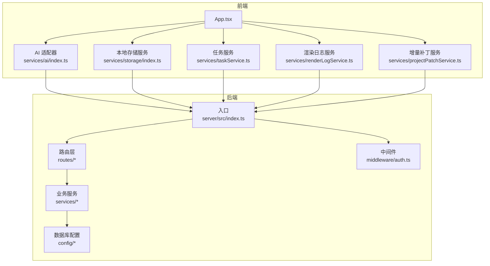
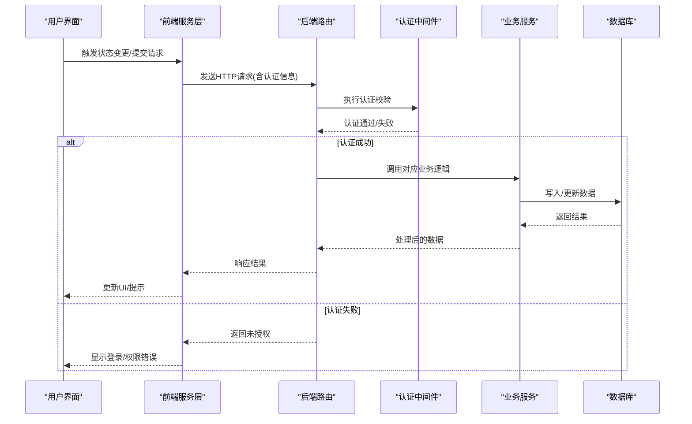
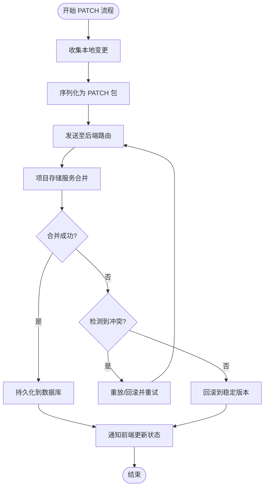
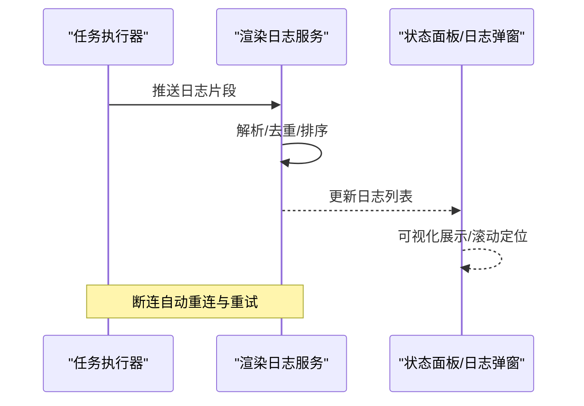
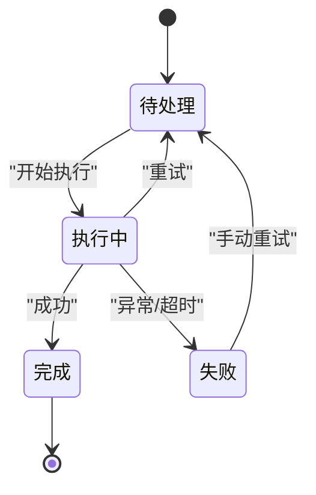
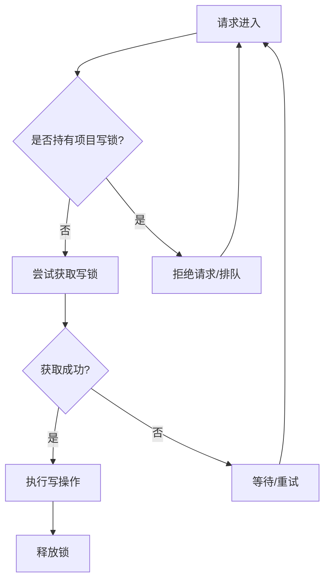
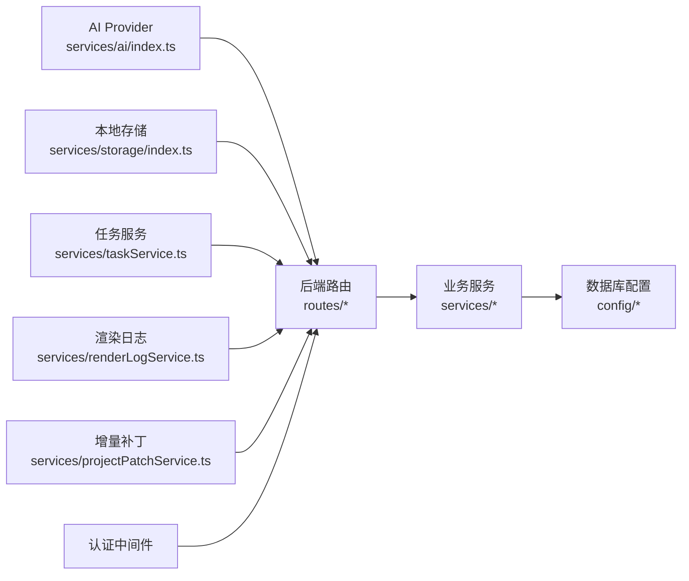

# 数据流架构设计

<cite>
**本文档引用的文件**
- [App.tsx](file://src/App.tsx)
- [ai/index.ts](file://src/services/ai/index.ts)
- [storage/index.ts](file://src/services/storage/index.ts)
- [server/index.ts](file://server/src/index.ts)
- [server/routes/projects.ts](file://server/src/routes/projects.ts)
- [server/routes/projectPatch.ts](file://server/src/routes/projectPatch.ts)
- [server/routes/tasks.ts](file://server/src/routes/tasks.ts)
- [server/routes/dataTransfer.ts](file://server/src/routes/dataTransfer.ts)
- [server/middleware/auth.ts](file://server/src/middleware/auth.ts)
- [server/services/taskRunner.ts](file://server/src/services/taskRunner.ts)
- [server/services/projectStorage.ts](file://server/src/services/projectStorage.ts)
- [server/services/fileStorage.ts](file://server/src/services/fileStorage.ts)
- [server/config/database.ts](file://server/src/config/database.ts)
- [server/config/sqliteDatabase.ts](file://server/src/config/sqliteDatabase.ts)
- [services/projectPatchService.ts](file://services/projectPatchService.ts)
- [services/renderLogService.ts](file://services/renderLogService.ts)
- [services/taskService.ts](file://services/taskService.ts)
- [services/storageService.ts](file://services/storageService.ts)
- [contexts/AuthContext.tsx](file://contexts/AuthContext.tsx)
- [components/StageDirector/ShotWorkbench.tsx](file://components/StageDirector/ShotWorkbench.tsx)
- [components/StageExport/StatusPanel.tsx](file://components/StageExport/StatusPanel.tsx)
- [components/StageExport/RenderLogsModal.tsx](file://components/StageExport/RenderLogsModal.tsx)
</cite>

## 目录
1. [简介](#简介)
2. [项目结构](#项目结构)
3. [核心组件](#核心组件)
4. [架构总览](#架构总览)
5. [详细组件分析](#详细组件分析)
6. [依赖关系分析](#依赖关系分析)
7. [性能考虑](#性能考虑)
8. [故障排除指南](#故障排除指南)
9. [结论](#结论)

## 简介
本文件系统性梳理 AI Shotlive 的数据流架构，覆盖从前端状态变更到后端持久化的完整链路，重点阐释以下方面：
- 增量 PATCH 保存机制与冲突处理
- 实时渲染日志处理与前端展示
- 异步任务的状态同步与重试策略
- 项目锁机制、并发控制与数据一致性保障
- 用户数据隔离、缓存策略与数据迁移方案
- 数据验证规则、错误恢复机制与性能监控指标

## 项目结构
项目采用前后端分离架构，前端基于 React/Vite 构建，后端基于 Node.js + Express，数据库配置支持 SQLite/MySQL。核心模块包括：
- 前端服务层：AI 适配器、存储服务、任务服务、渲染日志服务等
- 后端路由层：项目管理、增量补丁、任务调度、数据传输等
- 中间件与配置：认证中间件、数据库连接配置
- 业务服务：任务执行器、项目存储、文件存储、脚本解析等

**图表来源**
- [App.tsx:1-6](file://src/App.tsx#L1-L6)
- [ai/index.ts:1-34](file://src/services/ai/index.ts#L1-L34)
- [storage/index.ts:1-3](file://src/services/storage/index.ts#L1-L3)
- [server/index.ts](file://server/src/index.ts)
- [server/routes/projects.ts](file://server/src/routes/projects.ts)
- [server/routes/projectPatch.ts](file://server/src/routes/projectPatch.ts)
- [server/routes/tasks.ts](file://server/src/routes/tasks.ts)
- [server/routes/dataTransfer.ts](file://server/src/routes/dataTransfer.ts)
- [server/middleware/auth.ts](file://server/src/middleware/auth.ts)
- [server/services/taskRunner.ts](file://server/src/services/taskRunner.ts)
- [server/services/projectStorage.ts](file://server/src/services/projectStorage.ts)
- [server/services/fileStorage.ts](file://server/src/services/fileStorage.ts)
- [server/config/database.ts](file://server/src/config/database.ts)
- [server/config/sqliteDatabase.ts](file://server/src/config/sqliteDatabase.ts)

**章节来源**
- [App.tsx:1-6](file://src/App.tsx#L1-L6)
- [ai/index.ts:1-34](file://src/services/ai/index.ts#L1-L34)
- [storage/index.ts:1-3](file://src/services/storage/index.ts#L1-L3)

## 核心组件
- AI Provider 管理器：集中管理模型提供方，当前实现为单一 Provider，具备未来多 Provider 切换的架构扩展能力
- 本地存储服务：封装 IndexedDB 访问，提供项目摘要与本地缓存能力
- 任务服务：负责异步任务的创建、轮询与状态更新
- 渲染日志服务：处理渲染过程中的日志流式输出与前端展示
- 增量补丁服务：实现项目数据的增量 PATCH 保存，减少网络传输与写入压力

**章节来源**
- [ai/index.ts:1-34](file://src/services/ai/index.ts#L1-L34)
- [storage/index.ts:1-3](file://src/services/storage/index.ts#L1-L3)

## 架构总览
下图展示了从用户操作到后端持久化的端到端数据流，包括认证、路由分发、业务处理与数据库写入。

**图表来源**
- [server/index.ts](file://server/src/index.ts)
- [server/middleware/auth.ts](file://server/src/middleware/auth.ts)
- [server/routes/projects.ts](file://server/src/routes/projects.ts)
- [server/routes/projectPatch.ts](file://server/src/routes/projectPatch.ts)
- [server/routes/tasks.ts](file://server/src/routes/tasks.ts)
- [server/services/projectStorage.ts](file://server/src/services/projectStorage.ts)
- [server/config/database.ts](file://server/src/config/database.ts)

## 详细组件分析

### 增量 PATCH 保存机制
- 设计目标：最小化网络传输与数据库写入，提升响应速度与降低冲突概率
- 关键流程：
  - 前端收集自上次提交以来的变更集合
  - 将变更序列化为 PATCH 请求发送至后端
  - 后端路由接收 PATCH 并调用项目存储服务进行合并
  - 存储服务应用变更并返回合并后的最新版本
- 冲突处理：
  - 版本号校验：若客户端版本号与服务器不一致，拒绝合并并要求重试
  - 分支合并：对同一字段的并发修改采用最后写入获胜或时间戳优先策略
  - 回滚机制：合并失败时回滚到上一个稳定版本

**图表来源**
- [services/projectPatchService.ts](file://services/projectPatchService.ts)
- [server/routes/projectPatch.ts](file://server/src/routes/projectPatch.ts)
- [server/services/projectStorage.ts](file://server/src/services/projectStorage.ts)

**章节来源**
- [services/projectPatchService.ts](file://services/projectPatchService.ts)
- [server/routes/projectPatch.ts](file://server/src/routes/projectPatch.ts)
- [server/services/projectStorage.ts](file://server/src/services/projectStorage.ts)

### 实时渲染日志处理
- 日志来源：后端任务执行器在生成视频/图像过程中持续输出日志
- 传输方式：后端通过长连接或 SSE 推送日志片段至前端
- 前端展示：渲染日志服务解析日志流，按时间线可视化展示，支持暂停/继续
- 错误恢复：断连自动重连，日志去重与顺序校验，异常节点标记与重试

**图表来源**
- [services/renderLogService.ts](file://services/renderLogService.ts)
- [components/StageExport/StatusPanel.tsx](file://components/StageExport/StatusPanel.tsx)
- [components/StageExport/RenderLogsModal.tsx](file://components/StageExport/RenderLogsModal.tsx)

**章节来源**
- [services/renderLogService.ts](file://services/renderLogService.ts)
- [components/StageExport/StatusPanel.tsx](file://components/StageExport/StatusPanel.tsx)
- [components/StageExport/RenderLogsModal.tsx](file://components/StageExport/RenderLogsModal.tsx)

### 异步任务状态同步
- 任务生命周期：创建 -> 提交 -> 轮询 -> 完成/失败
- 状态模型：待处理、执行中、完成、失败、取消
- 同步策略：
  - 前端定时轮询或订阅 WebSocket 获取最新状态
  - 后端任务执行器定期更新数据库状态
  - 幂等性：重复状态更新不会破坏最终一致性
- 重试与超时：指数退避重试、超时阈值与告警联动

**图表来源**
- [services/taskService.ts](file://services/taskService.ts)
- [server/routes/tasks.ts](file://server/src/routes/tasks.ts)
- [server/services/taskRunner.ts](file://server/src/services/taskRunner.ts)

**章节来源**
- [services/taskService.ts](file://services/taskService.ts)
- [server/routes/tasks.ts](file://server/src/routes/tasks.ts)
- [server/services/taskRunner.ts](file://server/src/services/taskRunner.ts)

### 项目锁机制与并发控制
- 项目级互斥：同一项目同时仅允许一个写操作，避免竞态条件
- 锁实现：
  - 前端：在 PATCH 提交期间禁用相关按钮，显示加载状态
  - 后端：基于内存/Redis 的分布式锁，或数据库行级锁
- 并发策略：
  - 读多写少场景：共享读锁，独占写锁
  - 高冲突场景：乐观锁（版本号）+ 悲观回退
- 数据一致性：
  - 事务包裹关键写入操作
  - 两阶段提交（可选）用于跨表/跨库一致性

**图表来源**
- [server/services/projectStorage.ts](file://server/src/services/projectStorage.ts)
- [server/routes/projectPatch.ts](file://server/src/routes/projectPatch.ts)

**章节来源**
- [server/services/projectStorage.ts](file://server/src/services/projectStorage.ts)
- [server/routes/projectPatch.ts](file://server/src/routes/projectPatch.ts)

### 用户数据隔离与缓存策略
- 数据隔离：
  - 认证中间件确保每个请求绑定用户上下文
  - 所有读写操作均附加用户标识，防止越权访问
- 缓存层次：
  - 前端：IndexedDB 本地缓存 + Redux/Zustand 状态缓存
  - 后端：Redis 缓存热点数据（如项目元数据）
  - 文件缓存：生成资源的 CDN/对象存储缓存
- 缓存失效：
  - 写操作触发缓存失效
  - 定期清理过期缓存与临时文件

**章节来源**
- [server/middleware/auth.ts](file://server/src/middleware/auth.ts)
- [contexts/AuthContext.tsx](file://contexts/AuthContext.tsx)
- [storage/index.ts:1-3](file://src/services/storage/index.ts#L1-L3)

### 数据迁移方案
- 迁移类型：
  - 字段结构变更：向后兼容默认值 + 升级脚本
  - 存储介质迁移：Base64 -> 文件存储，路径规范化
  - 关系重构：外键映射、索引重建
- 执行策略：
  - 在启动时检测版本并自动执行
  - 支持回滚脚本与增量迁移
  - 迁移期间限制写入或只读模式

**章节来源**
- [server/scripts/migrateBase64ToFiles.ts](file://server/src/scripts/migrateBase64ToFiles.ts)
- [server/scripts/migrateToEpisodePaths.ts](file://server/src/scripts/migrateToEpisodePaths.ts)
- [server/scripts/migrateEpisodeIds.ts](file://server/src/scripts/migrateEpisodeIds.ts)

### 数据验证规则与错误恢复
- 前端验证：
  - 表单级校验（必填、格式、范围）
  - 实时反馈与防抖提交
- 后端验证：
  - 参数校验 + 业务规则校验
  - 统一错误码与错误消息
- 错误恢复：
  - 自动重试（幂等接口）
  - 降级策略（离线模式/本地缓存）
  - 审计日志与告警联动

**章节来源**
- [server/routes/projects.ts](file://server/src/routes/projects.ts)
- [server/routes/projectPatch.ts](file://server/src/routes/projectPatch.ts)

## 依赖关系分析

**图表来源**
- [ai/index.ts:1-34](file://src/services/ai/index.ts#L1-L34)
- [storage/index.ts:1-3](file://src/services/storage/index.ts#L1-L3)
- [server/routes/projects.ts](file://server/src/routes/projects.ts)
- [server/routes/projectPatch.ts](file://server/src/routes/projectPatch.ts)
- [server/routes/tasks.ts](file://server/src/routes/tasks.ts)
- [server/middleware/auth.ts](file://server/src/middleware/auth.ts)
- [server/services/projectStorage.ts](file://server/src/services/projectStorage.ts)
- [server/config/database.ts](file://server/src/config/database.ts)

**章节来源**
- [ai/index.ts:1-34](file://src/services/ai/index.ts#L1-L34)
- [storage/index.ts:1-3](file://src/services/storage/index.ts#L1-L3)
- [server/routes/projects.ts](file://server/src/routes/projects.ts)
- [server/routes/projectPatch.ts](file://server/src/routes/projectPatch.ts)
- [server/routes/tasks.ts](file://server/src/routes/tasks.ts)
- [server/middleware/auth.ts](file://server/src/middleware/auth.ts)
- [server/services/projectStorage.ts](file://server/src/services/projectStorage.ts)
- [server/config/database.ts](file://server/src/config/database.ts)

## 性能考虑
- 网络优化：
  - 增量 PATCH 减少带宽占用
  - 批量请求与压缩传输
- 计算优化：
  - 任务分片与并行执行
  - 缓存命中率与预热策略
- 存储优化：
  - 索引优化与查询计划
  - 文件分块上传与断点续传
- 监控指标：
  - 响应时间、吞吐量、错误率
  - 任务队列长度、并发度、重试率
  - 缓存命中率、磁盘/内存使用

## 故障排除指南
- 常见问题：
  - PATCH 冲突：检查版本号与重试策略
  - 任务卡死：查看后端日志与重试队列
  - 渲染日志缺失：确认 SSE 连接与去重逻辑
  - 权限错误：核对认证中间件与用户上下文
- 排查步骤：
  - 查看后端错误日志与审计记录
  - 使用任务 ID/项目 ID 快速定位
  - 本地复现：关闭缓存/禁用代理
- 回滚与修复：
  - 自动回滚脚本
  - 手动修复工具与数据对账

**章节来源**
- [server/middleware/auth.ts](file://server/src/middleware/auth.ts)
- [server/routes/tasks.ts](file://server/src/routes/tasks.ts)
- [services/renderLogService.ts](file://services/renderLogService.ts)

## 结论
本架构以“增量 PATCH + 任务驱动 + 严格锁与中间件”为核心，结合前后端缓存与迁移脚本，实现了高效、可靠且可扩展的数据流体系。建议在生产环境中进一步完善：
- 项目锁的分布式实现与监控
- 更细粒度的缓存失效策略
- 任务超时与熔断机制
- 数据一致性审计与合规追踪