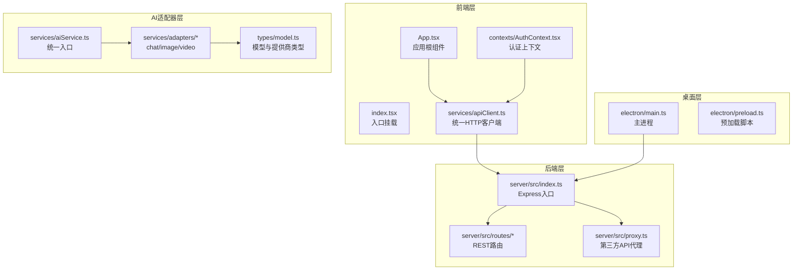
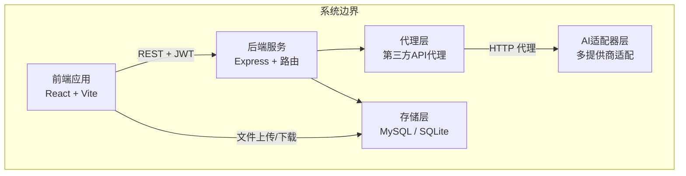
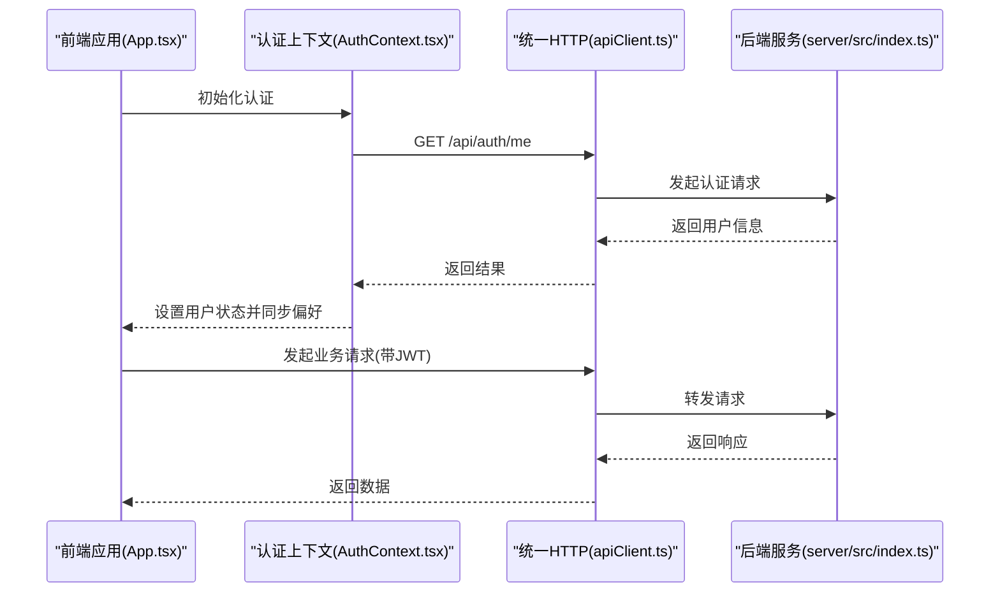
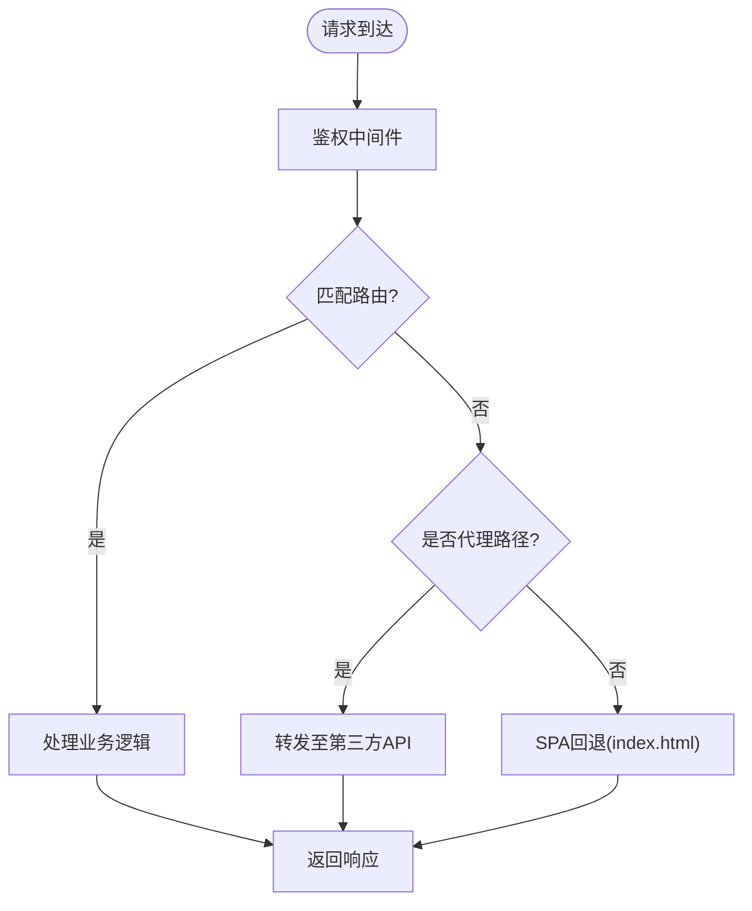
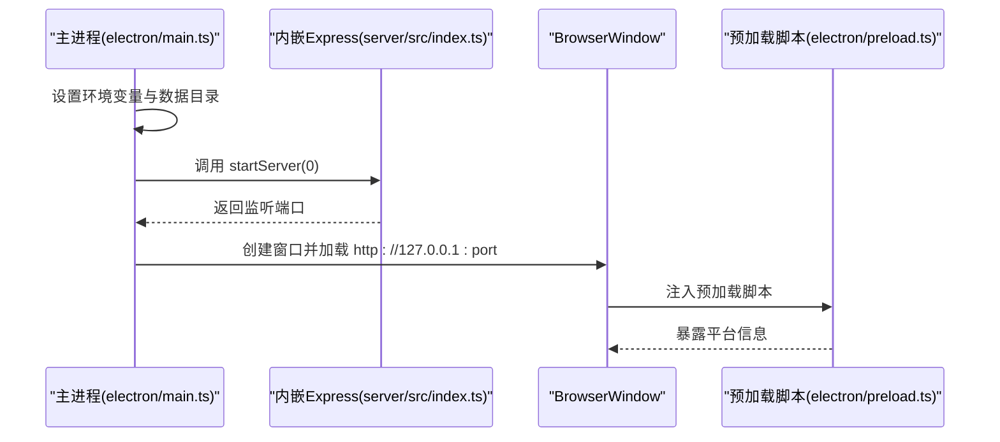
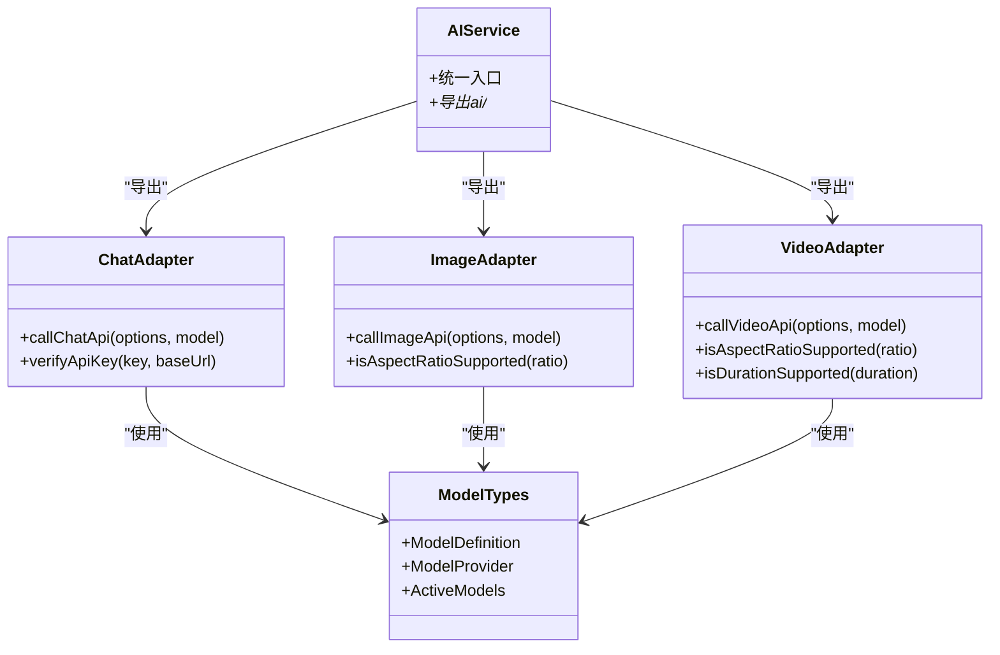
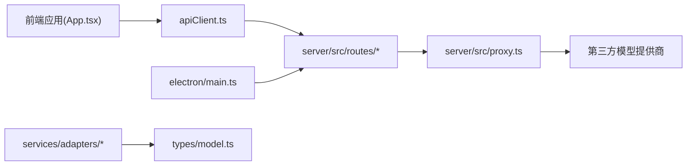

# 整体架构概览

<cite>
**本文引用的文件**
- [package.json](file://package.json)
- [README.md](file://README.md)
- [App.tsx](file://App.tsx)
- [index.tsx](file://index.tsx)
- [server/src/index.ts](file://server/src/index.ts)
- [electron/main.ts](file://electron/main.ts)
- [electron/preload.ts](file://electron/preload.ts)
- [services/aiService.ts](file://services/aiService.ts)
- [services/adapters/index.ts](file://services/adapters/index.ts)
- [types/model.ts](file://types/model.ts)
- [server/src/routes/ai.ts](file://server/src/routes/ai.ts)
- [services/apiClient.ts](file://services/apiClient.ts)
- [contexts/AuthContext.tsx](file://contexts/AuthContext.tsx)
- [services/adapters/chatAdapter.ts](file://services/adapters/chatAdapter.ts)
- [services/adapters/imageAdapter.ts](file://services/adapters/imageAdapter.ts)
- [services/adapters/videoAdapter.ts](file://services/adapters/videoAdapter.ts)
- [server/src/proxy.ts](file://server/src/proxy.ts)
</cite>

## 目录
1. [简介](#简介)
2. [项目结构](#项目结构)
3. [核心组件](#核心组件)
4. [架构总览](#架构总览)
5. [详细组件分析](#详细组件分析)
6. [依赖关系分析](#依赖关系分析)
7. [性能考虑](#性能考虑)
8. [故障排查指南](#故障排查指南)
9. [结论](#结论)

## 简介
本项目是一个面向创作者的“AI 短剧/漫剧”生成平台，采用三层架构设计：
- 前端 React 应用层：提供 Web 与桌面客户端双入口，负责用户界面、状态管理与跨层通信。
- 后端 Express 服务层：提供 REST API、认证授权、任务调度、文件存储与第三方代理。
- 桌面客户端 Electron 层：内嵌 Express 服务器与 SQLite，提供离线可用的本地化体验。

系统通过统一的 AI 适配器层屏蔽多模型提供商差异，支持文本、图像、视频、音频等多模态能力，并通过代理机制解决浏览器 CORS 限制，实现多平台统一接入。

## 项目结构
项目采用前后端分离与多平台打包的组织方式：
- 前端：React + Vite，入口在 index.tsx，应用根组件 App.tsx。
- 后端：Express + TypeScript，入口在 server/src/index.ts，路由集中在 server/src/routes。
- 桌面：Electron 主进程启动内嵌 Express，预加载脚本暴露有限 API。
- 服务层：统一的 AI 服务与适配器，类型定义集中在 types/model.ts。
- 构建与打包：package.json 定义脚本，electron-builder.yml 控制打包配置。

图表来源
- [App.tsx:1-380](file://App.tsx#L1-L380)
- [index.tsx:1-76](file://index.tsx#L1-L76)
- [server/src/index.ts:1-173](file://server/src/index.ts#L1-L173)
- [electron/main.ts:1-129](file://electron/main.ts#L1-L129)
- [electron/preload.ts:1-16](file://electron/preload.ts#L1-L16)
- [services/aiService.ts:1-17](file://services/aiService.ts#L1-L17)
- [services/adapters/index.ts:1-17](file://services/adapters/index.ts#L1-L17)
- [types/model.ts:1-800](file://types/model.ts#L1-L800)
- [server/src/proxy.ts:1-51](file://server/src/proxy.ts#L1-L51)

章节来源
- [README.md:308-370](file://README.md#L308-L370)
- [package.json:1-83](file://package.json#L1-L83)

## 核心组件
- 前端应用与状态管理
  - App.tsx 负责全局状态（项目、阶段、引导、模型配置弹窗、渲染日志回调等），并根据认证状态与设备类型渲染不同视图。
  - index.tsx 初始化 Sentry、主题与认证 Provider，挂载根组件。
  - AuthContext.tsx 管理登录、注册、登出与用户偏好同步。
  - apiClient.ts 提供统一的 HTTP 客户端，自动附加 JWT，处理 401 过期并触发登出。
- 后端服务
  - server/src/index.ts 启动 Express，加载 .env，挂载路由与代理，提供健康检查与 SPA 回退。
  - server/src/proxy.ts 代理多家第三方 API，解决浏览器 CORS 限制。
  - server/src/routes/ai.ts 提供占位的 AI 辅助接口（如 TTS）。
- 桌面客户端
  - electron/main.ts 设置 Electron 环境变量、启动内嵌 Express、创建 BrowserWindow 并加载本地服务。
  - electron/preload.ts 通过 contextBridge 暴露平台信息给渲染进程。
- AI 适配器层
  - services/aiService.ts 作为统一入口，导出 ai/* 模块。
  - services/adapters/* 实现多模型提供商的适配：chatAdapter、imageAdapter、videoAdapter。
  - types/model.ts 定义模型类型、提供商、参数与默认值，支撑适配器调用。

章节来源
- [App.tsx:1-380](file://App.tsx#L1-L380)
- [index.tsx:1-76](file://index.tsx#L1-L76)
- [contexts/AuthContext.tsx:1-189](file://contexts/AuthContext.tsx#L1-L189)
- [services/apiClient.ts:1-168](file://services/apiClient.ts#L1-L168)
- [server/src/index.ts:1-173](file://server/src/index.ts#L1-L173)
- [server/src/proxy.ts:1-51](file://server/src/proxy.ts#L1-L51)
- [server/src/routes/ai.ts:1-35](file://server/src/routes/ai.ts#L1-L35)
- [electron/main.ts:1-129](file://electron/main.ts#L1-L129)
- [electron/preload.ts:1-16](file://electron/preload.ts#L1-L16)
- [services/aiService.ts:1-17](file://services/aiService.ts#L1-L17)
- [services/adapters/index.ts:1-17](file://services/adapters/index.ts#L1-L17)
- [types/model.ts:1-800](file://types/model.ts#L1-L800)

## 架构总览
系统边界与职责划分：
- 前端层（Web/Electron）
  - 负责用户交互、状态管理、UI 渲染与跨层通信。
  - 通过 apiClient.ts 与后端 REST API 通信，使用 JWT 认证。
- 后端层（Express）
  - 提供认证、项目、资产、任务、数据导出导入等 API。
  - 通过代理层统一访问第三方模型提供商，屏蔽 CORS 与协议差异。
- 桌面层（Electron）
  - 内嵌 Express 与 SQLite，提供本地化、离线可用的体验。
  - 通过 preload 暴露有限能力，确保安全隔离。
- AI 适配器层
  - 统一模型注册、参数与调用协议，支持多提供商切换与错误重试。

图表来源
- [server/src/index.ts:60-113](file://server/src/index.ts#L60-L113)
- [server/src/proxy.ts:1-51](file://server/src/proxy.ts#L1-L51)
- [services/apiClient.ts:63-96](file://services/apiClient.ts#L63-L96)
- [types/model.ts:148-179](file://types/model.ts#L148-L179)

## 详细组件分析

### 前端应用与状态管理
- 全局状态与导航
  - App.tsx 维护项目状态、阶段切换、引导与模型配置弹窗，处理渲染日志回调与 API Key 错误捕获。
  - 通过 setLogCallback/clearLogCallback 动态绑定渲染日志，实现任务进度可视化。
- 认证与偏好
  - AuthContext.tsx 在启动时验证 token，同步用户偏好到 localStorage，并在登出时上传偏好。
  - apiClient.ts 在 401 时清理本地认证并触发登出回调。
- 多设备适配
  - 检测移动端并提示使用 PC 端以获得最佳体验。

图表来源
- [App.tsx:108-126](file://App.tsx#L108-L126)
- [contexts/AuthContext.tsx:95-128](file://contexts/AuthContext.tsx#L95-L128)
- [services/apiClient.ts:63-96](file://services/apiClient.ts#L63-L96)
- [server/src/index.ts:67-77](file://server/src/index.ts#L67-L77)

章节来源
- [App.tsx:1-380](file://App.tsx#L1-L380)
- [contexts/AuthContext.tsx:1-189](file://contexts/AuthContext.tsx#L1-L189)
- [services/apiClient.ts:1-168](file://services/apiClient.ts#L1-L168)

### 后端服务与代理
- Express 入口
  - 加载 .env，初始化 Sentry，挂载路由与代理，提供健康检查与 SPA 回退。
- 路由与中间件
  - 路由集中于 server/src/routes/*，统一使用 authMiddleware 保护。
- 第三方代理
  - server/src/proxy.ts 代理多家第三方 API，统一路径前缀与超时配置，避免浏览器 CORS 限制。

图表来源
- [server/src/index.ts:67-113](file://server/src/index.ts#L67-L113)
- [server/src/proxy.ts:38-50](file://server/src/proxy.ts#L38-L50)

章节来源
- [server/src/index.ts:1-173](file://server/src/index.ts#L1-L173)
- [server/src/proxy.ts:1-51](file://server/src/proxy.ts#L1-L51)

### 桌面客户端（Electron）
- 主进程启动
  - electron/main.ts 设置 ELECTRON 环境变量、SQLite 路径与数据目录，启动内嵌 Express 并创建 BrowserWindow。
- 预加载脚本
  - electron/preload.ts 通过 contextBridge.exposeInMainWorld 暴露平台信息，便于渲染进程识别运行环境。
- 安全与隔离
  - BrowserWindow 使用 contextIsolation，禁用 nodeIntegration，仅暴露必要 API。

图表来源
- [electron/main.ts:28-129](file://electron/main.ts#L28-L129)
- [server/src/index.ts:119-164](file://server/src/index.ts#L119-L164)
- [electron/preload.ts:12-16](file://electron/preload.ts#L12-L16)

章节来源
- [electron/main.ts:1-129](file://electron/main.ts#L1-L129)
- [electron/preload.ts:1-16](file://electron/preload.ts#L1-L16)

### AI 适配器层与统一入口
- 统一入口
  - services/aiService.ts 作为统一入口，导出 ai/* 模块，前端通过它调用各类 AI 能力。
- 适配器设计
  - chatAdapter：处理 OpenAI 兼容的 Chat Completions API，支持 JSON 响应、超时与重试。
  - imageAdapter：支持 Gemini generateContent 与 OpenAI/火山引擎 images/generations，自动处理参考图与 base64。
  - videoAdapter：支持 Veo（同步）与 Sora（异步），处理浏览器 CORS 限制与尺寸调整。
- 类型与注册
  - types/model.ts 定义模型类型、提供商、参数与默认值；适配器通过 modelRegistry 获取当前激活模型与 API Key。

图表来源
- [services/aiService.ts:1-17](file://services/aiService.ts#L1-L17)
- [services/adapters/chatAdapter.ts:62-173](file://services/adapters/chatAdapter.ts#L62-L173)
- [services/adapters/imageAdapter.ts:87-149](file://services/adapters/imageAdapter.ts#L87-L149)
- [services/adapters/videoAdapter.ts:138-200](file://services/adapters/videoAdapter.ts#L138-L200)
- [types/model.ts:84-179](file://types/model.ts#L84-L179)

章节来源
- [services/aiService.ts:1-17](file://services/aiService.ts#L1-L17)
- [services/adapters/index.ts:1-17](file://services/adapters/index.ts#L1-L17)
- [services/adapters/chatAdapter.ts:1-217](file://services/adapters/chatAdapter.ts#L1-L217)
- [services/adapters/imageAdapter.ts:1-417](file://services/adapters/imageAdapter.ts#L1-L417)
- [services/adapters/videoAdapter.ts:1-624](file://services/adapters/videoAdapter.ts#L1-L624)
- [types/model.ts:1-800](file://types/model.ts#L1-L800)

## 依赖关系分析
- 前端到后端
  - 前端通过 apiClient.ts 统一发起请求，后端路由集中处理业务逻辑，代理层统一访问第三方模型提供商。
- 桌面到后端
  - Electron 主进程启动内嵌 Express，渲染进程通过本地 127.0.0.1:port 访问服务。
- AI 适配器到模型注册
  - 适配器通过 modelRegistry 获取当前激活模型与 API Key，types/model.ts 提供类型与默认值。

图表来源
- [services/apiClient.ts:63-96](file://services/apiClient.ts#L63-L96)
- [server/src/index.ts:67-77](file://server/src/index.ts#L67-L77)
- [server/src/proxy.ts:38-50](file://server/src/proxy.ts#L38-L50)
- [electron/main.ts:68-81](file://electron/main.ts#L68-L81)
- [services/adapters/chatAdapter.ts:66-80](file://services/adapters/chatAdapter.ts#L66-L80)
- [types/model.ts:165-179](file://types/model.ts#L165-L179)

章节来源
- [services/apiClient.ts:1-168](file://services/apiClient.ts#L1-L168)
- [server/src/index.ts:1-173](file://server/src/index.ts#L1-L173)
- [server/src/proxy.ts:1-51](file://server/src/proxy.ts#L1-L51)
- [electron/main.ts:1-129](file://electron/main.ts#L1-L129)
- [services/adapters/chatAdapter.ts:1-217](file://services/adapters/chatAdapter.ts#L1-L217)
- [types/model.ts:1-800](file://types/model.ts#L1-L800)

## 性能考虑
- 前端性能
  - 使用 React 19 与 Vite，组件按需渲染，避免不必要的重渲染。
  - 渲染日志回调按项目变化重新绑定，减少全局状态污染。
- 后端性能
  - Express 中间件限制请求体大小，避免内存压力。
  - 代理层统一超时配置，防止长时间阻塞。
- 桌面性能
  - Electron 内嵌 SQLite，减少外部依赖，提升启动速度。
  - 预加载脚本最小化暴露 API，降低安全风险与上下文开销。
- AI 适配器性能
  - 适配器内置重试与超时控制，避免前端卡死。
  - 图像与视频生成前进行尺寸与格式规范化，减少无效请求。

## 故障排查指南
- 认证相关
  - 401 未授权：apiClient.ts 会在 401 时清理本地认证并触发登出回调，检查 JWT_SECRET 与 .env 配置。
  - 登录失败：确认用户名/密码正确，检查后端 /api/auth/* 路由是否可达。
- API Key 错误
  - 前端全局捕获 ApiKeyError，自动弹出模型配置弹窗，检查 providers 与 activeModels。
- 浏览器 CORS
  - 视频模型适配器检测浏览器跨域限制并提示切换代理服务（如 AiShotlive API）。
- 桌面客户端
  - 启动失败：检查 electron/main.ts 中环境变量与数据目录权限，确认内嵌 Express 可正常启动。
- 健康检查
  - 访问 /api/health，确认数据库连接状态与环境信息。

章节来源
- [services/apiClient.ts:86-96](file://services/apiClient.ts#L86-L96)
- [contexts/AuthContext.tsx:130-152](file://contexts/AuthContext.tsx#L130-L152)
- [services/adapters/chatAdapter.ts:12-17](file://services/adapters/chatAdapter.ts#L12-L17)
- [services/adapters/videoAdapter.ts:27-47](file://services/adapters/videoAdapter.ts#L27-L47)
- [electron/main.ts:75-81](file://electron/main.ts#L75-L81)
- [server/src/index.ts:79-98](file://server/src/index.ts#L79-L98)

## 结论
本项目通过清晰的三层架构与统一的 AI 适配器层，实现了 Web 与桌面客户端的多平台统一接入。前端负责用户体验与状态管理，后端提供稳定的 API 与代理能力，桌面客户端内嵌服务实现离线可用。AI 适配器层屏蔽多提供商差异，配合类型系统与默认配置，提升了系统的可扩展性与可维护性。通过代理与重试机制，系统在浏览器端也能稳定调用多家第三方模型提供商，满足创作者从灵感到成片的一站式需求。