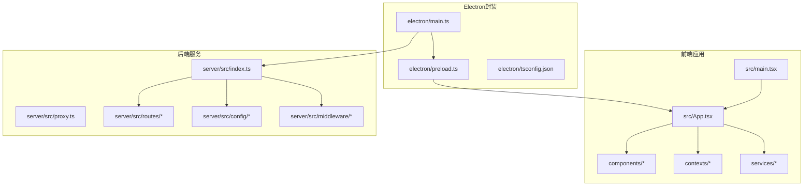
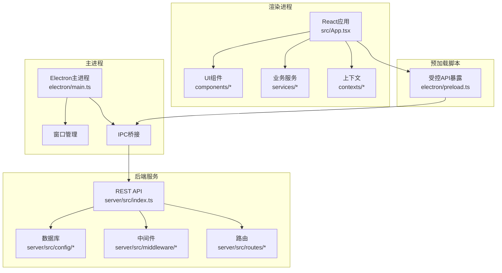
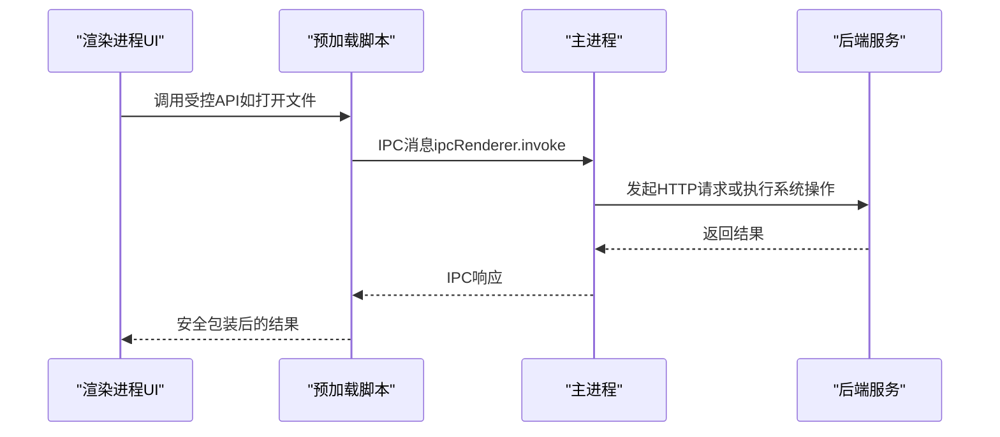
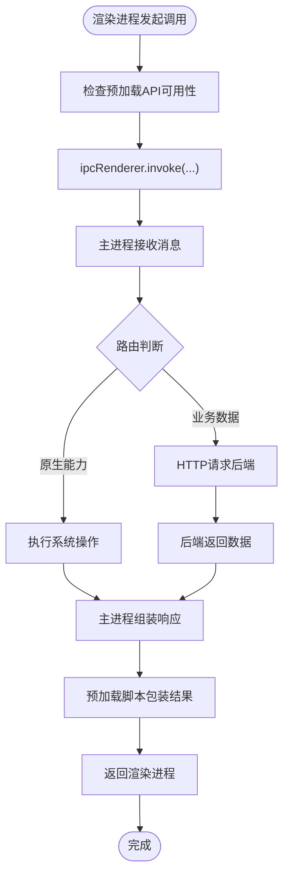
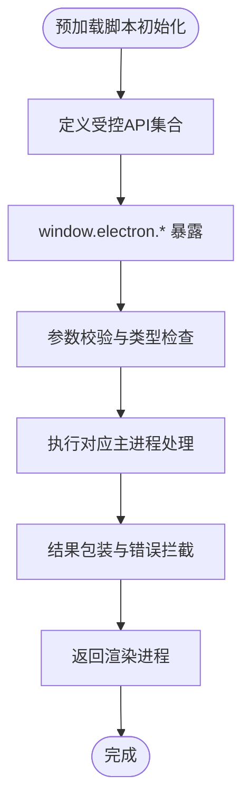
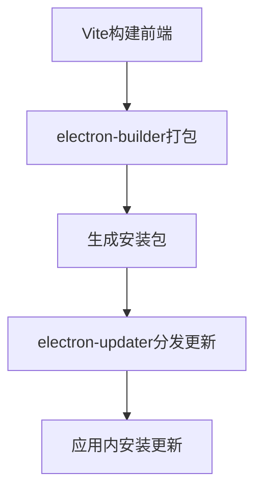
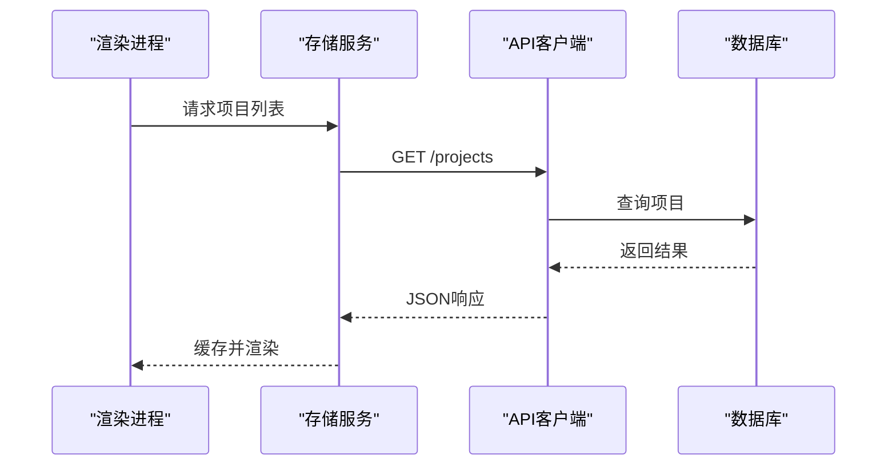
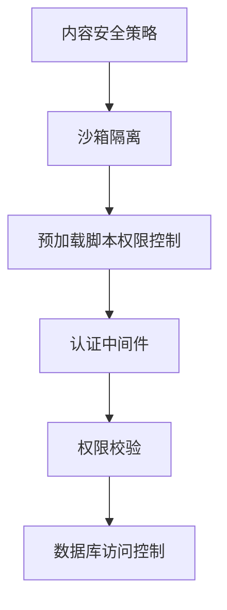
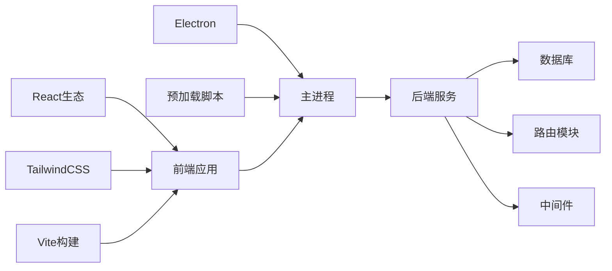

# 桌面客户端架构

<cite>
**本文档引用的文件**
- [package.json](file://package.json)
- [vite.config.ts](file://vite.config.ts)
- [tsconfig.json](file://tsconfig.json)
- [src/main.tsx](file://src/main.tsx)
- [src/App.tsx](file://src/App.tsx)
- [src/config.ts](file://src/config.ts)
- [electron/main.ts](file://electron/main.ts)
- [electron/preload.ts](file://electron/preload.ts)
- [electron/tsconfig.json](file://electron/tsconfig.json)
- [electron-builder.yml](file://electron-builder.yml)
- [scripts/build-electron.sh](file://scripts/build-electron.sh)
- [server/src/index.ts](file://server/src/index.ts)
- [server/src/proxy.ts](file://server/src/proxy.ts)
- [server/src/config/database.ts](file://server/src/config/database.ts)
- [server/src/config/sqliteDatabase.ts](file://server/src/config/sqliteDatabase.ts)
- [server/src/middleware/auth.ts](file://server/src/middleware/auth.ts)
- [server/src/routes/projects.ts](file://server/src/routes/projects.ts)
- [server/src/routes/dataTransfer.ts](file://server/src/routes/dataTransfer.ts)
- [services/apiClient.ts](file://services/apiClient.ts)
- [services/storageService.ts](file://services/storageService.ts)
- [services/taskService.ts](file://services/taskService.ts)
- [services/modelService.ts](file://services/modelService.ts)
- [services/adapters/index.ts](file://services/adapters/index.ts)
- [services/adapters/chatAdapter.ts](file://services/adapters/chatAdapter.ts)
- [services/adapters/imageAdapter.ts](file://services/adapters/imageAdapter.ts)
- [services/adapters/videoAdapter.ts](file://services/adapters/videoAdapter.ts)
- [services/adapters/dashscopeVideoAdapter.ts](file://services/adapters/dashscopeVideoAdapter.ts)
- [services/adapters/volcengineVideoAdapter.ts](file://services/adapters/volcengineVideoAdapter.ts)
- [components/Dashboard.tsx](file://components/Dashboard.tsx)
- [components/Login.tsx](file://components/Login.tsx)
- [components/Sidebar.tsx](file://components/Sidebar.tsx)
- [components/GlobalAlert.tsx](file://components/GlobalAlert.tsx)
- [contexts/AuthContext.tsx](file://contexts/AuthContext.tsx)
- [contexts/ThemeContext.tsx](file://contexts/ThemeContext.tsx)
- [lib/utils.ts](file://lib/utils.ts)
</cite>

## 目录
1. [简介](#简介)
2. [项目结构](#项目结构)
3. [核心组件](#核心组件)
4. [架构总览](#架构总览)
5. [详细组件分析](#详细组件分析)
6. [依赖关系分析](#依赖关系分析)
7. [性能考虑](#性能考虑)
8. [故障排除指南](#故障排除指南)
9. [结论](#结论)
10. [附录](#附录)

## 简介
本项目是一个基于React的桌面客户端应用，采用Electron作为桌面运行时，结合Vite构建工具链。应用提供AI驱动的漫画创作工作流，支持角色、场景、道具等资产管理和视频生成导出。本文档从架构角度深入解析主进程与渲染进程分离设计、IPC通信机制、预加载脚本安全策略、打包配置、自动更新机制、跨平台兼容性、数据同步与本地存储、原生功能集成、安全沙箱与权限管理，以及性能优化实践。

## 项目结构
项目采用前后端分离与多包组织方式：
- 前端（React + Vite）：位于src目录，包含应用入口、配置、样式与业务组件
- Electron封装：位于electron目录，包含主进程、预加载脚本与独立TS配置
- 后端服务：位于server目录，提供REST API、数据库与中间件
- 业务服务层：位于services目录，封装适配器、任务调度与存储
- 组件库：位于components目录，按功能域划分的UI组件
- 上下文：位于contexts目录，状态上下文管理
- 工具与类型：位于lib与types目录

**图表来源**
- [src/main.tsx:1-6](file://src/main.tsx#L1-L6)
- [src/App.tsx:1-6](file://src/App.tsx#L1-L6)
- [electron/main.ts:1-50](file://electron/main.ts#L1-L50)
- [electron/preload.ts:1-50](file://electron/preload.ts#L1-L50)
- [server/src/index.ts:1-50](file://server/src/index.ts#L1-L50)

**章节来源**
- [package.json:1-26](file://package.json#L1-L26)
- [vite.config.ts:1-13](file://vite.config.ts#L1-L13)
- [tsconfig.json:1-21](file://tsconfig.json#L1-L21)

## 核心组件
- 应用入口与渲染进程：React应用通过Vite构建，在渲染进程中运行，负责UI交互与业务逻辑
- 主进程：Electron主进程负责窗口生命周期、系统级事件与IPC桥接
- 预加载脚本：在受限上下文中暴露受控API给渲染进程，确保安全隔离
- 业务服务：封装AI适配器、任务调度、模型管理、存储与导出等功能
- 后端服务：提供认证、项目管理、数据传输、任务队列等REST接口
- 数据库：支持SQLite与MySQL配置，提供项目持久化与并发控制

**章节来源**
- [src/main.tsx:1-6](file://src/main.tsx#L1-L6)
- [src/App.tsx:1-6](file://src/App.tsx#L1-L6)
- [electron/main.ts:1-50](file://electron/main.ts#L1-L50)
- [electron/preload.ts:1-50](file://electron/preload.ts#L1-L50)
- [server/src/index.ts:1-50](file://server/src/index.ts#L1-L50)

## 架构总览
应用采用“渲染进程 + 主进程 + 预加载脚本”的经典Electron架构，并通过Vite进行开发与构建。后端服务提供统一的数据访问与业务能力，前端通过HTTP与IPC与后端交互。整体架构强调模块化、可扩展性与安全性。

**图表来源**
- [src/App.tsx:1-6](file://src/App.tsx#L1-L6)
- [electron/main.ts:1-50](file://electron/main.ts#L1-L50)
- [electron/preload.ts:1-50](file://electron/preload.ts#L1-L50)
- [server/src/index.ts:1-50](file://server/src/index.ts#L1-L50)

## 详细组件分析

### 主进程与渲染进程分离设计
- 渲染进程职责：承载React应用，处理用户界面与交互逻辑，调用预加载脚本暴露的受控API
- 主进程职责：管理窗口生命周期、系统菜单、托盘、对话框与原生系统能力；作为IPC中继，协调渲染进程与后端服务
- 安全边界：通过预加载脚本限制渲染进程直接访问Node/Electron API，仅暴露必要接口

**图表来源**
- [electron/main.ts:1-50](file://electron/main.ts#L1-L50)
- [electron/preload.ts:1-50](file://electron/preload.ts#L1-L50)
- [server/src/index.ts:1-50](file://server/src/index.ts#L1-L50)

**章节来源**
- [electron/main.ts:1-50](file://electron/main.ts#L1-L50)
- [electron/preload.ts:1-50](file://electron/preload.ts#L1-L50)

### IPC通信机制
- 渲染进程通过预加载脚本暴露的API发起IPC调用，主进程接收并处理，再返回结果
- IPC用于文件选择、系统通知、原生菜单、托盘与对话框等原生能力调用
- 业务数据通过HTTP REST接口访问后端服务，避免在IPC中传递复杂数据

**图表来源**
- [electron/preload.ts:1-50](file://electron/preload.ts#L1-L50)
- [electron/main.ts:1-50](file://electron/main.ts#L1-L50)
- [server/src/index.ts:1-50](file://server/src/index.ts#L1-L50)

**章节来源**
- [electron/preload.ts:1-50](file://electron/preload.ts#L1-L50)
- [electron/main.ts:1-50](file://electron/main.ts#L1-L50)

### 预加载脚本安全策略
- 仅暴露必要API：通过预加载脚本向渲染进程暴露受控方法，隐藏底层Node/Electron细节
- 权限最小化：每个API调用明确参数校验与返回值约束，避免越权访问
- 上下文隔离：预加载脚本在受限上下文执行，防止直接注入全局对象
- 错误处理：对IPC调用失败与异常进行捕获与反馈，避免信息泄露

**图表来源**
- [electron/preload.ts:1-50](file://electron/preload.ts#L1-L50)

**章节来源**
- [electron/preload.ts:1-50](file://electron/preload.ts#L1-L50)

### 打包配置与自动更新机制
- 打包工具：使用electron-builder进行多平台打包，配置文件位于根目录
- 构建脚本：通过脚本编排Vite构建与Electron打包流程
- 自动更新：基于electron-updater实现应用内更新，支持Windows/macOS/Linux
- 版本管理：通过package.json版本号与构建产物关联，发布渠道与签名策略需在构建配置中定义

**图表来源**
- [electron-builder.yml:1-50](file://electron-builder.yml#L1-L50)
- [scripts/build-electron.sh:1-50](file://scripts/build-electron.sh#L1-L50)

**章节来源**
- [electron-builder.yml:1-50](file://electron-builder.yml#L1-L50)
- [scripts/build-electron.sh:1-50](file://scripts/build-electron.sh#L1-L50)

### 跨平台兼容性处理
- 平台差异：针对不同操作系统调整窗口行为、路径分隔符、文件权限与原生菜单
- 资源图标：通过electron-builder配置不同平台的图标与安装器资源
- 文件系统：统一使用POSIX风格路径，避免硬编码分隔符
- 系统集成：根据平台启用托盘、Dock菜单或系统通知

**章节来源**
- [electron/main.ts:1-50](file://electron/main.ts#L1-L50)
- [electron-builder.yml:1-50](file://electron-builder.yml#L1-L50)

### 数据同步策略与本地存储
- 同步策略：通过后端REST接口实现项目、资产与任务的增删改查，保证数据一致性
- 本地缓存：渲染进程维护轻量级内存缓存，减少重复网络请求
- 存储服务：封装统一的存储接口，支持本地文件与远程仓库切换
- 事务与锁：后端使用互斥锁与事务保证并发写入安全

**图表来源**
- [services/storageService.ts:1-50](file://services/storageService.ts#L1-L50)
- [services/apiClient.ts:1-50](file://services/apiClient.ts#L1-L50)
- [server/src/routes/projects.ts:1-50](file://server/src/routes/projects.ts#L1-L50)
- [server/src/config/sqliteDatabase.ts:1-50](file://server/src/config/sqliteDatabase.ts#L1-L50)

**章节来源**
- [services/storageService.ts:1-50](file://services/storageService.ts#L1-L50)
- [services/apiClient.ts:1-50](file://services/apiClient.ts#L1-L50)
- [server/src/routes/projects.ts:1-50](file://server/src/routes/projects.ts#L1-L50)
- [server/src/config/sqliteDatabase.ts:1-50](file://server/src/config/sqliteDatabase.ts#L1-L50)

### 原生功能集成
- 文件系统：通过预加载脚本调用系统文件对话框，读取/保存项目与媒体文件
- 系统通知：在任务完成或错误时推送系统通知
- 托盘菜单：提供最小化到托盘与快速操作入口
- 复制粘贴：支持跨应用复制图像与文本，提升工作流效率

**章节来源**
- [electron/main.ts:1-50](file://electron/main.ts#L1-L50)
- [electron/preload.ts:1-50](file://electron/preload.ts#L1-L50)

### 安全沙箱与权限管理
- 内容安全策略：限制渲染进程加载不受信任内容，避免XSS与代码注入
- 预加载脚本权限：严格限定API范围，避免直接暴露敏感Node API
- 认证中间件：后端路由统一接入认证中间件，校验令牌有效性
- 数据访问控制：基于用户会话与项目权限控制数据读写

**图表来源**
- [server/src/middleware/auth.ts:1-50](file://server/src/middleware/auth.ts#L1-L50)
- [electron/preload.ts:1-50](file://electron/preload.ts#L1-L50)

**章节来源**
- [server/src/middleware/auth.ts:1-50](file://server/src/middleware/auth.ts#L1-L50)
- [electron/preload.ts:1-50](file://electron/preload.ts#L1-L50)

### 性能优化技巧
- 懒加载与分割：按需加载组件与路由，减少首屏体积
- 缓存策略：利用内存缓存与HTTP缓存降低重复请求
- 图片与媒体：压缩与懒加载策略，避免阻塞主线程
- 渲染优化：合理使用React.memo与useMemo，避免不必要的重渲染
- 打包优化：Tree-shaking与按需引入第三方库，减小bundle大小

**章节来源**
- [vite.config.ts:1-13](file://vite.config.ts#L1-L13)
- [tsconfig.json:1-21](file://tsconfig.json#L1-L21)

## 依赖关系分析
- 前端依赖：React、TailwindCSS、Vite插件生态
- Electron依赖：Electron主进程、预加载脚本与构建工具
- 后端依赖：数据库驱动、认证中间件与路由模块
- 业务依赖：适配器模式封装第三方AI服务，统一调用接口

**图表来源**
- [package.json:1-26](file://package.json#L1-L26)
- [vite.config.ts:1-13](file://vite.config.ts#L1-L13)
- [electron/main.ts:1-50](file://electron/main.ts#L1-L50)
- [server/src/index.ts:1-50](file://server/src/index.ts#L1-L50)

**章节来源**
- [package.json:1-26](file://package.json#L1-L26)
- [vite.config.ts:1-13](file://vite.config.ts#L1-L13)
- [electron/main.ts:1-50](file://electron/main.ts#L1-L50)
- [server/src/index.ts:1-50](file://server/src/index.ts#L1-L50)

## 性能考虑
- 构建性能：启用并行构建与增量编译，减少开发等待时间
- 运行时性能：避免在渲染进程执行CPU密集型任务，必要时通过Web Workers或主进程处理
- 网络性能：合并请求、使用长连接与CDN加速静态资源
- 存储性能：合理分区与索引，避免大文件频繁读写

## 故障排除指南
- 打包失败：检查electron-builder配置与脚本路径，确认依赖安装完整
- IPC调用异常：验证预加载脚本API定义与主进程监听逻辑
- 数据库连接问题：核对数据库配置与连接字符串，检查权限与网络
- 自动更新失败：确认更新服务器可达、证书有效与签名策略正确

**章节来源**
- [electron-builder.yml:1-50](file://electron-builder.yml#L1-L50)
- [electron/main.ts:1-50](file://electron/main.ts#L1-L50)
- [server/src/config/database.ts:1-50](file://server/src/config/database.ts#L1-L50)

## 结论
本架构以Electron为核心，结合React与Vite构建现代化桌面应用，通过严格的预加载脚本安全策略与后端REST接口实现数据与能力的安全访问。模块化的服务层与适配器模式提升了可扩展性，跨平台打包与自动更新机制保障了用户体验。建议持续完善测试覆盖、监控告警与安全审计，以支撑长期演进。

## 附录
- 开发环境：Node.js、pnpm/yarn/npm、Git
- 构建命令：开发模式、生产构建与打包
- 配置要点：路径别名、TypeScript路径映射、Tailwind集成

**章节来源**
- [vite.config.ts:1-13](file://vite.config.ts#L1-L13)
- [tsconfig.json:1-21](file://tsconfig.json#L1-L21)
- [package.json:1-26](file://package.json#L1-L26)