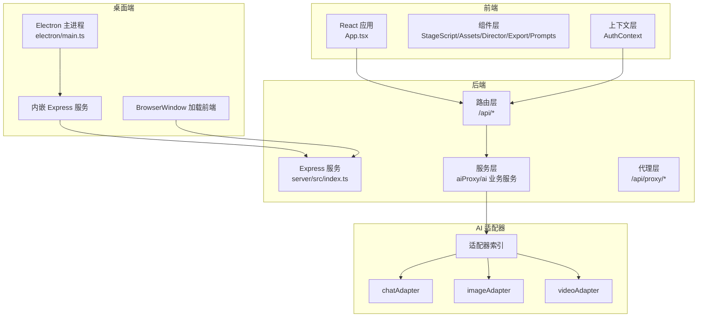
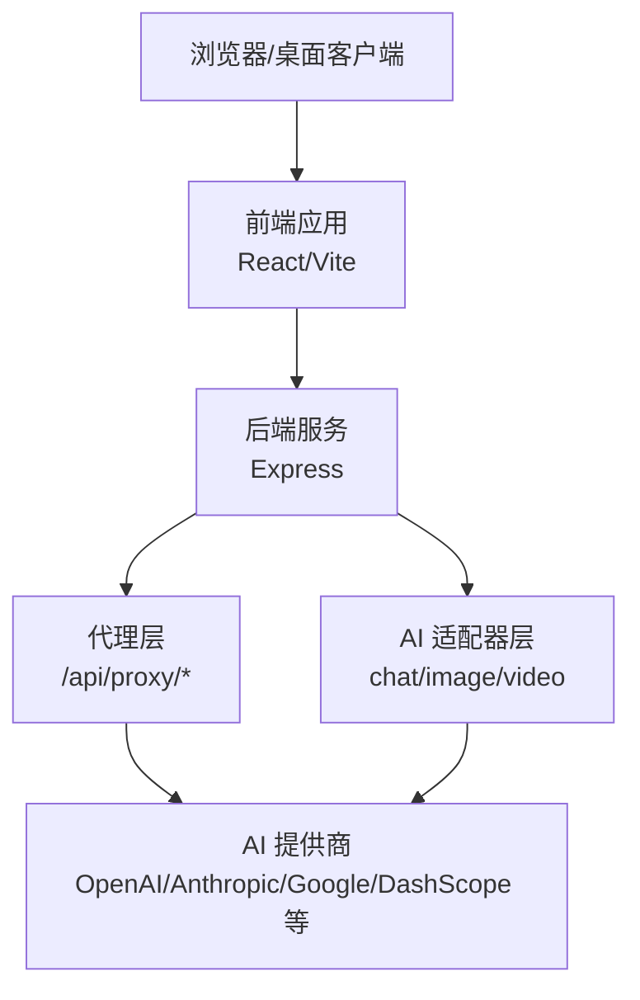
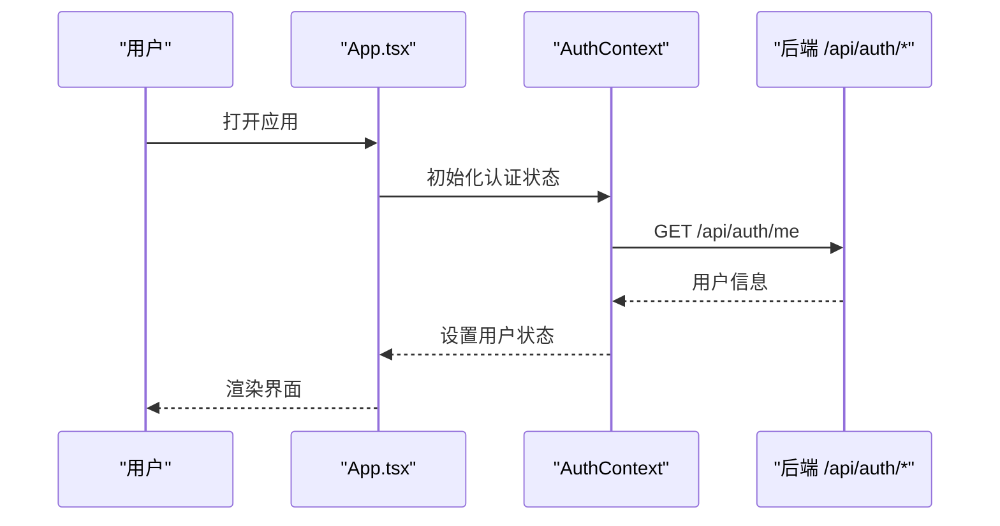
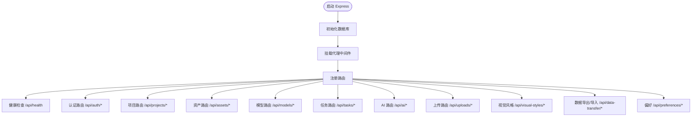
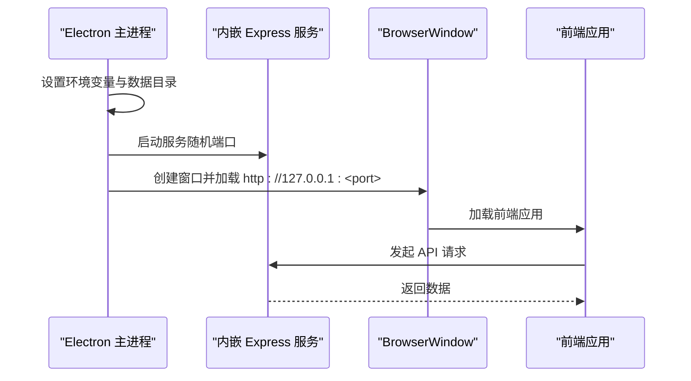
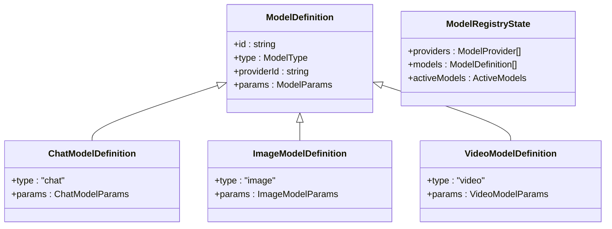
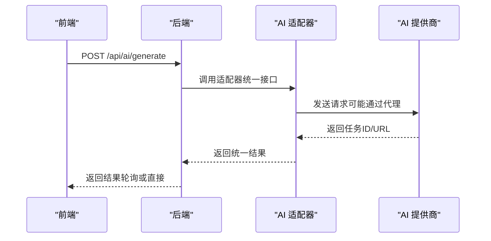
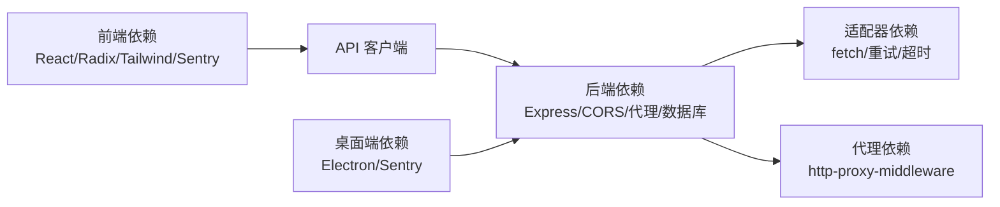

# 系统架构设计

<cite>
**本文档引用的文件**
- [package.json](file://package.json)
- [README.md](file://README.md)
- [App.tsx](file://App.tsx)
- [server/src/index.ts](file://server/src/index.ts)
- [electron/main.ts](file://electron/main.ts)
- [types/model.ts](file://types/model.ts)
- [services/adapters/index.ts](file://services/adapters/index.ts)
- [services/adapters/chatAdapter.ts](file://services/adapters/chatAdapter.ts)
- [services/adapters/imageAdapter.ts](file://services/adapters/imageAdapter.ts)
- [services/adapters/videoAdapter.ts](file://services/adapters/videoAdapter.ts)
- [server/src/routes/ai.ts](file://server/src/routes/ai.ts)
- [server/src/services/aiProxy.ts](file://server/src/services/aiProxy.ts)
- [server/src/proxy.ts](file://server/src/proxy.ts)
- [contexts/AuthContext.tsx](file://contexts/AuthContext.tsx)
</cite>

## 目录
1. [引言](#引言)
2. [项目结构](#项目结构)
3. [核心组件](#核心组件)
4. [架构总览](#架构总览)
5. [详细组件分析](#详细组件分析)
6. [依赖关系分析](#依赖关系分析)
7. [性能考量](#性能考量)
8. [故障排除指南](#故障排除指南)
9. [结论](#结论)

## 引言

AI Shotlive Director 是一个面向创作者的“小说 → 剧本 → 分镜 → 资产 → 关键帧 → 成片”的工业级短剧/漫剧生成平台。系统采用前后端分离设计，结合分层架构与多平台支持策略，提供统一的 AI 适配器层，屏蔽多厂商模型差异，实现跨平台（Web、桌面）的一致体验。

本架构文档聚焦以下目标：
- 整体架构模式：前后端分离、分层架构、多平台支持
- 前端 React 应用、后端 Express 服务、桌面客户端 Electron 应用的协作关系
- 数据流架构与安全架构设计
- AI 适配器层的统一接口设计与关键决策权衡
- 系统边界、组件交互图与技术选型说明

## 项目结构

系统采用典型的现代全栈项目组织方式，前端使用 React/Vite，后端使用 Express，桌面端使用 Electron，AI 服务通过适配器层统一调用。

**图表来源**
- [App.tsx:1-380](file://App.tsx#L1-L380)
- [server/src/index.ts:1-173](file://server/src/index.ts#L1-L173)
- [electron/main.ts:1-129](file://electron/main.ts#L1-L129)
- [services/adapters/index.ts:1-17](file://services/adapters/index.ts#L1-L17)

**章节来源**
- [README.md:127-138](file://README.md#L127-L138)
- [package.json:1-83](file://package.json#L1-L83)

## 核心组件

- 前端应用（React/Vite）
  - 负责用户界面、状态管理、组件化工作流（剧本、资产、导演、导出、提示词）
  - 通过上下文层进行认证状态管理与偏好同步
- 后端服务（Express）
  - 提供 RESTful API、认证中间件、数据库连接、任务调度与代理
  - 统一健康检查、CORS、静态资源托管（生产环境）
- 桌面客户端（Electron）
  - 内嵌 Express 服务与 BrowserWindow，提供本地 SQLite 数据存储与离线体验
- AI 适配器层
  - 统一聊天、图像、视频模型调用接口，屏蔽多厂商差异
  - 支持重试、超时、错误处理与跨平台兼容

**章节来源**
- [App.tsx:1-380](file://App.tsx#L1-L380)
- [contexts/AuthContext.tsx:1-189](file://contexts/AuthContext.tsx#L1-L189)
- [server/src/index.ts:1-173](file://server/src/index.ts#L1-L173)
- [electron/main.ts:1-129](file://electron/main.ts#L1-L129)
- [types/model.ts:1-875](file://types/model.ts#L1-L875)

## 架构总览

系统采用“前端 + 后端 + 桌面端 + AI 适配器”四层协同架构：

- 前端与后端通过 REST API 通信，使用 JWT 进行认证
- 桌面端内嵌后端服务，使用本地 SQLite 数据库，避免外部依赖
- AI 适配器层提供统一接口，支持多厂商模型与协议
- 代理层解决浏览器 CORS 限制，保障跨域调用稳定性

**图表来源**
- [server/src/proxy.ts:1-51](file://server/src/proxy.ts#L1-L51)
- [server/src/services/aiProxy.ts:1-906](file://server/src/services/aiProxy.ts#L1-L906)
- [services/adapters/chatAdapter.ts:1-217](file://services/adapters/chatAdapter.ts#L1-L217)
- [services/adapters/imageAdapter.ts:1-417](file://services/adapters/imageAdapter.ts#L1-L417)
- [services/adapters/videoAdapter.ts:1-624](file://services/adapters/videoAdapter.ts#L1-L624)

## 详细组件分析

### 前端应用（React）

- 组件化工作流
  - 脚本与分镜（StageScript）、资产（StageAssets）、导演工作台（StageDirector）、导出（StageExport）、提示词（StagePrompts）
  - 仪表盘（Dashboard）与引导流程（Onboarding）
- 状态与导航
  - 通过项目状态与阶段切换实现页面导航，支持剧集隔离与增量保存
- 错误处理
  - 全局捕获 API Key 错误，自动弹出模型配置窗口
- 认证与偏好
  - 使用 AuthContext 管理登录状态、用户信息与主题偏好同步

**图表来源**
- [App.tsx:1-380](file://App.tsx#L1-L380)
- [contexts/AuthContext.tsx:1-189](file://contexts/AuthContext.tsx#L1-L189)

**章节来源**
- [App.tsx:1-380](file://App.tsx#L1-L380)
- [contexts/AuthContext.tsx:1-189](file://contexts/AuthContext.tsx#L1-L189)

### 后端服务（Express）

- 路由与中间件
  - 认证中间件保护 API，CORS 支持跨域，JSON/URL 编码解析
- 数据与存储
  - 支持 MySQL 与 SQLite（本地模式），数据库池初始化与健康检查
- 代理与安全
  - 第三方 API 代理，生产环境静态资源托管与 SPA 回退
  - JWT 密钥强制配置（生产环境）
- 任务与恢复
  - 后台任务恢复机制，确保服务重启后任务连续性

**图表来源**
- [server/src/index.ts:1-173](file://server/src/index.ts#L1-L173)

**章节来源**
- [server/src/index.ts:1-173](file://server/src/index.ts#L1-L173)

### 桌面客户端（Electron）

- 内嵌服务
  - Electron 主进程启动内嵌 Express 服务，使用本地 SQLite 数据库
  - 设置用户数据目录，确保数据隔离与可移植性
- 窗口与导航
  - 创建 BrowserWindow 加载本地服务地址，外部链接在系统浏览器打开
- 打包与发布
  - electron-builder 配置，支持 macOS 与 Windows 平台

**图表来源**
- [electron/main.ts:1-129](file://electron/main.ts#L1-L129)

**章节来源**
- [electron/main.ts:1-129](file://electron/main.ts#L1-L129)

### AI 适配器层（统一接口）

- 统一导出
  - 适配器索引集中导出聊天、图像、视频调用函数，屏蔽具体实现
- 聊天模型适配（chatAdapter）
  - 支持 OpenAI 兼容协议，参数合并、JSON 响应清理、超时与重试
  - API Key 校验与错误分类
- 图像模型适配（imageAdapter）
  - 支持 Gemini generateContent、OpenAI/火山引擎 images/generations、DashScope 原生格式
  - 参考图归一化、CORS 降级处理、异步轮询
- 视频模型适配（videoAdapter）
  - 支持 Veo 同步与 Sora 异步模式，参考图处理、尺寸调整、轮询下载
  - DashScope 与火山引擎原生适配器集成
- 服务端代理（aiProxy）
  - 服务端直连 AI 提供商，绕过浏览器 CORS 限制
  - 通用异步视频任务创建与轮询、下载归一化
  - 参考图归一化（HTTP URL 下载为 base64）

**图表来源**
- [types/model.ts:1-875](file://types/model.ts#L1-L875)

**章节来源**
- [services/adapters/index.ts:1-17](file://services/adapters/index.ts#L1-L17)
- [services/adapters/chatAdapter.ts:1-217](file://services/adapters/chatAdapter.ts#L1-L217)
- [services/adapters/imageAdapter.ts:1-417](file://services/adapters/imageAdapter.ts#L1-L417)
- [services/adapters/videoAdapter.ts:1-624](file://services/adapters/videoAdapter.ts#L1-L624)
- [server/src/services/aiProxy.ts:1-906](file://server/src/services/aiProxy.ts#L1-L906)
- [types/model.ts:1-875](file://types/model.ts#L1-L875)

### 数据流架构

- 前端 → 后端：REST API 调用，认证中间件保护
- 后端 → AI 提供商：通过代理层或适配器直连，支持重试与超时
- 服务端代理：统一处理第三方 API 的 CORS 与跨域问题
- 任务与状态：异步任务通过轮询查询状态，完成后下载资源并返回前端

**图表来源**
- [server/src/routes/ai.ts:1-35](file://server/src/routes/ai.ts#L1-L35)
- [server/src/services/aiProxy.ts:1-906](file://server/src/services/aiProxy.ts#L1-L906)
- [services/adapters/chatAdapter.ts:1-217](file://services/adapters/chatAdapter.ts#L1-L217)
- [services/adapters/imageAdapter.ts:1-417](file://services/adapters/imageAdapter.ts#L1-L417)
- [services/adapters/videoAdapter.ts:1-624](file://services/adapters/videoAdapter.ts#L1-L624)

**章节来源**
- [server/src/routes/ai.ts:1-35](file://server/src/routes/ai.ts#L1-L35)
- [server/src/proxy.ts:1-51](file://server/src/proxy.ts#L1-L51)

### 安全架构设计

- 认证与授权
  - JWT 令牌管理，认证中间件保护路由
  - 生产环境强制配置 JWT_SECRET，防止默认密钥被利用
- 数据隔离
  - 用户数据按 user_id 隔离，剧集内数据按 episode_id 隔离
- 传输安全
  - HTTPS 代理与提供商调用，敏感信息（API Key）通过适配器与代理层传递
- 错误与审计
  - Sentry 集成，错误上报与性能监控
  - 健康检查与数据库连接验证，实现反馈控制

**章节来源**
- [server/src/index.ts:1-173](file://server/src/index.ts#L1-L173)
- [contexts/AuthContext.tsx:1-189](file://contexts/AuthContext.tsx#L1-L189)

## 依赖关系分析

- 前端依赖
  - React、Radix UI、Tailwind CSS、Framer Motion、Sentry
  - 通过 apiClient 与后端交互，使用 AuthContext 管理认证状态
- 后端依赖
  - Express、CORS、http-proxy-middleware、dotenv、jsonwebtoken、better-sqlite3/mysql2
  - 通过路由层暴露 API，服务层封装业务逻辑
- 桌面端依赖
  - Electron、@sentry/electron、electron-builder
  - 内嵌服务与本地数据存储

**图表来源**
- [package.json:26-81](file://package.json#L26-L81)
- [server/src/proxy.ts:1-51](file://server/src/proxy.ts#L1-L51)

**章节来源**
- [package.json:1-83](file://package.json#L1-L83)

## 性能考量

- 代理与缓存
  - 代理层统一处理第三方 API，减少前端直连带来的 CORS 与网络问题
- 重试与超时
  - 适配器层与服务端代理均实现指数退避重试，提升失败恢复能力
- 资源下载与转换
  - 服务端统一下载并转换为 base64，减少前端处理负担
- 数据库与任务
  - 数据库存储与任务恢复机制，确保长时间任务的连续性

## 故障排除指南

- API Key 错误
  - 前端全局错误监听捕获 ApiKeyError，自动弹出模型配置窗口
  - 适配器层抛出明确错误信息，便于定位问题
- CORS 与浏览器限制
  - 使用代理层或服务端直连绕过浏览器 CORS 限制
  - 对于不支持浏览器直连的提供商，提示切换为支持代理的服务
- 任务超时与失败
  - 适配器与服务端代理均设置超时与重试，失败时返回明确错误
  - 健康检查接口可用于诊断数据库连接与服务状态

**章节来源**
- [App.tsx:75-106](file://App.tsx#L75-L106)
- [services/adapters/chatAdapter.ts:12-47](file://services/adapters/chatAdapter.ts#L12-L47)
- [services/adapters/imageAdapter.ts:65-83](file://services/adapters/imageAdapter.ts#L65-L83)
- [services/adapters/videoAdapter.ts:27-47](file://services/adapters/videoAdapter.ts#L27-L47)
- [server/src/services/aiProxy.ts:57-82](file://server/src/services/aiProxy.ts#L57-L82)

## 结论

AI Shotlive Director 通过清晰的前后端分离、分层架构与多平台支持策略，实现了跨平台一致的工作流体验。统一的 AI 适配器层有效屏蔽了多厂商模型差异，配合代理层与服务端直连，解决了 CORS 与跨域问题。认证、数据隔离与健康检查构成了系统的安全与可靠性基础。该架构既满足了创作者的高效需求，也为未来扩展与维护提供了良好的技术基座。