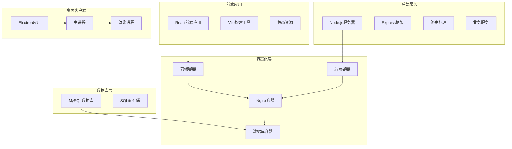
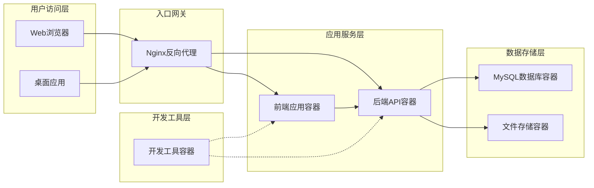
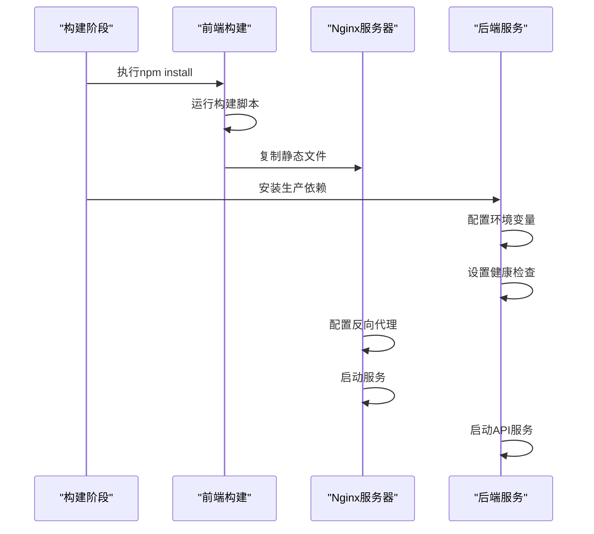
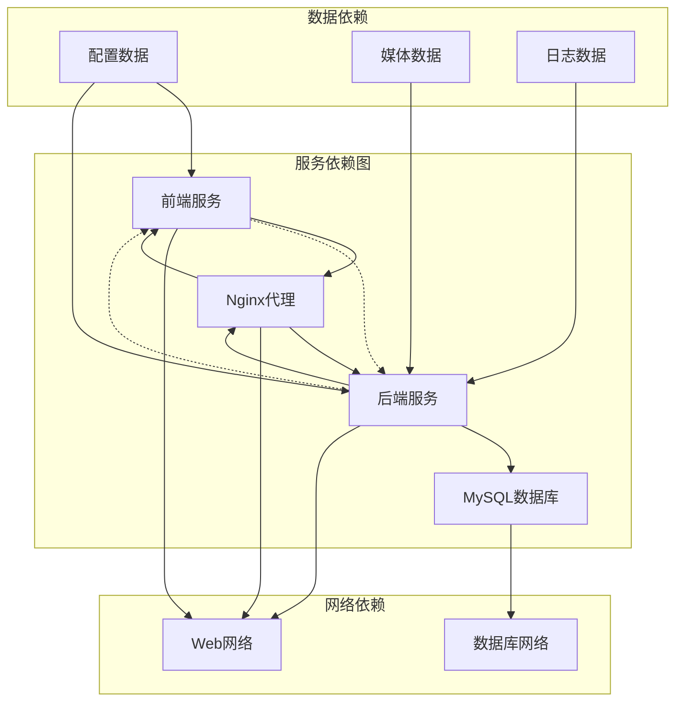

# Docker容器化部署

<cite>
**本文档引用的文件**
- [Dockerfile](file://Dockerfile)
- [docker-compose.yaml](file://docker-compose.yaml)
- [.dockerignore](file://.dockerignore)
- [nginx.conf](file://nginx.conf)
- [nginx.docker.conf](file://nginx.docker.conf)
- [docker-compose.mysql.yaml](file://docker-compose.mysql.yaml)
- [package.json](file://package.json)
- [server/src/index.ts](file://server/src/index.ts)
- [server/src/config/database.ts](file://server/src/config/database.ts)
- [server/src/routes](file://server/src/routes)
- [electron/main.ts](file://electron/main.ts)
- [scripts/build-electron.sh](file://scripts/build-electron.sh)
</cite>

## 目录
1. [简介](#简介)
2. [项目结构](#项目结构)
3. [核心组件](#核心组件)
4. [架构概览](#架构概览)
5. [详细组件分析](#详细组件分析)
6. [依赖关系分析](#依赖关系分析)
7. [性能考虑](#性能考虑)
8. [故障排除指南](#故障排除指南)
9. [结论](#结论)
10. [附录](#附录)

## 简介

AI Shotlive是一个基于React和Electron的视频生成应用，支持AI驱动的视频创作功能。本项目提供了完整的Docker容器化部署方案，包括多阶段构建、前后端分离部署、数据库容器化以及生产环境优化。

本文档详细说明了Docker容器化部署的各个方面，包括多阶段Docker构建过程、前端构建优化、后端编译配置、生产镜像优化策略、健康检查配置、以及完整的docker-compose服务编排。

## 项目结构

AI Shotlive项目采用现代化的全栈架构，包含前端React应用、后端Node.js服务器、以及Electron桌面客户端。项目结构清晰地分离了不同功能模块：



**图表来源**
- [Dockerfile](file://Dockerfile)
- [docker-compose.yaml](file://docker-compose.yaml)
- [server/src/index.ts](file://server/src/index.ts)

**章节来源**
- [Dockerfile](file://Dockerfile)
- [docker-compose.yaml](file://docker-compose.yaml)
- [package.json](file://package.json)

## 核心组件

### 前端构建系统

前端应用基于Vite构建工具，提供了快速的开发体验和高效的生产构建。构建流程包括代码转换、资源优化、以及多环境配置。

### 后端服务架构

后端采用Node.js + Express框架，提供RESTful API服务。服务架构包括：
- 身份验证中间件
- 业务逻辑服务层
- 数据库连接管理
- 文件存储服务

### 数据持久化策略

系统支持多种存储后端：
- MySQL用于生产环境的主数据库
- SQLite用于开发和测试环境
- 文件系统用于媒体资源存储

### 容器编排系统

使用Docker Compose进行多容器编排，包括：
- 前端Web应用容器
- 后端API服务容器
- MySQL数据库容器
- Nginx反向代理容器

**章节来源**
- [server/src/index.ts](file://server/src/index.ts)
- [server/src/config/database.ts](file://server/src/config/database.ts)
- [electron/main.ts](file://electron/main.ts)

## 架构概览

AI Shotlive的容器化架构采用了微服务设计理念，将不同的功能模块分离到独立的容器中，实现了高内聚、低耦合的系统设计。



**图表来源**
- [docker-compose.yaml](file://docker-compose.yaml)
- [nginx.conf](file://nginx.conf)
- [server/src/routes](file://server/src/routes)

## 详细组件分析

### 多阶段Docker构建

系统采用多阶段构建策略，优化了最终镜像大小并提高了安全性。

#### 阶段1：前端构建阶段
- 使用Node.js官方镜像作为基础
- 安装项目依赖并执行构建脚本
- 优化静态资源文件

#### 阶段2：Nginx静态服务器阶段
- 使用轻量级Nginx镜像
- 复制构建产物到Nginx目录
- 配置HTTP缓存和压缩

#### 阶段3：后端服务阶段
- 使用Node.js官方镜像
- 安装生产依赖
- 配置环境变量和健康检查



**图表来源**
- [Dockerfile](file://Dockerfile)
- [scripts/build-electron.sh](file://scripts/build-electron.sh)

### 健康检查配置

系统实现了多层次的健康检查机制：

#### Nginx健康检查
- 检查HTTP响应状态
- 验证静态资源可用性
- 监控反向代理连接

#### 后端API健康检查
- 检查数据库连接
- 验证核心API端点
- 监控内存使用情况

#### 数据库健康检查
- 验证MySQL连接
- 检查表结构完整性
- 监控查询性能

**章节来源**
- [Dockerfile](file://Dockerfile)
- [server/src/config/database.ts](file://server/src/config/database.ts)

### 前端构建优化

前端构建过程经过精心优化，以确保最佳的性能和用户体验：

#### 代码分割策略
- 按路由进行代码分割
- 动态导入重型库
- 实现懒加载机制

#### 资源优化
- 图片压缩和格式优化
- CSS和JavaScript压缩
- 缓存策略配置

#### 开发环境优化
- 热重载支持
- 错误边界处理
- 性能监控集成

**章节来源**
- [package.json](file://package.json)
- [vite.config.ts](file://vite.config.ts)

### 后端编译配置

后端服务采用TypeScript编译，确保类型安全和代码质量：

#### 编译配置
- TypeScript严格模式
- ES模块输出
- 源码映射生成

#### 运行时优化
- Node.js生产环境配置
- 内存管理优化
- 并发处理配置

#### 安全配置
- 环境变量验证
- 输入参数过滤
- 错误处理机制

**章节来源**
- [server/src/index.ts](file://server/src/index.ts)
- [server/tsconfig.json](file://server/tsconfig.json)

## 依赖关系分析

系统各组件之间的依赖关系复杂而有序，通过Docker Compose实现了自动化的服务发现和通信。



**图表来源**
- [docker-compose.yaml](file://docker-compose.yaml)
- [server/src/config/database.ts](file://server/src/config/database.ts)

### 组件耦合度分析

系统设计遵循了低耦合高内聚的原则：
- 前后端通过API接口通信
- 数据库抽象层隔离存储细节
- 配置管理统一化

### 外部依赖管理

系统对外部依赖进行了严格的版本控制和更新策略：
- Node.js依赖定期更新
- 数据库驱动程序版本锁定
- 安全补丁及时应用

**章节来源**
- [docker-compose.yaml](file://docker-compose.yaml)
- [package.json](file://package.json)

## 性能考虑

### 容器性能优化

#### 资源限制
- CPU和内存使用限制
- 文件描述符限制
- 网络带宽控制

#### 缓存策略
- Docker层缓存利用
- 应用缓存配置
- CDN集成

#### 并发处理
- 连接池配置
- 工作进程数量
- 请求队列管理

### 网络性能优化

#### 反向代理配置
- Gzip压缩启用
- HTTP/2支持
- SSL/TLS优化

#### 数据库连接优化
- 连接池大小调整
- 查询缓存配置
- 索引优化策略

### 存储性能优化

#### 文件系统优化
- 分层存储策略
- 压缩算法选择
- 缓存策略配置

#### 数据库性能调优
- 表结构优化
- 查询计划分析
- 索引维护策略

## 故障排除指南

### 常见部署问题

#### 容器启动失败
- 检查端口占用情况
- 验证环境变量配置
- 查看日志文件

#### 数据库连接问题
- 确认数据库服务状态
- 验证连接参数
- 检查防火墙设置

#### 前端资源加载失败
- 检查静态文件路径
- 验证Nginx配置
- 清除浏览器缓存

### 调试工具和方法

#### 日志分析
- Docker日志查看
- 应用错误日志
- 数据库查询日志

#### 性能监控
- 容器资源使用率
- API响应时间
- 数据库查询性能

#### 网络诊断
- 端口连通性测试
- DNS解析验证
- SSL证书检查

**章节来源**
- [Dockerfile](file://Dockerfile)
- [docker-compose.yaml](file://docker-compose.yaml)

## 结论

AI Shotlive的Docker容器化部署方案提供了一个完整、可扩展、高性能的应用交付解决方案。通过多阶段构建、合理的架构设计、以及全面的监控和优化策略，该方案能够满足从开发到生产的各种需求。

关键优势包括：
- 快速的构建和部署流程
- 良好的性能表现
- 强大的可维护性
- 完善的安全保障

## 附录

### 部署命令参考

#### 基础部署
```bash
# 构建所有服务
docker-compose build

# 启动所有服务
docker-compose up -d

# 停止所有服务
docker-compose down

# 查看服务状态
docker-compose ps
```

#### 开发环境部署
```bash
# 启动开发环境
docker-compose -f docker-compose.yaml -f docker-compose.dev.yaml up -d

# 重新构建开发环境
docker-compose -f docker-compose.yaml -f docker-compose.dev.yaml build --no-cache
```

#### 生产环境部署
```bash
# 启动生产环境
docker-compose -f docker-compose.yaml -f docker-compose.prod.yaml up -d

# 查看生产日志
docker-compose logs -f production_backend
```

### 容器管理指令

#### 容器操作
```bash
# 进入容器
docker exec -it container_name bash

# 查看容器资源使用
docker stats container_name

# 备份容器数据
docker run --rm -v container_name:/data -v $(pwd):/backup alpine tar czf /backup/backup.tar.gz -C /data .

# 恢复容器数据
docker run --rm -v container_name:/data -v $(pwd):/backup alpine tar xzf /backup/backup.tar.gz -C /data
```

#### 镜像管理
```bash
# 查看镜像
docker images

# 清理未使用镜像
docker image prune

# 删除特定镜像
docker rmi image_name

# 推送镜像到仓库
docker push registry/repository:tag
```

### 安全配置建议

#### 最佳实践
- 定期更新基础镜像
- 使用只读文件系统
- 配置适当的用户权限
- 启用容器安全扫描

#### 环境变量管理
- 敏感信息加密存储
- 环境变量验证
- 默认值安全配置

#### 网络安全
- 防火墙规则配置
- TLS证书管理
- 网络隔离策略

### 监控和日志

#### 日志配置
```yaml
logging:
  driver: "json-file"
  options:
    max-size: "10m"
    max-file: "3"
```

#### 健康检查配置
```yaml
healthcheck:
  test: ["CMD", "curl", "-f", "http://localhost:3000/health"]
  interval: 30s
  timeout: 10s
  retries: 3
  start_period: 40s
```

**章节来源**
- [docker-compose.yaml](file://docker-compose.yaml)
- [Dockerfile](file://Dockerfile)