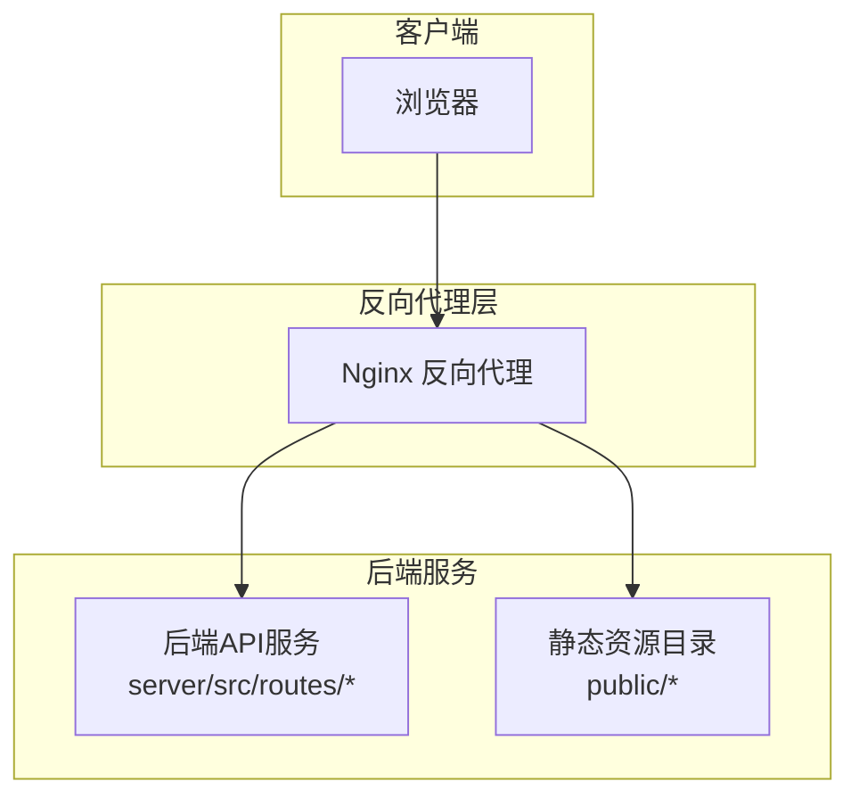
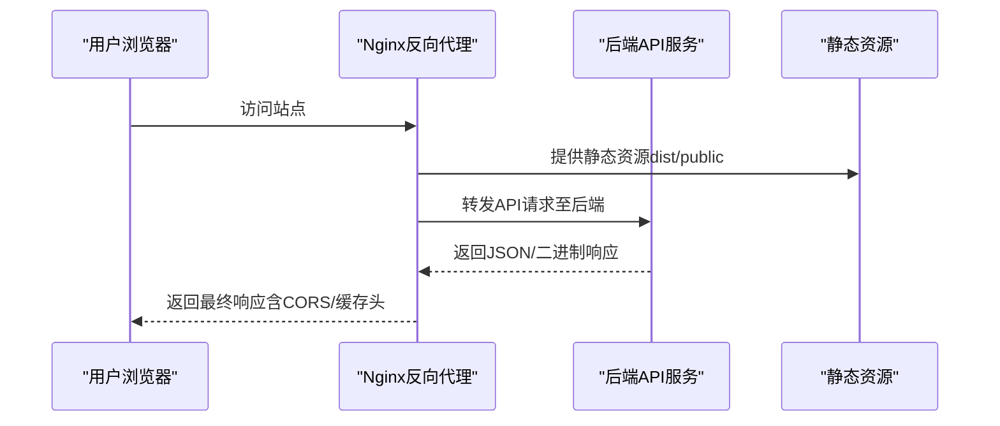
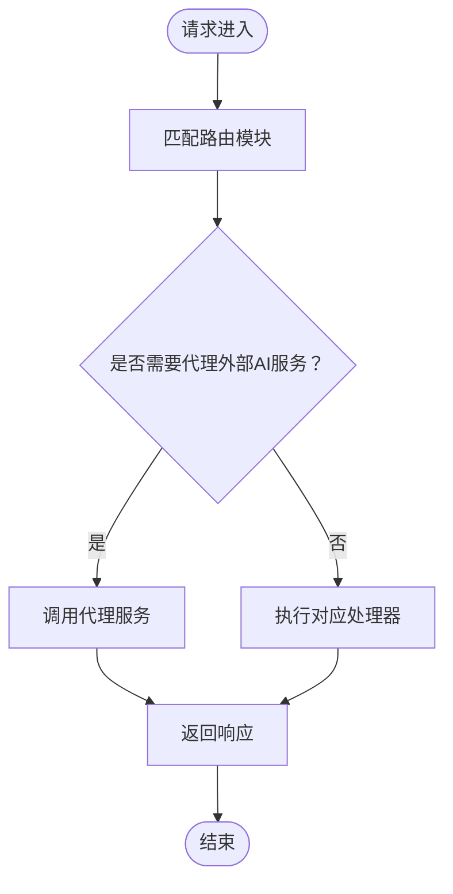
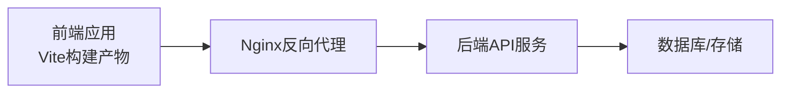

# Web应用部署

<cite>
**本文档引用的文件**
- [package.json](file://package.json)
- [vite.config.ts](file://vite.config.ts)
- [index.html](file://index.html)
- [README.md](file://README.md)
- [docker使用.md](file://docker使用.md)
- [server/src/routes/ai.ts](file://server/src/routes/ai.ts)
- [server/src/routes/assets.ts](file://server/src/routes/assets.ts)
- [server/src/routes/auth.ts](file://server/src/routes/auth.ts)
- [server/src/routes/dataTransfer.ts](file://server/src/routes/dataTransfer.ts)
- [server/src/routes/models.ts](file://server/src/routes/models.ts)
- [server/src/routes/preferences.ts](file://server/src/routes/preferences.ts)
- [server/src/routes/projectPatch.ts](file://server/src/routes/projectPatch.ts)
- [server/src/routes/projects.ts](file://server/src/routes/projects.ts)
- [server/src/routes/tasks.ts](file://server/src/routes/tasks.ts)
- [server/src/routes/uploads.ts](file://server/src/routes/uploads.ts)
- [server/src/routes/visualStyles.ts](file://server/src/routes/visualStyles.ts)
- [server/src/services/aiProxy.ts](file://server/src/services/aiProxy.ts)
- [server/src/services/fileStorage.ts](file://server/src/services/fileStorage.ts)
- [server/src/services/imageResolver.ts](file://server/src/services/imageResolver.ts)
- [server/src/services/projectStorage.ts](file://server/src/services/projectStorage.ts)
- [server/src/services/scriptParser.ts](file://server/src/services/scriptParser.ts)
- [server/src/services/taskRunner.ts](file://server/src/services/taskRunner.ts)
- [server/src/middleware/auth.ts](file://server/src/middleware/auth.ts)
</cite>

## 目录
1. [简介](#简介)
2. [项目结构](#项目结构)
3. [核心组件](#核心组件)
4. [架构总览](#架构总览)
5. [详细组件分析](#详细组件分析)
6. [依赖关系分析](#依赖关系分析)
7. [性能考虑](#性能考虑)
8. [故障排除指南](#故障排除指南)
9. [结论](#结论)
10. [附录](#附录)

## 简介
本部署文档面向AI Shotlive的Web应用，提供从构建到上线的完整指南。内容覆盖前端构建产物部署、静态资源服务、API路由转发、跨域处理、HTTPS配置、生产环境优化（Gzip压缩、缓存头、安全头部）、域名与SSL证书部署、以及负载均衡配置。同时给出部署后验证步骤与性能测试方法，帮助在生产环境中稳定运行。

## 项目结构
AI Shotlive采用前后端分离架构：
- 前端：基于Vite + React的单页应用（SPA），通过Vite进行开发与构建。
- 后端：Node.js服务（位于server目录），提供REST API与业务逻辑。
- 部署：可使用Nginx作为反向代理与静态资源服务器；也可通过容器编排（如Docker Compose）统一部署。

**章节来源**
- [package.json:1-26](file://package.json#L1-L26)
- [vite.config.ts:1-13](file://vite.config.ts#L1-L13)
- [index.html:1-14](file://index.html#L1-L14)

## 核心组件
- 前端构建与入口
  - 构建脚本通过Vite执行，输出静态资源到dist目录。
  - 入口HTML定义根节点与基础路径，确保SPA路由正常工作。
- 后端API路由
  - 路由模块覆盖AI生成、资产、认证、数据传输、模型管理、偏好设置、项目补丁、项目、任务、上传、视觉风格等。
- 代理与中间件
  - 中间件用于鉴权校验。
  - 代理服务负责外部AI服务的请求转发与响应处理。

**章节来源**
- [package.json:6-10](file://package.json#L6-L10)
- [vite.config.ts:5-12](file://vite.config.ts#L5-L12)
- [index.html:10-12](file://index.html#L10-L12)
- [server/src/middleware/auth.ts](file://server/src/middleware/auth.ts)
- [server/src/services/aiProxy.ts](file://server/src/services/aiProxy.ts)

## 架构总览
下图展示从浏览器到后端API与静态资源的整体流转：

**图表来源**
- [index.html:10-12](file://index.html#L10-L12)
- [server/src/routes/ai.ts](file://server/src/routes/ai.ts)
- [server/src/routes/assets.ts](file://server/src/routes/assets.ts)

## 详细组件分析

### Nginx反向代理配置要点
- 静态资源服务
  - 将构建产物（dist）或公共目录（public）映射为静态根目录，启用合适的缓存策略与安全头部。
- API路由转发
  - 将/api前缀的请求转发至后端服务地址（如http://localhost:8080），保持路径与查询参数。
- 跨域处理
  - 在Nginx中设置Access-Control-Allow-Origin、Credentials、Methods、Headers等必要响应头，避免浏览器CORS错误。
- HTTPS配置
  - 使用Let’s Encrypt或自签证书，开启TLS v1.2+，配置强密码套件与HSTS。
- 生产优化
  - 开启Gzip/Br压缩，设置合理的Cache-Control与Expires头，添加安全头部（X-Frame-Options、X-Content-Type-Options、Referrer-Policy等）。

注：本节为通用部署实践说明，具体Nginx配置文件（nginx.conf与nginx.docker.conf）需结合实际环境编写，建议遵循上述要点逐项落地。

### 前端构建产物部署
- 构建命令
  - 使用Vite执行构建，生成静态资源到默认输出目录。
- 部署位置
  - 将dist目录中的所有文件部署到Nginx的静态根目录，确保index.html可被访问。
- SPA路由支持
  - 配置Nginx对未匹配的静态资源返回index.html，以支持前端路由（history模式）。

**章节来源**
- [package.json:8](file://package.json#L8)
- [vite.config.ts:5-12](file://vite.config.ts#L5-L12)
- [index.html:10-12](file://index.html#L10-L12)

### 后端API路由与代理
- 路由模块概览
  - AI生成、资产、认证、数据传输、模型管理、偏好设置、项目补丁、项目、任务、上传、视觉风格等路由。
- 代理服务
  - 外部AI服务请求通过代理服务统一处理，实现超时、重试与响应透传。
- 鉴权中间件
  - 对受保护路由进行鉴权校验，拒绝未授权访问。

**图表来源**
- [server/src/services/aiProxy.ts](file://server/src/services/aiProxy.ts)
- [server/src/middleware/auth.ts](file://server/src/middleware/auth.ts)

**章节来源**
- [server/src/routes/ai.ts](file://server/src/routes/ai.ts)
- [server/src/routes/assets.ts](file://server/src/routes/assets.ts)
- [server/src/routes/auth.ts](file://server/src/routes/auth.ts)
- [server/src/routes/dataTransfer.ts](file://server/src/routes/dataTransfer.ts)
- [server/src/routes/models.ts](file://server/src/routes/models.ts)
- [server/src/routes/preferences.ts](file://server/src/routes/preferences.ts)
- [server/src/routes/projectPatch.ts](file://server/src/routes/projectPatch.ts)
- [server/src/routes/projects.ts](file://server/src/routes/projects.ts)
- [server/src/routes/tasks.ts](file://server/src/routes/tasks.ts)
- [server/src/routes/uploads.ts](file://server/src/routes/uploads.ts)
- [server/src/routes/visualStyles.ts](file://server/src/routes/visualStyles.ts)
- [server/src/services/aiProxy.ts](file://server/src/services/aiProxy.ts)
- [server/src/middleware/auth.ts](file://server/src/middleware/auth.ts)

### 静态文件缓存策略
- 缓存策略建议
  - JS/CSS/字体等静态资源：长缓存（Cache-Control max-age较长），文件名带哈希，版本升级自动失效。
  - HTML：短缓存或不缓存，确保SPA路由更新即时生效。
  - 图片/媒体：根据更新频率设置缓存，配合ETag/Last-Modified。
- 安全与性能
  - 启用Gzip/Br压缩，合理设置Cache-Control与Expires，减少带宽与延迟。

### HTTPS配置与证书部署
- 证书来源
  - 推荐使用Let’s Encrypt自动化证书；企业内网可使用自签证书。
- TLS配置
  - 启用TLS v1.2+，禁用弱密码套件；开启HSTS（Strict-Transport-Security）。
- 证书续期
  - 使用acme-client或certbot定期续期，确保服务连续性。

### 负载均衡配置
- 上游后端
  - 将多个后端实例加入upstream组，实现健康检查与故障转移。
- 反向代理
  - Nginx upstream + keepalive连接复用，提升吞吐量与降低延迟。
- 会话与状态
  - 若后端无状态，可直接分发；若需粘性会话，配置ip_hash或基于Cookie的策略。

## 依赖关系分析
前端与后端通过HTTP接口通信，Nginx作为统一入口承担静态资源与API转发职责。

**图表来源**
- [package.json:8](file://package.json#L8)
- [server/src/routes/ai.ts](file://server/src/routes/ai.ts)

**章节来源**
- [package.json:8](file://package.json#L8)
- [server/src/routes/ai.ts](file://server/src/routes/ai.ts)

## 性能考虑
- 压缩
  - Gzip/Br压缩静态资源，显著降低传输体积。
- 缓存
  - 静态资源长缓存，HTML短缓存；合理设置ETag/Last-Modified。
- 连接
  - 启用keepalive，限制并发连接数，避免资源争用。
- 安全
  - 设置安全头部，防止点击劫持、MIME混淆与敏感信息泄露。
- 监控
  - 记录访问日志与错误日志，结合指标监控（QPS、P95/P99、错误率）。

## 故障排除指南
- 前端路由404
  - 检查Nginx是否将未匹配路径回退到index.html。
- CORS错误
  - 确认Nginx已正确设置跨域响应头，Origin白名单与Credentials配置一致。
- API 502/504
  - 检查后端服务是否启动，Nginx上游地址与端口是否正确，网络连通性与防火墙规则。
- 静态资源404
  - 确认dist/public目录映射正确，文件权限允许读取。
- HTTPS证书问题
  - 检查证书链完整性、域名匹配与过期时间；确认HSTS与混合内容策略。

## 结论
通过Nginx统一反向代理与静态资源服务，结合后端API路由与代理能力，AI Shotlive可在生产环境中实现高可用、高性能与安全的Web应用部署。建议按本文档的配置要点逐步实施，并在上线前完成充分的验证与性能测试。

## 附录

### 部署后验证步骤
- 域名解析与DNS生效
- HTTPS证书安装与浏览器访问
- 静态资源加载（JS/CSS/图片）
- SPA路由跳转与刷新
- API接口连通性与鉴权
- CORS跨域请求验证
- 日志与监控指标检查

### 性能测试方法
- 压力测试
  - 使用ab、wrk或JMeter模拟并发请求，观察QPS、响应时间与错误率。
- 带宽与缓存
  - 测试不同缓存策略下的首屏加载时间与重复访问命中率。
- 安全扫描
  - 扫描常见漏洞（XSS、CSRF、CORS配置不当等），修复后回归测试。