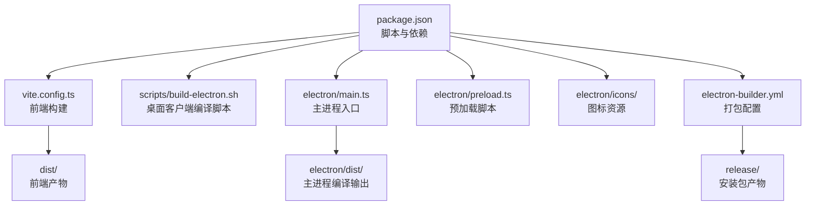
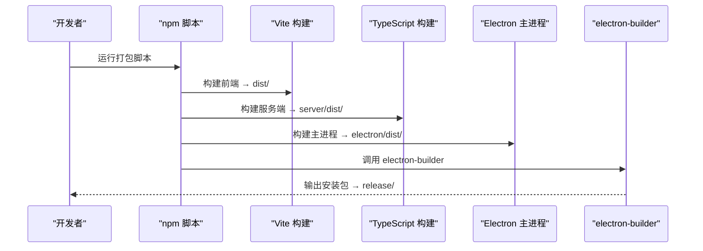
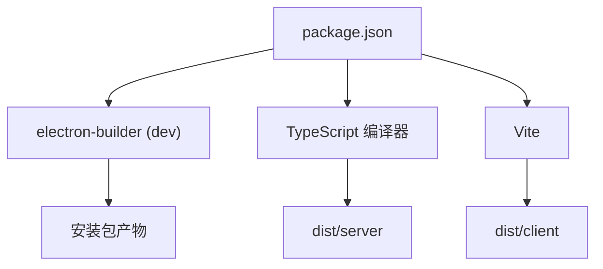

# 桌面客户端部署

<cite>
**本文引用的文件**
- [package.json](file://package.json)
- [vite.config.ts](file://vite.config.ts)
- [README.md](file://README.md)
- [README_EN.md](file://README_EN.md)
- [electron/icons/README.md](file://electron/icons/README.md)
- [electron/tsconfig.json](file://electron/tsconfig.json)
- [server/tsconfig.json](file://server/tsconfig.json)
- [package-lock.json](file://package-lock.json)
</cite>

## 目录
1. [简介](#简介)
2. [项目结构](#项目结构)
3. [核心组件](#核心组件)
4. [架构总览](#架构总览)
5. [详细组件分析](#详细组件分析)
6. [依赖关系分析](#依赖关系分析)
7. [性能考量](#性能考量)
8. [故障排查指南](#故障排查指南)
9. [结论](#结论)
10. [附录](#附录)

## 简介
本文件面向部署与运维工程师，系统性阐述 AI Shotlive 桌面客户端（Electron 应用）的打包与发布流程，覆盖以下主题：
- electron-builder.yml 的关键参数与平台特定配置
- 图标与资源准备
- 主进程与渲染进程的构建流程、预加载脚本作用与安全配置
- build-electron.sh 的功能与使用方法
- 多平台打包（Windows、macOS、Linux）与签名策略
- 自动更新机制与版本管理
- 安装包分发策略与用户升级流程
- 权限配置、沙盒设置与安全最佳实践

## 项目结构
桌面客户端相关的关键目录与文件如下：
- electron/：主进程入口、预加载脚本、图标资源
- scripts/：构建脚本（含 build-electron.sh）
- electron-builder.yml：打包配置（由 README 指出存在）
- vite.config.ts：前端构建配置
- package.json：脚本与依赖声明
- package-lock.json：依赖锁定，包含 electron-builder 及相关工具

图表来源
- [package.json:1-26](file://package.json#L1-L26)
- [vite.config.ts:1-13](file://vite.config.ts#L1-L13)
- [README.md:314-322](file://README.md#L314-L322)

章节来源
- [README.md:308-369](file://README.md#L308-L369)

## 核心组件
- 打包配置文件：electron-builder.yml（参数与平台特定配置详见“详细组件分析”）
- 主进程入口：electron/main.ts（负责启动渲染窗口与后端服务）
- 预加载脚本：electron/preload.ts（向渲染进程暴露受限 API，实现 IPC 与安全桥接）
- 构建脚本：scripts/build-electron.sh（封装编译与打包流程）
- 图标资源：electron/icons/（包含 icon.png，按 README 指引生成 .icns/.ico）

章节来源
- [README.md:314-322](file://README.md#L314-L322)
- [README.md:304-305](file://README.md#L304-L305)

## 架构总览
桌面客户端采用“前端（Vite）+ Electron 主进程 + 预加载脚本 + electron-builder 打包”的架构。打包流程分为三步：前端构建、服务端构建、主进程构建，最后由 electron-builder 产出平台安装包。

图表来源
- [README.md:268-275](file://README.md#L268-L275)
- [README_EN.md:283-290](file://README_EN.md#L283-L290)

## 详细组件分析

### electron-builder.yml 参数与平台特定配置
根据 README 描述，项目包含 electron-builder.yml 与 electron/ 目录，且明确支持 macOS (.dmg) 与 Windows (.exe) 打包。结合依赖锁定信息可知 electron-builder 为开发依赖，版本号在 package-lock.json 中可见。

- 关键点
  - 平台产物：macOS（Apple Silicon 与 Intel）、Windows（x64）
  - 原生模块处理：better-sqlite3 为 C++ 原生模块，打包时会自动针对 Electron 版本重新编译
  - 图标资源：应用图标位于 electron/icons/，可通过 README 指引生成 .icns/.ico
  - 跨平台 Windows 打包需在 Windows 环境下执行（或使用 CI）

章节来源
- [README.md:242-305](file://README.md#L242-L305)
- [README_EN.md:267-318](file://README_EN.md#L267-L318)
- [package-lock.json:4860-4951](file://package-lock.json#L4860-L4951)

### 主进程与渲染进程构建流程
- 前端构建：Vite 将 React 应用编译至 dist/
- 服务端构建：TypeScript 编译 server 源码至 server/dist/
- 主进程构建：TypeScript 编译 electron/main.ts 至 electron/dist/
- 打包：npx electron-builder 读取 electron-builder.yml 产出安装包

章节来源
- [README.md:268-275](file://README.md#L268-L275)
- [README_EN.md:283-290](file://README_EN.md#L283-L290)

### 预加载脚本的作用与安全配置
- 作用
  - 通过 contextBridge 向渲染进程暴露受控 API
  - 统一处理 IPC 通信，避免渲染进程直接访问 Node.js API
- 安全建议
  - 严格限定暴露给渲染进程的 API 列表
  - 对来自渲染进程的参数进行校验与最小权限授权
  - 使用 CSP 与 Node.js 集成限制（见“安全最佳实践”）

章节来源
- [README.md:316-317](file://README.md#L316-L317)

### build-electron.sh 功能与使用方法
- 功能
  - 封装前端构建、服务端构建、主进程构建与 electron-builder 打包的完整流程
  - 支持一次性打包当前平台，或分别打包 macOS 与 Windows
- 使用方法
  - 安装依赖后，运行 npm run build:electron 一键打包当前平台
  - 运行 npm run build:electron:mac 仅打包 macOS
  - 运行 npm run build:electron:win 仅打包 Windows

章节来源
- [README.md:252-266](file://README.md#L252-L266)
- [README_EN.md:267-281](file://README_EN.md#L267-L281)

### 图标配置与资源准备
- 位置：electron/icons/
- 生成指引：README 指出替换 icon.png 后可参考 electron/icons/README.md 生成 .icns/.ico
- 用途：electron-builder 读取图标生成平台安装包所需图标

章节来源
- [README.md:304-305](file://README.md#L304-L305)
- [electron/icons/README.md](file://electron/icons/README.md)

### 多平台打包与签名策略
- 平台产物
  - macOS：.dmg（Apple Silicon 与 Intel）
  - Windows：.exe（x64）
- 签名与公证
  - macOS：通常需要开发者证书与公证流程（具体参数以 electron-builder.yml 为准）
  - Windows：通常需要代码签名证书
- 跨平台注意事项
  - Windows 安装包需在 Windows 环境下打包（或使用 CI）

章节来源
- [README.md:277-284](file://README.md#L277-L284)
- [README_EN.md:292-299](file://README_EN.md#L292-L299)

### 自动更新机制与版本管理
- 更新机制
  - electron-builder 支持内置自动更新（基于发布到 GitHub Releases 的产物）
  - 需要在 electron-builder.yml 中配置 update渠道与发布源
- 版本管理
  - 版本号来源于 package.json 的 version 字段
  - 发布时遵循语义化版本（SemVer），并在 GitHub Releases 中附带变更说明

章节来源
- [README.md:414-423](file://README.md#L414-L423)
- [package.json:3-3](file://package.json#L3-L3)

### 安装包分发策略与用户升级流程
- 分发策略
  - 使用 GitHub Releases 发布安装包
  - 提供 macOS 与 Windows 的直链下载
- 升级流程
  - 应用启动后检查更新
  - 下载新版本安装包并提示用户重启应用完成升级

章节来源
- [README.md:414-423](file://README.md#L414-L423)

### 权限配置、沙盒设置与安全最佳实践
- 权限与隔离
  - 数据目录与应用目录分离，避免写入系统关键路径
  - 数据存储位置：macOS ~/Library/Application Support/ai-shotlive-director/；Windows %APPDATA%/ai-shotlive-director/
- 沙盒与最小权限
  - 渲染进程禁用 Node.js 集成，通过预加载脚本暴露必要 API
  - 严格限制 IPC 通道，仅暴露必要接口
- 安全加固
  - 启用内容安全策略（CSP）
  - 对来自渲染进程的数据进行输入校验与最小权限授权
  - 使用 HTTPS 与安全的密钥管理（例如在数据目录放置 .env 覆盖默认配置）

章节来源
- [README.md:285-299](file://README.md#L285-L299)
- [README_EN.md:300-313](file://README_EN.md#L300-L313)

## 依赖关系分析
- electron-builder 为开发依赖，版本号在 package-lock.json 中可见
- better-sqlite3 为原生模块，打包时会自动针对 Electron 版本重新编译
- Vite 与 TypeScript 负责前端与服务端构建

图表来源
- [package.json:16-24](file://package.json#L16-L24)
- [package-lock.json:4860-4951](file://package-lock.json#L4860-L4951)

章节来源
- [package.json:16-24](file://package.json#L16-L24)
- [package-lock.json:4860-4951](file://package-lock.json#L4860-L4951)

## 性能考量
- 构建优化
  - 前端与服务端并行构建，缩短整体打包时间
  - electron-builder 使用增量构建与缓存策略（取决于具体配置）
- 运行时优化
  - 预加载脚本避免频繁 IPC 往返
  - 合理拆分渲染进程任务，避免阻塞主线程

## 故障排查指南
- better-sqlite3 原生模块问题
  - 现象：打包时报原生模块不匹配
  - 处理：确保 electron-builder 自动重新编译原生模块（README 已说明）
- Windows 打包失败
  - 现象：跨平台打包失败
  - 处理：在 Windows 环境下执行打包（或使用 CI）
- 图标生成错误
  - 现象：安装包图标异常
  - 处理：按 electron/icons/README.md 生成 .icns/.ico 并放入 electron/icons/

章节来源
- [README.md:301-305](file://README.md#L301-L305)
- [README_EN.md:316-318](file://README_EN.md#L316-L318)

## 结论
本部署文档基于项目现有配置与 README 描述，梳理了 Electron 桌面客户端的打包与发布流程。建议在实际落地时补充 electron-builder.yml 的具体参数，并完善 macOS/Windows 的签名与公证配置，以确保安装包的安全性与可分发性。

## 附录
- 数据存储位置
  - macOS：~/Library/Application Support/ai-shotlive-director/
  - Windows：%APPDATA%/ai-shotlive-director/
- 配置覆盖
  - 在数据目录放置 .env 文件以覆盖默认配置（如 API Key、JWT 密钥等）

章节来源
- [README.md:285-299](file://README.md#L285-L299)
- [README_EN.md:300-313](file://README_EN.md#L300-L313)