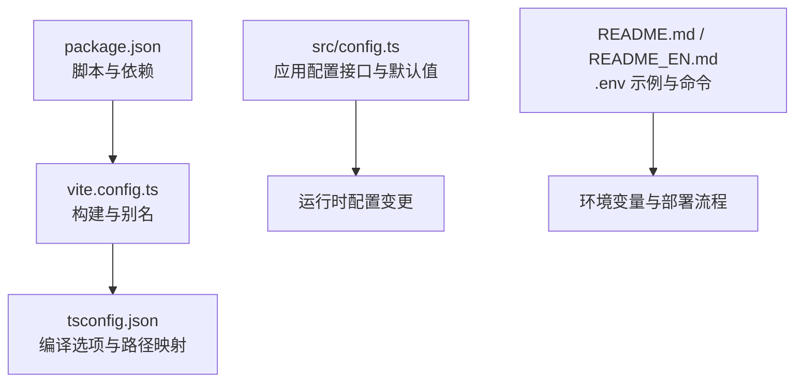
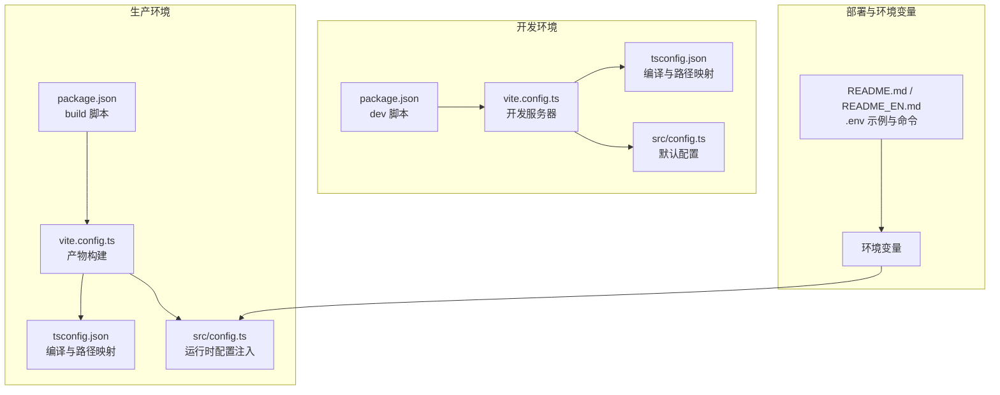
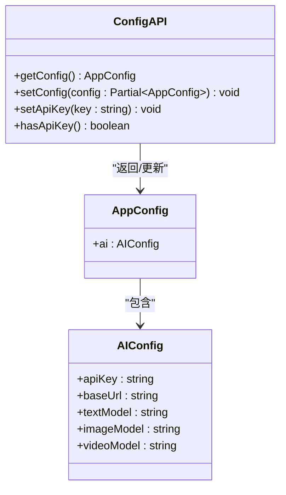
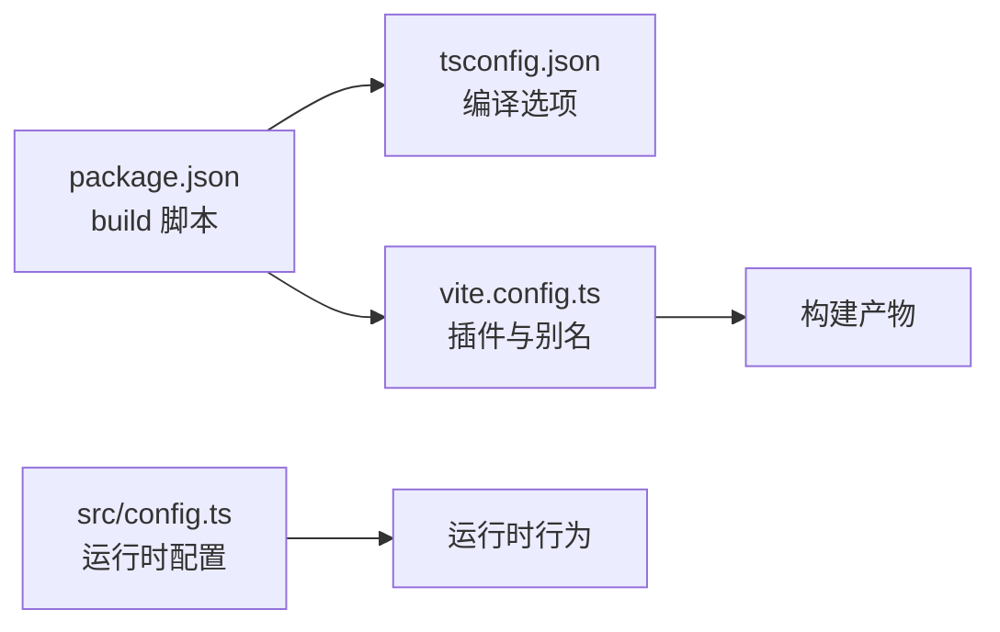

# 环境配置管理

<cite>
**本文引用的文件**
- [package.json](file://package.json)
- [vite.config.ts](file://vite.config.ts)
- [tsconfig.json](file://tsconfig.json)
- [src/config.ts](file://src/config.ts)
- [README.md](file://README.md)
- [README_EN.md](file://README_EN.md)
</cite>

## 目录
1. [简介](#简介)
2. [项目结构](#项目结构)
3. [核心组件](#核心组件)
4. [架构总览](#架构总览)
5. [详细组件分析](#详细组件分析)
6. [依赖关系分析](#依赖关系分析)
7. [性能考虑](#性能考虑)
8. [故障排查指南](#故障排查指南)
9. [结论](#结论)
10. [附录](#附录)

## 简介
本文件面向 AI Shotlive 项目的环境配置管理，聚焦以下目标：
- 明确开发、测试、生产三类环境的配置差异与管理策略
- 解释 package.json 脚本、依赖与版本控制
- 文档化 TypeScript 配置的环境相关设置、编译选项与路径映射
- 覆盖 Vite 构建配置的环境变量注入、代理与开发服务器设置
- 提供环境变量管理、密钥配置与敏感信息保护策略
- 包含配置验证、环境一致性检查与配置热更新机制建议

## 项目结构
本项目采用前后端同库多模块布局，前端基于 Vite + React + TailwindCSS，TypeScript 作为编译层，后端位于 server 子目录，使用 Node/TS 运行时。根目录配置文件包括：
- 构建与脚本：package.json
- 类型系统：tsconfig.json
- 构建工具：vite.config.ts
- 应用配置：src/config.ts
- 环境变量与部署：README 中的 .env 示例与命令

**图表来源**
- [package.json:1-26](file://package.json#L1-L26)
- [vite.config.ts:1-13](file://vite.config.ts#L1-L13)
- [tsconfig.json:1-21](file://tsconfig.json#L1-L21)
- [src/config.ts:1-46](file://src/config.ts#L1-L46)
- [README.md:163-206](file://README.md#L163-L206)
- [README_EN.md:188-259](file://README_EN.md#L188-L259)

**章节来源**
- [package.json:1-26](file://package.json#L1-L26)
- [vite.config.ts:1-13](file://vite.config.ts#L1-L13)
- [tsconfig.json:1-21](file://tsconfig.json#L1-L21)
- [src/config.ts:1-46](file://src/config.ts#L1-L46)
- [README.md:163-206](file://README.md#L163-L206)
- [README_EN.md:188-259](file://README_EN.md#L188-L259)

## 核心组件
- 构建与脚本（package.json）
  - 脚本：dev、build、preview
  - 依赖：React、Lucide React、TailwindCSS 及其 Vite 插件
  - 开发依赖：Vite、TypeScript、React 插件、类型声明
- 类型系统（tsconfig.json）
  - 编译目标：ES2022
  - 模块解析：bundler
  - JSX：react-jsx
  - 路径映射：@/* -> src/*
- 构建工具（vite.config.ts）
  - 插件：@vitejs/plugin-react、@tailwindcss/vite
  - 路径别名：@ -> /src
- 应用配置（src/config.ts）
  - 接口：AppConfig
  - 默认值：AI 基础地址、模型名称等
  - API Key：集中管理与校验

**章节来源**
- [package.json:6-10](file://package.json#L6-L10)
- [package.json:11-24](file://package.json#L11-L24)
- [tsconfig.json:2-18](file://tsconfig.json#L2-L18)
- [vite.config.ts:5-12](file://vite.config.ts#L5-L12)
- [src/config.ts:6-46](file://src/config.ts#L6-L46)

## 架构总览
下图展示前端在不同环境下的配置注入与运行路径，强调从构建到运行的关键节点。

**图表来源**
- [package.json:6-10](file://package.json#L6-L10)
- [vite.config.ts:5-12](file://vite.config.ts#L5-L12)
- [tsconfig.json:2-18](file://tsconfig.json#L2-L18)
- [src/config.ts:16-46](file://src/config.ts#L16-L46)
- [README.md:163-206](file://README.md#L163-L206)
- [README_EN.md:188-259](file://README_EN.md#L188-L259)

## 详细组件分析

### package.json：脚本、依赖与版本控制
- 脚本职责
  - dev：启动 Vite 开发服务器
  - build：先执行 tsc 校验，再进行 Vite 构建
  - preview：预览构建产物
- 依赖与版本
  - 生产依赖：React、React DOM、Lucide React
  - 开发依赖：Vite、TypeScript、React 插件、TailwindCSS 及其 Vite 插件、React 类型声明
- 版本控制建议
  - 使用语义化版本范围，避免破坏性升级
  - 对关键依赖（Vite、TypeScript、React）保持同步兼容
  - 通过 lock 文件固定依赖版本，确保团队一致性

**章节来源**
- [package.json:6-10](file://package.json#L6-L10)
- [package.json:11-24](file://package.json#L11-L24)

### tsconfig.json：编译选项与路径映射
- 编译目标与模块
  - target: ES2022
  - module: ESNext
  - moduleResolution: bundler
- JSX 与严格性
  - jsx: react-jsx
  - strict: true
  - skipLibCheck: true
  - isolatedModules: true
- 路径映射
  - baseUrl: .
  - paths: "@/*" -> ["src/*"]
- 影响范围
  - 与 vite.config.ts 的别名配合，统一模块解析行为
  - 保证类型检查与构建一致性

**章节来源**
- [tsconfig.json:2-18](file://tsconfig.json#L2-L18)

### vite.config.ts：构建与别名
- 插件
  - @vitejs/plugin-react：启用 React 快速刷新与优化
  - @tailwindcss/vite：集成 TailwindCSS
- 路径别名
  - alias: "@" -> "/src"
- 与 tsconfig.json 的协同
  - 两者共同确保模块解析一致，避免路径错误

**章节来源**
- [vite.config.ts:5-12](file://vite.config.ts#L5-L12)

### src/config.ts：应用配置与 API Key 管理
- 结构
  - AppConfig 接口定义 AI 配置字段（基础地址、文本/图像/视频模型）
  - DEFAULT_CONFIG 提供默认值
  - 运行时函数：getConfig、setConfig、setApiKey、hasApiKey
- 设计要点
  - 配置驱动，避免硬编码
  - API Key 通过 setApiKey 注入，hasApiKey 用于校验
  - 支持部分覆盖（Partial<AppConfig]），便于增量配置

**图表来源**
- [src/config.ts:6-46](file://src/config.ts#L6-L46)

**章节来源**
- [src/config.ts:6-46](file://src/config.ts#L6-L46)

### 环境变量与部署流程（README）
- .env 示例与关键键
  - 数据库：DB_HOST、DB_PORT、DB_USER、DB_PASSWORD、DB_NAME
  - 安全：JWT_SECRET
  - 服务：SERVER_PORT、NODE_ENV
- 启动与构建
  - 本地开发：npm run dev（前端 http://localhost:3000，后端 http://localhost:3001）
  - 生产构建：npm run build，随后以 NODE_ENV=production 启动
- Docker 与本地轻量方案
  - 提供 Docker Compose 与 SQLite 本地模式说明

**章节来源**
- [README.md:163-206](file://README.md#L163-L206)
- [README_EN.md:188-259](file://README_EN.md#L188-L259)

## 依赖关系分析
- 构建链路
  - package.json 的 build 脚本先触发 tsc 校验，再由 Vite 执行打包
  - tsconfig.json 的编译选项与模块解析影响最终产物
- 运行时链路
  - src/config.ts 在运行时提供默认配置，并支持动态注入 API Key
  - vite.config.ts 的别名与 tsconfig.json 的路径映射协同工作

**图表来源**
- [package.json:8](file://package.json#L8)
- [tsconfig.json:2-18](file://tsconfig.json#L2-L18)
- [vite.config.ts:5-12](file://vite.config.ts#L5-L12)
- [src/config.ts:26-46](file://src/config.ts#L26-L46)

**章节来源**
- [package.json:8](file://package.json#L8)
- [tsconfig.json:2-18](file://tsconfig.json#L2-L18)
- [vite.config.ts:5-12](file://vite.config.ts#L5-L12)
- [src/config.ts:26-46](file://src/config.ts#L26-L46)

## 性能考虑
- 构建性能
  - 使用 bundler 模式提升模块解析效率
  - 合理拆分第三方依赖，减少冷启动时间
- 运行性能
  - React 插件启用按需优化与快速刷新
  - 路径别名减少解析开销
- 类型检查
  - tsc 校验前置，提前发现类型问题，降低运行时风险

## 故障排查指南
- 构建失败
  - 检查 package.json 的 build 脚本是否正确执行 tsc
  - 确认 tsconfig.json 的编译选项未引入不兼容配置
- 模块解析错误
  - 对比 vite.config.ts 与 tsconfig.json 的路径映射，确保一致
- API Key 未生效
  - 确认已调用 setApiKey 注入
  - 使用 hasApiKey 校验是否为空
- 环境变量未加载
  - 检查 README 中的 .env 示例与命令
  - 确认 NODE_ENV 与 SERVER_PORT 设置正确

**章节来源**
- [package.json:8](file://package.json#L8)
- [tsconfig.json:2-18](file://tsconfig.json#L2-L18)
- [vite.config.ts:5-12](file://vite.config.ts#L5-L12)
- [src/config.ts:40-46](file://src/config.ts#L40-L46)
- [README.md:163-206](file://README.md#L163-L206)

## 结论
本项目通过“配置驱动”的设计，将环境差异与敏感信息集中在 src/config.ts 与 .env 中，结合 Vite 与 TypeScript 的路径映射与编译选项，形成清晰的构建与运行链路。建议在 CI/CD 中加入 tsc 校验与环境变量注入步骤，确保跨环境一致性与安全性。

## 附录

### 环境配置差异与管理策略
- 开发环境
  - NODE_ENV=development
  - 使用 Vite 开发服务器，启用热更新
  - 可临时注入 API Key 用于调试
- 测试环境
  - NODE_ENV=test 或 staging
  - 使用最小化 .env 配置，隔离真实密钥
  - 通过 CI 注入测试专用 API Key
- 生产环境
  - NODE_ENV=production
  - 通过容器/平台注入 .env，避免提交到仓库
  - 仅允许只读访问，定期轮换密钥

### 环境变量管理与敏感信息保护
- 使用 .env.example 提供模板，.env 本地覆盖
- 将 .env 加入 .gitignore，禁止提交
- 在 CI/CD 中使用受控密文存储，按环境注入
- 对外暴露的 API Key 限制权限范围与配额

### 配置验证与一致性检查
- 构建前执行 tsc 校验，确保类型安全
- 运行前校验 hasApiKey，防止空密钥请求
- 在 CI 中增加环境变量存在性检查

### 配置热更新机制建议
- 前端：通过 src/config.ts 的 setConfig 动态更新非敏感配置
- 后端：监听配置文件变化或通过 API 管理端点推送变更
- 容器：通过挂载卷或环境变量注入实现无重启更新