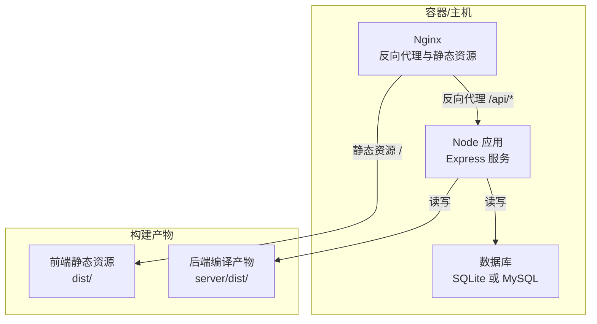
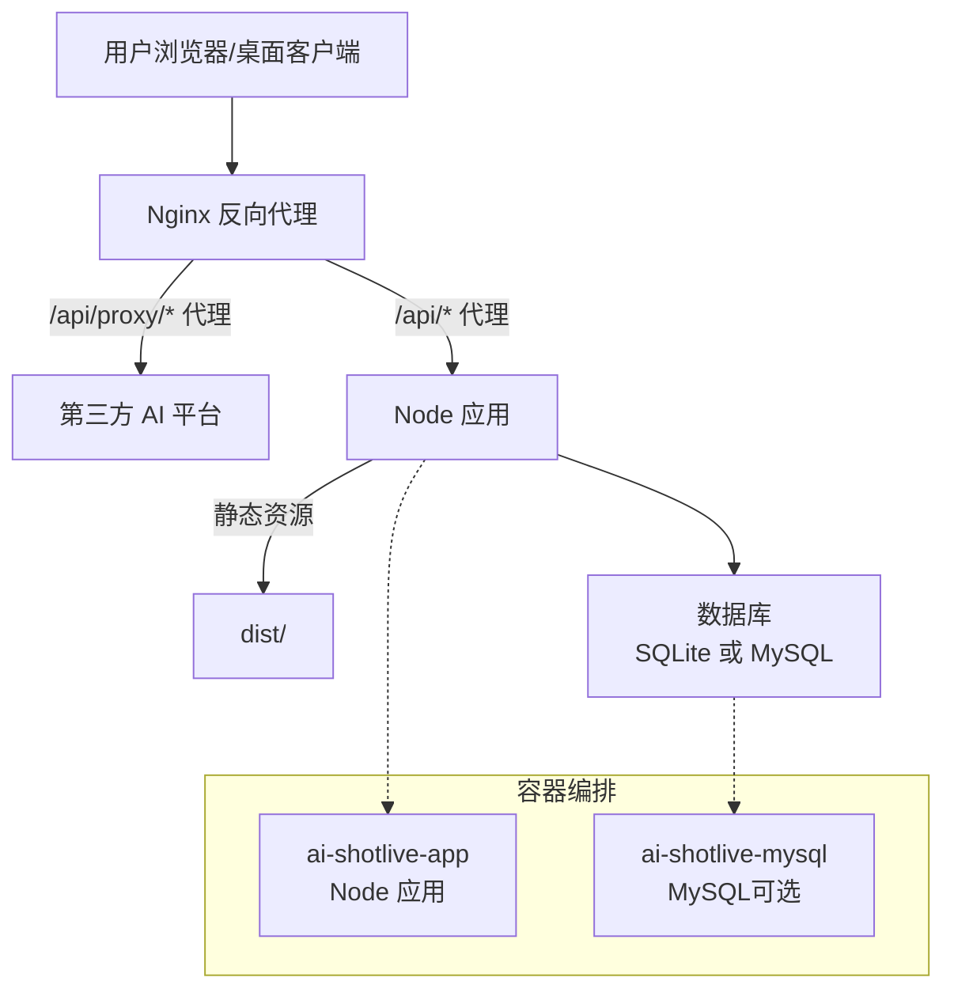
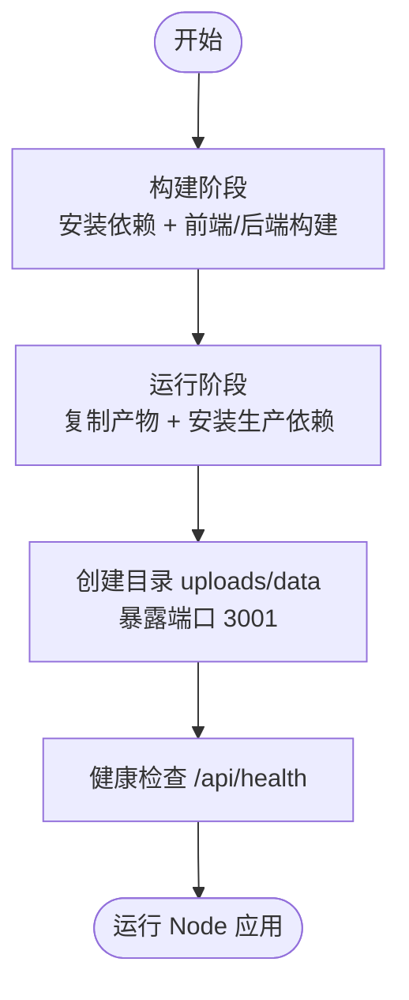
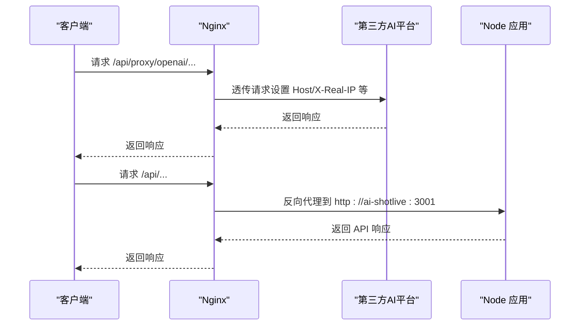
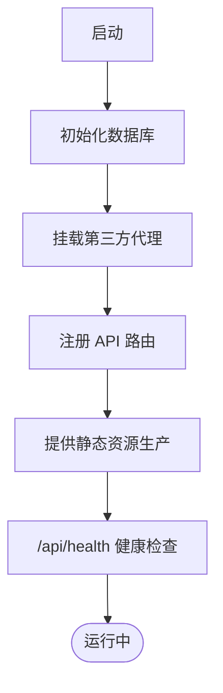
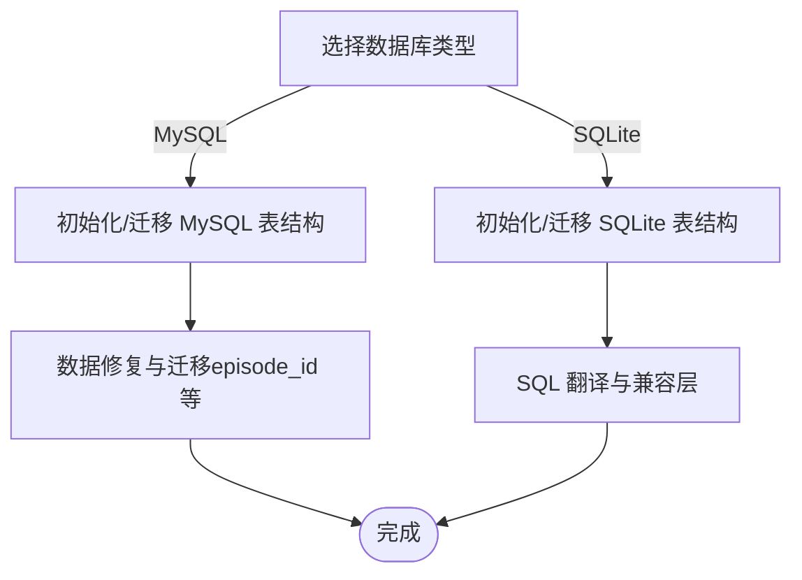
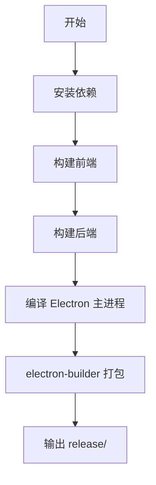
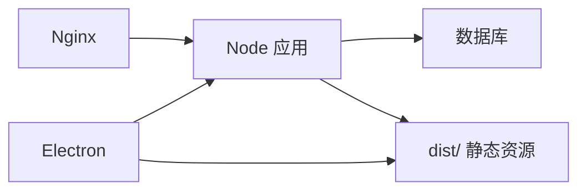

# 部署与运维

<cite>
**本文引用的文件**
- [Dockerfile](file://Dockerfile)
- [docker-compose.yaml](file://docker-compose.yaml)
- [docker-compose.mysql.yaml](file://docker-compose.mysql.yaml)
- [nginx.conf](file://nginx.conf)
- [nginx.docker.conf](file://nginx.docker.conf)
- [package.json](file://package.json)
- [scripts/build-electron.sh](file://scripts/build-electron.sh)
- [electron-builder.yml](file://electron-builder.yml)
- [server/src/index.ts](file://server/src/index.ts)
- [server/src/proxy.ts](file://server/src/proxy.ts)
- [server/src/config/database.ts](file://server/src/config/database.ts)
- [server/src/config/sqliteDatabase.ts](file://server/src/config/sqliteDatabase.ts)
- [docker使用.md](file://docker使用.md)
</cite>

## 目录
1. [简介](#简介)
2. [项目结构](#项目结构)
3. [核心组件](#核心组件)
4. [架构总览](#架构总览)
5. [详细组件分析](#详细组件分析)
6. [依赖关系分析](#依赖关系分析)
7. [性能考虑](#性能考虑)
8. [故障排查指南](#故障排查指南)
9. [结论](#结论)
10. [附录](#附录)

## 简介
本文件面向运维与开发团队，提供 AI Shotlive 在生产环境的完整部署与运维指南。内容覆盖：
- Docker 容器化部署与镜像构建
- Nginx 反向代理与静态资源服务
- 多种部署模式：Web 部署、Docker 部署、桌面客户端（Electron）部署
- 环境配置、数据库迁移与初始化、健康检查
- SSL 证书配置建议、监控与告警设置
- 性能优化、备份与恢复策略、CI/CD 自动化部署

## 项目结构
项目采用前后端同构 Node 服务，配合 Nginx 提供静态资源与 API 代理，支持 SQLite 与 MySQL 两种数据库后端。Electron 提供桌面客户端打包能力。

图表来源
- [nginx.conf:247-259](file://nginx.conf#L247-L259)
- [server/src/index.ts:100-113](file://server/src/index.ts#L100-L113)
- [Dockerfile:32-36](file://Dockerfile#L32-L36)

章节来源
- [Dockerfile:1-50](file://Dockerfile#L1-L50)
- [docker-compose.yaml:1-37](file://docker-compose.yaml#L1-L37)
- [docker-compose.mysql.yaml:1-61](file://docker-compose.mysql.yaml#L1-L61)
- [nginx.conf:1-313](file://nginx.conf#L1-L313)
- [nginx.docker.conf:1-228](file://nginx.docker.conf#L1-L228)
- [server/src/index.ts:1-173](file://server/src/index.ts#L1-L173)

## 核心组件
- 容器镜像与运行时
  - 多阶段构建，分离前端与后端构建，最终运行时基于 Node 20 Alpine，暴露 3001 端口，内置健康检查。
- Nginx 反向代理
  - 提供静态资源缓存、Gzip 压缩、安全头、第三方 AI 平台代理（DashScope、Volcengine、OpenAI、Anthropic、DeepSeek、Zhipu、Google Gemini、xAI、SiliconFlow、Moonshot、OpenRouter）、后端 API 代理与 SPA 回退。
- Node 应用（Express）
  - 提供认证、项目、资产、模型、任务、偏好、数据传输、AI 生成等 API；内置健康检查；生产环境提供静态资源；支持 SQLite 与 MySQL。
- 数据库适配
  - MySQL 与 SQLite 双栈，自动初始化表结构、列与索引，支持迁移与修复；MySQL 支持动态调整 max_allowed_packet。
- Electron 桌面客户端
  - 通过脚本与配置文件进行跨平台打包，输出 dmg/zip（macOS）与 nsis（Windows）安装包。

章节来源
- [Dockerfile:23-49](file://Dockerfile#L23-L49)
- [nginx.conf:58-259](file://nginx.conf#L58-L259)
- [server/src/index.ts:48-113](file://server/src/index.ts#L48-L113)
- [server/src/config/database.ts:244-711](file://server/src/config/database.ts#L244-L711)
- [server/src/config/sqliteDatabase.ts:282-670](file://server/src/config/sqliteDatabase.ts#L282-L670)
- [scripts/build-electron.sh:1-97](file://scripts/build-electron.sh#L1-L97)
- [electron-builder.yml:1-85](file://electron-builder.yml#L1-L85)

## 架构总览
整体架构由 Nginx 作为统一入口，负责静态资源与 API 代理；Node 应用提供业务 API 与静态资源；数据库支持 SQLite 与 MySQL 两种模式。

图表来源
- [nginx.conf:66-122](file://nginx.conf#L66-L122)
- [nginx.conf:247-259](file://nginx.conf#L247-L259)
- [server/src/proxy.ts:24-36](file://server/src/proxy.ts#L24-L36)
- [docker-compose.yaml:6-33](file://docker-compose.yaml#L6-L33)
- [docker-compose.mysql.yaml:5-53](file://docker-compose.mysql.yaml#L5-L53)

## 详细组件分析

### Docker 容器化与镜像构建
- 多阶段构建
  - 构建阶段：安装依赖、构建前端与后端。
  - 运行阶段：仅包含运行时依赖与构建产物，最小化镜像体积。
- 运行时
  - 工作目录 /app，创建 uploads 与 data 目录，暴露 3001 端口，健康检查调用 /api/health。
- Compose 编排
  - 单机模式：宿主机 MySQL，通过 host.docker.internal 访问；或使用内置 MySQL 容器。
  - 网络：自定义桥接网络 cinegen-network，便于容器互联。
- 环境变量
  - NODE_ENV、DB_TYPE、DB_HOST、DB_PORT、DB_NAME、DB_USER、DB_PASSWORD、JWT_SECRET、SERVER_PORT、UPLOADS_DIR、DIST_PATH 等。

图表来源
- [Dockerfile:1-50](file://Dockerfile#L1-L50)
- [docker-compose.yaml:6-33](file://docker-compose.yaml#L6-L33)
- [docker-compose.mysql.yaml:5-53](file://docker-compose.mysql.yaml#L5-L53)

章节来源
- [Dockerfile:1-50](file://Dockerfile#L1-L50)
- [docker-compose.yaml:1-37](file://docker-compose.yaml#L1-L37)
- [docker-compose.mysql.yaml:1-61](file://docker-compose.mysql.yaml#L1-L61)
- [docker使用.md:1-39](file://docker使用.md#L1-L39)

### Nginx 反向代理与静态资源
- 功能要点
  - Gzip 压缩、缓存策略、安全头、Keep-Alive、缓冲区优化。
  - 第三方 AI 平台代理：DashScope、Volcengine（含对象存储）、OpenAI、Anthropic、DeepSeek、Zhipu、Google Gemini、xAI、SiliconFlow、Moonshot、OpenRouter。
  - 后端 API 代理：/api/* 转发至 Node 应用；SPA 回退至 index.html。
- Docker 环境
  - 使用 Docker 内置 DNS（resolver 127.0.0.11），统一代理规则，简化容器网络。

图表来源
- [nginx.conf:66-122](file://nginx.conf#L66-L122)
- [nginx.conf:247-259](file://nginx.conf#L247-L259)
- [nginx.docker.conf:21-223](file://nginx.docker.conf#L21-L223)

章节来源
- [nginx.conf:1-313](file://nginx.conf#L1-L313)
- [nginx.docker.conf:1-228](file://nginx.docker.conf#L1-L228)

### Node 应用与健康检查
- 路由与中间件
  - CORS、JSON/URL 编码体限制、第三方代理挂载、API 路由注册。
- 健康检查
  - /api/health：验证数据库连接，返回状态与数据库类型。
- 静态资源
  - 生产环境提供 dist/ 静态资源，并对非 API 路由回退到 index.html。
- 安全加固
  - 生产环境强制配置 JWT_SECRET。

图表来源
- [server/src/index.ts:48-113](file://server/src/index.ts#L48-L113)
- [server/src/index.ts:79-98](file://server/src/index.ts#L79-L98)

章节来源
- [server/src/index.ts:1-173](file://server/src/index.ts#L1-L173)
- [server/src/proxy.ts:1-51](file://server/src/proxy.ts#L1-L51)

### 数据库初始化与迁移
- MySQL
  - 自动调整 max_allowed_packet 至 64MB（若无权限则给出提示），初始化表结构、列与索引，执行迁移与修复逻辑。
- SQLite
  - 通过 better-sqlite3 提供同步接口的异步封装，模拟 INFORMATION_SCHEMA 查询，支持 UPSERT 翻译与事务管理。

图表来源
- [server/src/config/database.ts:244-711](file://server/src/config/database.ts#L244-L711)
- [server/src/config/sqliteDatabase.ts:282-670](file://server/src/config/sqliteDatabase.ts#L282-L670)

章节来源
- [server/src/config/database.ts:1-712](file://server/src/config/database.ts#L1-L712)
- [server/src/config/sqliteDatabase.ts:1-671](file://server/src/config/sqliteDatabase.ts#L1-L671)

### Electron 桌面客户端
- 构建流程
  - 安装依赖、构建前端与后端、编译 Electron 主进程、使用 electron-builder 打包。
- 平台参数
  - 支持 mac、win、all，默认当前平台；产物输出到 release/。
- 打包配置
  - asar 打包、native 模块重建、图标与安装器选项。

图表来源
- [scripts/build-electron.sh:42-84](file://scripts/build-electron.sh#L42-L84)
- [electron-builder.yml:10-47](file://electron-builder.yml#L10-L47)

章节来源
- [scripts/build-electron.sh:1-97](file://scripts/build-electron.sh#L1-L97)
- [electron-builder.yml:1-85](file://electron-builder.yml#L1-L85)

## 依赖关系分析
- 组件耦合
  - Nginx 依赖 Node 应用提供静态资源与 API；Node 应用依赖数据库；Electron 依赖本地构建产物。
- 外部依赖
  - 第三方 AI 平台（DashScope、Volcengine、OpenAI、Anthropic、DeepSeek、Zhipu、Google Gemini、xAI、SiliconFlow、Moonshot、OpenRouter）。
- 环境变量契约
  - DB_TYPE、DB_HOST、DB_PORT、DB_NAME、DB_USER、DB_PASSWORD、JWT_SECRET、SERVER_PORT、UPLOADS_DIR、DIST_PATH 等。

图表来源
- [nginx.conf:247-259](file://nginx.conf#L247-L259)
- [server/src/index.ts:100-113](file://server/src/index.ts#L100-L113)
- [Dockerfile:32-36](file://Dockerfile#L32-L36)

章节来源
- [package.json:1-83](file://package.json#L1-L83)
- [server/src/index.ts:1-173](file://server/src/index.ts#L1-L173)

## 性能考虑
- Nginx
  - 启用 Gzip、长缓存静态资源、合理 keepalive、缓冲区与超时配置，降低延迟与带宽占用。
- Node 应用
  - 限制请求体大小、启用 CORS、健康检查与数据库连接池；生产环境提供静态资源减少后端压力。
- 数据库
  - MySQL 调整 max_allowed_packet 至 64MB，避免大文件上传/下载失败；SQLite 使用 WAL 模式提升并发。
- 容器
  - 多阶段构建减小镜像体积，健康检查与重启策略保障可用性。

章节来源
- [nginx.conf:9-312](file://nginx.conf#L9-L312)
- [server/src/index.ts:62-64](file://server/src/index.ts#L62-L64)
- [server/src/config/database.ts:42-75](file://server/src/config/database.ts#L42-L75)
- [server/src/config/sqliteDatabase.ts:114-116](file://server/src/config/sqliteDatabase.ts#L114-L116)
- [Dockerfile:23-49](file://Dockerfile#L23-L49)

## 故障排查指南
- 健康检查失败
  - 检查 /api/health 是否返回数据库可用信息；若降级返回错误，检查数据库连接参数与网络连通性。
- CORS 与第三方代理
  - 确认 Nginx 代理规则是否覆盖所需平台；检查代理超时与缓冲区设置。
- 静态资源缓存
  - 若页面显示旧版，清理浏览器缓存或上游 CDN 缓存。
- 数据库问题
  - MySQL：确认 max_allowed_packet 设置与权限；必要时手动执行调整命令；检查连接池配置。
  - SQLite：确认 data 目录权限与 WAL 模式。
- 容器与日志
  - 使用 docker-compose logs -f 查看实时日志；必要时强制重建容器与镜像。

章节来源
- [server/src/index.ts:79-98](file://server/src/index.ts#L79-L98)
- [nginx.conf:66-122](file://nginx.conf#L66-L122)
- [docker-compose.yaml:25-30](file://docker-compose.yaml#L25-L30)
- [docker-compose.mysql.yaml:47-51](file://docker-compose.mysql.yaml#L47-L51)
- [docker使用.md:11-12](file://docker使用.md#L11-L12)

## 结论
通过 Nginx 统一入口、Node 应用提供 API 与静态资源、双栈数据库适配，以及 Electron 桌面客户端打包，AI Shotlive 实现了灵活的多模式部署。结合健康检查、性能优化与完善的故障排查流程，可稳定支撑生产环境运行。

## 附录

### 环境配置清单
- 数据库
  - DB_TYPE: mysql 或 sqlite
  - DB_HOST/DB_PORT/DB_NAME/DB_USER/DB_PASSWORD
  - MySQL: max_allowed_packet 建议 ≥ 64MB
- 安全
  - JWT_SECRET: 生产环境必须配置
- 运行
  - SERVER_PORT: 应用监听端口（默认 3001）
  - UPLOADS_DIR: 上传目录
  - DIST_PATH: 静态资源目录（生产）

章节来源
- [server/src/config/database.ts:11-30](file://server/src/config/database.ts#L11-L30)
- [server/src/index.ts:125-137](file://server/src/index.ts#L125-L137)

### SSL 证书配置建议
- 在 Nginx 层启用 HTTPS，绑定域名证书；将 /api/proxy/* 与后端 API 代理配置为 HTTPS，确保 TLS 1.2+。
- 如需反向代理到 HTTPS，保持 proxy_ssl_protocols 与 proxy_ssl_server_name 正确设置。

章节来源
- [nginx.conf:66-122](file://nginx.conf#L66-L122)
- [nginx.conf:247-259](file://nginx.conf#L247-L259)

### 监控与告警
- 健康检查
  - 使用 /api/health 与容器健康检查（Compose/编排）联动。
- 日志
  - Nginx 访问/错误日志、Node 应用日志、数据库日志集中采集与轮转。
- 性能指标
  - CPU/内存/磁盘 IO、请求延迟、错误率、数据库连接数与队列长度。

章节来源
- [server/src/index.ts:79-98](file://server/src/index.ts#L79-L98)
- [Dockerfile:45-46](file://Dockerfile#L45-L46)
- [docker-compose.yaml:25-30](file://docker-compose.yaml#L25-L30)

### 备份与恢复策略
- 数据库
  - MySQL：定期逻辑备份（mysqldump）或物理备份（XtraBackup），校验恢复流程。
  - SQLite：备份 data/local.db 或整个 data 目录。
- 文件存储
  - 备份 uploads 目录，确保媒体与导出文件不丢失。
- 配置
  - 备份 .env 与 Nginx/Compose 配置文件，便于快速重建。

章节来源
- [server/src/config/sqliteDatabase.ts:109-118](file://server/src/config/sqliteDatabase.ts#L109-L118)
- [Dockerfile:38-39](file://Dockerfile#L38-L39)

### CI/CD 自动化部署
- 构建
  - 使用多阶段 Dockerfile 构建镜像；在流水线中缓存 npm 依赖以加速。
- 部署
  - Docker Compose 编排：一键 up/down；或在 Kubernetes 中以 Deployment/Service/Nginx Ingress 管理。
- 发布
  - Electron：在 CI 中执行打包脚本，产出安装包并上传制品库。
- 回滚
  - 保留镜像版本标签，支持快速回滚；数据库变更采用可逆迁移策略。

章节来源
- [Dockerfile:1-50](file://Dockerfile#L1-L50)
- [docker-compose.yaml:1-37](file://docker-compose.yaml#L1-L37)
- [scripts/build-electron.sh:1-97](file://scripts/build-electron.sh#L1-L97)
- [electron-builder.yml:1-85](file://electron-builder.yml#L1-L85)