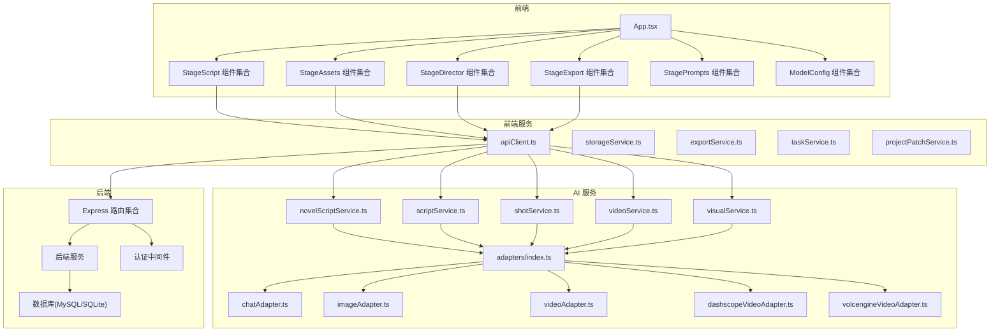
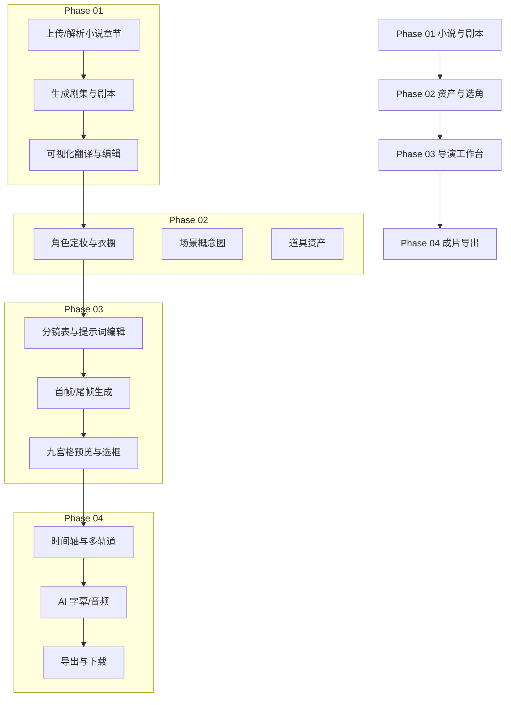
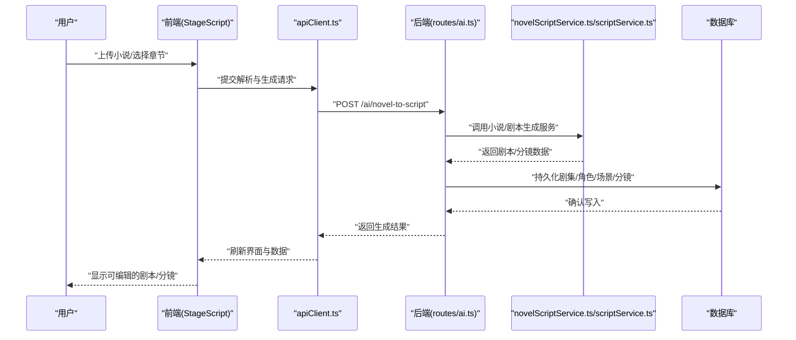
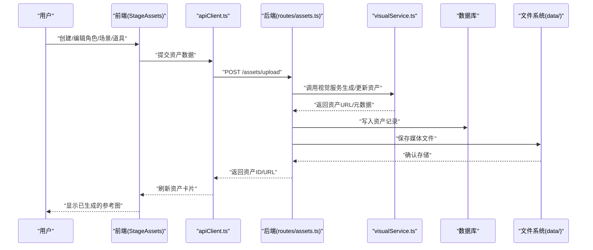
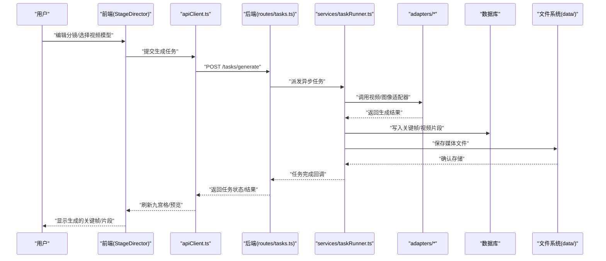
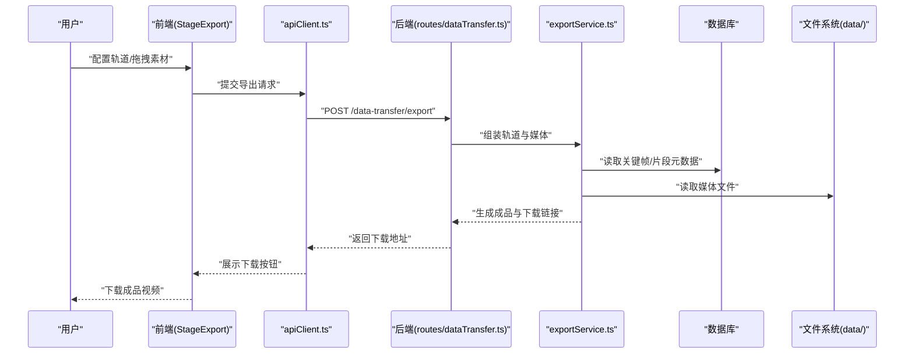
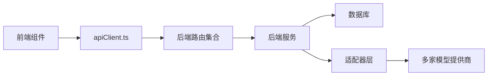

# 功能特性

<cite>
**本文引用的文件**
- [README.md](file://README.md)
- [App.tsx](file://src/App.tsx)
- [StageScript 组件集合](file://components/StageScript/index.tsx)
- [StageAssets 组件集合](file://components/StageAssets/index.tsx)
- [StageDirector 组件集合](file://components/StageDirector/index.tsx)
- [StageExport 组件集合](file://components/StageExport/index.tsx)
- [StagePrompts 组件集合](file://components/StagePrompts/index.tsx)
- [ModelConfig 组件集合](file://components/ModelConfig/index.tsx)
- [novelScriptService.ts](file://services/ai/novelScriptService.ts)
- [scriptService.ts](file://services/ai/scriptService.ts)
- [shotService.ts](file://services/ai/shotService.ts)
- [videoService.ts](file://services/ai/videoService.ts)
- [visualService.ts](file://services/ai/visualService.ts)
- [adapters/index.ts](file://services/adapters/index.ts)
- [adapters/chatAdapter.ts](file://services/adapters/chatAdapter.ts)
- [adapters/imageAdapter.ts](file://services/adapters/imageAdapter.ts)
- [adapters/videoAdapter.ts](file://services/adapters/videoAdapter.ts)
- [adapters/dashscopeVideoAdapter.ts](file://services/adapters/dashscopeVideoAdapter.ts)
- [adapters/volcengineVideoAdapter.ts](file://services/adapters/volcengineVideoAdapter.ts)
- [apiClient.ts](file://services/apiClient.ts)
- [storageService.ts](file://services/storageService.ts)
- [exportService.ts](file://services/exportService.ts)
- [taskService.ts](file://services/taskService.ts)
- [projectPatchService.ts](file://services/projectPatchService.ts)
- [routes/projects.ts](file://server/src/routes/projects.ts)
- [routes/assets.ts](file://server/src/routes/assets.ts)
- [routes/tasks.ts](file://server/src/routes/tasks.ts)
- [routes/dataTransfer.ts](file://server/src/routes/dataTransfer.ts)
- [routes/ai.ts](file://server/src/routes/ai.ts)
- [services/projectStorage.ts](file://server/src/services/projectStorage.ts)
- [services/taskRunner.ts](file://server/src/services/taskRunner.ts)
- [services/aiProxy.ts](file://server/src/services/aiProxy.ts)
- [services/scriptParser.ts](file://server/src/services/scriptParser.ts)
- [config/database.ts](file://server/src/config/database.ts)
- [config/sqliteDatabase.ts](file://server/src/config/sqliteDatabase.ts)
- [middleware/auth.ts](file://server/src/middleware/auth.ts)
</cite>

## 目录
1. [引言](#引言)
2. [项目结构](#项目结构)
3. [核心组件](#核心组件)
4. [架构总览](#架构总览)
5. [详细组件分析](#详细组件分析)
6. [依赖分析](#依赖分析)
7. [性能考虑](#性能考虑)
8. [故障排查指南](#故障排查指南)
9. [结论](#结论)
10. [附录](#附录)

## 引言
本文件面向创作者，系统性梳理 AI Shotlive 项目的四大工作阶段及其功能特性，包括：
- Phase 01 小说与剧本（章节解析、剧集生成、剧本编辑）
- Phase 02 资产与选角（角色定妆、场景概念、道具管理）
- Phase 03 导演工作台（分镜编辑、关键帧生成、九宫格预览）
- Phase 04 成片导出（视频剪辑、字幕生成、音频处理）

文档说明每个阶段的核心功能、用户交互方式与预期输出，并阐述阶段间协作关系与数据流转。

## 项目结构
项目采用前后端分离架构：前端基于 React 19/Vite 6/TailwindCSS/RadixUI/FramerMotion，后端基于 Express.js + MySQL/SQLite，AI 服务通过适配器层统一接入多家模型提供商，桌面端基于 Electron 打包。

图表来源
- [App.tsx](file://src/App.tsx)
- [StageScript 组件集合](file://components/StageScript/index.tsx)
- [StageAssets 组件集合](file://components/StageAssets/index.tsx)
- [StageDirector 组件集合](file://components/StageDirector/index.tsx)
- [StageExport 组件集合](file://components/StageExport/index.tsx)
- [StagePrompts 组件集合](file://components/StagePrompts/index.tsx)
- [ModelConfig 组件集合](file://components/ModelConfig/index.tsx)
- [apiClient.ts](file://services/apiClient.ts)
- [adapters/index.ts](file://services/adapters/index.ts)
- [routes/projects.ts](file://server/src/routes/projects.ts)
- [routes/assets.ts](file://server/src/routes/assets.ts)
- [routes/tasks.ts](file://server/src/routes/tasks.ts)
- [routes/dataTransfer.ts](file://server/src/routes/dataTransfer.ts)
- [routes/ai.ts](file://server/src/routes/ai.ts)
- [services/projectStorage.ts](file://server/src/services/projectStorage.ts)
- [services/taskRunner.ts](file://server/src/services/taskRunner.ts)
- [services/aiProxy.ts](file://server/src/services/aiProxy.ts)
- [services/scriptParser.ts](file://server/src/services/scriptParser.ts)
- [config/database.ts](file://server/src/config/database.ts)
- [config/sqliteDatabase.ts](file://server/src/config/sqliteDatabase.ts)
- [middleware/auth.ts](file://server/src/middleware/auth.ts)

章节来源
- [README.md](file://README.md)
- [App.tsx](file://src/App.tsx)

## 核心组件
- 前端应用入口与路由组织：App.tsx 负责页面级路由与阶段导航。
- 四大阶段组件集合：StageScript、StageAssets、StageDirector、StageExport 分别承载各阶段的 UI 与交互。
- 模型配置与视觉风格：ModelConfig、StagePrompts 提供模型提供商与提示词管理能力。
- 前端服务：apiClient 统一发起请求；storageService 管理本地/云端存储；exportService 与 taskService 协助导出与任务追踪；projectPatchService 支持项目增量更新。
- AI 服务：novelScriptService、scriptService、shotService、videoService、visualService 实现小说到剧本、剧本到分镜、关键帧与视频生成、视觉风格转换等核心逻辑。
- 适配器层：adapters/index.ts 及其子模块封装多家模型提供商的调用细节，屏蔽差异。
- 后端：routes/* 提供 REST 接口；services/* 实现任务调度、项目存储、AI 代理与脚本解析；middleware/auth.ts 提供认证；config/* 管理数据库连接。

章节来源
- [README.md](file://README.md)
- [StageScript 组件集合](file://components/StageScript/index.tsx)
- [StageAssets 组件集合](file://components/StageAssets/index.tsx)
- [StageDirector 组件集合](file://components/StageDirector/index.tsx)
- [StageExport 组件集合](file://components/StageExport/index.tsx)
- [StagePrompts 组件集合](file://components/StagePrompts/index.tsx)
- [ModelConfig 组件集合](file://components/ModelConfig/index.tsx)
- [apiClient.ts](file://services/apiClient.ts)
- [storageService.ts](file://services/storageService.ts)
- [exportService.ts](file://services/exportService.ts)
- [taskService.ts](file://services/taskService.ts)
- [projectPatchService.ts](file://services/projectPatchService.ts)
- [novelScriptService.ts](file://services/ai/novelScriptService.ts)
- [scriptService.ts](file://services/ai/scriptService.ts)
- [shotService.ts](file://services/ai/shotService.ts)
- [videoService.ts](file://services/ai/videoService.ts)
- [visualService.ts](file://services/ai/visualService.ts)
- [adapters/index.ts](file://services/adapters/index.ts)

## 架构总览
AI Shotlive 的工作流遵循“小说 → 剧本 → 分镜 → 资产 → 关键帧 → 成片”的工业管线，强调“先画后动”与“资产约束”，并通过多模型适配器实现跨厂商的统一调用。

图表来源
- [README.md](file://README.md)

## 详细组件分析

### Phase 01 小说与剧本（章节解析、剧集生成、剧本编辑）
- 核心功能
  - 小说上传与章节解析：支持上传 .txt 小说文件，按“第 X 章”自动解析章节，支持分页浏览与按需加载。
  - 剧集生成：选择章节范围生成剧集，AI 将章节改编为一集剧本（场次、对话、动作、视觉化描述）。
  - 剧本可视化翻译：将剧本描述转为绘图提示词，支持设定目标时长与镜头密度。
  - 手动编辑：可编辑角色视觉描述、分镜提示词、角色列表、动作与台词，精细控制生成效果。
- 用户交互
  - 在小说管理页面完成项目设置（标题、体裁、风格等），随后上传小说并选择章节创建剧集。
  - 在剧本编辑器中进行字段级编辑与校对。
- 预期输出
  - 剧集与剧本数据入库（含角色、场景、道具、分镜、关键帧等），为后续资产与导演工作台提供素材。
- 数据流
  - 前端通过 apiClient 调用后端接口，后端经 scriptParser 与 AI 服务生成剧本与分镜，写入数据库。

图表来源
- [StageScript 组件集合](file://components/StageScript/index.tsx)
- [apiClient.ts](file://services/apiClient.ts)
- [routes/ai.ts](file://server/src/routes/ai.ts)
- [novelScriptService.ts](file://services/ai/novelScriptService.ts)
- [scriptService.ts](file://services/ai/scriptService.ts)
- [services/scriptParser.ts](file://server/src/services/scriptParser.ts)
- [config/database.ts](file://server/src/config/database.ts)

章节来源
- [README.md](file://README.md)
- [StageScript 组件集合](file://components/StageScript/index.tsx)
- [apiClient.ts](file://services/apiClient.ts)
- [routes/ai.ts](file://server/src/routes/ai.ts)
- [novelScriptService.ts](file://services/ai/novelScriptService.ts)
- [scriptService.ts](file://services/ai/scriptService.ts)
- [services/scriptParser.ts](file://server/src/services/scriptParser.ts)
- [config/database.ts](file://server/src/config/database.ts)

### Phase 02 资产与选角（角色定妆、场景概念、道具管理）
- 核心功能
  - 角色定妆：为角色生成参考图；衣橱系统支持多套造型（日常、战斗等），保持面部一致。
  - 场景概念：生成场景参考图，保证同场景下镜头光影统一。
  - 道具管理：支持道具资产上传与管理。
- 用户交互
  - 在资产页面为角色与场景创建与编辑参考图；在道具卡片中维护描述与图片。
- 预期输出
  - 角色与场景的参考图入库，作为后续关键帧生成的约束条件。
- 数据流
  - 前端通过 apiClient 调用后端资产接口，后端经 visualService 与 AI 服务生成/更新资产，写入数据库与文件系统。

图表来源
- [StageAssets 组件集合](file://components/StageAssets/index.tsx)
- [apiClient.ts](file://services/apiClient.ts)
- [routes/assets.ts](file://server/src/routes/assets.ts)
- [visualService.ts](file://services/ai/visualService.ts)
- [config/database.ts](file://server/src/config/database.ts)

章节来源
- [README.md](file://README.md)
- [StageAssets 组件集合](file://components/StageAssets/index.tsx)
- [apiClient.ts](file://services/apiClient.ts)
- [routes/assets.ts](file://server/src/routes/assets.ts)
- [visualService.ts](file://services/ai/visualService.ts)
- [config/database.ts](file://server/src/config/database.ts)

### Phase 03 导演工作台（分镜编辑、关键帧生成、九宫格预览）
- 核心功能
  - 分镜表：网格化管理所有镜头，支持编辑提示词、角色、动作、台词。
  - 首帧/尾帧：生成并可选编辑首帧与结束帧，支持首尾帧插值成片。
  - 九宫格预览：同一镜头 9 个视角预览，可选用整图或单格作为首帧。
  - 上下文感知：生成时自动带入当前场景图与角色服装图，减少“不连戏”。
  - 视频模式：支持单图图生视频与首尾帧插值，按所选视频模型切换。
- 用户交互
  - 在导演工作台中选择镜头，编辑提示词与参数，触发关键帧生成与视频模式切换。
- 预期输出
  - 关键帧图像与视频片段入库，形成可编辑的时间轴基础素材。
- 数据流
  - 前端通过 apiClient 调用后端任务接口，后端经 shotService 与 videoService 调用适配器生成关键帧与视频，写入数据库与文件系统。

图表来源
- [StageDirector 组件集合](file://components/StageDirector/index.tsx)
- [apiClient.ts](file://services/apiClient.ts)
- [routes/tasks.ts](file://server/src/routes/tasks.ts)
- [services/taskRunner.ts](file://server/src/services/taskRunner.ts)
- [adapters/index.ts](file://services/adapters/index.ts)
- [adapters/videoAdapter.ts](file://services/adapters/videoAdapter.ts)
- [adapters/dashscopeVideoAdapter.ts](file://services/adapters/dashscopeVideoAdapter.ts)
- [adapters/volcengineVideoAdapter.ts](file://services/adapters/volcengineVideoAdapter.ts)
- [shotService.ts](file://services/ai/shotService.ts)
- [videoService.ts](file://services/ai/videoService.ts)
- [config/database.ts](file://server/src/config/database.ts)

章节来源
- [README.md](file://README.md)
- [StageDirector 组件集合](file://components/StageDirector/index.tsx)
- [apiClient.ts](file://services/apiClient.ts)
- [routes/tasks.ts](file://server/src/routes/tasks.ts)
- [services/taskRunner.ts](file://server/src/services/taskRunner.ts)
- [adapters/index.ts](file://services/adapters/index.ts)
- [adapters/videoAdapter.ts](file://services/adapters/videoAdapter.ts)
- [adapters/dashscopeVideoAdapter.ts](file://services/adapters/dashscopeVideoAdapter.ts)
- [adapters/volcengineVideoAdapter.ts](file://services/adapters/volcengineVideoAdapter.ts)
- [shotService.ts](file://services/ai/shotService.ts)
- [videoService.ts](file://services/ai/videoService.ts)
- [config/database.ts](file://server/src/config/database.ts)

### Phase 04 成片导出（视频剪辑、字幕生成、音频处理）
- 核心功能
  - 时间轴预览：渲染进度追踪，导出高清关键帧与 MP4 片段。
  - 视频剪辑器：多轨道（视频、音频、字幕、图片），可自由增删轨道；右侧资源库按剧本/镜头、角色、场景、视频、上传、AI 字幕、AI 音频分类展示，点击拖拽即可使用。
  - AI 字幕与音频：输入文本，AI 整理为字幕格式并加入字幕轨道；输入文本，AI 生成配音（TTS）并加入音频轨道。
  - 下载剪辑：将当前轨道中的视频与图片片段打包为 ZIP 下载。
- 用户交互
  - 在导出页面打开视频剪辑器，从资源库拖入素材到轨道，使用 AI 字幕/音频增强，最后下载剪辑后的视频。
- 预期输出
  - 成品视频与配套字幕/音频轨道，支持导出与分享。
- 数据流
  - 前端通过 exportService 与 apiClient 调用后端导出接口，后端整合轨道与媒体资源，生成成品并提供下载链接。

图表来源
- [StageExport 组件集合](file://components/StageExport/index.tsx)
- [apiClient.ts](file://services/apiClient.ts)
- [routes/dataTransfer.ts](file://server/src/routes/dataTransfer.ts)
- [exportService.ts](file://services/exportService.ts)
- [config/database.ts](file://server/src/config/database.ts)

章节来源
- [README.md](file://README.md)
- [StageExport 组件集合](file://components/StageExport/index.tsx)
- [apiClient.ts](file://services/apiClient.ts)
- [routes/dataTransfer.ts](file://server/src/routes/dataTransfer.ts)
- [exportService.ts](file://services/exportService.ts)
- [config/database.ts](file://server/src/config/database.ts)

## 依赖分析
- 组件耦合与内聚
  - 各阶段组件相对独立，通过 apiClient 与后端路由交互，降低前端耦合。
  - AI 服务与适配器层解耦，便于新增/替换模型提供商。
- 直接与间接依赖
  - 前端组件依赖 apiClient 与各阶段组件集合；apiClient 依赖后端路由与服务。
  - 后端路由依赖 services/* 与数据库；AI 服务依赖 adapters/*。
- 外部依赖与集成点
  - 多模型提供商通过 adapters/* 统一接入；数据库支持 MySQL/SQLite。
- 接口契约与实现
  - 后端路由提供明确的 REST 接口；AI 服务通过适配器屏蔽差异。

图表来源
- [apiClient.ts](file://services/apiClient.ts)
- [routes/projects.ts](file://server/src/routes/projects.ts)
- [routes/assets.ts](file://server/src/routes/assets.ts)
- [routes/tasks.ts](file://server/src/routes/tasks.ts)
- [routes/dataTransfer.ts](file://server/src/routes/dataTransfer.ts)
- [routes/ai.ts](file://server/src/routes/ai.ts)
- [services/projectStorage.ts](file://server/src/services/projectStorage.ts)
- [services/taskRunner.ts](file://server/src/services/taskRunner.ts)
- [services/aiProxy.ts](file://server/src/services/aiProxy.ts)
- [adapters/index.ts](file://services/adapters/index.ts)

章节来源
- [apiClient.ts](file://services/apiClient.ts)
- [routes/projects.ts](file://server/src/routes/projects.ts)
- [routes/assets.ts](file://server/src/routes/assets.ts)
- [routes/tasks.ts](file://server/src/routes/tasks.ts)
- [routes/dataTransfer.ts](file://server/src/routes/dataTransfer.ts)
- [routes/ai.ts](file://server/src/routes/ai.ts)
- [services/projectStorage.ts](file://server/src/services/projectStorage.ts)
- [services/taskRunner.ts](file://server/src/services/taskRunner.ts)
- [services/aiProxy.ts](file://server/src/services/aiProxy.ts)
- [adapters/index.ts](file://services/adapters/index.ts)

## 性能考虑
- 异步任务与进度追踪：通过任务队列与任务运行器实现异步生成，避免阻塞 UI。
- 适配器层复用：统一调用接口减少重复网络开销。
- 存储与缓存：媒体文件与数据库分离，合理利用 CDN/对象存储可提升下载速度。
- 批量导出：导出时合并轨道与媒体资源，减少多次 IO。

## 故障排查指南
- 认证失败
  - 检查认证中间件与 JWT 配置，确认用户登录状态与权限。
- 任务未完成
  - 检查任务运行器状态与日志，确认 AI 适配器是否正常调用。
- 资源缺失
  - 核对数据库与文件系统路径，确保资产与关键帧已正确写入。
- 导出失败
  - 检查导出服务与后端路由，确认轨道与媒体资源完整。

章节来源
- [middleware/auth.ts](file://server/src/middleware/auth.ts)
- [services/taskRunner.ts](file://server/src/services/taskRunner.ts)
- [routes/dataTransfer.ts](file://server/src/routes/dataTransfer.ts)
- [config/database.ts](file://server/src/config/database.ts)

## 结论
AI Shotlive 以“关键帧驱动”为核心理念，通过四大阶段的流水线化工作流，将“小说 → 剧本 → 分镜 → 资产 → 关键帧 → 成片”的创作过程标准化、自动化与可视化。借助多模型适配器与前后端分离架构，项目具备良好的扩展性与可用性，适合创作者从灵感到成片的一站式生产。

## 附录
- 快速开始步骤
  - 登录后配置模型，上传小说或直接输入故事/剧本，生成剧集与剧本。
  - 在资产阶段生成角色定妆与场景概念图。
  - 在导演工作台生成首帧/尾帧并进行九宫格预览，选择视频模型生成片段。
  - 在导出阶段使用视频剪辑器整合轨道与素材，生成成品并下载。

章节来源
- [README.md](file://README.md)