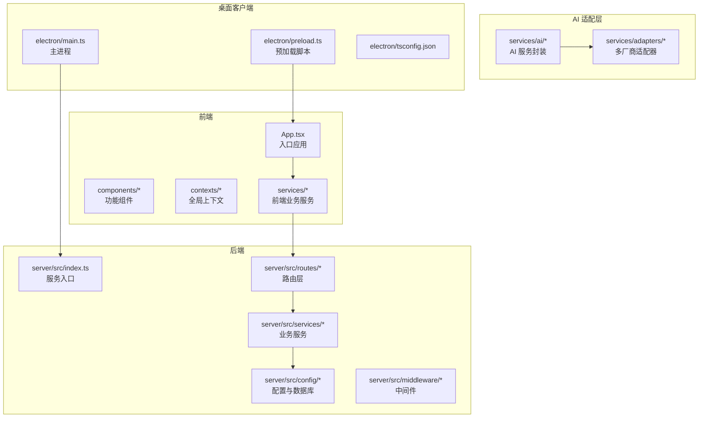
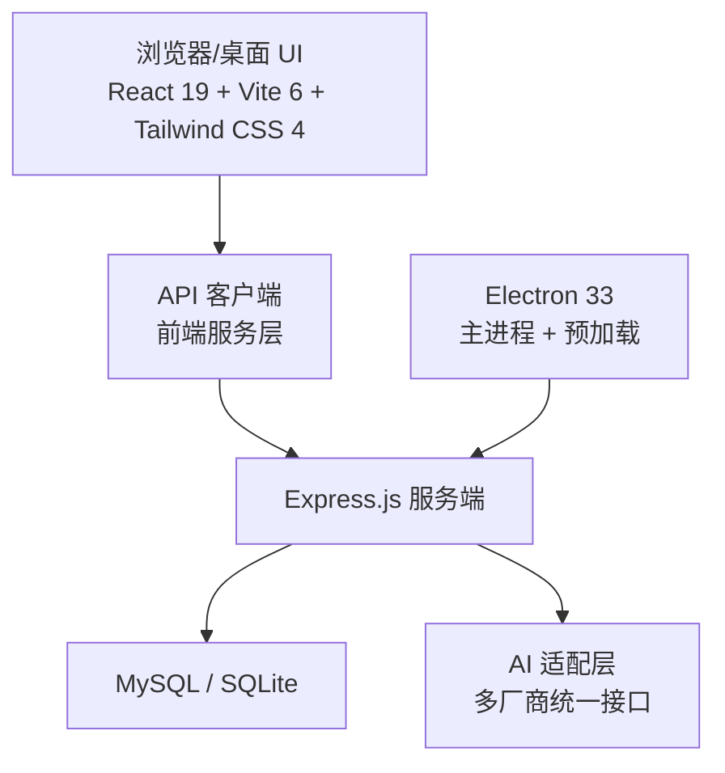
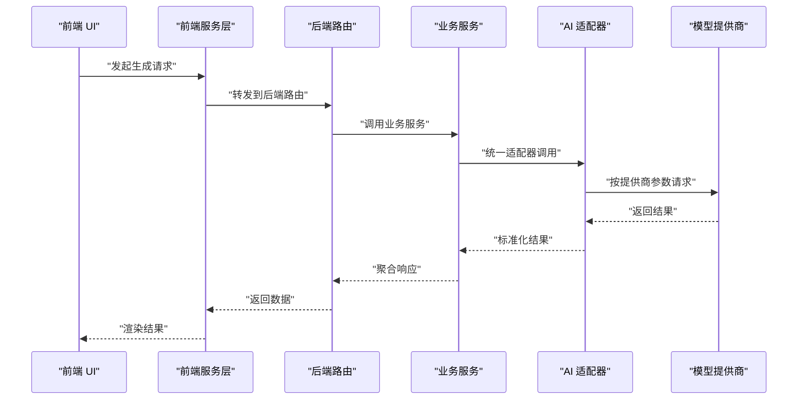

# 技术栈

<cite>
**本文引用的文件**
- [package.json](file://package.json)
- [vite.config.ts](file://vite.config.ts)
- [tsconfig.json](file://tsconfig.json)
- [README.md](file://README.md)
- [README_EN.md](file://README_EN.md)
</cite>

## 目录
1. [简介](#简介)
2. [项目结构](#项目结构)
3. [核心组件](#核心组件)
4. [架构总览](#架构总览)
5. [详细组件分析](#详细组件分析)
6. [依赖分析](#依赖分析)
7. [性能考量](#性能考量)
8. [故障排查指南](#故障排查指南)
9. [结论](#结论)
10. [附录](#附录)

## 简介
本技术栈文档聚焦于 AI Shotlive 项目的前端、后端、AI 服务与桌面客户端技术选型与实现要点。项目采用“前后端分离”的架构：前端以 React 19 + Vite 6 + Tailwind CSS 4 为核心，辅以 Radix UI 与 Framer Motion 提升交互与动画体验；后端基于 Express.js，数据持久化支持 MySQL 与 SQLite（本地/桌面模式），并通过 JWT 实现认证；AI 服务通过适配器层统一接入多家模型提供商；桌面客户端采用 Electron 33，内置 SQLite，实现“开箱即用”的本地化体验。

## 项目结构
项目采用按功能域划分的前端组件组织方式，配合后端 Express 路由与服务层、AI 适配器与桌面客户端工程化目录，形成清晰的分层与职责边界。

图表来源
- [README.md: 308-369:308-369](file://README.md#L308-L369)

章节来源
- [README.md: 308-369:308-369](file://README.md#L308-L369)

## 核心组件
- 前端技术栈
  - React 19：提供声明式 UI 与组件化能力，结合严格模式与 JSX 运行时提升开发体验与运行效率。
  - Vite 6：快速开发与构建工具，支持热更新与按需编译，满足现代前端工程化需求。
  - Tailwind CSS 4：原子化样式框架，配合 @tailwindcss/vite 插件实现高效样式开发与主题切换。
  - Radix UI：无障碍、可组合的 UI 组件库，提供高质量基础组件与可访问性保障。
  - Framer Motion：用于流畅的动画与交互动效，提升用户体验与界面表现力。
- 后端技术栈
  - Express.js：轻量、灵活的 Node.js Web 框架，适合快速迭代与模块化路由组织。
  - 数据库：MySQL（生产/Web 模式）与 SQLite（本地/桌面模式），通过配置层实现无缝切换。
  - JWT 认证：基于对称密钥的令牌机制，确保用户会话安全与跨域访问控制。
- AI 服务集成
  - 适配器层：统一抽象多家模型提供商（文本/图像/视频/音频），便于替换与扩展。
  - 类型与模型注册：通过类型定义与注册中心管理模型清单与配置。
- 桌面客户端
  - Electron 33：跨平台桌面应用框架，内置 SQLite，打包为 .dmg/.exe 安装包，数据与应用分离。

章节来源
- [README.md: 127-137:127-137](file://README.md#L127-L137)
- [README_EN.md: 87-97:87-97](file://README_EN.md#L87-L97)

## 架构总览
整体架构围绕“前端 + 后端 + AI 适配 + 桌面客户端”展开，前端通过 API 客户端与后端交互，后端负责数据持久化与业务编排，AI 适配层屏蔽多厂商差异，桌面客户端内嵌服务与数据库，实现离线可用与便捷部署。

图表来源
- [README.md: 127-137:127-137](file://README.md#L127-L137)
- [README_EN.md: 87-97:87-97](file://README_EN.md#L87-L97)

## 详细组件分析

### 前端技术栈：React 19、Vite 6、Tailwind CSS 4、Radix UI、Framer Motion
- 选择原因
  - React 19：提供并发特性与更优的开发体验，配合严格模式与新的 JSX 运行时，提升性能与可维护性。
  - Vite 6：更快的冷启动与热更新，支持 ES 模块与原生 ESM 生态，适配现代前端工程化。
  - Tailwind CSS 4：原子化样式减少 CSS 冲突，提升团队协作效率；与 @tailwindcss/vite 插件集成，实现按需生成与主题切换。
  - Radix UI：可组合、无障碍的基础组件库，契合现代 UI 设计趋势，降低重复造轮子成本。
  - Framer Motion：提供高性能动画与交互动效，便于实现复杂过渡与状态变化。
- 使用方式与配置要点
  - Vite 配置：启用 React 与 Tailwind CSS 插件，设置路径别名 @ 指向 src，便于模块导入与路径管理。
  - TypeScript 配置：采用 bundler 解析、ESNext 模块、严格模式与 JSX 运行时，确保类型安全与构建性能。
  - 组件组织：按功能域拆分组件（StageScript、StageAssets、StageDirector、StageExport 等），结合上下文（AuthContext、ThemeContext）实现状态共享与主题切换。
- 版本要求与依赖关系
  - React 19、React DOM 19、Vite 6、Tailwind CSS 4、@tailwindcss/vite 4、TypeScript ~5.8、@vitejs/plugin-react 5、lucide-react 等。
- 权衡考虑
  - 原子化样式 vs 传统样式：Tailwind 提升开发效率但需要统一设计规范；通过主题 CSS 变量与暗/亮主题文件平衡一致性与灵活性。
  - 动画与性能：Framer Motion 提供强大能力，需注意复杂动画对低端设备的影响，建议按需启用与优化关键路径。

章节来源
- [package.json: 11-24:11-24](file://package.json#L11-L24)
- [vite.config.ts: 1-13:1-13](file://vite.config.ts#L1-L13)
- [tsconfig.json: 1-21:1-21](file://tsconfig.json#L1-L21)
- [README.md: 127-137:127-137](file://README.md#L127-L137)

### 后端技术架构：Express.js、MySQL/SQLite、JWT 认证
- 设计考虑
  - Express.js：模块化路由与中间件机制，便于扩展认证、日志、错误处理等横切关注点。
  - 数据持久化：MySQL 适配生产/Web 模式，SQLite 适配本地/桌面模式，通过配置层实现无感切换。
  - JWT 认证：对称密钥令牌，支持会话状态管理与跨域访问控制，结合中间件实现权限校验。
- 路由与服务组织
  - 路由层：按领域划分（auth、ai、assets、models、projects、tasks、uploads、visualStyles 等），职责清晰。
  - 服务层：任务调度、项目存储、AI 代理、文件存储等，解耦业务逻辑与数据访问。
- 配置与启动
  - 环境变量：数据库连接、JWT 密钥、服务端口等通过 .env 管理，支持默认种子数据初始化。
  - 启动方式：本地开发（前端 + 后端）、Docker 部署（宿主机/内置 MySQL）、本地轻量（SQLite）。
- 权衡考虑
  - 数据库选择：MySQL 提供企业级能力，SQLite 降低部署复杂度；通过配置层隔离差异，避免业务代码耦合。

章节来源
- [README.md: 127-137:127-137](file://README.md#L127-L137)
- [README.md: 161-238:161-238](file://README.md#L161-L238)

### AI 服务集成方案
- 适配器层
  - 统一抽象多家模型提供商（文本/图像/视频/音频），前端通过适配器调用，便于替换与扩展。
  - 类型与模型注册：通过类型定义与注册中心管理模型清单与配置，确保调用一致性。
- 服务封装
  - 小说 → 剧本、剧本 → 视觉提示词、分镜生成、视频生成等服务封装，降低前端调用复杂度。
- 集成流程示意

图表来源
- [README.md: 111-124:111-124](file://README.md#L111-L124)
- [README_EN.md: 89-97:89-97](file://README_EN.md#L89-L97)

章节来源
- [README.md: 111-124:111-124](file://README.md#L111-L124)
- [README_EN.md: 89-97:89-97](file://README_EN.md#L89-L97)

### 文件存储策略
- 存储位置与隔离
  - uploads/：小说等上传文件，按用户隔离。
  - data/：媒体文件（图片/视频），按用户/项目隔离。
  - SQLite：本地/桌面模式下，数据库文件 local.db 存放于用户数据目录。
- 导出与导入
  - 支持 ZIP 归档导出/导入（数据库 + 媒体文件），导入时自动创建新用户，便于迁移与备份。
- 权衡考虑
  - 文件隔离与一致性：通过 user_id 与 episode_id 等维度隔离数据，避免跨用户/跨项目污染。
  - 备份完整性：导出包含数据库与媒体文件，确保迁移与恢复的完整性。

章节来源
- [README.md: 134-137:134-137](file://README.md#L134-L137)
- [README.md: 103-107:103-107](file://README.md#L103-L107)
- [README.md: 285-294:285-294](file://README.md#L285-L294)

### 桌面客户端架构：Electron 33
- 技术选型
  - Electron 33：跨平台桌面应用框架，支持 macOS 与 Windows，打包为 .dmg/.exe 安装包。
  - better-sqlite3：原生模块，随 Electron 版本自动重编译，内置 SQLite 数据库。
  - electron-builder：统一打包工具，支持多平台产物输出。
- 构建与打包流程
  - 前端构建：Vite 编译至 dist/。
  - 服务端构建：TypeScript 编译至 server/dist/。
  - Electron 主进程构建：TypeScript 编译至 electron/dist/。
  - 打包：electron-builder 输出安装包至 release/。
- 数据存储与自定义
  - 数据目录：用户数据目录下存放 local.db、data/、uploads/。
  - 自定义：可在数据目录放置 .env 覆盖默认配置（如 API Key、JWT 密钥等）。
- 权衡考虑
  - 原生模块与跨平台：better-sqlite3 需要针对 Electron 版本重编译，跨平台打包需在对应平台或 CI 环境执行。
  - 图标与签名：应用图标位于 electron/icons/，按说明生成 .icns/.ico 并配置签名。

章节来源
- [README.md: 242-305:242-305](file://README.md#L242-L305)
- [README_EN.md: 257-320:257-320](file://README_EN.md#L257-L320)

## 依赖分析
- 前端依赖
  - React 19、React DOM 19、lucide-react：提供 UI 与图标能力。
  - Vite 6、@vitejs/plugin-react 5、@tailwindcss/vite 4、tailwindcss 4、TypeScript ~5.8：构建与样式基础设施。
- 后端依赖
  - Express.js、数据库驱动与 ORM 工具（根据配置选择 MySQL 或 SQLite）、JWT 中间件与认证模块。
- 桌面客户端依赖
  - Electron 33、better-sqlite3、electron-builder、原生模块编译工具链（Xcode/VS）。

章节来源
- [package.json: 11-24:11-24](file://package.json#L11-L24)
- [README.md: 127-137:127-137](file://README.md#L127-L137)

## 性能考量
- 前端性能
  - Vite 的按需编译与模块联邦优化，结合 Tailwind 原子化样式减少无效 CSS，提升首屏与交互性能。
  - React 19 的并发特性有助于在复杂场景下维持 UI 流畅。
- 后端性能
  - Express 路由与中间件的模块化设计便于引入缓存与限流策略；数据库层面通过索引与查询优化降低延迟。
- 桌面客户端性能
  - Electron 应用体积与启动速度受打包策略影响，建议按需加载与懒编译；better-sqlite3 的本地读写性能优于远程数据库。

## 故障排查指南
- 环境与依赖
  - Node.js 版本要求：前端与桌面客户端分别要求 Node.js >= 20 与 >= 18；确保 npm >= 9。
  - 数据库：生产模式使用 MySQL 8+，本地/桌面模式使用内置 SQLite。
- 启动与调试
  - 本地开发：前端 + 后端同时启动，访问 http://localhost:3000（前端）与 http://localhost:3001（后端）。
  - Docker 部署：按编排文件启动，访问 http://localhost:3001。
  - 本地轻量：SQLite 模式，数据存储在 data/local.db。
- 认证与安全
  - JWT 密钥需在 .env 中配置；生产环境务必更换默认密钥。
- 桌面客户端
  - 原生模块编译：macOS 需 Xcode 命令行工具，Windows 需 Visual Studio 构建工具。
  - 打包产物：确认 release/ 目录产物与目标平台匹配。

章节来源
- [README.md: 149-156:149-156](file://README.md#L149-L156)
- [README.md: 161-238:161-238](file://README.md#L161-L238)
- [README.md: 242-305:242-305](file://README.md#L242-L305)

## 结论
AI Shotlive 的技术栈围绕“现代化前端 + 轻量后端 + 适配器式 AI 集成 + 跨平台桌面客户端”展开，既满足在线协作与规模化部署的需求，又兼顾本地化与离线可用场景。通过明确的分层与配置隔离，项目在可维护性、可扩展性与用户体验之间取得良好平衡。

## 附录
- 版本与配置要点摘要
  - 前端：React 19、Vite 6、Tailwind CSS 4、Radix UI、Framer Motion；Vite 插件与路径别名配置；TypeScript 严格模式与 JSX 运行时。
  - 后端：Express.js、MySQL/SQLite、JWT 认证；路由与服务分层；环境变量与种子数据。
  - 桌面：Electron 33、better-sqlite3、electron-builder；数据目录与自定义；原生模块编译工具链。
- 参考路径
  - 前端入口与组件：App.tsx、components/*、contexts/*
  - 后端入口与路由：server/src/index.ts、server/src/routes/*
  - AI 适配与服务：services/adapters/*、services/ai/*
  - 桌面主进程与预加载：electron/main.ts、electron/preload.ts