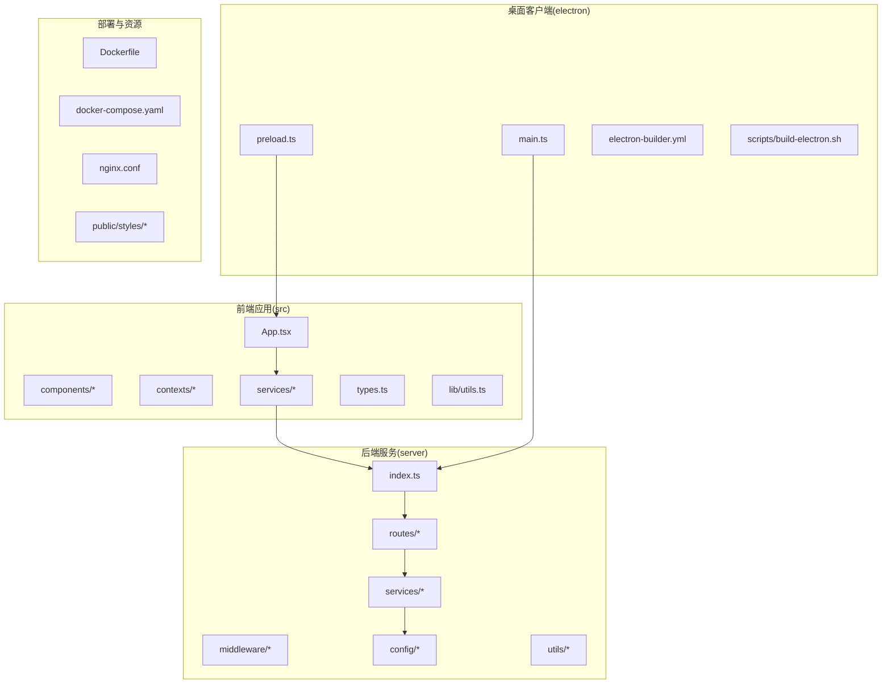
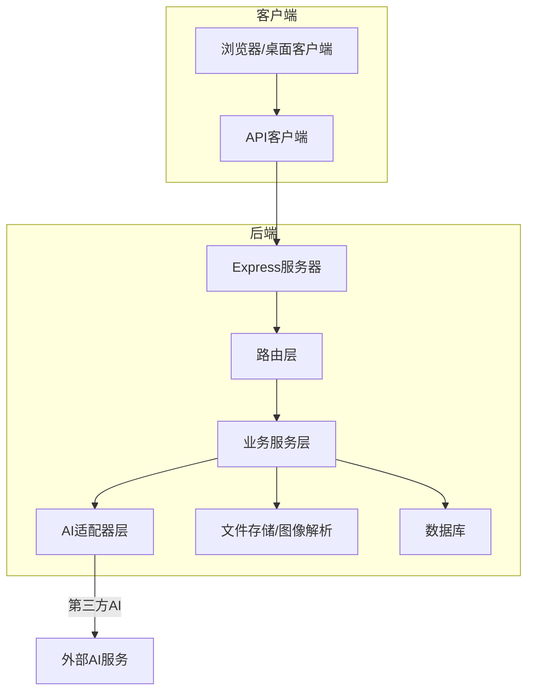
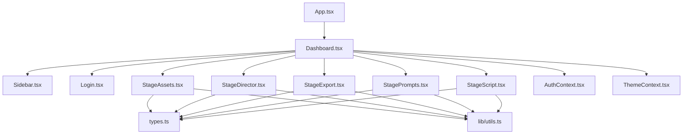
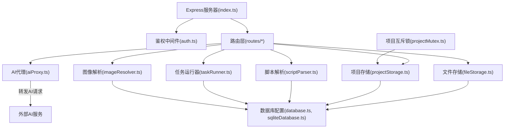
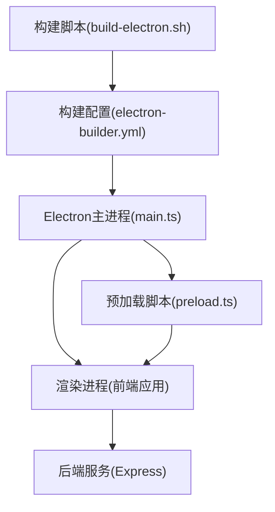
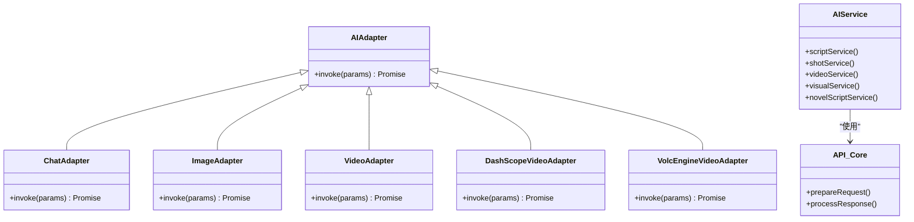
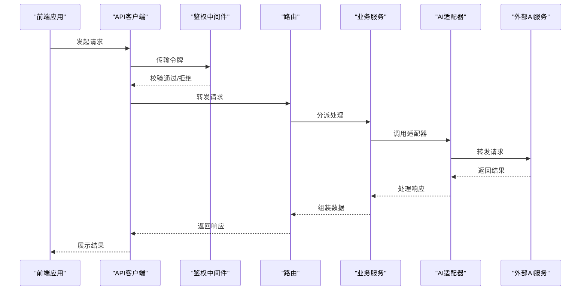
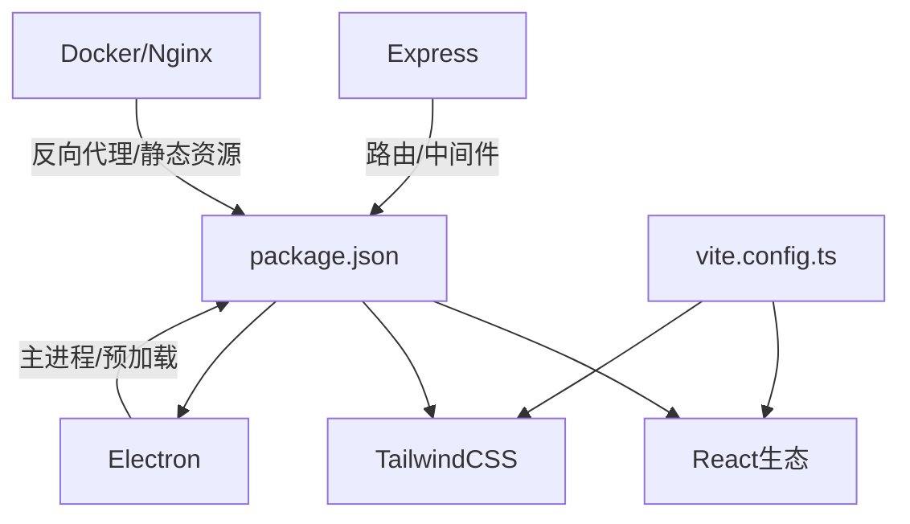

# 架构概览

<cite>
**本文档引用的文件**
- [package.json](file://package.json)
- [vite.config.ts](file://vite.config.ts)
- [src/App.tsx](file://src/App.tsx)
- [src/index.html](file://src/index.html)
- [src/types.ts](file://src/types.ts)
- [src/lib/utils.ts](file://src/lib/utils.ts)
- [src/components/Dashboard.tsx](file://src/components/Dashboard.tsx)
- [src/components/Login.tsx](file://src/components/Login.tsx)
- [src/components/Sidebar.tsx](file://src/components/Sidebar.tsx)
- [src/contexts/AuthContext.tsx](file://src/contexts/AuthContext.tsx)
- [src/contexts/ThemeContext.tsx](file://src/contexts/ThemeContext.tsx)
- [src/services/apiClient.ts](file://src/services/apiClient.ts)
- [src/services/modelConfigService.ts](file://src/services/modelConfigService.ts)
- [src/services/modelService.ts](file://src/services/modelService.ts)
- [src/services/taskService.ts](file://src/services/taskService.ts)
- [src/services/exportService.ts](file://src/services/exportService.ts)
- [src/services/storageService.ts](file://src/services/storageService.ts)
- [src/services/assetLibraryService.ts](file://src/services/assetLibraryService.ts)
- [src/services/renderLogService.ts](file://src/services/renderLogService.ts)
- [src/services/visualStyleService.ts](file://src/services/visualStyleService.ts)
- [src/services/projectPatchService.ts](file://src/services/projectPatchService.ts)
- [src/services/novelParser.ts](file://src/services/novelParser.ts)
- [src/services/mockData.ts](file://src/services/mockData.ts)
- [src/services/adapters/index.ts](file://src/services/adapters/index.ts)
- [src/services/adapters/chatAdapter.ts](file://src/services/adapters/chatAdapter.ts)
- [src/services/adapters/imageAdapter.ts](file://src/services/adapters/imageAdapter.ts)
- [src/services/adapters/videoAdapter.ts](file://src/services/adapters/videoAdapter.ts)
- [src/services/adapters/dashscopeVideoAdapter.ts](file://src/services/adapters/dashscopeVideoAdapter.ts)
- [src/services/adapters/volcengineVideoAdapter.ts](file://src/services/adapters/volcengineVideoAdapter.ts)
- [src/services/ai/index.ts](file://src/services/ai/index.ts)
- [src/services/ai/apiCore.ts](file://src/services/ai/apiCore.ts)
- [src/services/ai/scriptService.ts](file://src/services/ai/scriptService.ts)
- [src/services/ai/shotService.ts](file://src/services/ai/shotService.ts)
- [src/services/ai/videoService.ts](file://src/services/ai/videoService.ts)
- [src/services/ai/visualService.ts](file://src/services/ai/visualService.ts)
- [src/services/ai/novelScriptService.ts](file://src/services/ai/novelScriptService.ts)
- [src/services/ai/promptConstants.ts](file://src/services/ai/promptConstants.ts)
- [src/services/aiService.ts](file://src/services/aiService.ts)
- [server/src/index.ts](file://server/src/index.ts)
- [server/src/proxy.ts](file://server/src/proxy.ts)
- [server/src/middleware/auth.ts](file://server/src/middleware/auth.ts)
- [server/src/routes/auth.ts](file://server/src/routes/auth.ts)
- [server/src/routes/projects.ts](file://server/src/routes/projects.ts)
- [server/src/routes/models.ts](file://server/src/routes/models.ts)
- [server/src/routes/tasks.ts](file://server/src/routes/tasks.ts)
- [server/src/routes/assets.ts](file://server/src/routes/assets.ts)
- [server/src/routes/ai.ts](file://server/src/routes/ai.ts)
- [server/src/routes/uploads.ts](file://server/src/routes/uploads.ts)
- [server/src/routes/preferences.ts](file://server/src/routes/preferences.ts)
- [server/src/routes/projectPatch.ts](file://server/src/routes/projectPatch.ts)
- [server/src/routes/dataTransfer.ts](file://server/src/routes/dataTransfer.ts)
- [server/src/routes/visualStyles.ts](file://server/src/routes/visualStyles.ts)
- [server/src/services/aiProxy.ts](file://server/src/services/aiProxy.ts)
- [server/src/services/fileStorage.ts](file://server/src/services/fileStorage.ts)
- [server/src/services/projectStorage.ts](file://server/src/services/projectStorage.ts)
- [server/src/services/scriptParser.ts](file://server/src/services/scriptParser.ts)
- [server/src/services/taskRunner.ts](file://server/src/services/taskRunner.ts)
- [server/src/services/imageResolver.ts](file://server/src/services/imageResolver.ts)
- [server/src/config/database.ts](file://server/src/config/database.ts)
- [server/src/config/sqliteDatabase.ts](file://server/src/config/sqliteDatabase.ts)
- [server/src/utils/projectMutex.ts](file://server/src/utils/projectMutex.ts)
- [electron-builder.yml](file://electron-builder.yml)
- [scripts/build-electron.sh](file://scripts/build-electron.sh)
- [Dockerfile](file://Dockerfile)
- [docker-compose.yaml](file://docker-compose.yaml)
- [nginx.conf](file://nginx.conf)
- [public/styles/theme-dark.css](file://public/styles/theme-dark.css)
- [public/styles/theme-light.css](file://public/styles/theme-light.css)
</cite>

## 目录
1. [简介](#简介)
2. [项目结构](#项目结构)
3. [核心组件](#核心组件)
4. [架构总览](#架构总览)
5. [详细组件分析](#详细组件分析)
6. [依赖关系分析](#依赖关系分析)
7. [性能考虑](#性能考虑)
8. [故障排除指南](#故障排除指南)
9. [结论](#结论)

## 简介
本项目为“AI Shotlive”（暂译：AI漫画导演）创作工具，采用前后端分离与模块化架构设计，支持桌面客户端与Web应用双形态部署。系统围绕“控制论式四阶段创作工作流”构建，提供从剧本到镜头再到视频渲染的全流程AI辅助创作能力。前端基于React/Vite构建，后端采用Express服务，桌面端通过Electron封装，数据库与静态资源由独立容器化服务支撑。

## 项目结构
项目采用多模块分层组织：
- 前端应用：src目录下包含组件、上下文、服务层与类型定义
- 后端服务：server目录下包含路由、中间件、业务服务与配置
- 桌面客户端：electron目录与构建脚本
- 资源与样式：public目录下的样式与静态资源
- 部署与容器：Dockerfile、docker-compose与Nginx配置

图示来源
- [src/App.tsx:1-6](file://src/App.tsx#L1-L6)
- [server/src/index.ts](file://server/src/index.ts)
- [electron-builder.yml](file://electron-builder.yml)
- [Dockerfile](file://Dockerfile)
- [docker-compose.yaml](file://docker-compose.yaml)
- [nginx.conf](file://nginx.conf)

章节来源
- [package.json:1-26](file://package.json#L1-L26)
- [vite.config.ts:1-13](file://vite.config.ts#L1-L13)
- [src/index.html](file://src/index.html)

## 核心组件
- 前端应用层：以React组件为核心，通过上下文提供认证与主题状态，服务层负责与后端API通信与AI适配器对接。
- 后端服务层：Express服务器承载REST接口，路由按功能域划分，中间件处理鉴权与请求预处理，业务服务封装AI代理、文件存储与任务执行。
- 桌面客户端层：Electron主进程启动浏览器窗口，预加载脚本注入受控API，构建脚本打包跨平台可执行程序。
- 数据与资源层：SQLite/MySQL数据库配置，Nginx反向代理与静态资源服务，Docker容器化部署。

章节来源
- [src/App.tsx:1-6](file://src/App.tsx#L1-L6)
- [src/contexts/AuthContext.tsx](file://src/contexts/AuthContext.tsx)
- [src/contexts/ThemeContext.tsx](file://src/contexts/ThemeContext.tsx)
- [server/src/index.ts](file://server/src/index.ts)
- [server/src/middleware/auth.ts](file://server/src/middleware/auth.ts)
- [server/src/routes/auth.ts](file://server/src/routes/auth.ts)
- [electron-builder.yml](file://electron-builder.yml)
- [scripts/build-electron.sh](file://scripts/build-electron.sh)

## 架构总览
系统采用前后端分离与模块化设计，核心交互链路如下：
- 前端通过API客户端调用后端REST接口，后端路由根据资源域进行分发
- AI相关请求经由AI代理服务统一转发至第三方适配器（DashScope、火山引擎等）
- 文件上传与下载通过文件存储服务与图像解析服务处理
- 任务执行由任务运行器调度，渲染日志与导出流程在服务层协调
- 桌面客户端通过Electron桥接本地资源与后端服务

图示来源
- [src/services/apiClient.ts](file://src/services/apiClient.ts)
- [server/src/index.ts](file://server/src/index.ts)
- [server/src/routes/ai.ts](file://server/src/routes/ai.ts)
- [server/src/services/aiProxy.ts](file://server/src/services/aiProxy.ts)
- [server/src/services/fileStorage.ts](file://server/src/services/fileStorage.ts)
- [server/src/services/imageResolver.ts](file://server/src/services/imageResolver.ts)
- [server/src/config/database.ts](file://server/src/config/database.ts)

## 详细组件分析

### 前端应用架构
- 组件层次：Dashboard作为主界面容器，Sidebar提供导航，Login负责认证入口；各功能域组件（StageAssets、StageDirector、StageExport、StagePrompts、StageScript）按领域拆分，提升内聚性与可维护性。
- 状态管理：通过AuthContext与ThemeContext提供全局认证与主题状态，减少跨层级传递成本。
- 路由设计：基于Vite开发环境的单页应用模式，结合上下文状态驱动页面切换与权限控制。
- 类型与工具：types.ts集中定义数据模型，lib/utils.ts提供通用工具函数，确保类型安全与代码复用。

图示来源
- [src/App.tsx:1-6](file://src/App.tsx#L1-L6)
- [src/components/Dashboard.tsx](file://src/components/Dashboard.tsx)
- [src/components/Sidebar.tsx](file://src/components/Sidebar.tsx)
- [src/components/Login.tsx](file://src/components/Login.tsx)
- [src/contexts/AuthContext.tsx](file://src/contexts/AuthContext.tsx)
- [src/contexts/ThemeContext.tsx](file://src/contexts/ThemeContext.tsx)
- [src/types.ts](file://src/types.ts)
- [src/lib/utils.ts](file://src/lib/utils.ts)

章节来源
- [src/App.tsx:1-6](file://src/App.tsx#L1-L6)
- [src/components/Dashboard.tsx](file://src/components/Dashboard.tsx)
- [src/components/Sidebar.tsx](file://src/components/Sidebar.tsx)
- [src/components/Login.tsx](file://src/components/Login.tsx)
- [src/contexts/AuthContext.tsx](file://src/contexts/AuthContext.tsx)
- [src/contexts/ThemeContext.tsx](file://src/contexts/ThemeContext.tsx)
- [src/types.ts](file://src/types.ts)
- [src/lib/utils.ts](file://src/lib/utils.ts)

### 后端服务架构
- 服务器与中间件：Express服务器作为入口，鉴权中间件统一处理访问令牌校验与用户上下文注入。
- API设计：按资源域划分路由，如auth、projects、models、tasks、assets、ai、uploads、preferences、projectPatch、dataTransfer、visualStyles，职责清晰、易于扩展。
- 业务服务：AI代理、文件存储、项目存储、脚本解析、任务运行器、图像解析等服务解耦AI实现细节与数据持久化。
- 配置与并发：数据库配置支持SQLite/MySQL，项目互斥锁保障并发写入一致性。

图示来源
- [server/src/index.ts](file://server/src/index.ts)
- [server/src/middleware/auth.ts](file://server/src/middleware/auth.ts)
- [server/src/routes/auth.ts](file://server/src/routes/auth.ts)
- [server/src/routes/projects.ts](file://server/src/routes/projects.ts)
- [server/src/routes/models.ts](file://server/src/routes/models.ts)
- [server/src/routes/tasks.ts](file://server/src/routes/tasks.ts)
- [server/src/routes/assets.ts](file://server/src/routes/assets.ts)
- [server/src/routes/ai.ts](file://server/src/routes/ai.ts)
- [server/src/routes/uploads.ts](file://server/src/routes/uploads.ts)
- [server/src/routes/preferences.ts](file://server/src/routes/preferences.ts)
- [server/src/routes/projectPatch.ts](file://server/src/routes/projectPatch.ts)
- [server/src/routes/dataTransfer.ts](file://server/src/routes/dataTransfer.ts)
- [server/src/routes/visualStyles.ts](file://server/src/routes/visualStyles.ts)
- [server/src/services/aiProxy.ts](file://server/src/services/aiProxy.ts)
- [server/src/services/fileStorage.ts](file://server/src/services/fileStorage.ts)
- [server/src/services/projectStorage.ts](file://server/src/services/projectStorage.ts)
- [server/src/services/scriptParser.ts](file://server/src/services/scriptParser.ts)
- [server/src/services/taskRunner.ts](file://server/src/services/taskRunner.ts)
- [server/src/services/imageResolver.ts](file://server/src/services/imageResolver.ts)
- [server/src/config/database.ts](file://server/src/config/database.ts)
- [server/src/config/sqliteDatabase.ts](file://server/src/config/sqliteDatabase.ts)
- [server/src/utils/projectMutex.ts](file://server/src/utils/projectMutex.ts)

章节来源
- [server/src/index.ts](file://server/src/index.ts)
- [server/src/middleware/auth.ts](file://server/src/middleware/auth.ts)
- [server/src/routes/auth.ts](file://server/src/routes/auth.ts)
- [server/src/routes/projects.ts](file://server/src/routes/projects.ts)
- [server/src/routes/models.ts](file://server/src/routes/models.ts)
- [server/src/routes/tasks.ts](file://server/src/routes/tasks.ts)
- [server/src/routes/assets.ts](file://server/src/routes/assets.ts)
- [server/src/routes/ai.ts](file://server/src/routes/ai.ts)
- [server/src/routes/uploads.ts](file://server/src/routes/uploads.ts)
- [server/src/routes/preferences.ts](file://server/src/routes/preferences.ts)
- [server/src/routes/projectPatch.ts](file://server/src/routes/projectPatch.ts)
- [server/src/routes/dataTransfer.ts](file://server/src/routes/dataTransfer.ts)
- [server/src/routes/visualStyles.ts](file://server/src/routes/visualStyles.ts)
- [server/src/services/aiProxy.ts](file://server/src/services/aiProxy.ts)
- [server/src/services/fileStorage.ts](file://server/src/services/fileStorage.ts)
- [server/src/services/projectStorage.ts](file://server/src/services/projectStorage.ts)
- [server/src/services/scriptParser.ts](file://server/src/services/scriptParser.ts)
- [server/src/services/taskRunner.ts](file://server/src/services/taskRunner.ts)
- [server/src/services/imageResolver.ts](file://server/src/services/imageResolver.ts)
- [server/src/config/database.ts](file://server/src/config/database.ts)
- [server/src/config/sqliteDatabase.ts](file://server/src/config/sqliteDatabase.ts)
- [server/src/utils/projectMutex.ts](file://server/src/utils/projectMutex.ts)

### 桌面客户端架构
- 主进程：负责创建BrowserWindow、加载渲染进程、处理原生菜单与系统集成。
- 预加载脚本：在受限上下文中注入受控API，实现安全的IPC通信与DOM访问控制。
- 构建与打包：electron-builder.yml定义打包配置，build-electron.sh脚本自动化构建流程。
- 运行时交互：桌面客户端通过本地HTTP服务或代理访问后端API，实现离线/本地化部署场景。

图示来源
- [electron-builder.yml](file://electron-builder.yml)
- [scripts/build-electron.sh](file://scripts/build-electron.sh)

章节来源
- [electron-builder.yml](file://electron-builder.yml)
- [scripts/build-electron.sh](file://scripts/build-electron.sh)

### AI适配器与服务层
- 适配器层：chatAdapter、imageAdapter、videoAdapter、dashscopeVideoAdapter、volcengineVideoAdapter等，统一抽象不同厂商的API差异。
- AI服务：aiService聚合多个AI子服务（script、shot、video、visual、novelScript），通过apiCore封装请求参数与响应处理。
- 服务编排：AI代理服务负责请求转发与错误处理，确保上层调用的一致性与稳定性。

图示来源
- [src/services/adapters/index.ts](file://src/services/adapters/index.ts)
- [src/services/adapters/chatAdapter.ts](file://src/services/adapters/chatAdapter.ts)
- [src/services/adapters/imageAdapter.ts](file://src/services/adapters/imageAdapter.ts)
- [src/services/adapters/videoAdapter.ts](file://src/services/adapters/videoAdapter.ts)
- [src/services/adapters/dashscopeVideoAdapter.ts](file://src/services/adapters/dashscopeVideoAdapter.ts)
- [src/services/adapters/volcengineVideoAdapter.ts](file://src/services/adapters/volcengineVideoAdapter.ts)
- [src/services/aiService.ts](file://src/services/aiService.ts)
- [src/services/ai/apiCore.ts](file://src/services/ai/apiCore.ts)

章节来源
- [src/services/adapters/index.ts](file://src/services/adapters/index.ts)
- [src/services/adapters/chatAdapter.ts](file://src/services/adapters/chatAdapter.ts)
- [src/services/adapters/imageAdapter.ts](file://src/services/adapters/imageAdapter.ts)
- [src/services/adapters/videoAdapter.ts](file://src/services/adapters/videoAdapter.ts)
- [src/services/adapters/dashscopeVideoAdapter.ts](file://src/services/adapters/dashscopeVideoAdapter.ts)
- [src/services/adapters/volcengineVideoAdapter.ts](file://src/services/adapters/volcengineVideoAdapter.ts)
- [src/services/aiService.ts](file://src/services/aiService.ts)
- [src/services/ai/apiCore.ts](file://src/services/ai/apiCore.ts)

### 数据流与安全边界
- 数据流：前端通过API客户端发起请求，后端路由接收并交由相应服务处理，服务层调用适配器或存储服务，最终返回结果或触发任务执行。
- 安全边界：鉴权中间件在进入业务逻辑前拦截请求，确保访问令牌有效；预加载脚本限制渲染进程对Node.js API的直接访问，仅暴露必要接口。
- 错误处理：服务层统一捕获异常并向客户端返回标准化错误信息；AI代理层对第三方服务失败进行降级与重试策略。

图示来源
- [server/src/middleware/auth.ts](file://server/src/middleware/auth.ts)
- [server/src/routes/ai.ts](file://server/src/routes/ai.ts)
- [server/src/services/aiProxy.ts](file://server/src/services/aiProxy.ts)
- [src/services/apiClient.ts](file://src/services/apiClient.ts)

## 依赖关系分析
- 前端依赖：React生态（react、react-dom）、UI图标库（lucide-react）、构建工具（Vite、TailwindCSS），通过package.json与vite.config.ts统一管理。
- 后端依赖：Express框架、数据库驱动与ORM配置，路由与中间件按功能域组织，避免循环依赖。
- 桌面端依赖：Electron主进程与预加载脚本，构建工具链与打包配置。
- 部署依赖：Docker镜像、Compose编排与Nginx反向代理，统一对外提供静态资源与API网关。

图示来源
- [package.json:1-26](file://package.json#L1-L26)
- [vite.config.ts:1-13](file://vite.config.ts#L1-L13)

章节来源
- [package.json:1-26](file://package.json#L1-L26)
- [vite.config.ts:1-13](file://vite.config.ts#L1-L13)

## 性能考虑
- 前端性能：组件按功能域拆分，减少不必要的重渲染；TailwindCSS按需引入，降低包体积；Vite开发与构建优化提升热更新与打包效率。
- 后端性能：路由与服务分离，避免长链路阻塞；数据库配置支持SQLite/MySQL，可根据负载选择合适存储；任务运行器异步化处理耗时操作。
- 桌面端性能：Electron主进程与渲染进程分离，预加载脚本最小化权限，IPC通信避免频繁网络请求。
- 部署性能：Nginx反向代理缓存静态资源，Docker容器化便于弹性伸缩与CDN分发。

## 故障排除指南
- 认证失败：检查鉴权中间件是否正确注入用户上下文，确认令牌格式与有效期。
- API调用异常：查看API客户端错误处理与后端路由响应码，定位具体服务层问题。
- 文件上传/下载失败：核对文件存储服务与图像解析服务的路径与权限配置。
- 任务执行卡顿：检查任务运行器队列与并发度设置，关注项目互斥锁是否导致阻塞。
- 桌面端无法访问后端：确认预加载脚本注入的IPC接口与本地服务地址配置。

章节来源
- [server/src/middleware/auth.ts](file://server/src/middleware/auth.ts)
- [src/services/apiClient.ts](file://src/services/apiClient.ts)
- [server/src/services/fileStorage.ts](file://server/src/services/fileStorage.ts)
- [server/src/services/taskRunner.ts](file://server/src/services/taskRunner.ts)
- [server/src/utils/projectMutex.ts](file://server/src/utils/projectMutex.ts)

## 结论
本项目通过前后端分离与模块化设计，实现了创作工作流的完整闭环。前端以React组件为核心，后端以Express服务为枢纽，桌面端提供跨平台体验，配合容器化与反向代理形成稳定的交付体系。AI适配器层抽象了多家供应商的差异，提升了系统的可扩展性与可维护性。建议后续持续完善测试覆盖、监控告警与灰度发布机制，以支撑更大规模的创作场景。