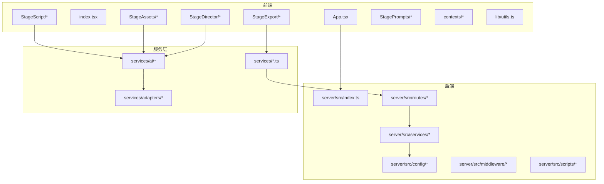
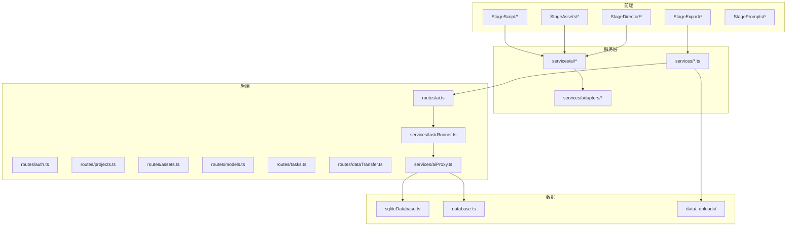
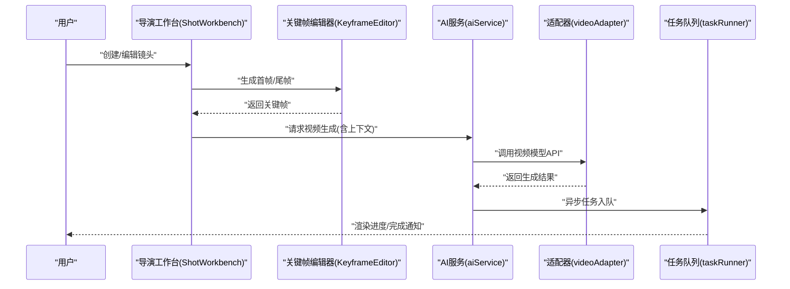
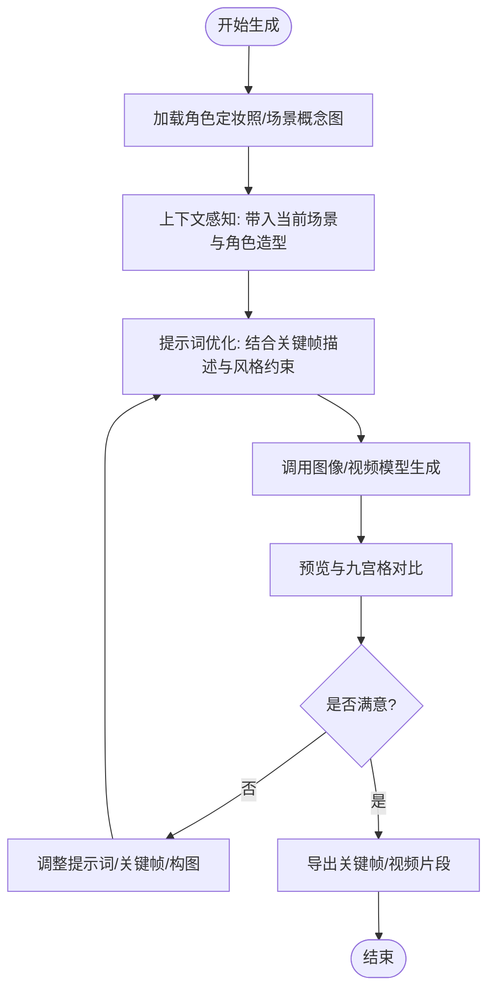
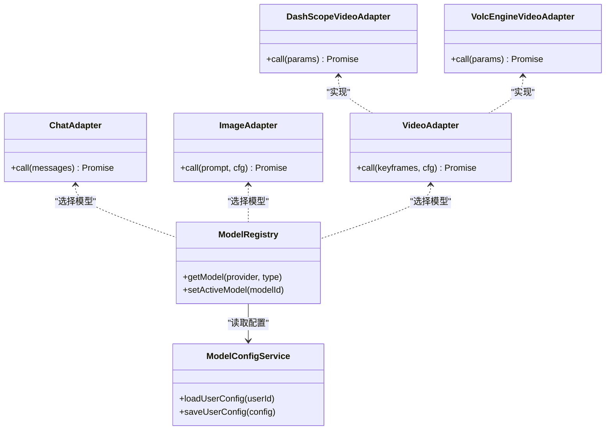
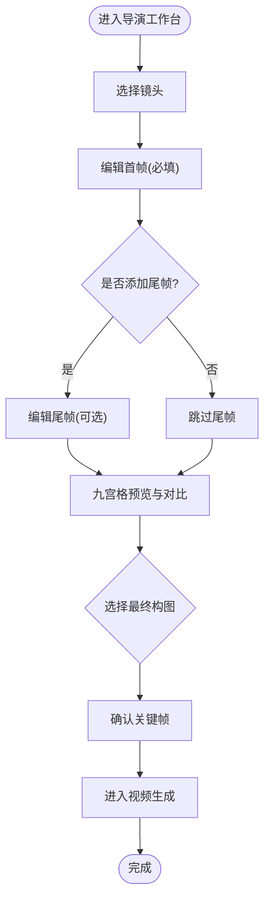
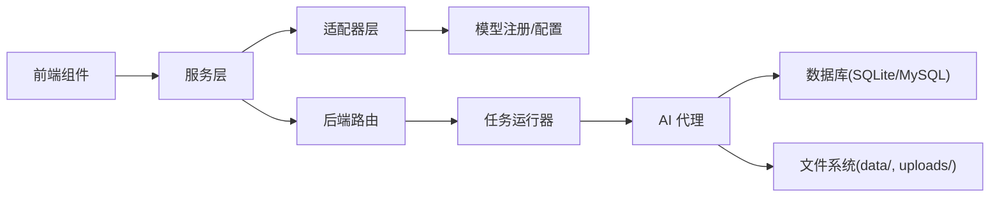

# 核心理念

<cite>
**本文引用的文件**
- [README.md](file://README.md)
- [README_EN.md](file://README_EN.md)
- [types.ts](file://types.ts)
- [types/model.ts](file://types/model.ts)
- [services/adapters/index.ts](file://services/adapters/index.ts)
- [services/adapters/chatAdapter.ts](file://services/adapters/chatAdapter.ts)
- [services/adapters/imageAdapter.ts](file://services/adapters/imageAdapter.ts)
- [services/adapters/videoAdapter.ts](file://services/adapters/videoAdapter.ts)
- [services/adapters/dashscopeVideoAdapter.ts](file://services/adapters/dashscopeVideoAdapter.ts)
- [services/adapters/volcengineVideoAdapter.ts](file://services/adapters/volcengineVideoAdapter.ts)
- [components/StageDirector/KeyframeEditor.tsx](file://components/StageDirector/KeyframeEditor.tsx)
- [components/StageDirector/ShotWorkbench.tsx](file://components/StageDirector/ShotWorkbench.tsx)
- [components/StageAssets/PromptEditor.tsx](file://components/StageAssets/PromptEditor.tsx)
- [components/StagePrompts/KeyframeSection.tsx](file://components/StagePrompts/KeyframeSection.tsx)
- [components/StageAssets/CharacterCard.tsx](file://components/StageAssets/CharacterCard.tsx)
- [components/StageAssets/SceneCard.tsx](file://components/StageAssets/SceneCard.tsx)
- [components/StageAssets/WardrobeModal.tsx](file://components/StageAssets/WardrobeModal.tsx)
- [components/StageAssets/TurnaroundModal.tsx](file://components/StageAssets/TurnaroundModal.tsx)
- [components/StageDirector/cameraMovementGuides.ts](file://components/StageDirector/cameraMovementGuides.ts)
- [components/StageDirector/constants.ts](file://components/StageDirector/constants.ts)
- [components/StageAssets/constants.ts](file://components/StageAssets/constants.ts)
- [components/StagePrompts/constants.ts](file://components/StagePrompts/constants.ts)
- [server/src/routes/ai.ts](file://server/src/routes/ai.ts)
- [server/src/services/taskRunner.ts](file://server/src/services/taskRunner.ts)
- [server/src/services/aiProxy.ts](file://server/src/services/aiProxy.ts)
- [services/aiService.ts](file://services/aiService.ts)
- [services/ai/apiCore.ts](file://services/ai/apiCore.ts)
- [services/ai/promptConstants.ts](file://services/ai/promptConstants.ts)
- [services/ai/shotService.ts](file://services/ai/shotService.ts)
- [services/ai/videoService.ts](file://services/ai/videoService.ts)
- [services/ai/visualService.ts](file://services/ai/visualService.ts)
- [services/assetLibraryService.ts](file://services/assetLibraryService.ts)
- [services/modelRegistry.ts](file://services/modelRegistry.ts)
- [services/modelConfigService.ts](file://services/modelConfigService.ts)
- [contexts/AuthContext.tsx](file://contexts/AuthContext.tsx)
- [contexts/ThemeContext.tsx](file://contexts/ThemeContext.tsx)
- [App.tsx](file://App.tsx)
- [index.tsx](file://index.tsx)
- [lib/utils.ts](file://lib/utils.ts)
- [electron/main.ts](file://electron/main.ts)
- [electron/preload.ts](file://electron/preload.ts)
- [server/src/config/database.ts](file://server/src/config/database.ts)
- [server/src/config/sqliteDatabase.ts](file://server/src/config/sqliteDatabase.ts)
- [server/src/middleware/auth.ts](file://server/src/middleware/auth.ts)
- [server/src/routes/projects.ts](file://server/src/routes/projects.ts)
- [server/src/routes/assets.ts](file://server/src/routes/assets.ts)
- [server/src/routes/models.ts](file://server/src/routes/models.ts)
- [server/src/routes/tasks.ts](file://server/src/routes/tasks.ts)
- [server/src/routes/uploads.ts](file://server/src/routes/uploads.ts)
- [server/src/routes/dataTransfer.ts](file://server/src/routes/dataTransfer.ts)
- [server/src/routes/preferences.ts](file://server/src/routes/preferences.ts)
- [server/src/routes/visualStyles.ts](file://server/src/routes/visualStyles.ts)
- [server/src/scripts/seed.ts](file://server/src/scripts/seed.ts)
- [server/src/utils/projectMutex.ts](file://server/src/utils/projectMutex.ts)
- [services/storageService.ts](file://services/storageService.ts)
- [services/renderLogService.ts](file://services/renderLogService.ts)
- [services/exportService.ts](file://services/exportService.ts)
- [services/taskService.ts](file://services/taskService.ts)
- [services/novelParser.ts](file://services/novelParser.ts)
- [services/projectPatchService.ts](file://services/projectPatchService.ts)
- [services/styleService.ts](file://services/styleService.ts)
- [services/mockData.ts](file://services/mockData.ts)
</cite>

## 目录
1. [引言](#引言)
2. [项目结构](#项目结构)
3. [核心组件](#核心组件)
4. [架构总览](#架构总览)
5. [详细组件分析](#详细组件分析)
6. [依赖关系分析](#依赖关系分析)
7. [性能考量](#性能考量)
8. [故障排查指南](#故障排查指南)
9. [结论](#结论)
10. [附录](#附录)

## 引言
本文件聚焦于 AI Shotlive 的核心理念：关键帧驱动（Keyframe-Driven）工作流与“先画后动”的创作范式，阐释资产约束机制如何保障画面一致性，以及多模型提供商支持策略与适配器层设计。文档以循序渐进的方式，结合前端组件、后端路由与服务、适配器层、数据库模型与上下文，帮助创作者和技术读者理解从“小说 → 剧本 → 分镜 → 资产 → 关键帧 → 成片”的完整工业流程。

## 项目结构
AI Shotlive 采用前后端分离架构：前端基于 React/Vite，后端基于 Express/TypeScript，数据库支持 MySQL 与 SQLite（本地/桌面模式）。项目通过“阶段化”模块组织功能，包括小说与剧本、角色与场景资产、导演工作台（关键帧与视频生成）、导出与剪辑等。

图表来源
- [App.tsx](file://App.tsx)
- [index.tsx](file://index.tsx)
- [server/src/index.ts](file://server/src/index.ts)
- [services/ai/apiCore.ts](file://services/ai/apiCore.ts)
- [services/adapters/index.ts](file://services/adapters/index.ts)

章节来源
- [README.md:52-125](file://README.md#L52-L125)
- [README_EN.md:37-120](file://README_EN.md#L37-L120)

## 核心组件
- 关键帧驱动工作流：通过首帧/尾帧约束与插值生成视频，确保运动与构图可控。
- 资产约束机制：角色定妆照与场景概念图贯穿生成过程，避免画面漂移。
- 多模型适配器：统一不同厂商 API 接口，支持文本/图像/视频/音频模型切换。
- 工业化流程：从“小说/故事 → 剧本 → 分镜 → 资产 → 关键帧 → 成片”，支持导出与剪辑。

章节来源
- [README.md:52-125](file://README.md#L52-L125)
- [README_EN.md:37-120](file://README_EN.md#L37-L120)

## 架构总览
整体架构围绕“阶段化工作流 + 适配器层 + 统一服务层 + 可插拔模型配置”展开。前端负责交互与可视化，后端负责数据持久化、任务调度与代理调用，适配器层屏蔽厂商差异，服务层封装业务逻辑。

图表来源
- [server/src/routes/ai.ts](file://server/src/routes/ai.ts)
- [server/src/services/taskRunner.ts](file://server/src/services/taskRunner.ts)
- [server/src/services/aiProxy.ts](file://server/src/services/aiProxy.ts)
- [server/src/config/sqliteDatabase.ts](file://server/src/config/sqliteDatabase.ts)
- [server/src/config/database.ts](file://server/src/config/database.ts)
- [services/adapters/index.ts](file://services/adapters/index.ts)
- [services/ai/apiCore.ts](file://services/ai/apiCore.ts)

## 详细组件分析

### 关键帧驱动工作流与“先画后动”
- 设计思想
  - “先画后动”强调以精确的首帧/尾帧为起点，通过插值生成中间过渡，从而稳定控制角色姿态、场景构图与镜头运动。
  - 通过“资产约束”（角色定妆照、场景概念图）确保生成内容与既定风格一致，减少“不连戏”和风格漂移。
- 实现要点
  - 导演工作台提供首帧/尾帧编辑与九宫格预览，便于挑选最优构图。
  - 适配器层支持多种视频模型（如 Veo/Sora-2 等），统一调用接口，简化切换成本。
- 使用场景
  - 需要严格控制角色动作与镜头运动的短剧/漫剧制作。
  - 对画面一致性要求高的系列作品（角色、场景风格统一）。

图表来源
- [components/StageDirector/ShotWorkbench.tsx](file://components/StageDirector/ShotWorkbench.tsx)
- [components/StageDirector/KeyframeEditor.tsx](file://components/StageDirector/KeyframeEditor.tsx)
- [services/aiService.ts](file://services/aiService.ts)
- [services/adapters/videoAdapter.ts](file://services/adapters/videoAdapter.ts)
- [server/src/services/taskRunner.ts](file://server/src/services/taskRunner.ts)

章节来源
- [README.md:79-86](file://README.md#L79-L86)
- [README_EN.md:62-72](file://README_EN.md#L62-L72)

### 资产约束机制：角色定妆照与场景概念图
- 角色定妆照
  - 为每个角色生成标准参考图，支持“衣橱”多套造型（日常、战斗等），保持面部一致性。
  - 在生成过程中自动带入当前场景图与角色特定造型图，提升上下文感知能力。
- 场景概念图
  - 生成场景参考图，保证同场景下光照、氛围与空间关系一致。
- 实现路径
  - 角色与场景卡片组件负责展示与管理资产；提示词编辑器负责细化生成约束；常量与工具函数支撑上下文拼接与提示词优化。

图表来源
- [components/StageAssets/CharacterCard.tsx](file://components/StageAssets/CharacterCard.tsx)
- [components/StageAssets/SceneCard.tsx](file://components/StageAssets/SceneCard.tsx)
- [components/StageAssets/WardrobeModal.tsx](file://components/StageAssets/WardrobeModal.tsx)
- [components/StageAssets/TurnaroundModal.tsx](file://components/StageAssets/TurnaroundModal.tsx)
- [components/StageAssets/PromptEditor.tsx](file://components/StageAssets/PromptEditor.tsx)
- [components/StagePrompts/KeyframeSection.tsx](file://components/StagePrompts/KeyframeSection.tsx)

章节来源
- [README.md:73-78](file://README.md#L73-L78)
- [README_EN.md:56-61](file://README_EN.md#L56-L61)

### 多模型提供商支持与适配器层
- 支持厂商与模型
  - 文本：OpenAI、Anthropic、DeepSeek、豆包、通义千问、智谱、Google Gemini、xAI、AntSK、SiliconFlow、Moonshot、OpenRouter 等。
  - 图像：Google Gemini、豆包 Seedream、通义万相、可灵 Image（AntSK）等。
  - 视频：Veo 3.1 / Sora-2（AntSK/OpenAI）、豆包 Seedance、可灵、Vidu、万象（通义）等。
- 适配器层设计
  - 统一 chat/image/video 的调用接口，隐藏厂商差异，支持动态切换与回退。
  - 模型注册与配置服务负责读取用户配置，决定当前激活的提供商与模型。
- 最佳实践
  - 在“模型配置”中为各类型填写 API Key，优先使用 AntSK API 以获得更稳定的统一体验。
  - 根据场景需求选择合适模型：文本用于剧本拆解与提示词优化，图像用于资产生成，视频用于关键帧插值。

图表来源
- [services/modelRegistry.ts](file://services/modelRegistry.ts)
- [services/modelConfigService.ts](file://services/modelConfigService.ts)
- [services/adapters/chatAdapter.ts](file://services/adapters/chatAdapter.ts)
- [services/adapters/imageAdapter.ts](file://services/adapters/imageAdapter.ts)
- [services/adapters/videoAdapter.ts](file://services/adapters/videoAdapter.ts)
- [services/adapters/dashscopeVideoAdapter.ts](file://services/adapters/dashscopeVideoAdapter.ts)
- [services/adapters/volcengineVideoAdapter.ts](file://services/adapters/volcengineVideoAdapter.ts)

章节来源
- [README.md:111-124](file://README.md#L111-L124)
- [README_EN.md:99-120](file://README_EN.md#L99-L120)

### 导演工作台：关键帧编辑与九宫格预览
- 功能要点
  - 首帧/尾帧编辑：支持精确控制起止状态。
  - 九宫格预览：在同一镜头下生成 9 个视角，便于挑选最佳构图。
  - 上下文感知：自动带入当前场景图与角色特定造型图，减少“不连戏”。
- 相关常量与指南
  - 摄像机运动指南与常量定义辅助镜头规划与一致性控制。

图表来源
- [components/StageDirector/ShotWorkbench.tsx](file://components/StageDirector/ShotWorkbench.tsx)
- [components/StageDirector/KeyframeEditor.tsx](file://components/StageDirector/KeyframeEditor.tsx)
- [components/StageDirector/cameraMovementGuides.ts](file://components/StageDirector/cameraMovementGuides.ts)
- [components/StageDirector/constants.ts](file://components/StageDirector/constants.ts)

章节来源
- [README.md:79-86](file://README.md#L79-L86)
- [README_EN.md:62-72](file://README_EN.md#L62-L72)

### 提示词管理与关键帧提示词
- 提示词编辑器与分节管理
  - 为角色、场景、道具与关键帧分别维护提示词，支持折叠/展开与状态标记。
  - 关键帧分节集中管理首帧/尾帧的提示词与状态，便于迭代优化。
- 提示词优化策略
  - 结合资产约束（角色定妆照、场景概念图）与镜头密度、时长目标，自动优化提示词结构与权重。

章节来源
- [components/StagePrompts/KeyframeSection.tsx](file://components/StagePrompts/KeyframeSection.tsx)
- [components/StagePrompts/PropSection.tsx](file://components/StagePrompts/PropSection.tsx)
- [components/StagePrompts/SceneSection.tsx](file://components/StagePrompts/SceneSection.tsx)
- [components/StagePrompts/CharacterSection.tsx](file://components/StagePrompts/CharacterSection.tsx)
- [components/StagePrompts/constants.ts](file://components/StagePrompts/constants.ts)

### 小说与剧本阶段：从文本到分镜
- 小说解析与剧集生成
  - 支持上传 txt 小说，按“第 X 章”自动解析章节，分页浏览与按需加载。
  - 选择章节创建剧集，AI 将章节改编为剧本（场次、对话、动作、视觉化描述）。
- 剧本与分镜
  - 支持手动编辑角色视觉描述、分镜提示词、角色列表、动作与台词，精细控制生成效果。
- 视觉化翻译
  - 将剧本描述转换为绘图提示词，支持设定目标时长与镜头密度。

章节来源
- [README.md:62-72](file://README.md#L62-L72)
- [README_EN.md:47-55](file://README_EN.md#L47-L55)

### 成片导出与剪辑
- 时间轴预览与渲染追踪
  - 渲染进度实时追踪，导出高清关键帧与 MP4 片段。
- 多轨道视频剪辑器
  - 支持视频、音频、字幕、图片轨道，资源库按剧本/镜头、角色、场景、视频、上传、AI 字幕、AI 音频分类展示，拖拽即可使用。
- 下载与打包
  - 将当前轨道中的视频与图片片段打包为 ZIP 下载，便于后续专业剪辑软件处理。

章节来源
- [README.md:87-97](file://README.md#L87-L97)
- [README_EN.md:73-77](file://README_EN.md#L73-L77)

## 依赖关系分析
- 前端组件依赖服务层与上下文，服务层依赖适配器层与后端路由。
- 适配器层依赖模型注册与配置服务，统一不同厂商 API。
- 后端路由依赖任务运行器与 AI 代理，实现异步任务与外部调用。
- 数据层支持 MySQL 与 SQLite，文件系统承载媒体与上传资源。

图表来源
- [services/modelRegistry.ts](file://services/modelRegistry.ts)
- [services/modelConfigService.ts](file://services/modelConfigService.ts)
- [services/adapters/index.ts](file://services/adapters/index.ts)
- [server/src/routes/ai.ts](file://server/src/routes/ai.ts)
- [server/src/services/taskRunner.ts](file://server/src/services/taskRunner.ts)
- [server/src/services/aiProxy.ts](file://server/src/services/aiProxy.ts)
- [server/src/config/sqliteDatabase.ts](file://server/src/config/sqliteDatabase.ts)
- [server/src/config/database.ts](file://server/src/config/database.ts)

## 性能考量
- 生成任务异步化：通过任务队列与渲染日志追踪进度，避免阻塞前端交互。
- 适配器层复用：统一接口减少重复网络往返，提高稳定性。
- 资产约束前置：在生成前明确角色与场景风格，降低失败重试概率。
- 存储隔离：媒体与上传文件按用户/项目隔离，避免 IO 竞争。

## 故障排查指南
- 模型配置问题
  - 确认 API Key 正确且可用；检查模型类型与提供商匹配。
  - 参考模型配置服务与注册中心的读取逻辑。
- 生成失败
  - 查看渲染日志与任务状态；根据错误信息调整提示词或关键帧。
  - 切换备用视频模型进行回退测试。
- 数据导出/导入
  - 导出包含数据库与媒体文件；导入时系统自动创建新用户并恢复数据。
- 权限与认证
  - 确保 JWT 配置正确；检查认证中间件与路由权限。

章节来源
- [server/src/routes/dataTransfer.ts](file://server/src/routes/dataTransfer.ts)
- [server/src/middleware/auth.ts](file://server/src/middleware/auth.ts)
- [services/renderLogService.ts](file://services/renderLogService.ts)
- [services/taskService.ts](file://services/taskService.ts)

## 结论
AI Shotlive 的核心在于以“关键帧驱动”和“先画后动”为核心的工作流，辅以严格的资产约束与多模型适配器层，形成从创意到成片的高可控、高一致性的工业流程。通过阶段化的前端组件与后端服务协同，项目在保证易用性的同时，提供了强大的扩展性与可移植性。

## 附录
- 快速开始步骤
  - 登录 → 配置模型 → 项目与剧本 → 资产 → 分镜与成片 → 导出与剪辑。
- 数据隔离与备份
  - 剧集内数据按 episode_id 隔离；支持 ZIP 导出/导入，适用于迁移与恢复。
- 桌面客户端
  - 内嵌 SQLite，免安装即可使用；数据目录可覆盖 .env 进行配置。

章节来源
- [README.md:401-411](file://README.md#L401-L411)
- [README_EN.md:323-331](file://README_EN.md#L323-L331)
- [README.md:373-398](file://README.md#L373-L398)
- [README_EN.md:257-321](file://README_EN.md#L257-L321)