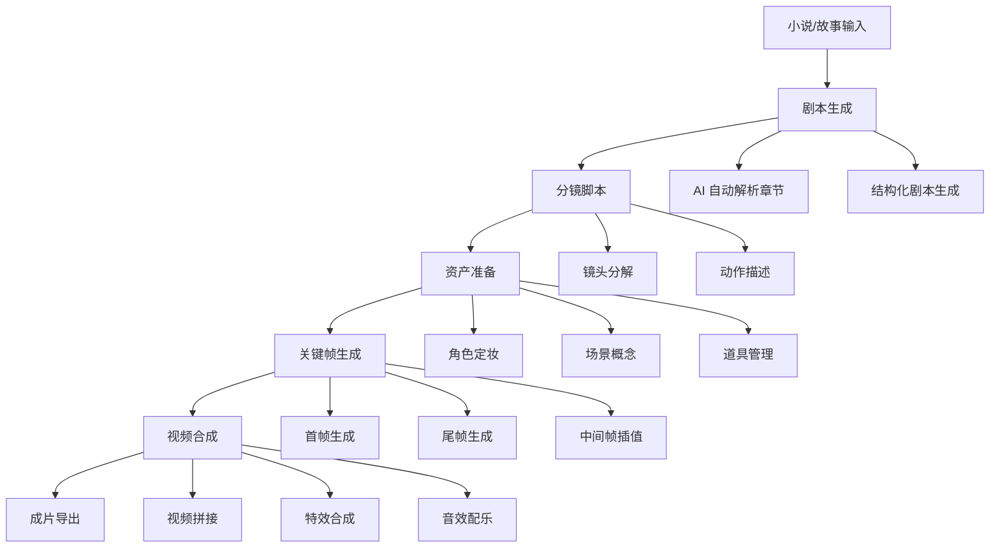
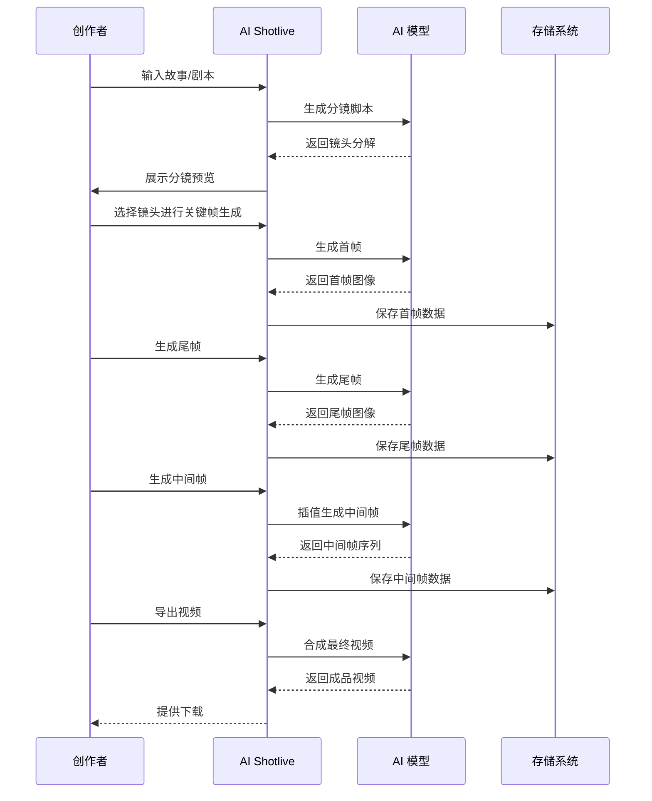
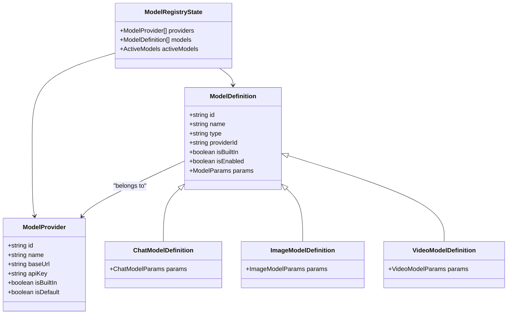
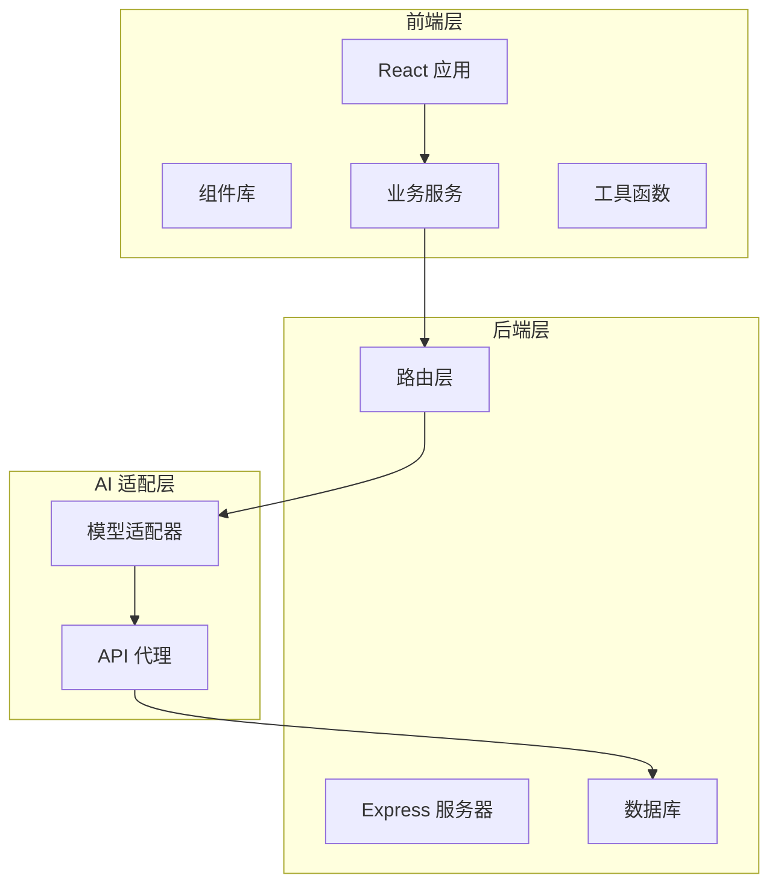
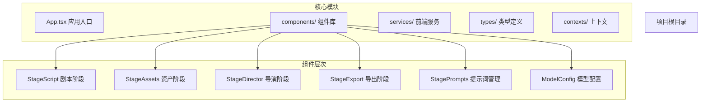
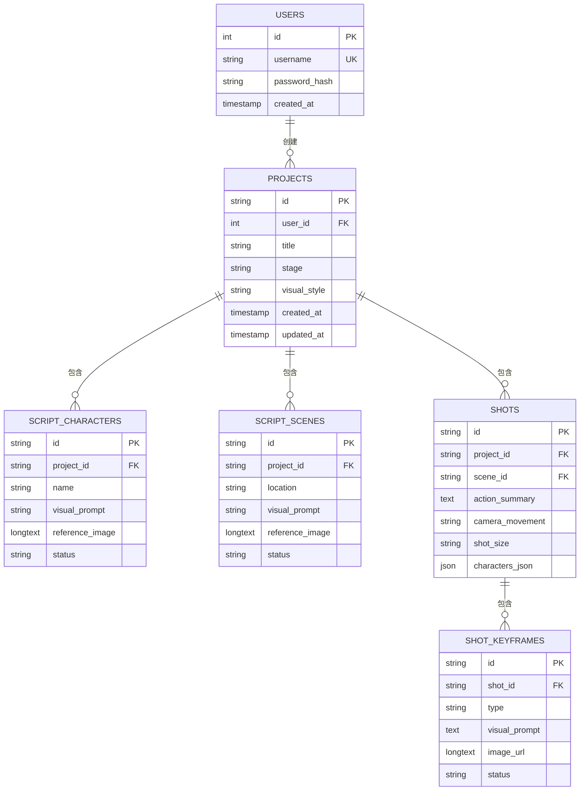
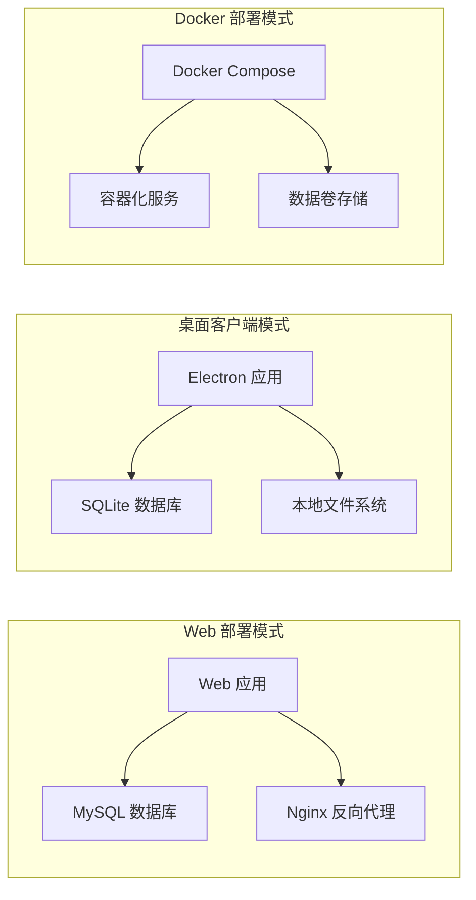

# 项目介绍

<cite>
**本文档引用的文件**
- [README.md](file://README.md)
- [App.tsx](file://App.tsx)
- [package.json](file://package.json)
- [server/src/index.ts](file://server/src/index.ts)
- [electron/main.ts](file://electron/main.ts)
- [components/StageScript/index.tsx](file://components/StageScript/index.tsx)
- [components/StageAssets/index.tsx](file://components/StageAssets/index.tsx)
- [components/StageDirector/index.tsx](file://components/StageDirector/index.tsx)
- [components/StageExport/index.tsx](file://components/StageExport/index.tsx)
- [components/StagePrompts/index.tsx](file://components/StagePrompts/index.tsx)
- [components/ModelConfig/index.tsx](file://components/ModelConfig/index.tsx)
- [types/model.ts](file://types/model.ts)
- [services/adapters/index.ts](file://services/adapters/index.ts)
- [services/aiService.ts](file://services/aiService.ts)
- [services/modelRegistry.ts](file://services/modelRegistry.ts)
- [services/storageService.ts](file://services/storageService.ts)
- [server/src/config/database.ts](file://server/src/config/database.ts)
</cite>

## 目录
1. [项目概述](#项目概述)
2. [核心价值主张](#核心价值主张)
3. [目标用户与应用场景](#目标用户与应用场景)
4. [项目定位与差异化优势](#项目定位与差异化优势)
5. [工作流设计理念](#工作流设计理念)
6. [关键帧驱动方法详解](#关键帧驱动方法详解)
7. [多模型提供商支持](#多模型提供商支持)
8. [前后端分离架构](#前后端分离架构)
9. [技术架构概览](#技术架构概览)
10. [项目结构与模块划分](#项目结构与模块划分)
11. [数据库设计与数据隔离](#数据库设计与数据隔离)
12. [部署与运行模式](#部署与运行模式)
13. [总结](#总结)

## 项目概述

AI Shotlive Director 是一个面向创作者的 AI 短剧/漫剧生产平台，采用「小说 → 剧本 → 分镜 → 资产 → 关键帧 → 成片」的工业化工作流，支持多模型提供商，从灵感到成片一站式完成。

该项目基于 React 前端 + Express 后端的前后端分离架构，采用 MySQL/SQLite 数据库存储，支持桌面客户端和 Web 应用两种部署模式。项目提供了完整的 AI 创作工具链，涵盖从文本到图像再到视频的全流程生成能力。

## 核心价值主张

### 一站式创作体验
- **全流程覆盖**：从小说解析到最终成片的完整工作流
- **多模态支持**：文本、图像、视频、音频模型统一管理
- **工业级标准**：支持多剧集、多角色、多场景的复杂项目管理

### 关键帧驱动的创作方法
- **先画后动**：通过首帧/尾帧控制运镜，实现精确的动画控制
- **资产约束**：通过角色定妆照和场景概念图保证画面一致性
- **多厂商适配**：支持 OpenAI、Google、豆包、通义等多家模型提供商

### 开发者友好
- **模块化设计**：清晰的组件划分和接口定义
- **可扩展性强**：支持自定义模型和工作流扩展
- **跨平台部署**：支持 Web、桌面客户端等多种运行环境

## 目标用户与应用场景

### 目标用户群体
- **内容创作者**：漫画作者、短视频制作者、独立游戏开发者
- **影视制作团队**：动画制作公司、短视频工作室、广告公司
- **教育机构**：艺术院校、培训学校、在线教育平台
- **个人爱好者**：对 AI 创作感兴趣的个人用户

### 典型应用场景
- **短剧制作**：从小说改编为短视频内容
- **动漫制作**：分镜脚本生成和关键帧驱动的动画制作
- **广告创意**：快速生成创意脚本和视觉素材
- **教育培训**：教学案例制作和多媒体课件开发

## 项目定位与差异化优势

### 项目定位
AI Shotlive Director 定位为专业级的 AI 创作工具，专注于为创作者提供从灵感到成品的完整解决方案。项目强调工业化的创作流程和高质量的输出标准。

### 核心差异化优势
1. **关键帧驱动方法**：区别于传统的文本到视频直接生成，通过关键帧控制实现更精确的动画效果
2. **多模型生态**：支持多家模型提供商，用户可根据需求灵活选择
3. **资产管理系统**：完善的角色、场景、道具资产管理，支持跨项目复用
4. **多平台部署**：既支持云端 Web 应用，也提供桌面客户端，满足不同使用场景

## 工作流设计理念

### 工业化创作流程
项目采用标准化的创作流程，确保作品质量和创作效率：

**图表来源**
- [README.md:52-96](file://README.md#L52-L96)
- [components/StageScript/index.tsx:1-800](file://components/StageScript/index.tsx#L1-L800)
- [components/StageAssets/index.tsx:1-800](file://components/StageAssets/index.tsx#L1-L800)
- [components/StageDirector/index.tsx:1-800](file://components/StageDirector/index.tsx#L1-L800)

### 数据驱动的创作
项目通过结构化的数据模型支持复杂的创作需求：
- **项目级隔离**：每个用户拥有独立的创作空间
- **剧集级管理**：支持多剧集并行创作和管理
- **资产复用**：角色、场景、道具可在不同项目间共享

## 关键帧驱动方法详解

### 方法论基础
关键帧驱动是项目的核心创作方法，通过精确控制动画的关键时刻来实现流畅的视觉效果。

**图表来源**
- [components/StageDirector/index.tsx:233-330](file://components/StageDirector/index.tsx#L233-L330)
- [components/StageDirector/index.tsx:378-474](file://components/StageDirector/index.tsx#L378-L474)

### 关键帧生成流程
1. **首帧生成**：根据镜头描述和上下文生成起始画面
2. **尾帧生成**：基于首帧和动作描述生成结束画面
3. **中间帧插值**：通过 AI 模型生成过渡帧
4. **质量优化**：通过多轮迭代提升画面质量

### 资产约束机制
- **角色一致性**：通过定妆照确保角色外观统一
- **场景连贯性**：通过概念图保证场景风格一致
- **动作合理性**：通过上下文理解确保动作逻辑正确

## 多模型提供商支持

### 模型生态架构
项目采用统一的模型抽象层，支持多家 AI 模型提供商：

**图表来源**
- [types/model.ts:84-179](file://types/model.ts#L84-L179)
- [services/modelRegistry.ts:35-42](file://services/modelRegistry.ts#L35-L42)

### 支持的模型类型
- **对话模型（Chat）**：OpenAI、Anthropic、DeepSeek、豆包、通义千问等
- **图像模型（Image）**：Google Gemini、豆包 Seedream、通义万相、可灵等
- **视频模型（Video）**：Veo 3.1、Sora-2、豆包 Seedance、可灵、万象等
- **音频模型（Audio）**：用于 AI 字幕整理与 TTS 配音

### 模型管理功能
- **统一配置**：集中管理各提供商的 API Key
- **动态切换**：支持在不同模型间灵活切换
- **性能优化**：根据任务类型自动选择最优模型
- **成本控制**：提供模型使用统计和成本分析

**章节来源**
- [README.md:111-124](file://README.md#L111-L124)
- [types/model.ts:279-753](file://types/model.ts#L279-L753)
- [services/modelRegistry.ts:553-654](file://services/modelRegistry.ts#L553-L654)

## 前后端分离架构

### 前端架构设计
项目采用现代化的前端技术栈，提供优秀的用户体验：

**图表来源**
- [App.tsx:21-380](file://App.tsx#L21-L380)
- [services/adapters/index.ts:1-17](file://services/adapters/index.ts#L1-L17)

### 核心前端组件
- **工作台组件**：负责主要的创作功能
- **模型配置**：管理 AI 模型和提供商设置
- **资产库**：统一管理创作资源
- **导出系统**：提供多种格式的成品导出

### 后端服务架构
- **RESTful API**：提供标准化的接口服务
- **任务队列**：异步处理耗时的 AI 生成任务
- **文件存储**：管理图片、视频等媒体文件
- **用户认证**：基于 JWT 的安全认证机制

**章节来源**
- [package.json:26-59](file://package.json#L26-L59)
- [server/src/index.ts:1-173](file://server/src/index.ts#L1-L173)

## 技术架构概览

### 技术栈选择
项目采用成熟稳定的技术组合，确保系统的可靠性和可维护性：

| 层级 | 技术 | 版本 | 用途 |
|------|------|------|------|
| **前端** | React 19 | Latest | 用户界面框架 |
| | Vite 6 | Latest | 构建工具 |
| | Tailwind CSS 4 | Latest | 样式框架 |
| | Framer Motion | Latest | 动画库 |
| **后端** | Express.js | Latest | Web 服务器 |
| | TypeScript | ~5.8 | 类型安全 |
| | MySQL 8 / SQLite | Latest | 数据存储 |
| **AI** | 多模型适配器 | 自定义 | 统一模型调用 |
| **桌面** | Electron 33 | Latest | 桌面客户端 |

### 系统特性
- **响应式设计**：适配不同屏幕尺寸的设备
- **离线支持**：桌面客户端支持离线使用
- **实时协作**：支持多用户协作创作
- **扩展性**：模块化设计便于功能扩展

## 项目结构与模块划分

### 前端项目结构

**图表来源**
- [App.tsx:1-380](file://App.tsx#L1-L380)
- [components/StageScript/index.tsx:1-800](file://components/StageScript/index.tsx#L1-L800)

### 后端项目结构
后端采用模块化设计，清晰分离关注点：

- **配置层**：数据库连接、环境配置
- **路由层**：HTTP 请求处理和路由分发
- **服务层**：业务逻辑实现
- **适配层**：第三方 API 调用封装

### 数据流设计
项目实现了完整的数据流管理，确保创作过程的连续性和可追溯性。

**章节来源**
- [README.md:308-369](file://README.md#L308-L369)

## 数据库设计与数据隔离

### 数据库架构
项目采用关系型数据库设计，支持复杂的数据关联和查询需求：

**图表来源**
- [server/src/config/database.ts:256-502](file://server/src/config/database.ts#L256-L502)

### 数据隔离策略
- **用户隔离**：每个用户的数据完全隔离
- **项目隔离**：项目间数据互不干扰
- **剧集隔离**：支持多剧集并行创作
- **资产隔离**：资产库支持跨项目共享

### 数据迁移与兼容性
项目提供了完善的数据迁移机制，支持版本升级和数据格式转换。

**章节来源**
- [server/src/config/database.ts:137-239](file://server/src/config/database.ts#L137-L239)

## 部署与运行模式

### 多环境部署
项目支持多种部署方式，满足不同使用场景的需求：

**图表来源**
- [electron/main.ts:1-129](file://electron/main.ts#L1-L129)
- [server/src/index.ts:1-173](file://server/src/index.ts#L1-L173)

### 部署配置
- **环境变量**：通过 .env 文件配置数据库连接、API Key 等参数
- **Docker 支持**：提供完整的容器化部署方案
- **桌面客户端**：支持 macOS 和 Windows 平台

### 性能优化
- **异步任务**：耗时的 AI 生成任务异步执行
- **缓存策略**：合理使用缓存提升响应速度
- **资源管理**：优化图片和视频资源的存储和传输

**章节来源**
- [README.md:149-295](file://README.md#L149-L295)

## 总结

AI Shotlive Director 作为一个专业的 AI 创作平台，通过关键帧驱动的方法实现了从灵感到成片的完整创作流程。项目采用前后端分离架构，支持多模型提供商，具有良好的扩展性和可维护性。

### 主要优势
1. **创新的工作流**：关键帧驱动确保了创作的精确性和可控性
2. **强大的生态支持**：多模型提供商选择，满足不同需求
3. **工业级标准**：完善的数据管理和项目隔离机制
4. **灵活的部署方式**：支持 Web、桌面客户端等多种使用场景

### 适用场景
- 短视频内容创作
- 动漫制作
- 广告创意
- 教育培训

项目为创作者提供了一个强大而易用的工具，降低了 AI 创作的门槛，提高了创作效率和作品质量。无论是个人创作者还是专业团队，都能从中获得价值。