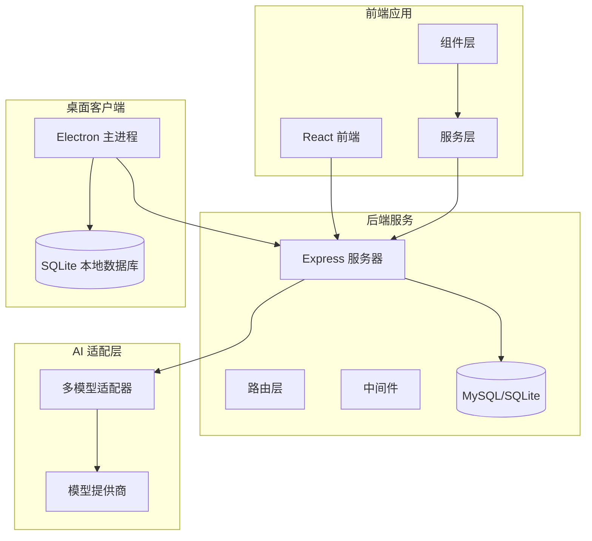
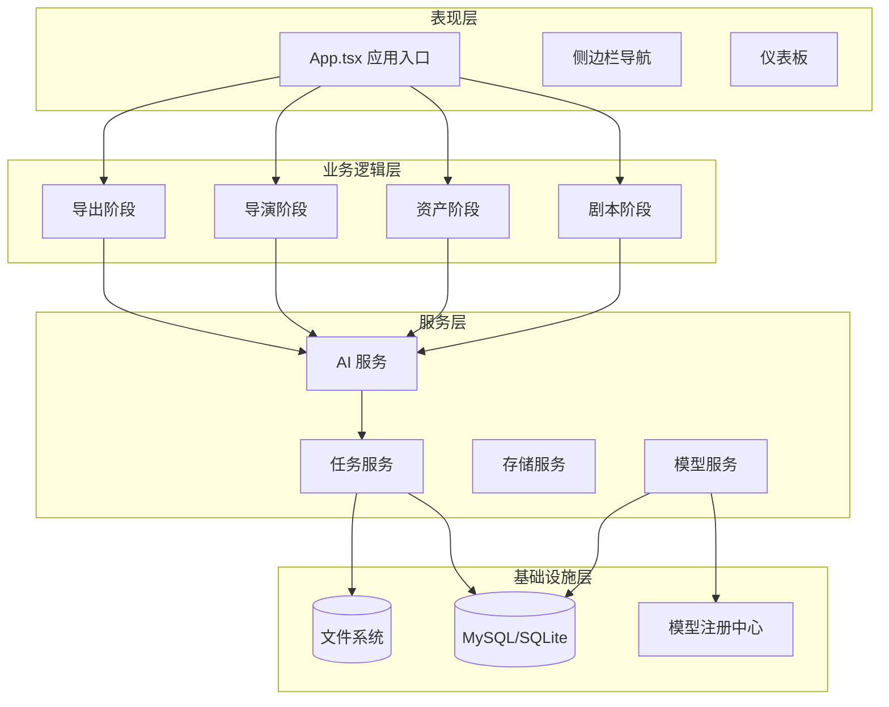
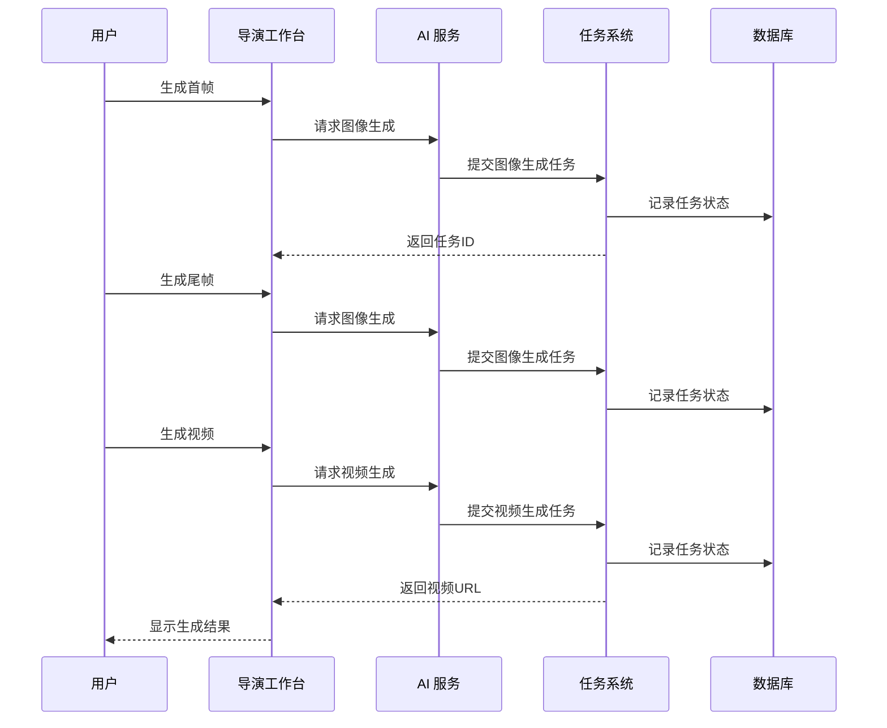
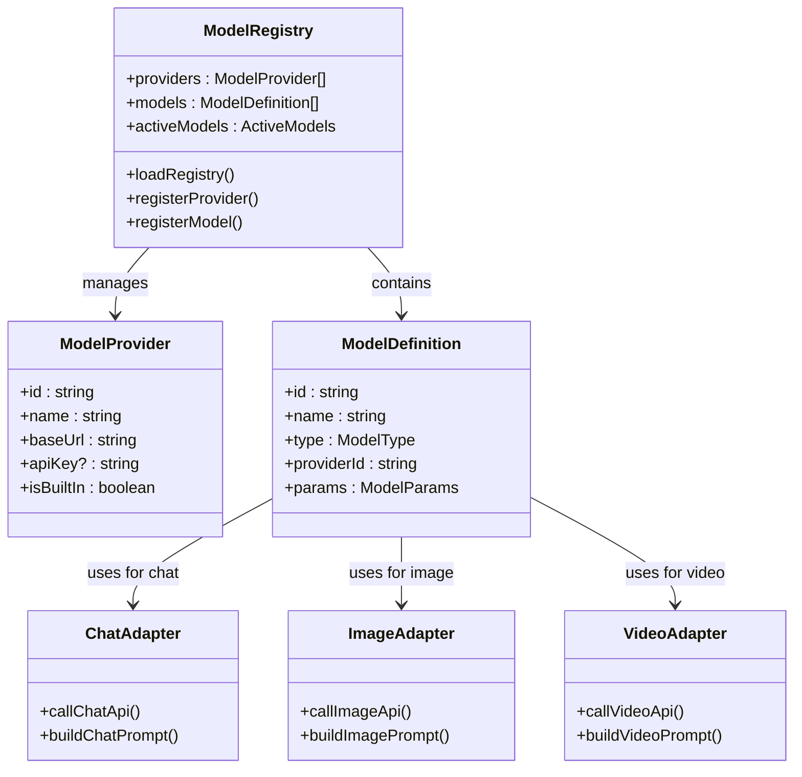
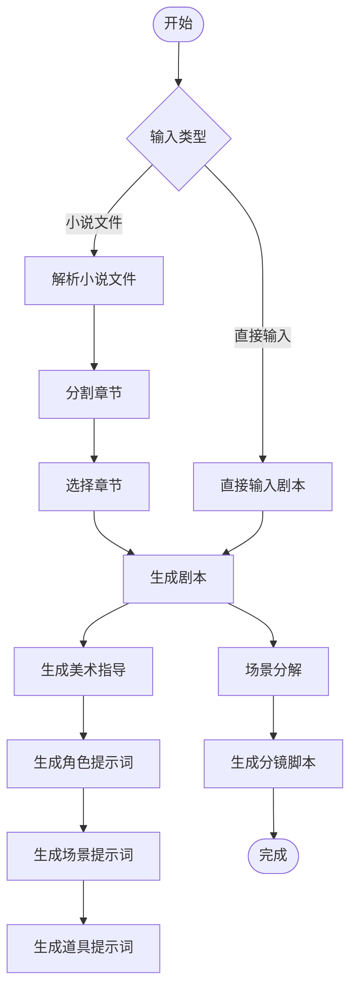
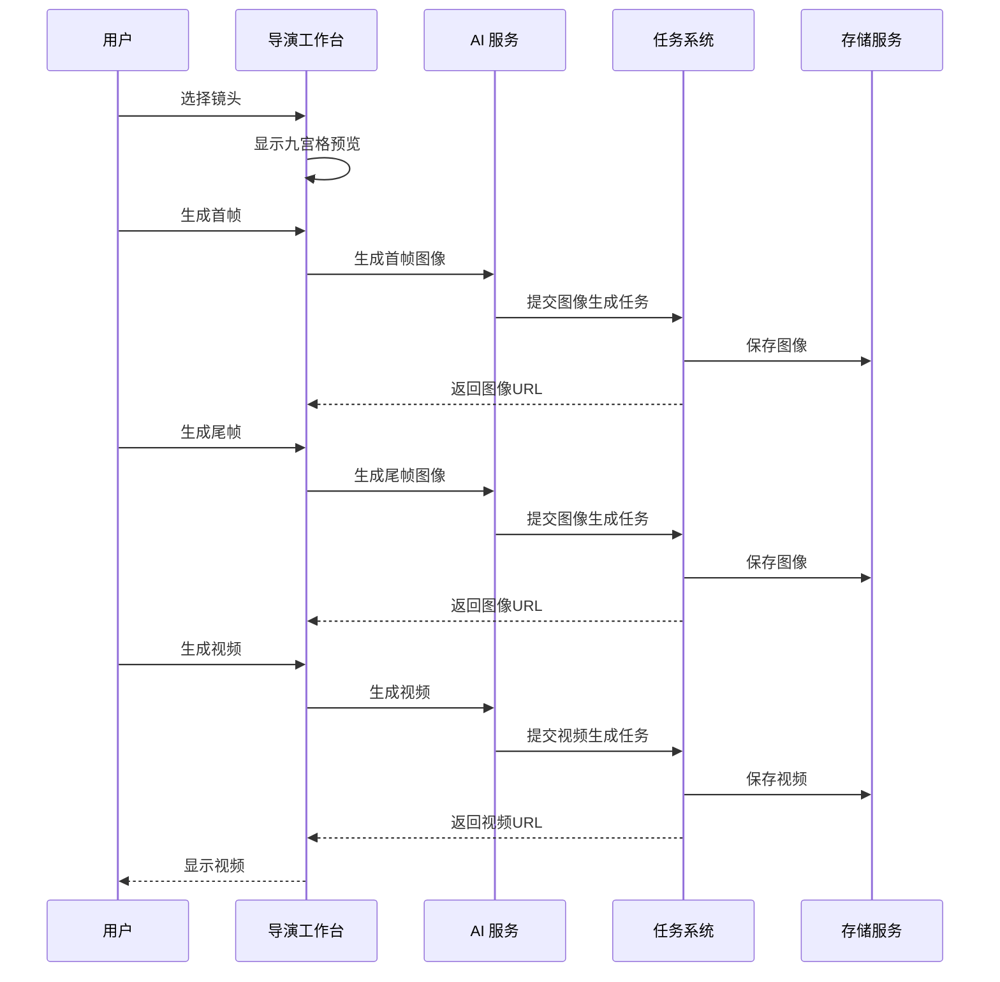
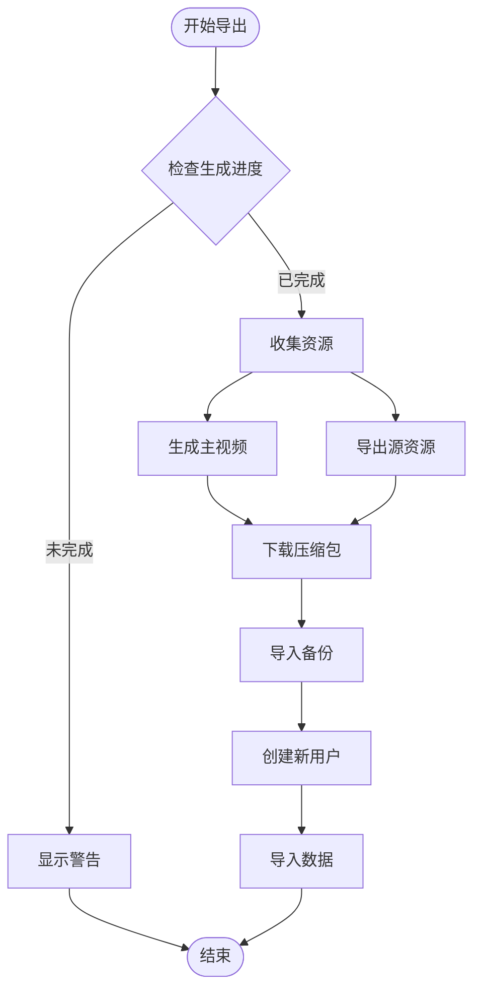
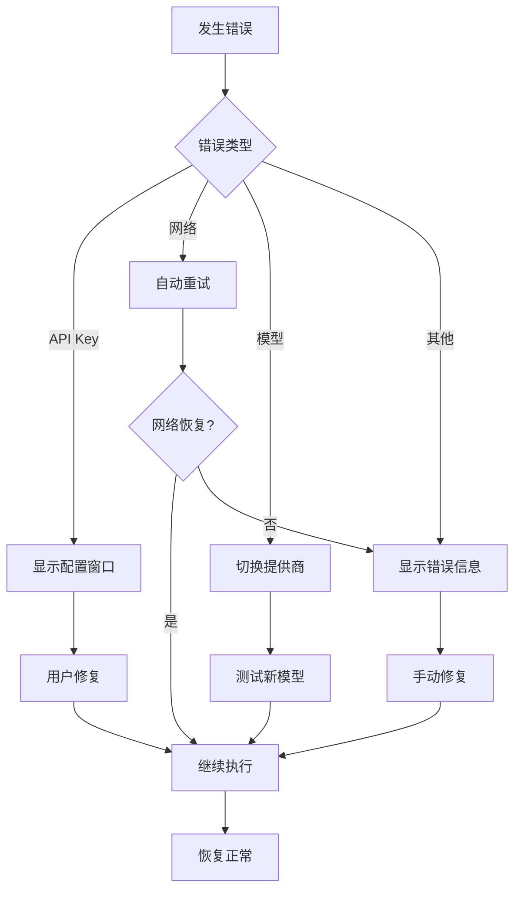

# 项目概述

<cite>
**本文档引用的文件**
- [README.md](file://README.md)
- [package.json](file://package.json)
- [App.tsx](file://App.tsx)
- [server/src/index.ts](file://server/src/index.ts)
- [electron/main.ts](file://electron/main.ts)
- [types/model.ts](file://types/model.ts)
- [services/adapters/index.ts](file://services/adapters/index.ts)
- [services/modelRegistry.ts](file://services/modelRegistry.ts)
- [services/taskService.ts](file://services/taskService.ts)
- [services/aiService.ts](file://services/aiService.ts)
- [services/ai/scriptService.ts](file://services/ai/scriptService.ts)
- [services/ai/visualService.ts](file://services/ai/visualService.ts)
- [services/ai/videoService.ts](file://services/ai/videoService.ts)
- [components/StageScript/index.tsx](file://components/StageScript/index.tsx)
- [components/StageDirector/index.tsx](file://components/StageDirector/index.tsx)
- [components/StageExport/index.tsx](file://components/StageExport/index.tsx)
</cite>

## 目录
1. [引言](#引言)
2. [项目结构](#项目结构)
3. [核心组件](#核心组件)
4. [架构总览](#架构总览)
5. [详细组件分析](#详细组件分析)
6. [依赖分析](#依赖分析)
7. [性能考虑](#性能考虑)
8. [故障排除指南](#故障排除指南)
9. [结论](#结论)
10. [附录](#附录)

## 引言
AI Shotlive Director 是一款面向创作者的「小说→剧本→分镜→资产→关键帧→成片」的工业级 AI 短剧/漫剧生产平台。项目采用前后端分离架构，结合多模型提供商支持与关键帧驱动的工作流，为用户提供从灵感到成片的一站式自动化生产体验。

项目的核心价值主张包括：
- 工业化工作流：严格遵循「小说→剧本→分镜→资产→关键帧→成片」的标准化流程，确保创作过程可追溯、可复用
- 关键帧驱动：通过首帧/首尾帧控制运镜，配合多厂商图像与视频模型，实现高质量动画生成
- 多模型支持：统一适配 OpenAI、Google、豆包、通义、可灵、万象等多家厂商的文本/图像/视频/音频模型
- 前后端分离：React 前端 + Express 后端，数据持久化于 MySQL/SQLite，支持桌面客户端
- 账户与数据管理：完善的用户隔离机制，支持数据导出/导入与跨服务器迁移

## 项目结构
项目采用典型的前后端分离架构，主要分为前端应用、后端服务和桌面客户端三部分：



**图表来源**
- [package.json:1-83](file://package.json#L1-L83)
- [server/src/index.ts:1-173](file://server/src/index.ts#L1-L173)
- [electron/main.ts:1-129](file://electron/main.ts#L1-L129)

项目采用模块化设计，前端组件按工作阶段划分（剧本、资产、导演、导出），后端服务按功能职责分离（认证、项目管理、AI 代理、任务调度），AI 服务通过适配器层统一接入多家模型提供商。

**章节来源**
- [README.md:308-370](file://README.md#L308-L370)
- [package.json:1-83](file://package.json#L1-L83)

## 核心组件
项目的核心组件围绕四大工作阶段构建，每个阶段都有专门的组件负责特定功能：

### 剧本阶段组件
- **StageScript**：负责小说解析、剧本生成、分镜脚本创建
- **ScriptEditor**：提供剧本编辑界面
- **SceneBreakdown**：场景分解与管理
- **ConfigPanel**：项目配置面板

### 资产阶段组件
- **StageAssets**：角色定妆、场景概念图、道具管理
- **CharacterCard**：角色卡片管理
- **SceneCard**：场景卡片管理
- **PropCard**：道具卡片管理

### 导演阶段组件
- **StageDirector**：关键帧生成、九宫格预览、视频生成
- **ShotCard**：镜头卡片管理
- **KeyframeEditor**：关键帧编辑器
- **VideoGenerator**：视频生成器

### 导出阶段组件
- **StageExport**：成片导出、渲染日志、数据备份
- **TimelineVisualizer**：时间轴可视化
- **VideoPlayerModal**：视频播放器
- **RenderLogsModal**：渲染日志查看

**章节来源**
- [components/StageScript/index.tsx:1-800](file://components/StageScript/index.tsx#L1-L800)
- [components/StageDirector/index.tsx:1-800](file://components/StageDirector/index.tsx#L1-L800)
- [components/StageExport/index.tsx:1-336](file://components/StageExport/index.tsx#L1-L336)

## 架构总览
项目采用分层架构设计，确保各层职责明确、耦合度低：



**图表来源**
- [App.tsx:1-380](file://App.tsx#L1-L380)
- [server/src/index.ts:1-173](file://server/src/index.ts#L1-L173)
- [services/taskService.ts:1-200](file://services/taskService.ts#L1-L200)

### 关键帧驱动工作原理
项目采用关键帧驱动的视频生成策略，通过首帧/首尾帧控制运镜，实现高质量动画生成：



**图表来源**
- [components/StageDirector/index.tsx:233-330](file://components/StageDirector/index.tsx#L233-L330)
- [services/taskService.ts:107-144](file://services/taskService.ts#L107-L144)

### 多模型提供商支持架构
项目通过适配器模式统一接入多家模型提供商，支持文本、图像、视频、音频四类模型：



**图表来源**
- [services/modelRegistry.ts:1-200](file://services/modelRegistry.ts#L1-L200)
- [services/adapters/index.ts:1-17](file://services/adapters/index.ts#L1-L17)
- [types/model.ts:1-800](file://types/model.ts#L1-L800)

**章节来源**
- [README.md:127-138](file://README.md#L127-L138)
- [services/modelRegistry.ts:1-200](file://services/modelRegistry.ts#L1-L200)
- [services/adapters/index.ts:1-17](file://services/adapters/index.ts#L1-L17)

## 详细组件分析

### 剧本阶段工作流
剧本阶段负责将原始文本转化为结构化的剧本数据，支持小说解析和直接剧本输入两种模式：



**图表来源**
- [components/StageScript/index.tsx:196-296](file://components/StageScript/index.tsx#L196-L296)
- [services/ai/scriptService.ts:30-200](file://services/ai/scriptService.ts#L30-L200)

剧本阶段的关键特性：
- **智能解析**：自动识别章节结构，支持分页浏览
- **风格化生成**：根据项目风格生成统一的视觉提示词
- **批量处理**：支持角色、场景、道具的批量视觉提示词生成
- **实时预览**：生成过程中提供进度反馈和实时预览

**章节来源**
- [components/StageScript/index.tsx:1-800](file://components/StageScript/index.tsx#L1-L800)
- [services/ai/scriptService.ts:1-200](file://services/ai/scriptService.ts#L1-L200)

### 导演阶段关键帧生成
导演阶段通过关键帧驱动的方式生成高质量视频内容：



**图表来源**
- [components/StageDirector/index.tsx:233-474](file://components/StageDirector/index.tsx#L233-L474)
- [services/ai/videoService.ts:28-200](file://services/ai/videoService.ts#L28-L200)

导演阶段的核心功能：
- **九宫格预览**：提供同一镜头的9种视角预览
- **关键帧优化**：AI 自动优化提示词，提升生成质量
- **批量生成**：支持批量生成关键帧，提高效率
- **实时预览**：生成过程中提供实时进度反馈

**章节来源**
- [components/StageDirector/index.tsx:1-800](file://components/StageDirector/index.tsx#L1-L800)
- [services/ai/videoService.ts:1-200](file://services/ai/videoService.ts#L1-L200)

### 导出阶段与数据管理
导出阶段负责将生成的视频和资源进行整合和导出：



**图表来源**
- [components/StageExport/index.tsx:115-231](file://components/StageExport/index.tsx#L115-L231)

导出阶段的功能特性：
- **进度监控**：实时显示生成进度和估算时长
- **资源管理**：支持主视频和源资源的分别导出
- **数据备份**：完整的数据导出/导入功能
- **批量操作**：支持多镜头的批量预览和下载

**章节来源**
- [components/StageExport/index.tsx:1-336](file://components/StageExport/index.tsx#L1-L336)

## 依赖分析
项目采用模块化依赖管理，各层之间通过清晰的接口进行通信：

```mermaid
graph TB
subgraph "前端依赖"
React[React 19]
Vite[Vite 6]
Tailwind[Tailwind CSS 4]
RadixUI[Radix UI]
FramerMotion[Framer Motion]
end
subgraph "后端依赖"
Express[Express.js]
MySQL[mysql2]
JWT[jsonwebtoken]
Bcrypt[bcryptjs]
end
subgraph "桌面客户端"
Electron[Electron 33]
BetterSQLite[better-sqlite3]
Sentry[@sentry/electron]
end
subgraph "AI 依赖"
OpenAI[OpenAI SDK]
Google[Google AI]
DashScope[DashScope]
VolcEngine[VolcEngine]
end
React --> Express
Express --> MySQL
Electron --> BetterSQLite
Express --> OpenAI
Express --> Google
Express --> DashScope
Express --> VolcEngine
```

**图表来源**
- [package.json:26-82](file://package.json#L26-L82)
- [server/src/index.ts:1-173](file://server/src/index.ts#L1-L173)
- [electron/main.ts:1-129](file://electron/main.ts#L1-L129)

### 核心依赖关系
项目的关键依赖关系包括：
- **前端框架**：React 19 + Vite 6 提供现代化的开发体验
- **UI 组件库**：Tailwind CSS + Radix UI + Framer Motion 构建响应式界面
- **后端框架**：Express.js + TypeScript 提供稳定的 API 服务
- **数据库**：MySQL/SQLite 双模式支持，满足不同部署需求
- **桌面客户端**：Electron + better-sqlite3 实现跨平台应用
- **AI 服务**：多模型适配器支持多家提供商的统一接入

**章节来源**
- [package.json:1-83](file://package.json#L1-L83)
- [README.md:127-138](file://README.md#L127-L138)

## 性能考虑
项目在性能方面采用了多项优化策略：

### 异步任务处理
- **后台执行**：所有 AI 生成任务都在服务端后台执行，避免前端阻塞
- **任务恢复**：支持页面刷新后的任务状态恢复
- **进度跟踪**：实时显示任务进度和状态信息

### 缓存与优化
- **模型注册中心**：本地存储模型配置，减少重复加载
- **图像缓存**：关键帧图像按项目隔离存储
- **渲染优化**：React 19 的并发特性提升界面响应性

### 资源管理
- **文件系统**：媒体文件按用户/项目隔离存储
- **内存管理**：大型图像和视频文件采用流式处理
- **网络优化**：多模型提供商的负载均衡和错误重试

## 故障排除指南
项目提供了完善的错误处理和故障排除机制：

### 常见问题诊断
- **API Key 错误**：自动检测并弹出模型配置窗口
- **网络连接问题**：提供详细的错误信息和重试机制
- **模型配置问题**：支持切换不同的模型提供商和 API 端点

### 错误处理流程


**章节来源**
- [App.tsx:75-106](file://App.tsx#L75-L106)
- [components/StageDirector/index.tsx:80-108](file://components/StageDirector/index.tsx#L80-L108)

## 结论
AI Shotlive Director 通过其工业化的 AI 短剧/漫剧生产工作流，为创作者提供了一套完整、高效、可扩展的自动化解决方案。项目的核心优势体现在：

**技术创新点**：
- 关键帧驱动的视频生成策略，确保动画质量和连贯性
- 多模型提供商统一适配，打破厂商锁定
- 前后端分离架构，支持云端和桌面客户端部署

**用户体验优势**：
- 标准化的工作流程，降低学习成本
- 实时进度反馈和错误处理
- 完善的数据管理和迁移功能

**技术架构优势**：
- 模块化设计，便于维护和扩展
- 异步任务处理，提升系统稳定性
- 跨平台支持，满足不同使用场景

该项目特别适合需要批量生产短剧、动漫内容的创作者和工作室，能够显著提升内容生产的效率和质量。

## 附录

### 主要功能特性
- **小说→剧本**：自动解析章节，生成结构化剧本
- **剧本→分镜**：AI 自动生成分镜脚本和视觉提示词
- **资产→关键帧**：角色定妆与场景概念图约束生成
- **关键帧→视频**：首帧/首尾帧驱动的高质量视频生成
- **多模型支持**：OpenAI、Google、豆包、通义、可灵、万象等
- **数据管理**：完整的导出/导入和备份功能

### 目标用户群体
- **内容创作者**：漫画、短视频、动画制作团队
- **独立开发者**：需要自动化内容生产的个人开发者
- **教育机构**：影视制作、动画专业的教学实践
- **企业用户**：品牌宣传、营销短片制作部门

### 项目定位
AI Shotlive Director 定位于「AI 驱动的工业级内容生产平台」，致力于通过技术创新降低内容创作门槛，提升创作效率，为数字内容产业提供可持续的发展动力。